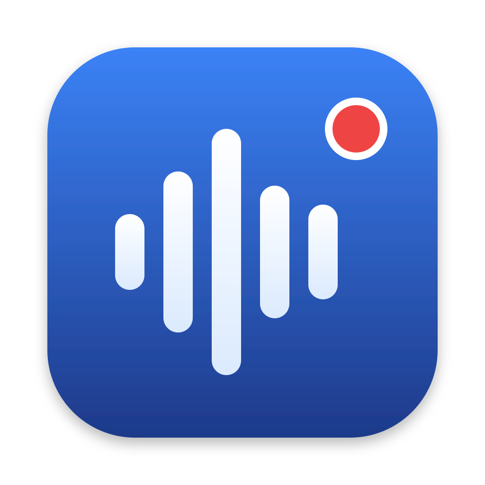
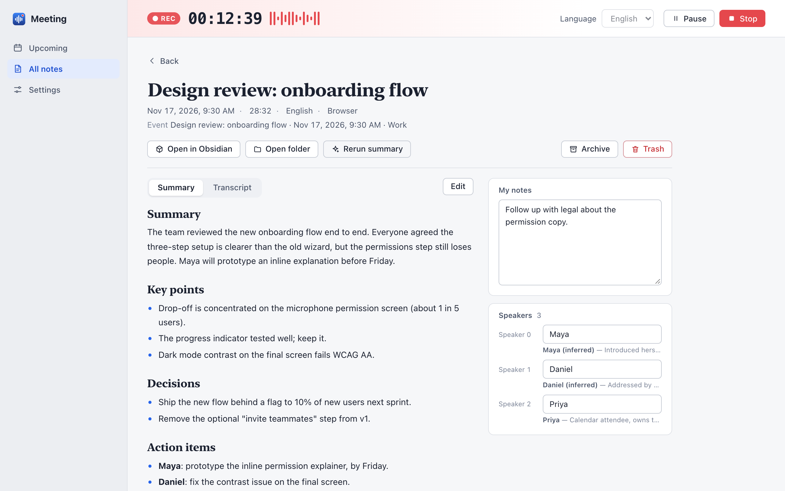
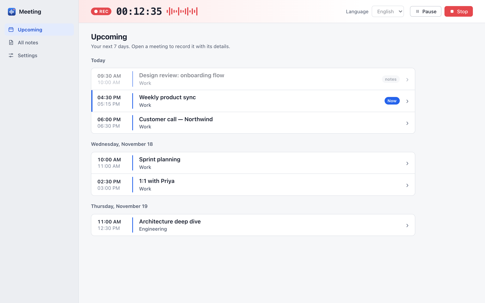
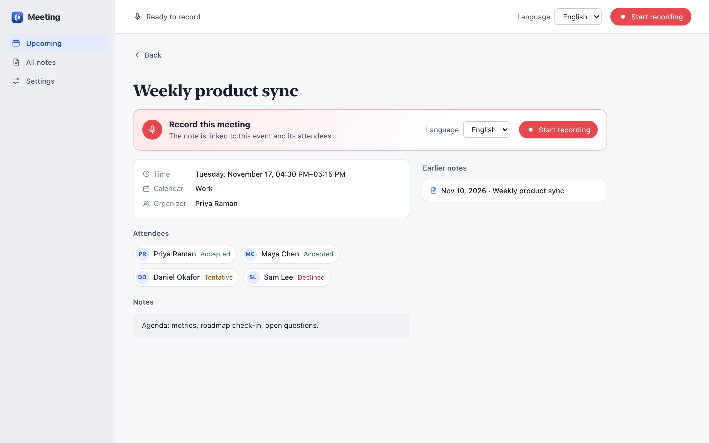
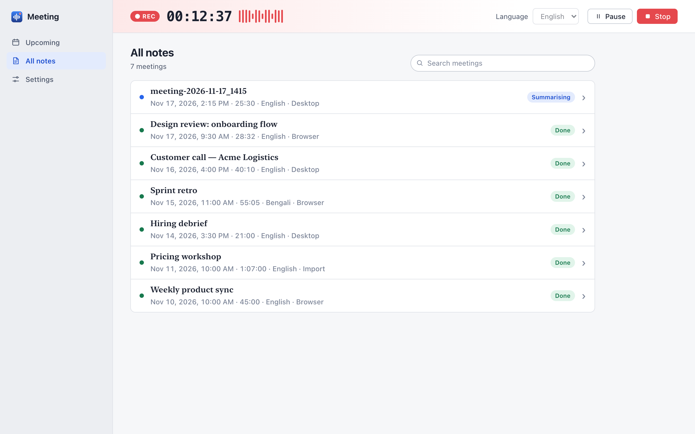
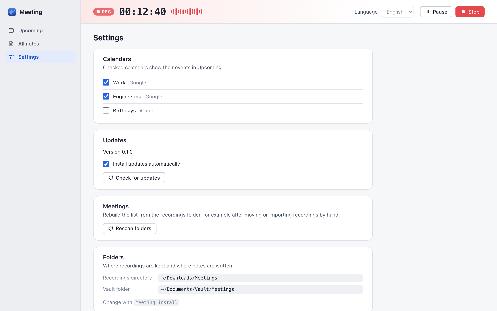
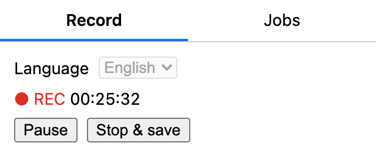
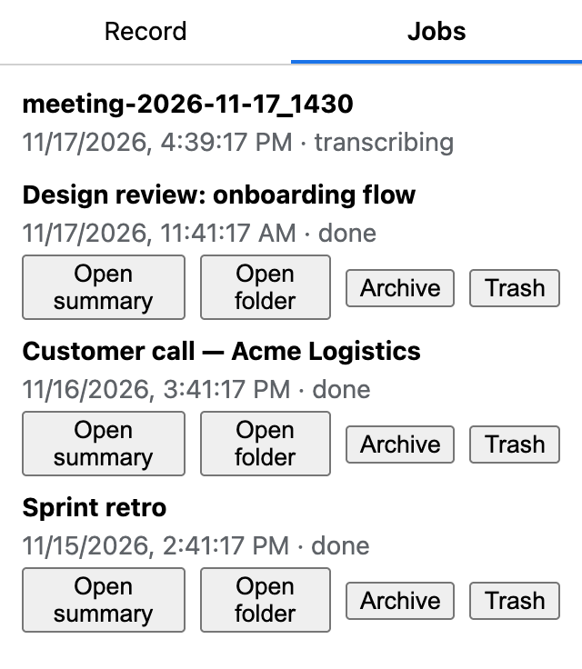
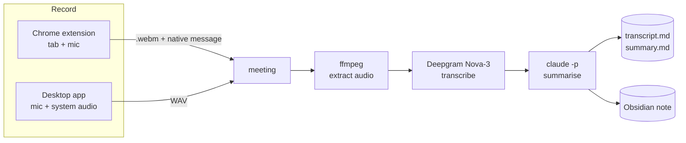

<div align="center">



# Meeting Manager

**Record any meeting on your Mac. Get a speaker-labelled transcript and an AI summary in your Obsidian vault.**

No bot joins the call. No server. Everything runs on your machine.

[](https://github.com/masnun-siam/meeting-manager/releases/latest)


[Features](#features) · [Screenshots](#screenshots) · [Install](#installation) · [Usage](#usage) · [How it works](#how-it-works) · [Privacy](#privacy) · [Development](#development)

<br>

<picture>
  <source media="(prefers-color-scheme: dark)" srcset="docs/assets/screenshots/desktop-note-dark.png">
  
</picture>

</div>

## Features

| | |
|---|---|
| 🎙️ **Record from Chrome or the desktop** | The Chrome extension records the meeting tab plus your mic. The desktop app records your mic and system audio, so it works with Zoom, Teams, Slack or any app. |
| 🗣️ **Speaker-labelled transcripts** | Deepgram Nova-3 transcribes **English** or **Bengali** with diarisation: `[00:03:40] Speaker 1: …` |
| ✨ **Summaries that are useful** | Claude Code (Opus) writes a summary, key points, decisions, action items, insights and a guess at who each speaker is. Summaries are always in English. |
| 📓 **Straight into Obsidian** | Every meeting becomes `YYYY-MM-DD HHMM <title>.md` in your vault, with frontmatter. A rerun updates the same note. |
| 📅 **Calendar aware** | The desktop app lists your next 7 days from macOS Calendar. Record from an event and the note carries its title, attendees and earlier notes from the same series. |
| ✏️ **Edit after the fact** | Rename speakers, edit the title or summary, add your own notes. Edits sync to the vault note. |
| 🔁 **Background processing** | Processing keeps going after Chrome quits. A macOS notification tells you when the note is ready; failed jobs can be retried. |
| 📥 **Import old recordings** | `meeting import call.m4a` processes a file recorded anywhere else. |
| 🔒 **Local first** | Your Deepgram key lives in the Keychain, your recordings stay in `~/Downloads/Meetings`, and Claude runs with every tool disabled. |

## Screenshots

<table>
  <tr>
    <td width="50%">
      <picture>
        <source media="(prefers-color-scheme: dark)" srcset="docs/assets/screenshots/desktop-upcoming-dark.png">
        
      </picture>
      <p align="center"><b>Upcoming</b>: your next 7 days, with a live recording bar</p>
    </td>
    <td width="50%">
      <picture>
        <source media="(prefers-color-scheme: dark)" srcset="docs/assets/screenshots/desktop-event-dark.png">
        
      </picture>
      <p align="center"><b>Event</b>: record it with its attendees and context</p>
    </td>
  </tr>
  <tr>
    <td width="50%">
      <picture>
        <source media="(prefers-color-scheme: dark)" srcset="docs/assets/screenshots/desktop-notes-dark.png">
        
      </picture>
      <p align="center"><b>All notes</b>: search every meeting, see what is still processing</p>
    </td>
    <td width="50%">
      <picture>
        <source media="(prefers-color-scheme: dark)" srcset="docs/assets/screenshots/desktop-settings-dark.png">
        
      </picture>
      <p align="center"><b>Settings</b>: calendars, auto-updates, folders, health</p>
    </td>
  </tr>
  <tr>
    <td width="50%" align="center">
      
      <p><b>Chrome extension</b>: record the meeting tab</p>
    </td>
    <td width="50%" align="center">
      
      <p><b>Jobs</b>: progress, open the summary, archive or trash</p>
    </td>
  </tr>
</table>

<sub>Screenshots use demo data.</sub>

## Installation

> [!NOTE]
> macOS only. The Chrome extension needs Chrome 116+; the desktop app needs macOS 14.4+ on Apple silicon.

### Prerequisites

| Need | Check | Get it |
|---|---|---|
| Rust via rustup (the repo pins 1.99.1) | `rustc --version` | `curl https://sh.rustup.rs -sSf \| sh` |
| Node.js 24+ | `node --version` | `brew install node` |
| ffmpeg with libopus | `ffmpeg -hide_banner -encoders \| grep libopus` | `brew install ffmpeg` |
| Claude Code, logged in | `claude auth status` | [claude.com/claude-code](https://claude.com/claude-code), then `claude auth login` |
| Deepgram API key | | [console.deepgram.com](https://console.deepgram.com) (billed per audio minute) |
| An Obsidian vault | the folder exists | Any folder works |

### 1. Install the `meeting` tool

```sh
git clone https://github.com/masnun-siam/meeting-manager.git
cd meeting-manager
cargo install --path crates/meeting
meeting install          # finds ffmpeg and claude, asks for your vault, registers the Chrome host
meeting config set-key   # stores the Deepgram key in the macOS Keychain
meeting doctor           # every check must show ✓
```

### 2. Install the Chrome extension

```sh
cd extension && npm ci && npm run build
```

Open `chrome://extensions`, turn on **Developer mode**, click **Load unpacked** and pick `extension/dist/`. Pin it to the toolbar.

### 3. Install the desktop app (optional)

```sh
cd /Applications
curl -fL https://github.com/masnun-siam/meeting-manager/releases/latest/download/Meeting.app.tar.gz | tar xz
```

The app is ad-hoc signed: open it the first time with right-click › **Open**, then grant Microphone, System Audio Recording and Calendar access. It updates itself from Settings › Updates.

> [!IMPORTANT]
> The desktop app is in preview behind the build-time flag `FEATURE_DESKTOP_APP` (see [FLAGS.md](FLAGS.md)). Until it ships on by default, build the tool with the flag on: `FEATURE_DESKTOP_APP=1 cargo install --path crates/meeting`.

Full guide, including building the app from source, updating and uninstalling: **[docs/guides/installation.md](docs/guides/installation.md)**. First recording in five minutes: **[quickstart](docs/guides/quickstart.md)**.

## Usage

### From Chrome

1. On the meeting tab, open the extension popup, pick **বাংলা** (Bengali) or **English** and press the round red **Start recording** button. The first time, a page asks for mic permission; grant it and press Start recording again.
2. **Pause** and **Resume** as needed, then **Stop & save**. Recording also stops at 3 hours or when the tab closes.
3. Processing runs in the background. The **Jobs** tab shows progress and opens the summary or folder; **Retry** reruns a failed job, **Archive** moves it to `~/Downloads/Meetings/Archive/`, **Trash** (click twice, macOS 15+) moves it to the Trash and keeps the vault note.

### From the desktop app

Press **Start recording** in the top bar, or open an event under **Upcoming** to record it with its attendees. To start and stop from a hotkey (Raycast, Alfred, Shortcuts or `open`), use the `meeting-manager://record/…` links: **[quick record guide](docs/guides/quick-record.md)**. Finished meetings show up under **All notes**, where you can edit the summary, rename speakers and add your own notes.

### From the terminal

```sh
meeting process ~/Downloads/Meetings/meeting-2026-10-19_1430/recording.webm   # reuse the transcript, redo the summary
meeting process <file> --retranscribe                                          # transcribe again (Deepgram is billed again)
meeting process <file> --language en                                           # the wrong language was picked
meeting import ~/Desktop/call.m4a --language en                                # a recording made outside Chrome
```

### What you get

Each meeting gets a folder `~/Downloads/Meetings/<name>/`:

| File | Content |
|---|---|
| `recording.<ext>` | The recording (`.webm` from Chrome; imports keep their extension) |
| `transcript.md` | `[hh:mm:ss] Speaker N: text` lines |
| `summary.md` | Summary, key points, decisions, action items, insights, speakers |
| `meta.json` | Language, timestamps, job history |

Plus a note in your vault at `<vault>/Meetings/YYYY-MM-DD HHMM <title>.md`. Recordings under 10 seconds are saved but not processed.

## How it works



| Part | Stack | Path | Docs |
|---|---|---|---|
| Chrome extension | MV3, React 19, Vite | `extension/` | [docs/extension.md](docs/extension.md) |
| `meeting` CLI and native-messaging host | Rust | `crates/meeting/` | [docs/tool.md](docs/tool.md) |
| Desktop app | Tauri 2, React 19, Core Audio, EventKit | `desktop/` | [docs/desktop.md](docs/desktop.md) |

The full map is in [docs/architecture.md](docs/architecture.md).

## Configuration

| What | Where |
|---|---|
| Settings (vault, folder, recordings dir, tool paths) | `~/.config/meeting-manager/config.toml`; rerun `meeting install` or edit it |
| Deepgram key | macOS Keychain, service `meeting-manager`, account `deepgram` |
| Job status | `~/Library/Application Support/meeting-manager/jobs/` |
| Log | `~/Library/Logs/meeting-manager/meeting.log` (never contains the key or transcript text) |

Every setting, path and `doctor` check: [docs/features/setup.md](docs/features/setup.md).

## Troubleshooting

<details>
<summary><b>Something failed</b></summary>

Run `meeting doctor`; each `✗` line names its fix. Then read the log above.
</details>

<details>
<summary><b>The popup says the tool is not installed</b></summary>

Run `meeting install`. The recording is already saved; process it with `meeting process <file>`.
</details>

<details>
<summary><b>"already processing"</b></summary>

A job for that recording is still running. A lock left by a crashed run clears itself.
</details>

<details>
<summary><b>Recordings are saved somewhere else</b></summary>

The host only accepts `<name>/recording.<ext>` under `recordings_dir`. Change it in the config file.
</details>

## Privacy

- Only the extracted **audio** goes to Deepgram.
- Only the **transcript** goes to Anthropic, through your own Claude Code login. Claude runs with every tool disabled and treats the transcript as untrusted data.
- Secrets live only in the macOS Keychain. Logs never contain transcript text or calendar details.
- Everything else, recordings, notes and the notes database, stays on your machine.

## Development

```sh
cargo fmt --all --check && cargo clippy --all-targets -- -D warnings && cargo test
cd extension && npm run build && npm run typecheck && npx biome ci . && npm test
cd desktop && npm run build && npm run typecheck && npx biome ci . && npm test
```

Details in [docs/development.md](docs/development.md). CI runs the same gates per part on every pull request. New features ship dark behind build-time flags ([FLAGS.md](FLAGS.md)).

- Workflow, commit style and rules: [CONTRIBUTING.md](CONTRIBUTING.md)
- Documentation index: [docs/README.md](docs/README.md)
- Requirements and decisions: [docs/prds/meeting-recorder.md](docs/prds/meeting-recorder.md)
- Agent instructions: [CLAUDE.md](CLAUDE.md)

<div align="center">
<br>
<sub>Built with Rust, Tauri, React, Deepgram and Claude.</sub>
</div>
