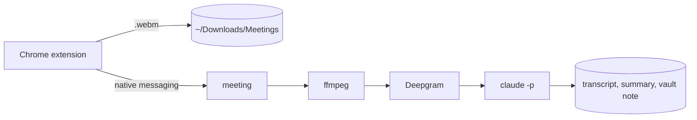

# Meeting Manager

Record a browser meeting in Chrome and get a speaker-labelled transcript plus an English summary, with action items and insights, in your Obsidian vault. No bot joins the call and there is no server: a Chrome extension records the tab and your mic, and a local Rust CLI (`meeting`) transcribes the audio with Deepgram Nova-3 (Bengali or English) and summarises it with Claude Code (Opus).

macOS and Google Chrome only. Single user, personal tool.



## Install

Needs macOS, Chrome 116+, Rust 1.87+, Node 24+, ffmpeg with libopus, a logged-in Claude Code, a Deepgram API key and an Obsidian vault.

```sh
cargo install --path crates/meeting
meeting install          # finds ffmpeg/claude, asks for the vault, registers the Chrome host
meeting config set-key   # stores the Deepgram key in the Keychain
meeting doctor           # every check must show ✓
cd extension && npm ci && npm run build
```

Then load `extension/dist/` as an unpacked extension in `chrome://extensions`. Step by step, plus update and uninstall: [installation guide](docs/guides/installation.md). First recording in five minutes: [quickstart](docs/guides/quickstart.md).

## Use

1. On the meeting tab, open the extension popup, pick **Bengali** or **English** and press **Start**. The first time, a page asks for mic permission; grant it and press Start again.
2. **Pause**/**Resume** as needed, then **Stop & save**. Recording also stops at 3 hours or when the tab closes.
3. Processing runs in the background, even if Chrome quits. A macOS notification says when it is done; the popup's **Jobs** tab shows progress and opens the summary or folder, **Retry** reruns a failed job, and **Archive** moves a finished meeting to `~/Downloads/Meetings/Archive/`.

Outputs, in the meeting's folder `~/Downloads/Meetings/<name>/`:

| File | Content |
|---|---|
| `recording.webm` | The recording (tab video and audio plus mic) |
| `transcript.md` | `[hh:mm:ss] Speaker N: text` lines |
| `summary.md` | Summary, key points, decisions, action items, insights, speakers |
| `meta.json` | Language, timestamps, job history |

The vault gets `<vault>/<folder>/YYYY-MM-DD HHMM <title>.md` (folder defaults to `Meetings`) with frontmatter. Rerunning overwrites that note instead of adding a second one. Recordings under 10 seconds are saved but not processed.

Rerun from the terminal:

```sh
meeting process ~/Downloads/Meetings/meeting-2026-10-19_1430.webm   # reuse the transcript, redo the summary
meeting process <file> --retranscribe                              # pay Deepgram again
meeting process <file> --language en                               # wrong language picked
```

## Configuration

| What | Where |
|---|---|
| Settings (vault, folder, recordings dir, tool paths) | `~/.config/meeting-manager/config.toml` — rerun `meeting install` or edit it |
| Deepgram key | macOS Keychain, service `meeting-manager`, account `deepgram` |
| Job status | `~/Library/Application Support/meeting-manager/jobs/` |
| Log | `~/Library/Logs/meeting-manager/meeting.log` (never contains the key or transcript text) |

Full reference: [docs/features/setup.md](docs/features/setup.md).

## Troubleshooting

- **Anything fails:** run `meeting doctor`; each `✗` line names its fix. Then read the log above.
- **Popup says the tool is not installed:** run `meeting install`. The recording is already saved; process it with `meeting process <file>`.
- **"already processing":** a job for that recording is still running. A lock left by a crashed run clears itself.
- **Recordings saved somewhere else:** the host only accepts `.webm` files under `recordings_dir`; change it in the config file.

## Privacy

Only the extracted audio goes to Deepgram, and only the transcript goes to Anthropic through your own Claude Code login. Claude runs with every tool disabled and treats the transcript as untrusted data. Everything else stays on your machine.

## Development

```sh
cargo fmt --all --check && cargo clippy --all-targets -- -D warnings && cargo test
cd extension && npm run build && npm run typecheck && npx biome ci . && npm test
```

CI runs the same gates per part on every pull request. Workflow, commit style and rules: [CONTRIBUTING.md](CONTRIBUTING.md). Start with [docs/README.md](docs/README.md) (architecture, development, per-component and per-feature docs). Requirements and decisions are in the PRD, [docs/prds/meeting-recorder.md](docs/prds/meeting-recorder.md). Agent instructions: [CLAUDE.md](CLAUDE.md).
