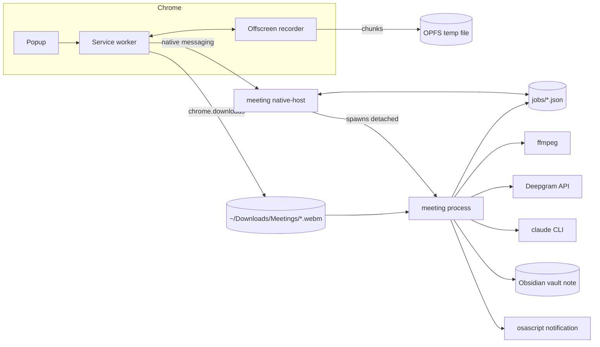
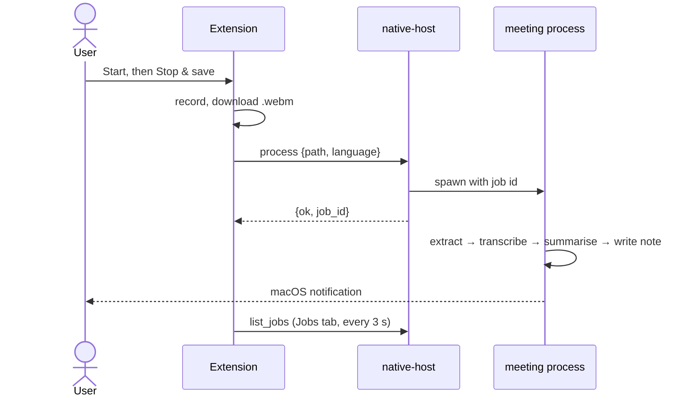

# Architecture

Covers: Cargo.toml, crates/meeting/, extension/, .github/workflows/

A Chrome extension records a meeting tab plus the mic; a local Rust CLI (`meeting`) transcribes it with Deepgram, summarises it with headless Claude Code and writes a note into an Obsidian vault. macOS only. No server: everything runs on the user's machine.

## Components

| Component | Path | Doc |
|---|---|---|
| Chrome MV3 extension (React 19, Vite, CRXJS) | `extension/` | [extension.md](extension.md) |
| Rust CLI and native-messaging host `meeting` | `crates/meeting/` | [tool.md](tool.md) |

## How they talk

- **Extension internals:** `chrome.runtime` messages between popup, service worker and offscreen document; status in `chrome.storage.session`. See [extension.md](extension.md#message-passing).
- **Extension → tool:** Chrome native messaging (`com.meeting_manager.host`). Chrome launches `meeting chrome-extension://<id>/` per request, which `main.rs` runs as `native-host`; the host only accepts the pinned extension origin. See [features/native-messaging.md](features/native-messaging.md).
- **Tool → tool:** the host never processes a recording itself; it writes a `queued` job and spawns `meeting process --job-id <id>` in its own process group, then exits.
- **Tool → extension:** no push. The popup Jobs tab polls `list_jobs`; the tool reads and writes job JSON files that both sides see through the host.

## Data stores

| Store | Owner | Doc |
|---|---|---|
| `chrome.storage.session` / `.local`, OPFS `recordings/` | Extension | [extension.md](extension.md#state-storage) |
| Recording and side files in the recording's folder (`meta.json`, `transcript.md`, `summary.md`, …) | Tool | [features/processing.md](features/processing.md#files) |
| Job files under `~/Library/Application Support/meeting-manager/jobs/` | Tool | [features/processing.md](features/processing.md#job-lifecycle) |
| `~/.config/meeting-manager/config.toml`, Keychain item, Chrome host manifest | Tool | [features/setup.md](features/setup.md) |
| Vault note | Tool | [features/processing.md](features/processing.md#files) |
| Log `~/Library/Logs/meeting-manager/meeting.log` | Tool | [tool.md](tool.md#gotchas) |

## Main flow

Details per stage: [features/recording.md](features/recording.md) → [features/native-messaging.md](features/native-messaging.md) → [features/processing.md](features/processing.md). First-run setup: [features/setup.md](features/setup.md).

## Cross-cutting rules

- **Pinned extension ID.** The `key` in `extension/manifest.config.ts` fixes the ID that `EXTENSION_ID` in `crates/meeting/src/install.rs` trusts. Changing one breaks the host handshake.
- **Shared wire types.** `extension/src/shared/native.ts` mirrors the Rust request and job types in `native.rs` and `jobs.rs` by hand; change both sides together.
- **No secrets in files or logs.** The Deepgram key lives only in the Keychain; transcript text is never logged.
