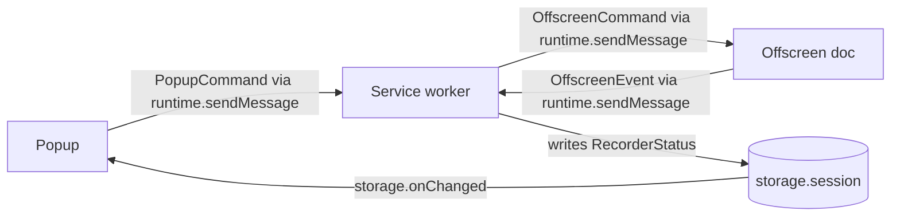

# Chrome extension

Covers: extension/manifest.config.ts, extension/manifest.test.ts, extension/vite.config.ts, extension/vitest.config.ts, extension/tsconfig.json, extension/biome.json, extension/src/

MV3 extension (React 19, Vite, `@crxjs/vite-plugin`, vitest, biome). It records the active tab and mic, saves the file to `Downloads/Meetings/`, and hands it to the `meeting` tool. See [architecture.md](architecture.md) for the whole system and [development.md](development.md) for commands.

## Entry points

| Context | Declared in | File | Role |
|---|---|---|---|
| Service worker (module) | `manifest.config.ts` `background` | `src/background/serviceWorker.ts` | State owner. Registers all listeners at top level. |
| Popup | `action.default_popup` | `src/popup/index.html` -> `main.tsx` -> `Popup` | Tabs: Record, Jobs. |
| Offscreen document | `vite.config.ts` `rollupOptions.input` only; created at runtime by `ensureOffscreen()` | `src/offscreen/offscreen.html` -> `offscreen.ts` | Capture and mixing. No UI. |
| Meet content script | `manifest.config.ts` `content_scripts`, only with `FEATURE_MEETING_CONTEXT=1` | `src/content/meet.ts` | Idle until `context_start`; then reads roster, title and who is speaking on Meet and sends `context_update` batches. |
| Mic permission page | `vite.config.ts` `rollupOptions.input` only; opened by `openMicPermissionPage()` | `src/permission/permission.html` -> `main.tsx` -> `MicPermission` | One-time mic grant. |

- Offscreen and permission pages are not in the manifest, so `vite.config.ts` lists them as extra build inputs. A new unreferenced page needs the same.
- `manifest.config.ts` pins `key`, which fixes the extension ID `obbaikcmcdooakogedoiiflflbbhpgdh` (the native host trusts it). Never edit the key. `manifest.test.ts` checks the ID.
- `minimum_chrome_version` is `116` (offscreen document consuming a `tabCapture` stream ID).

## Permissions

`manifest.test.ts` asserts exactly these five. A build with `FEATURE_MEETING_CONTEXT=1` (read in `manifest.config.ts` by `flagFromEnv`, `buildManifest(true)`) adds `activeTab`, `host_permissions` for `https://meet.google.com/*` and the content script; unset, the manifest is unchanged.

| Permission | Used for |
|---|---|
| `tabCapture` | `chrome.tabCapture.getMediaStreamId` in `recordingControl.ts` |
| `offscreen` | `chrome.offscreen.createDocument` / `closeDocument` |
| `downloads` | Saving `Meetings/<name>/recording.webm` in `save.ts` |
| `nativeMessaging` | Talking to the Rust host, see [features/native-messaging.md](features/native-messaging.md) |
| `storage` | `chrome.storage.session` (status) and `chrome.storage.local` (language, last recording) |

## Directory map

| Path | Role | Key symbols |
|---|---|---|
| `src/background/serviceWorker.ts` | Listener registration only | `chrome.runtime.onMessage`, `tabs.onRemoved`, `runtime.onStartup` / `onInstalled` |
| `src/background/recordingControl.ts` | Recording state machine owner | `handlePopupCommand`, `handleOffscreenEvent`, `handleTabRemoved`, `handleContentEvent`, `serial`, `readStatus`, `writeStatus`, `ensureOffscreen`, `closeOffscreen` |
| `src/background/contextSession.ts` | Meeting context session (flag on): talks to the Meet content script, merges its batches | `startContext`, `collectFinalBatch`, `closeSegment`, `openSegment`, `mergeBatch`, `applyBatch`, `settleContext`, `mapToRecordingMs`, `readContext` |
| `src/background/save.ts` | Download, then hand off to the tool | `saveRecording`, `recordingName`, `nextFreeName`, `takenNames` |
| `src/background/recover.ts` | Save leftovers on startup | `recoverLeftovers`, `recoveredName` |
| `src/offscreen/offscreen.ts` | Offscreen message router | `chrome.runtime.onMessage` listener |
| `src/offscreen/recorder.ts` | MediaRecorder session | `startRecording`, `pauseRecording`, `resumeRecording`, `stopRecording` |
| `src/popup/Popup.tsx` | Shell: "meeting." wordmark and tabs | `Popup` |
| `src/popup/RecordTab.tsx` | Record UI | `RecordTab` |
| `src/popup/useRecorderStatus.ts` | Live status hook | `useRecorderStatus` |
| `src/popup/useMeetingContext.ts` | Live meeting context hook (flag on; null and no storage read when off) | `useMeetingContext` |
| `src/popup/ContinueCard.tsx` | Continue card on the idle Record tab (flag on) | `ContinueCard` |
| `src/popup/useContinuable.ts` | The `last_recording` to offer, live (flag on; null and no storage or downloads call when off) | `useContinuable`, `RECHECK_MS` |
| `src/popup/formatElapsed.ts` | `H:MM:SS` time text | `formatElapsed` |
| `src/popup/JobsTab.tsx`, `useJobs.ts` | Jobs UI | see [features/native-messaging.md](features/native-messaging.md) |
| `src/permission/MicPermission.tsx` | Mic grant page | `MicPermission` |
| `src/shared/meetingContext.ts` | Pure context helpers | `identityFromTab`, `contextForHandoff`, `trimToLimit`, `cleanText`, `formatClock`, `MEET_CODE` |
| `src/shared/flags.ts` | Build-time flags, defined in `vite.config.ts` from `FEATURE_MEETING_CONTEXT` and `FEATURE_CONTINUE_RECORDING` (`flagFromEnv`) | `meetingContextEnabled`, `continueRecordingEnabled` |
| `src/shared/continuingParts.ts` | Continued part -> meeting link (flag on) | `rememberContinuingPart`, `readContinuingPart`, `forgetContinuingPart`, `CONTINUING_PARTS_KEY` |
| `src/shared/lastRecording.ts` | Last saved recording (flag on) and the pure can-continue rule | `canContinue`, `readLastRecording`, `writeLastRecording`, `clearLastRecording`, `lastRecordingExists`, `folderOf`, `CONTINUE_WINDOW_MS`, `LAST_RECORDING_KEY` |
| `src/shared/tokens.css`, `tokens.test.ts` | Design tokens, fonts, focus ring, reduced motion; contrast test | `--surface`, `--text`, `--accent`, `--record`, `--focus-ring`, `--chip-<tone>-fill`/`-text` (Jobs stage chips) |
| `src/shared/fonts/` | Bundled woff2 fonts and their OFL licences | |
| `src/content/meet.ts` | Meet content script (flag-on build only): 1 s reads, 10 s batches, 60 s give-up, `context_hello` resume | `chrome.runtime.onMessage` listener |
| `src/content/meetReader.ts` | Pure Meet page reads | `readRoster`, `readTitle`, `readSpeaking`, `diffSpeaking` |
| `src/shared/messages.ts` | All cross-context types | `ContentCommand`, `ContentEvent`, `PopupCommand`, `OffscreenCommand`, `OffscreenEvent`, `RecorderStatus`, `Notice`, `DismissTarget`, `RECORDER_STATUS_KEY` |
| `src/shared/recordingState.ts` | Pure lifecycle | `transition`, `elapsedMs`, `remainingMs`, `RECORDING_CAP_MS` |
| `src/shared/recordingFile.ts` | OPFS file per recording | `appendChunk`, `getRecordingFile`, `deleteRecordingFile`, `RECORDINGS_DIR` |
| `src/shared/micPermission.ts` | Mic permission helpers | `micPermissionState`, `openMicPermissionPage`, `MIC_PERMISSION_PAGE` |
| `src/shared/native.ts`, `nativeClient.ts` | Native host client | see [features/native-messaging.md](features/native-messaging.md) |
| `src/test/setup.ts` | vitest setup | `cleanup` after each test |
| `manifest.config.ts`, `vite.config.ts`, `vitest.config.ts`, `tsconfig.json`, `biome.json` | Build and tooling config | |

Feature flow for recording: [features/recording.md](features/recording.md). Processing: [features/processing.md](features/processing.md).

## Message passing

All types live in `src/shared/messages.ts`. Add new messages there.

| Direction | Type | `type` values |
|---|---|---|
| Popup -> SW | `PopupCommand` | `start`, `continue` (flag on; next part of `last_recording`), `pause`, `resume`, `stop`, `dismiss {what: 'notice' \| 'stop' \| 'mic'}` |
| SW -> offscreen | `OffscreenCommand` | `offscreen_start`, `offscreen_pause`, `offscreen_resume`, `offscreen_stop`, `offscreen_file_url` |
| Offscreen -> SW | `OffscreenEvent` | `offscreen_started`, `offscreen_stopped`, `offscreen_error` |
| SW -> Meet content script (`tabs.sendMessage`) | `ContentCommand` | `context_start` (after the Start commit, Meet tabs only; answered `{ ok: true }`), `context_stop` (at Stop, before the download; answered with the final batch) |
| Meet content script -> SW | `ContentEvent` | `context_update` (a batch), `context_hello` (on load; answered `ContextHelloReply`) |

- The SW routes by `type` using the `POPUP_COMMANDS`, `OFFSCREEN_EVENTS` and `CONTENT_EVENTS` sets and ignores the rest.
- Fire-and-forget, except `offscreen_file_url` (the offscreen document replies via `sendResponse` with `{ url }` or `{ error }`) and `context_hello` (the SW replies `{ recording: true, startedAt }` to the recorded tab, else `{ recording: false }`).
- Content events count only with the flag on, from this extension (`sender.id`), from the recorded tab (`sender.tab.id === status.tabId`) and while `recording` or `paused`; anything else is ignored.
- The popup never reads SW memory. It reads `RecorderStatus` from storage.
- `tab_closed` is not an offscreen event. The SW sees `tabs.onRemoved`.

## State storage

| Store | Key | Holds | Written by |
|---|---|---|---|
| `chrome.storage.session` | `RECORDER_STATUS_KEY` (`'recorder'`) | `RecorderStatus` (state, language, micIncluded, micWarningDismissed?, notice, tabId, continuing `{folder, part, base_ms}` or `null`) | SW only |
| `chrome.storage.session` | `MEETING_CONTEXT_KEY` (`'meeting_context'`), flag on only | `MeetingContextState`: tab identity, recording segments, title, participants, speaking intervals (recording-clock ms), `truncated`, FR-5 `capture` and `reloadHint`; written at Start, merged per batch, sent with `process`, cleared after hand-off | SW only |
| `chrome.storage.local` | `language` | Last chosen `'bn'` or `'en'` | `RecordTab`; read by `recover.ts` |
| `chrome.storage.local` | `LAST_RECORDING_KEY` (`'last_recording'`), `FEATURE_CONTINUE_RECORDING` only | `LastRecording`: `download_id`, `path`, `folder`, `ext`, `recorded_ms`, `language`, `stopped_at`, `stop_reason` (`null` when recovered), `parts`; survives a browser restart | Written by `save.ts` after a completed download (stops, saved parts and recovery); removed by Start, kept by Continue |
| `chrome.storage.local` | `CONTINUING_PARTS_KEY` (`'continuing_parts'`), `FEATURE_CONTINUE_RECORDING` only | `{<startedAt>: {folder, part, language}}`: the meeting a continued part's temp file belongs to | Written by Continue before `offscreen_start`; removed by `save.ts` after the part's download completes; read by start-up recovery, which also drops entries with no file left |
| Origin-private file system | `recordings/<startedAt>.webm` | Chunks of an in-progress or unsaved recording | Offscreen (`appendChunk`); SW deletes |

- Module variables in the SW are not state. Every handler calls `readStatus()` first.
- The offscreen `recorder.ts` keeps its own module-level `session`; it is lost if the document is destroyed.

## Conventions

- **CSS modules**: each component has a colocated `<Name>.module.css`, imported as `styles` (Popup, RecordTab, ContinueCard, JobsTab, MicPermission). The only global CSS is `src/shared/tokens.css`, imported first by each page's `main.tsx`: colour, radius and font tokens (CSS custom properties, a light set and a dark set switched by `prefers-color-scheme`), the `@font-face` rules, `body` defaults, the `:focus-visible` ring and the `prefers-reduced-motion: reduce` reset. Component styles use `var(--…)` tokens, never colour literals.
- **Colours**: write tokens as plain `#rrggbb`; `src/shared/tokens.test.ts` parses both palettes and checks WCAG 2.1 AA contrast of each foreground/background pair it lists. Add a pair there for any new token used as text or a control boundary.
- **Fonts**: Inter (body) and Space Grotesk (wordmark, headings) are bundled from `src/shared/fonts/` (Latin subsets, weights 400 to 700, OFL texts beside them); Vite emits them as hashed `dist/assets/*.woff2`. No font or style loads from the network. Other scripts (Bengali) fall back to `system-ui`. How the files were made: `src/shared/fonts/README.md`.
- **Tests**: colocated `<name>.test.ts(x)`, run by vitest in jsdom with `src/test/setup.ts`. No own test file: `serviceWorker.ts`, `offscreen/offscreen.ts`, `useRecorderStatus.ts` and `useMeetingContext.ts` (covered through `RecordTab.test.tsx`), both `main.tsx`. `manifest.test.ts` sits in `extension/`.
- **Chrome API mocking**: no shared mock. Tests that touch Chrome APIs call `vi.stubGlobal('chrome', { ...only the APIs they use })`. Browser globals are stubbed the same way (`navigator.permissions`, `navigator.storage`, `navigator.mediaDevices`). `vi.mock` replaces sibling modules (e.g. `nativeClient`, `recordingFile` in `save.test.ts`).
- **Setup**: `src/test/setup.ts` loads jest-dom matchers and calls Testing Library `cleanup` in `afterEach` (test globals are off, so import `describe/it/expect/vi` from `vitest`).
- **Pure logic apart from Chrome**: `recordingState.ts` takes every time as an argument and touches no Chrome API.
- **Format**: biome, single quotes, 2 spaces, 120 columns, trailing commas. TypeScript `strict`, `types: ["chrome", ...]`.
- **Error style**: handlers in the SW are wrapped by `serial()` and `.catch(logFailure)`. `saveRecording` never throws and returns a `Notice`.

## Gotchas

- **Service worker sleeps.** Listeners must be registered at top level (`serviceWorker.ts`). State must be re-read from `storage.session`.
- **One queue.** All state changes go through `serial()` in `recordingControl.ts` so a Start, a stop event and startup recovery never interleave.
- **One offscreen document.** Chrome allows one. `ensureOffscreen()` reuses it whatever its reason (`USER_MEDIA` for recording, `BLOBS` for recovery).
- **Offscreen is the only place with media APIs.** The SW has no `getUserMedia`, `MediaRecorder` or `URL.createObjectURL`, so it asks the offscreen document for a blob URL (`offscreen_file_url`).
- **Blob URL lifetime.** It lives as long as the offscreen document; the SW closes the document after the download.
- **Stream ID is minted in the SW** (`tabCapture.getMediaStreamId`), then consumed in the offscreen document.
- **Mic permission cannot be requested from the offscreen document or popup.** A tab page (`permission.html`) does it.
- **Stop waits at most 2 s for the content script.** `context_start` and `context_stop` race a 2 s timer (`ANSWER_MS`); a rejection or timeout never fails Start or holds up the save. A `tab_closed` stop does not ask at all. `context_start` failing sets `capture: 'unavailable'` with `reloadHint`.
- **Speaking times are wall-clock until merged.** `openSpeaking.at` stays wall-clock. An open set is a wall-clock span `[at, end)` mapped onto every segment it overlaps (`offsetMs + (t - wallStart)`), so pause time yields nothing, a speaker flagged at Resume (talking through the pause or started in it) continues from Resume, and pieces in consecutive segments merge. A change inside a pause ends the previous span at the pause. An interval open at a pause or stop is ended only by the next change or at hand-off (`settleContext`, at the last segment's end), so a late batch can still end it earlier. Intervals under 1 s are dropped, touching ones with the same names merged; limits: 200 names, 10 names per interval, 5,000 intervals, each cut listed in `truncated`.
- **Startup recovery** runs on `onStartup` and `onInstalled` only, never on SW wake, so it cannot touch a live recording.

## Google Meet page reading

Spike result (#104), from one real call with 3 participants (host plus two guests, started from a calendar event) in the top frame. Fixtures are sanitised `outerHTML` in `extension/src/content/fixtures/` (fake names `Sam Host` (self), `Alex Example`, `Riley Sample`, code `abc-defg-hij`). The people panel was open in every capture except `meet-ad-hoc.html` and `meet-lobby.html`.

Roster and title reading is implemented in `src/content/meetReader.ts` (#105): the people panel is the only roster source (no tile fallback, so the lobby and a closed panel read nothing), and a title matching the meeting code is null. Speaking reading is implemented there too (#106): `readSpeaking` maps each flagged tile's `data-participant-id` to its roster item, so names match `readRoster` and nothing is read with the panel closed; `meet.ts` adds each change of the set (`{ at, names }`, wall-clock ms, order ignored, no debounce) to the next batch's `speaking` and to the `context_stop` reply.

**FR-4 verdict: speaking indicator reliable on this call: #106 goes ahead.** Its selector is an obfuscated class pair, so #106 must treat "no match" as "no speaking data", never as an error.

| Part | Where | Precondition | Stability | Fixture |
|---|---|---|---|---|
| Roster | `[role="list"][aria-label="Participants"] > [role="listitem"]`, name in the item's `aria-label`; `data-participant-id` is the stable key | People panel open | Semantic (`role`, `aria-label`, `data-*`) | `meet-full.html`, `meet-no-roster.html` |
| Self | The listitem whose text holds a `(You)` span; its `aria-label` is the real display name | People panel open | Text `(You)` is localised | `meet-full.html` |
| Title | `document.title` is `Meet - <event name>`; also a bottom-bar `div` (class `u6vdEc`, obfuscated) | Event-based meeting | `document.title` prefix is the steadier read | `meet-full.html`, `meet-ad-hoc.html`, `meet-no-title.html` |
| Speaking | A tile `[data-tile-media-id]` holds descendants with classes `kssMZb` and `v5h6Xc` only while its person speaks; map the tile's `data-participant-id` to the roster item for the name | Meeting grid | Obfuscated classes, expect breakage on a Meet release | `meet-speaking-a.html`, `meet-speaking-b.html`, `meet-no-speaking.html` |

Findings:

- **Panel closed:** not captured. Each grid tile also carries the name in a `span.notranslate`, but the people panel is the only source (PRD Non-goal: no tile fallback; the lobby also shows an own tile and tiles have no `(You)` marker). The Record tab line tells the user to open the panel (#127).
- **Left participants:** the roster only shows who is present now, so the content script builds the union itself.
- **Own name:** readable. Meet shows the real name plus `(You)`, so `self` can be set from the `(You)` item.
- **Ad-hoc meeting, no title:** Meet shows the meeting code as the title (`Meet - abc-defg-hij` in `document.title` and in the bottom-bar title `div`). #105 must treat a title that matches `^[a-z]{3}-[a-z]{4}-[a-z]{3}$` as no title (null). `meet-ad-hoc.html` is the real capture (panel closed, only your own tile); `meet-no-title.html` is the title removed by hand.
- **Lobby (waiting to be admitted):** no roster (no `Participants` list, no panel), one tile for yourself, title is the meeting code, and the page says "Please wait until a meeting host brings you into the call". The content script must read nothing here. `meet-lobby.html`.
- **Mic state is not speech:** the item's mic wrapper classes (`FTMc0c`, `biFrsd`) and the mute button `aria-label` ("Mute <name>'s microphone" versus "You can't unmute someone else") follow mic on/off only. A silent unmuted participant has neither speaking class (`sxlEM` alone also appears when unmuted).
- **Two speakers:** `meet-two-speakers.html` was captured with two guests unmuted, but only one tile carried the speaking classes, so at most one speaker is flagged at a time (or only one was talking); two simultaneous speakers cannot be told apart. #106 must tolerate one flagged tile at a time.
- **Not tested:** shared-room tile, presentation tile, join/leave, compact layout, tile pagination, panel-closed call with several people.
- **Fixture notes:** `meet-full.html` and the derived fixtures have the speaking classes stripped (the host's own tile carried them in the source capture). Scripts, styles, URLs, page meta tokens, `js*` attributes and svg contents were removed. The lobby guest is named `Guest Example`.
