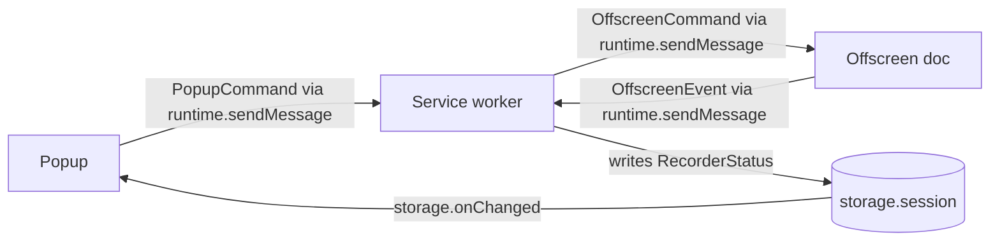

# Chrome extension

Covers: extension/manifest.config.ts, extension/manifest.test.ts, extension/vite.config.ts, extension/vitest.config.ts, extension/tsconfig.json, extension/biome.json, extension/src/

MV3 extension (React 19, Vite, `@crxjs/vite-plugin`, vitest, biome). It records the active tab and mic, saves the file to `Downloads/Meetings/`, and hands it to the `meeting` tool. See [architecture.md](architecture.md) for the whole system and [development.md](development.md) for commands.

## Entry points

| Context | Declared in | File | Role |
|---|---|---|---|
| Service worker (module) | `manifest.config.ts` `background` | `src/background/serviceWorker.ts` | State owner. Registers all listeners at top level. |
| Popup | `action.default_popup` | `src/popup/index.html` -> `main.tsx` -> `Popup` | Tabs: Record, Jobs. |
| Offscreen document | `vite.config.ts` `rollupOptions.input` only; created at runtime by `ensureOffscreen()` | `src/offscreen/offscreen.html` -> `offscreen.ts` | Capture and mixing. No UI. |
| Mic permission page | `vite.config.ts` `rollupOptions.input` only; opened by `openMicPermissionPage()` | `src/permission/permission.html` -> `main.tsx` -> `MicPermission` | One-time mic grant. |

- Offscreen and permission pages are not in the manifest, so `vite.config.ts` lists them as extra build inputs. A new unreferenced page needs the same.
- `manifest.config.ts` pins `key`, which fixes the extension ID `obbaikcmcdooakogedoiiflflbbhpgdh` (the native host trusts it). Never edit the key. `manifest.test.ts` checks the ID.
- `minimum_chrome_version` is `116` (offscreen document consuming a `tabCapture` stream ID).

## Permissions

`manifest.test.ts` asserts exactly these five.

| Permission | Used for |
|---|---|
| `tabCapture` | `chrome.tabCapture.getMediaStreamId` in `recordingControl.ts` |
| `offscreen` | `chrome.offscreen.createDocument` / `closeDocument` |
| `downloads` | Saving `Meetings/<name>/recording.webm` in `save.ts` |
| `nativeMessaging` | Talking to the Rust host, see [features/native-messaging.md](features/native-messaging.md) |
| `storage` | `chrome.storage.session` (status) and `chrome.storage.local` (language) |

## Directory map

| Path | Role | Key symbols |
|---|---|---|
| `src/background/serviceWorker.ts` | Listener registration only | `chrome.runtime.onMessage`, `tabs.onRemoved`, `runtime.onStartup` / `onInstalled` |
| `src/background/recordingControl.ts` | Recording state machine owner | `handlePopupCommand`, `handleOffscreenEvent`, `handleTabRemoved`, `serial`, `readStatus`, `writeStatus`, `ensureOffscreen`, `closeOffscreen` |
| `src/background/save.ts` | Download, then hand off to the tool | `saveRecording`, `recordingName`, `nextFreeName`, `takenNames` |
| `src/background/recover.ts` | Save leftovers on startup | `recoverLeftovers`, `recoveredName` |
| `src/offscreen/offscreen.ts` | Offscreen message router | `chrome.runtime.onMessage` listener |
| `src/offscreen/recorder.ts` | MediaRecorder session | `startRecording`, `pauseRecording`, `resumeRecording`, `stopRecording` |
| `src/popup/Popup.tsx` | Tab shell | `Popup` |
| `src/popup/RecordTab.tsx` | Record UI | `RecordTab` |
| `src/popup/useRecorderStatus.ts` | Live status hook | `useRecorderStatus` |
| `src/popup/JobsTab.tsx`, `useJobs.ts` | Jobs UI | see [features/native-messaging.md](features/native-messaging.md) |
| `src/permission/MicPermission.tsx` | Mic grant page | `MicPermission` |
| `src/shared/messages.ts` | All cross-context types | `PopupCommand`, `OffscreenCommand`, `OffscreenEvent`, `RecorderStatus`, `Notice`, `RECORDER_STATUS_KEY` |
| `src/shared/recordingState.ts` | Pure lifecycle | `transition`, `elapsedMs`, `remainingMs`, `RECORDING_CAP_MS` |
| `src/shared/recordingFile.ts` | OPFS file per recording | `appendChunk`, `getRecordingFile`, `deleteRecordingFile`, `RECORDINGS_DIR` |
| `src/shared/micPermission.ts` | Mic permission helpers | `micPermissionState`, `openMicPermissionPage`, `MIC_PERMISSION_PAGE` |
| `src/shared/native.ts`, `nativeClient.ts` | Native host client | see [features/native-messaging.md](features/native-messaging.md) |
| `src/test/setup.ts` | vitest setup | `cleanup` after each test |
| `manifest.config.ts`, `vite.config.ts`, `vitest.config.ts`, `tsconfig.json`, `biome.json` | Build and tooling config | |

Feature flow for recording: [features/recording.md](features/recording.md). Processing: [features/processing.md](features/processing.md).

## Message passing

All types live in `src/shared/messages.ts`. Add new messages there.

| Direction | Type | `type` values |
|---|---|---|
| Popup -> SW | `PopupCommand` | `start`, `pause`, `resume`, `stop` |
| SW -> offscreen | `OffscreenCommand` | `offscreen_start`, `offscreen_pause`, `offscreen_resume`, `offscreen_stop`, `offscreen_file_url` |
| Offscreen -> SW | `OffscreenEvent` | `offscreen_started`, `offscreen_stopped`, `offscreen_error` |

- The SW routes by `type` using the `POPUP_COMMANDS` and `OFFSCREEN_EVENTS` sets and ignores the rest.
- Fire-and-forget, except `offscreen_file_url`: the offscreen document replies via `sendResponse` with `{ url }` or `{ error }`.
- The popup never reads SW memory. It reads `RecorderStatus` from storage.
- `tab_closed` is not an offscreen event. The SW sees `tabs.onRemoved`.

## State storage

| Store | Key | Holds | Written by |
|---|---|---|---|
| `chrome.storage.session` | `RECORDER_STATUS_KEY` (`'recorder'`) | `RecorderStatus` (state, language, micIncluded, notice, tabId) | SW only |
| `chrome.storage.local` | `language` | Last chosen `'bn'` or `'en'` | `RecordTab`; read by `recover.ts` |
| Origin-private file system | `recordings/<startedAt>.webm` | Chunks of an in-progress or unsaved recording | Offscreen (`appendChunk`); SW deletes |

- Module variables in the SW are not state. Every handler calls `readStatus()` first.
- The offscreen `recorder.ts` keeps its own module-level `session`; it is lost if the document is destroyed.

## Conventions

- **CSS modules**: each component has a colocated `<Name>.module.css`, imported as `styles` (Popup, RecordTab, JobsTab, MicPermission). No global CSS.
- **Tests**: colocated `<name>.test.ts(x)`, run by vitest in jsdom with `src/test/setup.ts`. No own test file: `serviceWorker.ts`, `offscreen/offscreen.ts`, `useRecorderStatus.ts` (covered through `RecordTab.test.tsx`), both `main.tsx`. `manifest.test.ts` sits in `extension/`.
- **Chrome API mocking**: no shared mock. Tests that touch Chrome APIs call `vi.stubGlobal('chrome', { ...only the APIs they use })`. Browser globals are stubbed the same way (`navigator.permissions`, `navigator.storage`, `navigator.mediaDevices`). `vi.mock` replaces sibling modules (e.g. `nativeClient`, `recordingFile` in `save.test.ts`).
- **Setup**: `src/test/setup.ts` loads jest-dom matchers and calls Testing Library `cleanup` in `afterEach` (test globals are off, so import `describe/it/expect/vi` from `vitest`).
- **Pure logic apart from Chrome**: `recordingState.ts` takes every time as an argument and touches no Chrome API.
- **Format**: biome, single quotes, 2 spaces, 120 columns, trailing commas. TypeScript `strict`, `types: ["chrome", ...]`.
- **Error style**: handlers in the SW are wrapped by `serial()` and `.catch(logFailure)`. `saveRecording` never throws and returns a `Notice`.

## Gotchas

- **Service worker sleeps.** Listeners must be registered at top level (`serviceWorker.ts`). State must be re-read from `storage.session`.
- **One queue.** All state changes go through `serial()` in `recordingControl.ts` so a Start, a stop event and startup recovery never interleave.
- **One offscreen document.** Chrome allows one. `ensureOffscreen()` reuses it whatever its reason (`USER_MEDIA` for recording, `BLOBS` for recovery).
- **Offscreen is the only place with media APIs.** The SW has no `getUserMedia`, `MediaRecorder` or `URL.createObjectURL`, so it asks the offscreen document for a blob URL (`offscreen_file_url`).
- **Blob URL lifetime.** It lives as long as the offscreen document; the SW closes the document after the download.
- **Stream ID is minted in the SW** (`tabCapture.getMediaStreamId`), then consumed in the offscreen document.
- **Mic permission cannot be requested from the offscreen document or popup.** A tab page (`permission.html`) does it.
- **Startup recovery** runs on `onStartup` and `onInstalled` only, never on SW wake, so it cannot touch a live recording.
