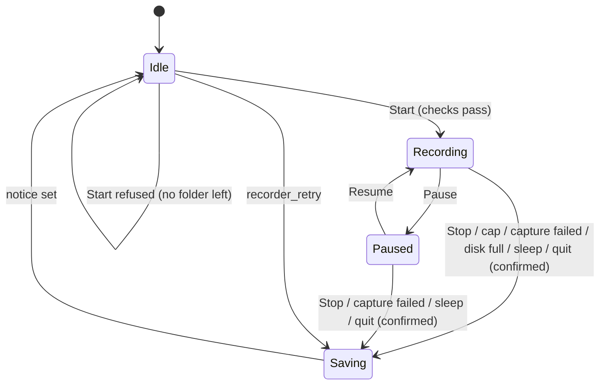

# Desktop recorder

Covers: desktop/src-tauri/src/recorder/, desktop/src-tauri/src/tray.rs

The desktop app's recording session: start, pause, resume, stop, the automatic stops (including sleep and quit), the WAV written while recording, the hand-off to `meeting process`, crash recovery, `recorder_retry` and the menu-bar item. Behaviour: [../prds/desktop-app.md](../prds/desktop-app.md) FR-1 to FR-7 (D13, D14, D15, D32, D33, D36). Audio comes from the capture boundary ([../desktop.md](../desktop.md#capture-boundary-capturemodrs)).

## Files

| File | Holds |
|---|---|
| `mod.rs` | `Recorder` (state machine, `Deps` of fn pointers), `Reason`, `Clock`, `start`/`pause`/`resume`/`stop`/`status`, `on_change`, `begin_saving`, the commands |
| `wav.rs` | `WavWriter` (writer thread, header patching), `repair` (sizes from the file length; used after a write error and by recovery) |
| `folder.rs` | `new_folder`: `meeting-YYYY-MM-DD_HHMM[-n]` via `meeting::import::create_folder` |
| `convert.rs` | `to_m4a`: ffmpeg by absolute path, `.part` then rename |
| `handoff.rs` | `write_context` / `ensure_context` (`context.json`), `finish_recording` (convert, delete WAV, spawn) |
| `notice.rs` | `Notice {kind, message, folder}` and the fixed messages |
| `recover.rs` | `recover_all` (launch), `retry` (`recorder_retry`), `recover_one` shared by both |
| `sleep.rs` | `register` (`NSWorkspaceWillSleepNotification` observer), `confirm_quit_alert` (`NSAlert`) |
| `../tray.rs` | The menu-bar item: pure `menu_state(&Status, start_error)`, `setup`, the menu handler, the 1 s title timer |

Tests inject everything through `Recorder::with(&env, Deps { capture, clock, local_minute, open_wav, spawn, check_tool, cap_s, flush_every, confirm_quit })`: `open_wav` lets a test hand the writer a sink that fills up like a full disk; a fake capture stores its callbacks in a `thread_local!` so the test pushes samples itself; conversion uses the real ffmpeg on `PATH`.

## Lifecycle

One `Mutex<State>` guards `Idle | Starting | Active(Session) | Saving`; every command locks only to check and change the state. `Starting` (reported as `idle`) holds the slot while `start` runs its checks, so a second start is refused. `stop(reason)` takes the session out, ends the stream, finishes the WAV (header patched) and returns; conversion and the spawn run on a thread that sets `idle` and the notice. A second stop finds no session and does nothing, so racing stops save once. A panic in an injected call while starting or saving returns the state to `idle` (a `capture_failed` refusal, or an `error` notice offering a retry). Each session has a watcher thread: the cap, a capture failure and a write error queue a stop for it (never inline: `events` runs on the thread `Stream::stop` joins), and it stops only its own session.

## Start

Checked in this order; any refusal leaves no folder and the state `idle`:

| Check | Code |
|---|---|
| Not idle | `already_recording` |
| `config.toml` unreadable, or `ffmpeg_path` not a file | `not_configured` (names `meeting install` / `meeting doctor`) |
| Chosen event: unknown, lookup failed / access denied / starts more than 7 days from now | `unknown_event` / `calendar_denied` / `event_too_far` |
| `capture.check`, then `capture.request` | `permission_mic`, `permission_audio` (message names the System Settings pane) |
| Folder, WAV or `capture.start` fails | `permission_*` when the error downcasts to `capture::Denied` (D36), else `capture_failed`; the folder is removed |

On success the language is saved to the store setting `language` (a store failure is logged, never fails Start) and the notice is cleared. `recorder_status.language` when idle is that setting, `bn` when unset or unreadable.

## Recording

| Rule | Where |
|---|---|
| Samples callback (real-time thread): if paused or capped, drop; else `try_send` the chunk to a bounded queue (3,000 chunks, about 30 s). A full queue drops the chunk and counts it; the writer logs once. No lock, I/O or blocking send | `samples_callback` |
| Recorded time = frames queued / 48,000; paused time is not counted. `elapsed_s` reads it | `Shared.frames` |
| Pause keeps the stream open and drops samples; Resume continues the same file | `set_paused` |
| Cap: recorded time reaching `CAP_S` (3 h; 15 min in debug builds) queues `stop(Cap)` once | `samples_callback` |
| `Event::Failed(msg)` → `stop(CaptureFailed(msg))`; `DeviceChanged` is ignored | `events_callback` |
| Write error: `StorageFull` → `stop(DiskFull)`, anything else → `CaptureFailed("cannot write audio: <kind>")` | `write_failure` |

## Files in the meeting folder

| File | When | Shape |
|---|---|---|
| `recording.partial.wav` | Start → after a good conversion | Mode `0600`, canonical 44-byte header (PCM, mono, 48 kHz, 16-bit) then little-endian `i16`. Every 5 s the writer flushes and patches the RIFF (offset 4) and data (offset 40) sizes, so a crash leaves a file valid to the last flush. No `sync_all` |
| `context.json` | Start (rewritten at Stop only if missing) | Mode `0600` (the temp file is created `0600` before the rename), through `meeting::context::check`: `version 1`, `platform "desktop"`, `started_at_ms`, `utc_offset_min`, `time_zone` (from `NSTimeZone`, `null` if `check` would reject it), `url`/`meeting_id`/`tab_title` null, empty lists, `calendar_event` when chosen. An event `check` rejects is left out; logs carry rule names only |
| `recording.m4a` | Stop | AAC, mono, 64 kbps: `ffmpeg -i <wav> -vn -ac 1 -c:a aac -b:a 64k -f mp4 recording.m4a.part`, renamed on exit 0 |

## Stop and notices

`finish_recording` converts, deletes the WAV, then hands off. The reason's prefix leads the message ("Stopped at 3 hours. ", "Recording stopped: <msg>. ", "Stopped because the Mac went to sleep. "); with a prefix the message ends with a full stop.

| Outcome | `notice.kind` | Message | `folder` |
|---|---|---|---|
| ≥ 10 s recorded, spawned `<meeting_path> process <folder>/recording.m4a --language <bn\|en>` | `saved` | Saved, sent for processing | null |
| < 10 s recorded: m4a kept, nothing spawned | `too_short` | Under 10 seconds, so it was saved but not processed. | null |
| `meeting_path` missing or fails `check_tool` | `setup` | Processing tool not found — run `meeting install` | null |
| Spawn failed | `error` | Saved, but processing could not be started: <error> | null |
| ffmpeg failed: WAV kept, no m4a | `error` | `ffmpeg failed: <last stderr line>` or `ffmpeg not found at <path>; run \`meeting doctor\`` | meeting folder |
| Disk full: WAV kept (sizes repaired), no conversion | `error` | The disk is full, so recording stopped. … | meeting folder |

`meeting_path` is read from `config.toml` at Stop; `ffmpeg_path` is the one checked at Start. The newest notice wins and is cleared by the next successful Start.

## Commands

All run on a blocking thread (permission prompts, joins and ffmpeg block). Replies: [../desktop.md](../desktop.md) and the PRD's API table.

| Command | Reply | Errors |
|---|---|---|
| `recorder_status` | `{state: idle\|recording\|paused\|saving, elapsed_s, language, folder\|null, notice\|null}` | none |
| `recorder_start {language, event_occurrence_id\|null}` | `{folder}` | see Start |
| `recorder_pause` / `recorder_resume` | `{state}` | `not_recording` |
| `recorder_stop` | `{state: "saving"}` at once | `not_recording` |
| `recorder_retry {folder}` | `{state: "saving"}` at once | `not_found`, `already_recording` |

`on_change(f)` runs `f` after every state or notice change (the menu-bar item uses it). `begin_saving()` holds `saving` while a retry converts.

## Sleep and quit

| Event | What happens | Where |
|---|---|---|
| `NSWorkspaceWillSleepNotification` (observer registered once at launch, `on_sleep`) | Recording or paused: `stop(Sleep)`. The handler returns once the stream has ended and the WAV header is patched; conversion and spawn run on the saving thread, after wake if need be. Notice "Stopped because the Mac went to sleep. Saved, sent for processing." Idle or saving: nothing | `sleep::will_sleep` |
| `ExitRequested` (Cmd-Q, the menu's Quit via `app.exit(0)`, last window closed) | `Recorder::quit()`: idle → quit; saving → wait until idle, then quit; recording/paused → `confirm_quit()`: Cancel keeps recording (exit prevented), confirm → `stop(Quit)`, join the saving thread, then quit. A spawned job has its own process group and outlives the app. If conversion fails the WAV stays and the next launch recovers it | `on_exit_requested`, `quit` |
| The confirmation | `NSAlert` "Quit Meeting?" / "The recording will be stopped and saved." / "Stop recording and quit", "Cancel". The app is activated first. Off the main thread it is not shown and the answer is Cancel | `sleep::confirm_quit_alert` |

`quit` blocks the main thread while saving, so the menu-bar item never waits on the main thread: every update is queued with `run_on_main_thread`.

## Crash recovery and retry

On launch `on_launch` runs `recover_all` on its own thread (the window is usable at once):

| Rule | Detail |
|---|---|
| Candidates | Direct subfolders of `recordings_dir` holding `recording.partial.wav`, sorted by name (oldest first). `Archive/` and symlinked folders are not looked at |
| Leftover | No other `recording.*` in the folder; a stale `recording.m4a.part` is deleted first and does not count |
| Skipped | The folder of the session that is recording or saving; checked under the `converting` lock, which recovery and retry each hold for one folder |
| Repair | `wav::repair` sets the sizes from the file length (whole samples). A file under 44 bytes or not our canonical header is kept untouched and counts as a failure. Zero frames: the WAV is deleted, and the folder if that leaves it empty; no notice |
| `context.json` | Kept if present (written at Start, with the event). Missing: written without an event, `started_at_ms` from the WAV's creation time (else modified time) |
| Hand-off | `finish_recording` as a stop does, in the last language (store `language`, default `bn`): m4a, WAV deleted, spawned when ≥ 10 s |
| Notice | One per run, none when nothing was recovered or failed: `{kind: "recovered", message: "Recovered N recording(s)"}`; with failures `{kind: "error", message: "Recovered N recording(s). Could not convert M: <first error>", folder: <first failed folder>}`. Dropped if a recording was started while recovery ran (that recording's notice wins). Recovery never changes the state |

`recorder_retry {folder}` (D33): the folder is canonicalised and must be a direct subfolder of the canonical `recordings_dir` (not `Archive`) holding the WAV, else `not_found` (also for `..`, symlinks out, paths elsewhere, a missing config). Not idle → `already_recording`. Otherwise it answers `saving` at once, and a thread runs the same `recover_one` and sets the notice it returns (`saved`, `too_short`, `setup`, or `error` with the folder again). Works after a disk-full stop and after an ffmpeg failure. Logs carry counts and kinds only.

## Menu-bar item (`tray.rs`)

Built in `tray::setup` on the main thread (skipped with a warning otherwise, so the mock-runtime tests run without it): `TrayIconBuilder::with_id("main")`, left click opens the menu.

| State | Icon | Title | Start | Pause/Resume | Stop |
|---|---|---|---|---|---|
| idle | `tray-idle.png` (template) | none | enabled | "Pause", disabled | disabled |
| recording | `tray-recording.png` (red, not a template) | `H:MM:SS` of `elapsed_s`, refreshed each second | disabled | "Pause" | enabled |
| paused | `tray-paused.png` (template) | frozen `H:MM:SS` | disabled | "Resume" | enabled |
| saving | idle icon | none | disabled | disabled | disabled |

- First line, disabled, only when there is something to say: the last Start error from the menu (the FR-2 permission texts word for word, `not_configured`, `capture_failed`…), else an `error` or `setup` notice. A Start error clears once a recording runs.
- Start recording: ad hoc, in the last language, on a thread. Open Meeting: shows and focuses the `main` window. Quit: `app.exit(0)`, so the quit logic above decides.
- Every recorder change re-renders through `on_change`; a timer thread refreshes only the title while recording.
