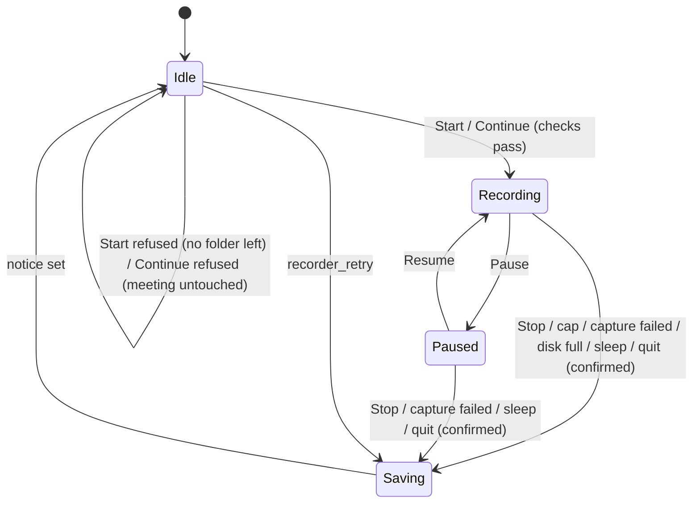

# Desktop recorder

Covers: desktop/src-tauri/src/recorder/, desktop/src-tauri/src/tray.rs, desktop/src-tauri/src/link.rs

The desktop app's recording session: start, pause, resume, stop, the automatic stops (including sleep and quit), the WAV written while recording, the hand-off to `meeting process`, crash recovery, `recorder_retry` and the menu-bar item. Behaviour: [../prds/desktop-app.md](../prds/desktop-app.md) FR-1 to FR-7 (D13, D14, D15, D32, D33, D36). Audio comes from the capture boundary ([../desktop.md](../desktop.md#capture-boundary-capturemodrs)).

## Files

| File | Holds |
|---|---|
| `mod.rs` | `Recorder` (state machine, `Deps` of fn pointers), `Reason`, `Clock`, `start`/`continue_recording`/`pause`/`resume`/`stop`/`status`, `on_change`, `begin_saving`, the commands; `Part` (a continued part), `save` / `save_part` / `save_moved` |
| `wav.rs` | `WavWriter` (writer thread, header patching), `repair` (sizes from the file length; used after a write error and by recovery) |
| `folder.rs` | `new_folder`: `meeting-YYYY-MM-DD_HHMM[-n]` via `meeting::import::create_folder` |
| `convert.rs` | `to_m4a`: ffmpeg by absolute path, `.part` then rename |
| `handoff.rs` | `write_context` / `ensure_context` (`context.json`), `finish_recording` (convert, delete WAV, spawn), `finish_part` (the same for `recording-part-N`, spawning the meeting's `recording.m4a`), `part_wav` / `part_m4a` |
| `notice.rs` | `Notice {kind, message, folder}` and the fixed messages |
| `recover.rs` | `recover_all` (launch), `retry` (`recorder_retry`), `recover_one` shared by both |
| `continuable.rs` | The last recording (continue-recording FR-4): store key `last_recording`, `LastRecording`, `Continuable`, the pure rule `offer`, `Recorder::remember_last` / `clear_last` / `continuable` / `last_continuable`; see [Last recording](#last-recording-continue-recording-fr-4) |
| `sleep.rs` | `register` (`NSWorkspaceWillSleepNotification` observer), `confirm_quit_alert` (`NSAlert`) |
| `../tray.rs` | The menu-bar item: pure `menu_state(&Status, start_error)` and `menu_ids(continue_enabled)`, `setup`, the menu handler, the 1 s title timer |

Tests inject everything through `Recorder::with(&env, Deps { capture, clock, local_minute, open_wav, spawn, spawn_continue, check_tool, cap_s, flush_every, confirm_quit, continue_enabled })`: `open_wav` lets a test hand the writer a sink that fills up like a full disk; a fake capture stores its callbacks in a `thread_local!` so the test pushes samples itself; conversion uses the real ffmpeg on `PATH`.

## Lifecycle

One `Mutex<State>` guards `Idle | Starting | Active(Session) | Saving`; every command locks only to check and change the state. `Starting` (reported as `idle`) holds the slot while `start` runs its checks, so a second start is refused; once `open` creates the meeting folder, and before the WAV exists, it also holds that folder so launch recovery skips it (#262). A continue holds the existing meeting folder the same way, before the part's WAV exists. `stop(reason)` takes the session out, ends the stream, finishes the WAV (header patched) and returns; conversion and the spawn run on a thread that sets `idle` and the notice. A second stop finds no session and does nothing, so racing stops save once. A panic in an injected call while starting or saving returns the state to `idle` (a `capture_failed` refusal, or an `error` notice offering a retry). Each session has a watcher thread: the cap, a capture failure and a write error queue a stop for it (never inline: `events` runs on the thread `Stream::stop` joins), and it stops only its own session.

## Start

Checked in this order; any refusal leaves no folder and the state `idle`:

| Check | Code |
|---|---|
| Not idle | `already_recording` |
| `config.toml` unreadable, or `ffmpeg_path` not a file | `not_configured` (names `meeting install` / `meeting doctor`) |
| Chosen event: unknown, lookup failed / access denied / starts more than 7 days from now | `unknown_event` / `calendar_denied` / `event_too_far` |
| `capture.check`, then `capture.request` | `permission_mic`, `permission_audio` (message names the System Settings pane) |
| Folder, WAV or `capture.start` fails | `permission_*` when the error downcasts to `capture::Denied` (D36), else `capture_failed`; the folder is removed |

On success the language is saved to the store setting `language` (a store failure is logged, never fails Start), the notice and start error are cleared, and with the continue flag the store setting `last_recording` is set to JSON `null` (see Last recording). `recorder_status.language` when idle is that setting, `bn` when unset or unreadable.

**Start error (quick-record FR-5).** `Recorder::start_ad_hoc(language)` is the Start from outside the window (the menu bar, #235's links): no event, in `language`, else the last used. When it is refused with any code but `already_recording` (not idle is never a start error), the refusal is kept as `start_error: {code, message}` and announced through `on_change`; the log carries only `recorder: start refused (<code>)`. The window's `recorder_start` never sets it (its reply already shows the refusal). `Recorder::continue_ad_hoc()` is the same for a continue (the menu bar's Continue last recording, the `continue` link): it shares `start_ad_hoc`'s refusal handling, so `nothing_to_continue` and Start's refusals become the start error, logged as `recorder: continue refused (<code>)`. Any successful Start or continue clears it, as does `dismiss_start_error` (`recorder_dismiss_start_error`), which announces only when there was one. Memory only, never stored.

## Continue (continue-recording FR-6, FR-8, FR-9)

Built only with `FEATURE_CONTINUE_RECORDING=1`: `recorder_continue` is registered only then (see [../desktop.md](../desktop.md)). `Recorder::continue_recording()` records the next part of the last recording (`last_continuable`, the stored value re-checked by `offer`) into its meeting folder. It shares `start`'s slot claim, panic guard and activation; the checks run in this order and any refusal leaves the meeting folder, `recording.m4a` and `context.json` as they were:

| Check | Code |
|---|---|
| Not idle | `already_recording` |
| Nothing offered (none stored, older than 2 h, `recording.m4a` or the folder gone, total ≥ cap) | `nothing_to_continue`: "Nothing to continue: the last recording stopped more than 2 hours ago, or was moved." |
| Start's configuration and permission checks, in Start's order | `not_configured`, `permission_mic`, `permission_audio` |
| Part WAV, its link or `capture.start` fails | `permission_*` or `capture_failed` (a link that cannot be made: "cannot write audio: …"); only the part's WAV and link are removed |

| Rule | Detail |
|---|---|
| Part number N | The stored `parts` + 1 (at least 2), then the first N whose `recording-part-N.partial.wav`, `recording-part-N.m4a` and link are all free |
| Files | `<folder>/recording-part-N.partial.wav` (same format and flushes as `recording.partial.wav`, mode `0600`), hard-linked at once to `<recordings_dir>/.continuing-<folder name>-part-N.partial.wav` (same inode) so the audio survives the folder being moved. `context.json` is not touched |
| Language | The earlier part's (D9); saved as the `language` setting, as Start does |
| Recorded time | `Shared.frames` starts at `recorded_s × 48,000`, so the cap, `elapsed_s` and the menu-bar timer count the whole meeting. `recorder_status.part` is N while the part records or is paused, else `null` |
| `last_recording` | Not cleared at the continue (the meeting stays the last recording); at the save, written as `{folder, recorded_s: total, parts: N}` once the part is converted. A failed conversion or a full disk leaves it unchanged |
| Stop | `finish_part` converts to `recording-part-N.m4a`, deletes the part WAV and, when the meeting's total is ≥ 10 s, spawns `<meeting_path> process <folder>/recording.m4a --continue --language <l>` (`spawn::continue_detached`, no `--job-id`). Notices as for Start; a failed conversion or full disk keeps the part WAV with a Retry notice naming the folder (`recorder_retry` answers `not_found` for a part WAV until #282 widens `retry_folder`). The link is deleted once the part WAV is handled |
| Moved meeting (D17) | At the save, if the part WAV or `recording.m4a` is no longer in the folder: a new `meeting-…` folder (named from the part's start), the link renamed into it as `recording.partial.wav` (a copy still in the old folder is the same file and is deleted), then Start's save path (`context.json`, `finish_recording`, no `--continue`, the part's frames alone for the 10 s rule). The notice is `error` "Could not add to <folder name>: it was moved; saved as a new meeting." unless the hand-off itself failed, whose notice is kept. The new folder becomes the last recording |

## Recording

| Rule | Where |
|---|---|
| Samples callback (real-time thread): if paused or capped, drop; else `try_send` the chunk to a bounded queue (3,000 chunks, about 30 s). A full queue drops the chunk and counts it; the writer logs once. No lock, I/O or blocking send | `samples_callback` |
| Recorded time = frames queued / 48,000; paused time is not counted. `elapsed_s` reads it | `Shared.frames` |
| Pause keeps the stream open and drops samples; Resume continues the same file | `set_paused` |
| Cap: recorded time reaching `CAP_S` (3 h; 15 min in debug builds) queues `stop(Cap)` once | `samples_callback` |
| `Event::Failed(msg)` → `stop(CaptureFailed(msg))`; `DeviceChanged` is ignored | `events_callback` |
| Write error: `StorageFull` → `stop(DiskFull)`, anything else → `CaptureFailed("cannot write audio: <kind>")` | `write_failure` |

## Files in the meeting folder

| File | When | Shape |
|---|---|---|
| `recording.partial.wav` | Start → after a good conversion | Mode `0600`, canonical 44-byte header (PCM, mono, 48 kHz, 16-bit) then little-endian `i16`. Every 5 s the writer flushes and patches the RIFF (offset 4) and data (offset 40) sizes, so a crash leaves a file valid to the last flush. No `sync_all` |
| `context.json` | Start (rewritten at Stop only if missing) | Mode `0600` (the temp file is created `0600` before the rename), through `meeting::context::check`: `version 1`, `platform "desktop"`, `started_at_ms`, `utc_offset_min`, `time_zone` (from `NSTimeZone`, `null` if `check` would reject it), `url`/`meeting_id`/`tab_title` null, empty lists, `calendar_event` when chosen. An event `check` rejects is left out; logs carry rule names only |
| `recording.m4a` | Stop | AAC, mono, 64 kbps: `ffmpeg -i <wav> -vn -ac 1 -c:a aac -b:a 64k -f mp4 recording.m4a.part`, renamed on exit 0 |
| `recording-part-N.partial.wav` | Continue → after a good conversion | As `recording.partial.wav`; while it records, also hard-linked as `<recordings_dir>/.continuing-<folder name>-part-N.partial.wav` |
| `recording-part-N.m4a` | Stop of a continued part | As `recording.m4a`; the meeting's `recording.m4a` is never rewritten |

## Stop and notices

`finish_recording` converts, deletes the WAV, then hands off. The reason's prefix leads the message ("Stopped at 3 hours. ", "Recording stopped: <msg>. ", "Stopped because the Mac went to sleep. "); with a prefix the message ends with a full stop.

| Outcome | `notice.kind` | Message | `folder` |
|---|---|---|---|
| ≥ 10 s recorded (a continued part: the meeting's total), spawned `<meeting_path> process <folder>/recording.m4a --language <bn\|en>` (a part: with `--continue`) | `saved` | Saved, sent for processing | null |
| < 10 s recorded: m4a kept, nothing spawned | `too_short` | Under 10 seconds, so it was saved but not processed. | null |
| `meeting_path` missing or fails `check_tool` | `setup` | Processing tool not found — run `meeting install` | null |
| Spawn failed | `error` | Saved, but processing could not be started: <error> | null |
| ffmpeg failed: WAV kept, no m4a | `error` | `ffmpeg failed: <last stderr line>` or `ffmpeg not found at <path>; run \`meeting doctor\`` | meeting folder |
| Disk full: WAV kept (sizes repaired), no conversion | `error` | The disk is full, so recording stopped. … | meeting folder |

`meeting_path` is read from `config.toml` at Stop; `ffmpeg_path` is the one checked at Start. The newest notice wins and is cleared by the next successful Start or by `dismiss_notice` (`recorder_dismiss_notice`, continue-recording FR-1), which takes only the notice lock, announces through `on_change` only when there was one and logs nothing. Dismissing an `error` notice with a `folder` drops its Retry; the kept WAV stays and the next launch's recovery converts it. A later notice shows again.

## Commands

All run on a blocking thread (permission prompts, joins and ffmpeg block). Replies: [../desktop.md](../desktop.md) and the PRD's API table.

| Command | Reply | Errors |
|---|---|---|
| `recorder_status` | `{state: idle\|recording\|paused\|saving, elapsed_s, language, folder\|null, notice\|null, start_error: {code, message}\|null, continuable: {folder, name, recorded_s, stopped_at}\|null, part: N\|null}` (`start_error`: see Start error; `continuable`: see Last recording, always present, `null` when built without the flag; `part`: see Continue, always present) | none |
| `recorder_dismiss_start_error` | `{}`; clears the start error (already clear is fine) | none |
| `recorder_dismiss_notice` (not flagged) | `{}`; clears the notice (already clear is fine); announced through the change listeners, so the menu bar and pill drop it at once | none |
| `recorder_start {language, event_occurrence_id\|null}` | `{folder}` | see Start |
| `recorder_continue` (flag on only; flag off it does not exist) | `{folder}`: the existing meeting folder | see Continue |
| `recorder_pause` / `recorder_resume` | `{state}` | `not_recording` |
| `recorder_stop` | `{state: "saving"}` at once | `not_recording` |
| `recorder_retry {folder}` | `{state: "saving"}` at once | `not_found`, `already_recording` |

`on_change(f)` adds a listener: every listener runs, in the order added, after every state or notice change, called outside the lock so it may read `status()` (the menu-bar item uses it; the indicator will too). `begin_saving()` holds `saving` while a retry converts.

## Sleep and quit

| Event | What happens | Where |
|---|---|---|
| `NSWorkspaceWillSleepNotification` (observer registered once at launch, `on_sleep`) | Recording or paused: `stop(Sleep)`. The handler returns once the stream has ended and the WAV header is patched; conversion and spawn run on the saving thread, after wake if need be. Notice "Stopped because the Mac went to sleep. Saved, sent for processing." Idle or saving: nothing | `sleep::will_sleep` |
| `ExitRequested` (Cmd-Q, the menu's Quit via `app.exit(0)`; closing the window only hides it, D15) | `Recorder::quit()`: idle → quit; saving → wait until idle, then quit; recording/paused → `confirm_quit()`: Cancel keeps recording (exit prevented), confirm → `stop(Quit)`, join the saving thread, then quit. A spawned job has its own process group and outlives the app. If conversion fails the WAV stays and the next launch recovers it | `on_exit_requested`, `quit` |
| The confirmation | `NSAlert` "Quit Meeting?" / "The recording will be stopped and saved." / "Stop recording and quit", "Cancel". The app is activated first. Off the main thread it is not shown and the answer is Cancel | `sleep::confirm_quit_alert` |

Recovery and retry conversions are not waited for: quitting mid-way kills ffmpeg, and the next launch deletes the stale `recording.m4a.part` and recovers the kept WAV. `quit` blocks the main thread while saving, so the menu-bar item never waits on the main thread: every update is queued with `run_on_main_thread`.

## Crash recovery and retry

On launch `on_launch` runs `recover_all` on its own thread (the window is usable at once):

| Rule | Detail |
|---|---|
| Candidates | Direct subfolders of `recordings_dir` holding `recording.partial.wav`, sorted by name (oldest first). `Archive/` and symlinked folders are not looked at |
| Leftover | No other `recording.*` in the folder; a stale `recording.m4a.part` is deleted first and does not count |
| Skipped | The folder of the session that is starting, recording or saving; checked under the `converting` lock, which recovery and retry each hold for one folder |
| Repair | `wav::repair` sets the sizes from the file length (whole samples). A file under 44 bytes or not our canonical header is kept untouched and counts as a failure. Zero frames: the WAV is deleted, and the folder if that leaves it empty; no notice |
| `context.json` | Kept if present (written at Start, with the event). Missing: written without an event, `started_at_ms` from the WAV's creation time (else modified time) |
| Hand-off | `finish_recording` as a stop does, in the last language (store `language`, default `bn`): m4a, WAV deleted, spawned when ≥ 10 s |
| Notice | One per run, none when nothing was recovered or failed: `{kind: "recovered", message: "Recovered N recording(s)"}`; with failures `{kind: "error", message: "Recovered N recording(s). Could not convert M: <first error>", folder: <first failed folder>}`. Dropped if a recording was started while recovery ran (that recording's notice wins). Recovery never changes the state |

After `finish_recording`, whatever its outcome, `recover_one` remembers the folder as the last recording, stopped at the recovery time, unless a recording is starting, running or saving, or one was started since the call began (checked under the state lock). With several leftovers the newest one recovered is the last one.

`recorder_retry {folder}` (D33): the folder is canonicalised and must be a direct subfolder of the canonical `recordings_dir` (not `Archive`) holding the WAV, else `not_found` (also for `..`, symlinks out, paths elsewhere, a missing config). Not idle → `already_recording`. Otherwise it answers `saving` at once, and a thread runs the same `recover_one` and sets the notice it returns (`saved`, `too_short`, `setup`, or `error` with the folder again). Works after a disk-full stop and after an ffmpeg failure. Logs carry counts and kinds only.

## Menu-bar item (`tray.rs`)

Built in `tray::setup` on the main thread (skipped with a warning otherwise, so the mock-runtime tests run without it): `TrayIconBuilder::with_id("main")`, left click opens the menu.

| State | Icon | Title | Start | Pause/Resume | Stop |
|---|---|---|---|---|---|
| idle | `tray-idle.png` (template) | none | enabled | "Pause", disabled | disabled |
| recording | `tray-recording.png` (red, not a template) | `H:MM:SS` of `elapsed_s`, refreshed each second | disabled | "Pause" | enabled |
| paused | `tray-paused.png` (template) | frozen `H:MM:SS` | disabled | "Resume" | enabled |
| saving | idle icon | none | disabled | disabled | disabled |

- First line, disabled, only when there is something to say: the recorder's start error (the FR-2 permission texts word for word, `not_configured`, `capture_failed`), else an `error` or `setup` notice. The window's Dismiss clears the start error here too, and `recorder_dismiss_notice` the notice. "A recording is already running" is never shown: not idle is not a start error.
- Continue last recording (continue-recording FR-6, FR-14): only in a build with `FEATURE_CONTINUE_RECORDING=1` (`menu_ids` lists it directly under Start recording; without the flag it is not in the menu). Enabled only when idle and `recorder_status.continuable` is not `null` (`MenuState.continue_enabled`); a click runs `Recorder::continue_ad_hoc()` on a thread, and a refusal becomes the start error on the first line.
- Start recording: `Recorder::start_ad_hoc(None)` on a thread. Open Meeting: shows and focuses the `main` window. Quit: `app.exit(0)`, so the quit logic above decides.
- Every recorder change re-renders through `on_change`; a timer thread refreshes the title each second while recording and, with the flag, re-renders every 30 s when the Continue item no longer matches `continuable` (`continue_stale`: the 2 hours passed or the folder was moved, with no recorder change).

## Links (`link.rs`)

`meeting-manager://record/<action>` (quick-record FR-1 to FR-5, FR-12, D18). User guide: [../guides/quick-record.md](../guides/quick-record.md). Bundled builds only: macOS delivers opened links through `RunEvent::Opened`, which `run()` passes to `on_opened`; a development run receives none, so tests call `parse`, `dispatch` and the pure decisions.

| Link | idle (and `Starting`) | recording | paused | saving |
|---|---|---|---|---|
| `start[?language=bn\|en]` | `start_ad_hoc(language)` | — | — | — |
| `stop` | — | `stop(User)` | `stop(User)` | — |
| `pause` | — | `pause` | — | — |
| `resume` | — | — | `resume` | — |
| `toggle[?language=bn\|en]` | `start_ad_hoc(language)` | `stop(User)` | `stop(User)` | — |
| `continue` (continue-recording FR-7; flag only) | `continue_ad_hoc()` | — | — | — |

"—" is `Outcome::Nothing`: no change, no error. `Starting` reports `idle`, so a start or continue then gets `already_recording`, swallowed like `not_recording`. The updater's hold is `saving`, so every link does nothing during an install.

- **`parse`** calls the pure `parse_with(url, continue_enabled())`, so tests run both builds in one run. Scheme, host and path compare case-insensitively (`Url` keeps the host's case for a non-special scheme, so `parse` lowercases it); one trailing slash is allowed. In order: scheme not `meeting-manager`, host not `record`, an unknown path (`continue` in a build without `FEATURE_CONTINUE_RECORDING`, so its parameters are never looked at), userinfo, a port or a fragment → `unknown_route`; a query key other than `language`, `language` on `stop`/`pause`/`resume`, any parameter on `continue` (no parameters; a bare `?` parses), or `language` twice → `unknown_param`; `language` not exactly `bn` or `en` (empty and `EN` included) → `bad_language`.
- **`on_opened`.** Each URL is parsed on the main thread; an ignored one logs `link ignored: <reason>`. An action goes to one worker thread named `link`, started by the first link, which runs `dispatch` for each in the order macOS delivered them (Start may wait on a permission prompt; later links wait behind it) and logs `link: <action> → <outcome>` (`started`, `stopped`, `paused`, `resumed`, `nothing`, or the refusal code). A refused start or continue (any code but `already_recording`, which is `nothing`; `nothing_to_continue` included) becomes the start error and queues `focus_main` on the main thread (FR-5). Logs never carry the link, its query or the language.
- **Cold launch (FR-4, D18).** `launch` builds `main` hidden. `on_launch` manages `LinkLaunch` and starts a `link-launch` timer: after `LAUNCH_GRACE` (100 ms) it shows the window unless a link arrived first. On a cold `open` macOS delivers the link before `setup`, before the recorder exists: `on_opened` queues its actions in `LinkLaunch` and `on_launch` runs them. The first link logs `link: first link before launch` or `link: first link <ms> ms after launch`. A link after the decision changes nothing. A second launch (single-instance) and the Dock (`RunEvent::Reopen`) still focus the window.

## Floating indicator

With "Show floating indicator while recording" on (`indicator_enabled`, on by default, read at each start), a recording from any source shows a small pill over every app and Space that stays through pause and saving and then shows the outcome; a `saving` without a recording (retry, recovery, the updater) never shows it. The Rust side (window, show/hide rule, position, settings) is in [desktop.md](../desktop.md#floating-indicator-indicator); the page inside it is `desktop/indicator.html`.

## Last recording (continue-recording FR-4)

Built only with `FEATURE_CONTINUE_RECORDING=1` (`crate::continue_enabled()`, injected as `Deps.continue_enabled`): without it nothing is written and `continuable` is always `null`. Code: `continuable.rs`.

| Rule | Detail |
|---|---|
| Store key | `last_recording`: `{folder, recorded_s, language, stopped_at, parts}` (`stopped_at` Unix epoch ms; `parts`: the meeting's part count, see Continue) or JSON `null` |
| Written | By the saving thread of every stop, any reason, before the state returns to `idle` (disk full and failed conversions included); by `recover_one` (launch recovery and Retry, `stopped_at` = the recovery time). A new Start (window, menu bar, `start`/`toggle` link) writes `null` as soon as it records |
| Offered | `recorder_status.continuable = {folder, name (last path component), recorded_s, stopped_at}` only when `idle` (not `starting`) and `offer` holds: `now - stopped_at <= 2 h`, `recorded_s < cap_s` (3 h; 15 min in debug builds) and `<folder>/recording.m4a` is a file (archived, trashed, moved, deleted or not yet converted: not offered) |
| Failures | A missing, `null` or invalid value, or a store that cannot be opened: `null`. A failed write logs `recorder: last recording not saved: <error kind>` and never fails the recording. Logs never carry the folder |
| Cost | One store read and one `is_file` per `recorder_status` poll |

