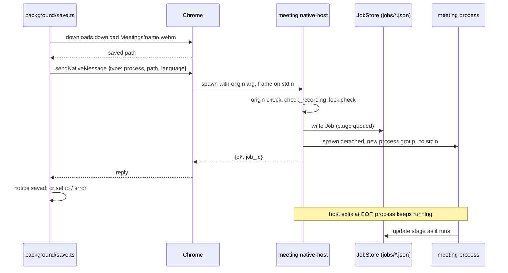

# Native messaging

Covers: crates/meeting/src/native.rs, crates/meeting/tests/native_host.rs, extension/src/shared/native.ts, extension/src/shared/nativeClient.ts, extension/src/background/save.ts, extension/src/popup/JobsTab.tsx, extension/src/popup/useJobs.ts

The extension talks to the `meeting` binary through Chrome native messaging. Chrome starts `meeting <origin>` (no subcommand: the host manifest can't add arguments; `chrome_args` in `main.rs` turns it into `native-host <origin>`) per `chrome.runtime.sendNativeMessage` call; the host answers and exits at end of input. See [../architecture.md](../architecture.md), [processing.md](processing.md), [setup.md](setup.md).

## Host and wire format

| Item | Value |
|---|---|
| Host name | `com.meeting_manager.host` (`NATIVE_HOST` in `native.ts`, `HOST_NAME` in `doctor.rs`) |
| Launch | `meeting native-host [origin]` (`Command::NativeHost` in `main.rs`); Chrome passes only `chrome-extension://<id>/`, which `chrome_args` rewrites to `native-host <origin>` |
| Permission | `nativeMessaging` in `extension/manifest.config.ts` |
| Frame | 4-byte native-endian `u32` length, then UTF-8 JSON (`read_frame`, `write_frame`) |
| Max request | 1 MiB (`MAX_REQUEST_BYTES`); larger gets `bad_request`, then the host stops |
| Loop | `native::serve` answers one reply per request frame until stdin closes |
| Types | snake_case on the wire; request tag is `type` |

## Request handling order (`dispatch`)

- Invalid JSON: `bad_request`.
- Config failed to load and request is not `health`: `not_configured` (message names `meeting install`).
- Config loaded: origin must equal `chrome-extension://<config.extension_id>/`, else `bad_request`. A `None` origin also fails.
- Unknown `type` or bad fields: `bad_request`.
- With no config, `health` skips the origin check and reports why.
- Only the message type is logged, never content.

## Messages

| Request (`type`) | Fields | Success reply | Notes |
|---|---|---|---|
| `process` | `path`, `language` (`bn`\|`en`) | `{ok, job_id}` | `start_checked`; spawns `meeting process` |
| `retry` | `job_id` | `{ok, job_id}` | Same as `process` on the old job's recording, no `--language`; `job_id` is the new job |
| `list_jobs` | `limit` | `{ok, jobs: JobSummary[]}` | Newest `started_at` first via `JobStore::list` |
| `open` | `job_id`, `what` (`summary`\|`folder`) | `{ok}` | Runs `/usr/bin/open` on `summary_path` or the recording's parent dir |
| `health` | none | `{ok, checks: {name, ok, fix}[]}` | `doctor::checks`, same list as `meeting doctor` ([setup.md](setup.md)) |

`JobSummary` (`native.ts`) mirrors `jobs::Job`: `job_id`, `recording`, `title`, `stage`, `error`, `started_at`, `updated_at`, `summary_path`. Optional fields are `null`, never omitted. Stages: `queued`, `extracting`, `transcribing`, `summarising`, `writing`, `done`, `failed`.

## Errors

Error reply: `{ok: false, code, message}`.

| Code | When |
|---|---|
| `bad_request` | Bad JSON, unknown type, bad field (e.g. language `fr`), wrong or missing origin, oversized frame |
| `not_configured` | No or invalid config |
| `invalid_path` | `check_recording` failed: not absolute, not `.webm`, missing, not a file, outside `recordings_dir` (after canonicalising, so symlinks out are refused) |
| `already_processing` | `lock::is_held` on the recording's lock; no job is written |
| `unknown_job` | Id missing from the store, or not `[A-Za-z0-9-]+` (stops path traversal) |
| `missing_file` | `open` target no longer exists, or `summary_path` is null |
| `host_missing` | Client only, not a wire code: Chrome says "Specified native messaging host not found"; `sendNative` returns `HOST_MISSING_MESSAGE` |

- A failed spawn is still `{ok: true, job_id}`: the job is written as `failed` with error `queued: cannot start meeting process: ...`.
- A truncated frame or I/O error exits the host with an error (no reply).

## Hand-off of a saved recording

- `spawn_process` runs `<exe> process <recording> [--language bn|en] --job-id <id>` with `process_group(0)` and null stdio, so the job outlives the host.
- `saveRecording` maps replies via `noticeFor`: `ok` gives `saved`; `host_missing` or `not_configured` gives a `setup` notice; anything else is `error`. A thrown error becomes "Could not reach the meeting tool: ...".
- `process` is only sent when the recording ran at least `MIN_PROCESS_MS` (10 s, `background/recordingControl.ts`); otherwise `saveRecording` returns the `too_short` notice.

## Popup Jobs tab

| Piece | Behaviour |
|---|---|
| `useJobs` | Sends `list_jobs` with `limit: 10` on mount and every 3 s (`POLL_MS`); clears the timer on unmount |
| Ordering | Each fetch gets an increasing id; a reply older than one already applied is dropped |
| View states | `loading`, `ready` (jobs), `error` (reply message, or "Could not reach the meeting tool: ...") |
| Row | Title (or file name), local start time, stage, error text when `failed` |
| Buttons | `done` with `summary_path`: Open summary; `done`: Open folder; `failed`: Retry |
| Actions | `JobsTab.run` sends `open` or `retry`; a failed reply shows its `message` in a status line; a successful `retry` calls `refresh()` |

The popup does not call `health`; no extension code sends it.

## Tests

`crates/meeting/tests/native_host.rs` runs the real binary with a temp `HOME`:

- `list_jobs_round_trip_over_stdio`: framed `list_jobs` returns a job from the jobs dir.
- `process_and_retry_outlive_the_host`: `process` replies in under 1 s; a stub `ffmpeg` that fails shows the job reaching `failed` (`extracting: ffmpeg failed...`) after the host exited; `retry` yields a new `job_id`.

Handler cases (origin, framing, path checks, locks, open) are unit tests in `native.rs`. Client parsing is covered by `extension/src/shared/nativeClient.test.ts`.
