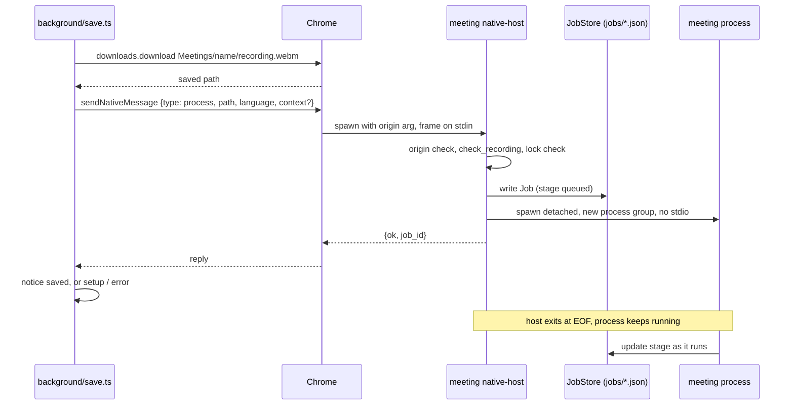

# Native messaging

Covers: crates/meeting/src/native.rs, crates/meeting/src/config.rs (`check_part`), crates/meeting/src/folders.rs, crates/meeting/src/spawn.rs, crates/meeting/src/context.rs, crates/meeting/tests/native_host.rs, extension/src/shared/native.ts, extension/src/shared/nativeClient.ts, extension/src/background/save.ts, extension/src/popup/JobsTab.tsx, extension/src/popup/useJobs.ts

The extension talks to the `meeting` binary through Chrome native messaging. Chrome starts `meeting <origin>` (no subcommand: the host manifest can't add arguments; `chrome_args` in `main.rs` turns it into `native-host <origin>`) per `chrome.runtime.sendNativeMessage` call; the host answers and exits at end of input. See [../architecture.md](../architecture.md), [processing.md](processing.md), [setup.md](setup.md).

## Host and wire format

| Item | Value |
|---|---|
| Host name | `com.meeting_manager.host` (`NATIVE_HOST` in `native.ts`, `HOST_NAME` in `doctor.rs`) |
| Launch | `meeting native-host [origin]` (`Command::NativeHost` in `main.rs`); Chrome passes only `chrome-extension://<id>/`, which `chrome_args` rewrites to `native-host <origin>` |
| Permission | `nativeMessaging` in `extension/manifest.config.ts` |
| Frame | 4-byte native-endian `u32` length, then UTF-8 JSON (`read_frame`, `write_frame`) |
| Max request | 1 MiB (`MAX_REQUEST_BYTES`); larger gets `bad_request`, then the host stops |
| Loop | `native::serve` answers one reply per request frame until stdin closes |
| Types | snake_case on the wire; request tag is `type` |

## Request handling order (`dispatch`)

- Invalid JSON: `bad_request`.
- Config failed to load and request is not `health`: `not_configured` (message names `meeting install`).
- Config loaded: origin must equal `chrome-extension://<config.extension_id>/`, else `bad_request`. A `None` origin also fails.
- Unknown `type` or bad fields: `bad_request`.
- `process_part` on a host built without `FEATURE_CONTINUE_RECORDING=1` (`Host.continue_recording` off): `bad_request` ("unknown request type process_part", no path echoed), like an unknown type. Being after the config check, an unconfigured flag-off host answers `not_configured`.
- With no config, `health` skips the origin check and reports why.
- Only the message type is logged, never content.

## Messages

| Request (`type`) | Fields | Success reply | Notes |
|---|---|---|---|
| `process` | `path`, `language` (`bn`\|`en`), optional `context` | `{ok, job_id}` | `start_checked`; spawns `meeting process`. With `Host.context` on (`FEATURE_MEETING_CONTEXT=1` build), a `context` is checked by `context::check` and written to `context.json` beside the recording before the job file; a missing, rejected or unwritable context is logged by rule name only and never changes the reply. `context::check` also accepts `platform: "desktop"` and a `calendar_event` (the desktop app's fields; the extension sends neither). Off: `context` is ignored. |
| `process_part` | `path` (absolute `recording-part-N.<ext>`), `language` (`bn`\|`en`) | `{ok, job_id}` | Continue flag on only. `config::check_part` gives the canonical `recording.<ext>` beside the part; a held lock is **not** refused (the continuation stops that run). Reuses the newest job of that recording from `JobStore::list` (updated in place: `queued`, `error` null, `started_at` and `title` kept), else a new job; spawns `meeting process <recording> --continue --language <l> --job-id <id>` (`spawn::continue_detached`). Shares `queue` with `process`, so a failed spawn behaves the same. |
| `retry` | `job_id` | `{ok, job_id}` | Same as `process` on the old job's recording, no `--language`, no `context` (an existing `context.json` stays); `job_id` is the new job |
| `archive` | `job_id` | `{ok}` | See [Archive](#archive) |
| `trash` | `job_id` | `{ok}` | See [Trash](#trash) |
| `list_jobs` | `limit` | `{ok, jobs: JobSummary[]}` | Newest `started_at` first via `JobStore::list` |
| `open` | `job_id`, `what` (`summary`\|`folder`) | `{ok}` | Runs `/usr/bin/open` on `summary_path` or the recording's parent dir |
| `health` | none | `{ok, checks: {name, ok, fix}[]}` | `doctor::checks`, same list as `meeting doctor` ([setup.md](setup.md)), so a `FEATURE_DESKTOP_APP=1` build adds `meeting_path` |

`JobSummary` (`native.ts`) mirrors `jobs::Job`: `job_id`, `recording`, `title`, `stage`, `error`, `started_at`, `updated_at`, `summary_path`. Optional fields are `null`, never omitted. Stages: `queued`, `joining` (continue flag on), `extracting`, `transcribing`, `summarising`, `writing`, `done`, `failed`.

## Archive

`archive` acts on the job's recording folder, never on a path from the extension. The host only looks the job up (`lookup_job`, step 1's first half) and maps the result to a reply; every other rule is `folders::archive(config, jobs, store, recording)`, which the desktop app will call with a recording path of its own.

1. Unknown or malformed `job_id` → `unknown_job`. Recording file gone → delete its jobs, reply `{ok: true}` (if the jobs cannot be deleted: `archive_failed`, or `trash_failed` for `trash`).
2. `check_recording` → `invalid_path`; folder already under `Archive/` → `invalid_path` ("already archived"); held lock → `already_processing`.
3. Rename the folder to `<recordings_dir>/Archive/<name>[-2, -3, ...]` (first free name).
4. Set `meta.json`'s `recording` (skipped if absent) to the moved file under its real name (`recording.m4a` stays `recording.m4a`), then `vault::repoint_note` rewrites the note's `recording:` and `transcript:` lines (skipped if no note), then `JobStore::remove_for` deletes every job for the recording.

A failure after step 3 replies `archive_failed`; the folder stays in `Archive/` and the jobs stay.

### Notes store

Only a host built with `FEATURE_DESKTOP_APP=1` (`Host.desktop`) opens the notes database at `Host.store_path` (`store::default_path`), once per `archive` or `trash` request, and passes it to `folders`. With the flag off no store file or directory is created.

- Archive: right after the rename in step 3, the row's recording path becomes the archived path (`Store::moved`), so it is right even when a later step fails.
- Trash: the row is removed (`Store::removed`) once the folder is in the Trash. The missing-file shortcut of either verb removes the row too.
- A refusal before the move (`invalid_path`, `already_processing`, a failed trash command) touches no row, and no row is ever created here.
- A store that cannot be opened or written never changes the reply: it is logged as `store open failed: <kind>`, `store moved failed: <kind>` or `store removed failed: <kind>` (`store::error_kind`, a fixed word) and the move goes on.

## Trash

`trash` runs the same steps 1–2 as `archive` (job lookup, missing-file shortcut, `check_recording`, held lock), except an archived recording is allowed. `folders::trash` then runs `/usr/bin/trash -s <folder>` (absolute path; `-s` makes a failed move exit non-zero) through the injected `Host::trash`, and `JobStore::remove_for` deletes every job for the recording. The vault note is untouched. `/usr/bin/trash` ships with macOS 15+; on older macOS the reply is `trash_failed` naming the missing command.

## Errors

Error reply: `{ok: false, code, message}`.

| Code | When |
|---|---|
| `bad_request` | Bad JSON, unknown type, bad field (e.g. language `fr`), wrong or missing origin, oversized frame |
| `not_configured` | No or invalid config |
| `invalid_path` | `check_recording` failed: not absolute, not `<recordings_dir>/<name>/recording.<ext>` or `<recordings_dir>/Archive/<name>/recording.<ext>` (ext one of `RECORDING_EXTENSIONS`: webm, mp4, m4a, mov, mkv, mp3, wav, ogg), missing, not a file, outside `recordings_dir` (after canonicalising, so symlinks out are refused). For `process_part`, `check_part` failed: not absolute, contains `..`, not `recording-part-N.<ext>` with N >= 2 (digits, no leading zero, lower-case ext from `RECORDING_EXTENSIONS`, `join::part_number`), missing, not a regular file (a symlinked part is refused), its folder a symlink, no `recording.<same ext>` that is a real file of the folder, folder not directly in `recordings_dir` (under `Archive/`, or nested) |
| `already_processing` | `lock::is_held` on the recording's lock; no job is written |
| `archive_failed` | `archive` failed after the check: the message names the step (`move`, `meta.json`, `vault note`, `jobs`) and the path; or the recording is gone and its jobs could not be removed, or `recordings_dir` could not be read |
| `trash_failed` | `trash` could not move the folder (command missing or non-zero exit): the message names the reason; nothing moved, jobs stay; or the folder is in the Trash but its jobs could not be removed (the message says so); or the recording is gone and its jobs could not be removed |
| `unknown_job` | Id missing from the store, or not `[A-Za-z0-9-]+` (stops path traversal) |
| `missing_file` | `open` target no longer exists, or `summary_path` is null |
| `host_missing` | Client only, not a wire code: Chrome says "Specified native messaging host not found"; `sendNative` returns `HOST_MISSING_MESSAGE` |

- A failed spawn is still `{ok: true, job_id}`: the job is written as `failed` with error `queued: cannot start meeting process: ...`.
- A truncated frame or I/O error exits the host with an error (no reply).

## Hand-off of a saved recording

- `spawn::process_detached` runs `<exe> process <recording> [--language bn|en] [--job-id <id>]` (the host always passes the job id) with `process_group(0)` and null stdio, so the job outlives the host. `<exe>` is `Host.exe`, the running binary; `PATH` is never used.
- `saveRecording` maps replies via `noticeFor`: `ok` gives `saved`; `host_missing` or `not_configured` gives a `setup` notice; anything else is `error`. A thrown error becomes "Could not reach the meeting tool: ...".
- `process` is only sent when the recording ran at least `MIN_PROCESS_MS` (10 s, `background/save.ts`); otherwise `saveRecording` returns the `too_short` notice.
- A continued part (flag on) is sent as `process_part {path, language}` with the Chrome-reported path of `recording-part-N.webm` beside the meeting's `recording.webm`, when the meeting total is at least 10 s; the replies map through the same `noticeFor`, so an old tool's `bad_request` shows as an error notice. See [recording.md](recording.md) Continue.

## Popup Jobs tab

| Piece | Behaviour |
|---|---|
| `useJobs` | Sends `list_jobs` with `limit: 10` on mount and every 3 s (`POLL_MS`); clears the timer on unmount |
| Ordering | Each fetch gets an increasing id; a reply older than one already applied is dropped |
| View states | `loading`, `ready` (jobs), `error` (reply message, or "Could not reach the meeting tool: ...") |
| Row | A card: title (or folder name; file name for a file not named `recording.<ext>`), a stage chip, local start time, error text when `failed`. The chip's text is the raw stage (capitalised by CSS); its `data-tone` comes from `TONE: Record<Stage, Tone>`: `queued`, `working` (`joining` to `writing`), `done`, `failed`; a stage this build does not know shows as `working` |
| Buttons | `done` with `summary_path`: Open summary; `done`: Open folder; `failed`: Retry; `done` and `failed`: Archive and Trash (two-step: the first click reads "Confirm trash" for 3 s, a second click in that time sends `trash`) |
| Actions | `JobsTab.run` sends `open`, `retry`, `archive` or `trash`; a failed reply shows its `message` in a status line; a successful `retry`, `archive` or `trash` calls `refresh()` |

The popup does not call `health`; no extension code sends it.

## Tests

`crates/meeting/tests/native_host.rs` runs the real binary with a temp `HOME`:

- `list_jobs_round_trip_over_stdio`: framed `list_jobs` returns a job from the jobs dir.
- `process_part_over_stdio_is_one_frame`: `process_part` gets exactly one frame and nothing else on stdout: `bad_request` in a flag-off build, `invalid_path` for the bogus path with the flag on; no job is written.
- `process_and_retry_outlive_the_host`: `process` replies in under 1 s; a stub `ffmpeg` that fails shows the job reaching `failed` (`extracting: ffmpeg failed...`) after the host exited; `retry` yields a new `job_id`.

Handler cases (origin, framing, path checks, locks, open, the store wiring) are unit tests in `native.rs`; the Archive and Trash rules are tested in `folders.rs`, the detached spawn in `spawn.rs`. Client parsing is covered by `extension/src/shared/nativeClient.test.ts`.
