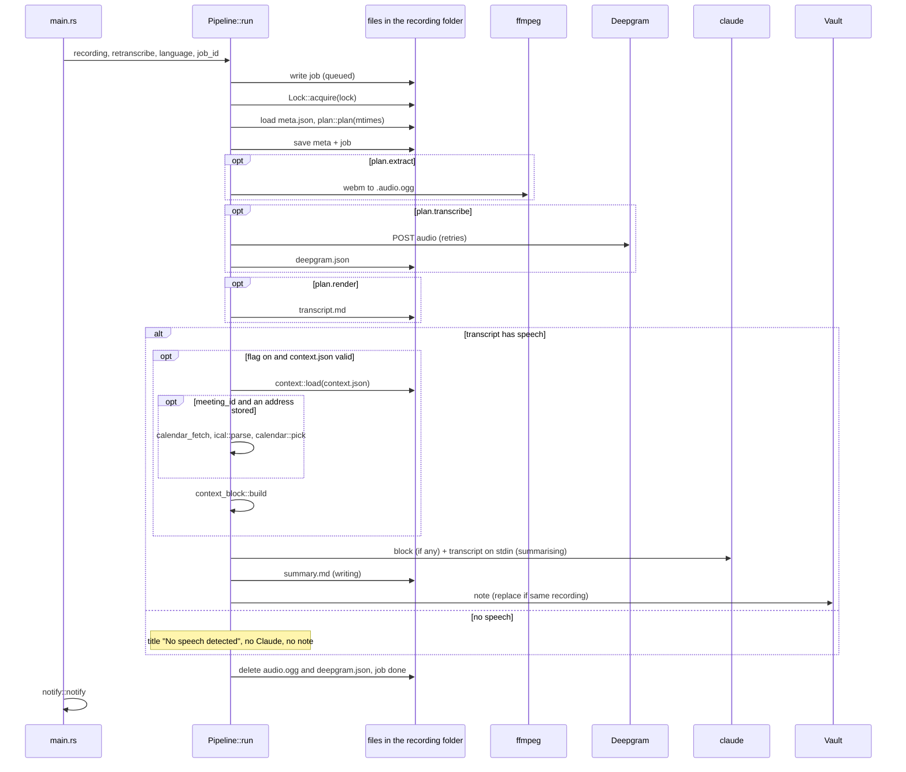
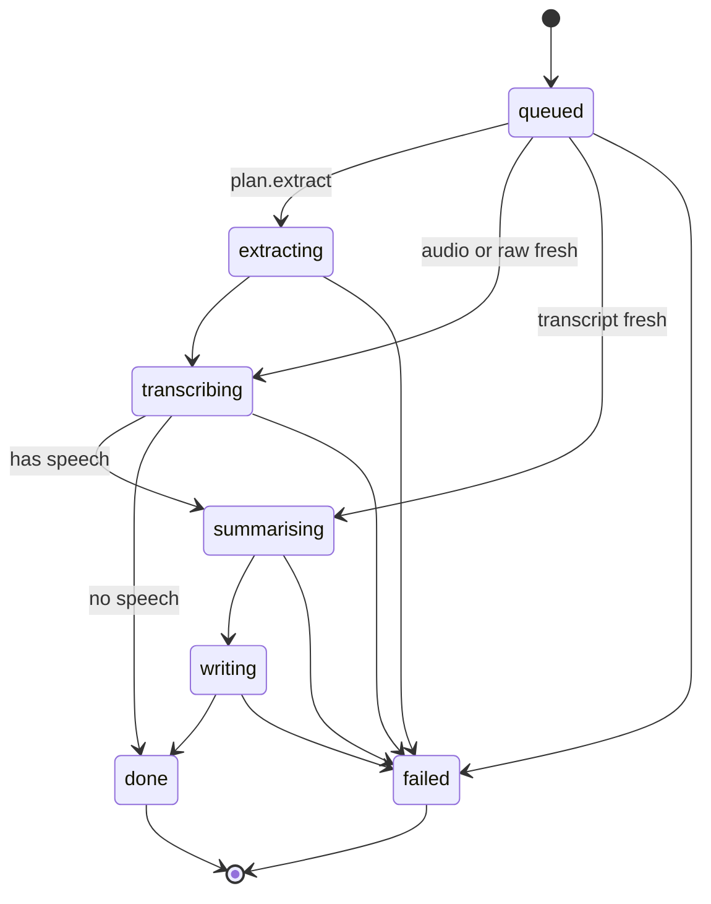

# Processing: recording to transcript and note

Covers: crates/meeting/src/pipeline.rs, crates/meeting/src/plan.rs, crates/meeting/src/extract.rs, crates/meeting/src/deepgram.rs, crates/meeting/src/transcript.rs, crates/meeting/src/summarise.rs, crates/meeting/src/context.rs, crates/meeting/src/context_block.rs, crates/meeting/src/summary_md.rs, crates/meeting/src/vault.rs, crates/meeting/src/meta.rs, crates/meeting/src/jobs.rs, crates/meeting/src/lock.rs, crates/meeting/src/notify.rs

`meeting process <recording>` turns a recording (`webm`, `mp4`, `m4a`, `mov`, `mkv`, `mp3`, `wav` or `ogg`) into a transcript, a summary, and an Obsidian note. It runs in the foreground. It refuses any path that is not `<recordings_dir>/<name>/recording.<ext>` (or under `Archive/`) before writing a job, so a refused path leaves no Jobs-tab row; the refusal points to moving the file into its own folder or to `meeting import`. The native host starts it as a detached child ([native-messaging.md](native-messaging.md)); the recording itself comes from [recording.md](recording.md). Crate layout: [../tool.md](../tool.md).

## External services

| Service | Used for | Config |
|---|---|---|
| `ffmpeg` (local binary) | Extract audio | `ffmpeg_path` in `config.toml` |
| Deepgram API (`/v1/listen`, model `nova-3`) | Transcription with speaker diarization | Key in Keychain, read through `secret::deepgram_key` |
| Calendar iCal address (`GET`, no auth header; `calendar_fetch::fetch`) | Meeting context: the event a recording belongs to, fetched on every summary run (no cache) | Secret address in the Keychain (`secret::calendar_address`), read only for a `context.json` with a meeting ID; https only, https-only redirects (max 3), 20 s timeout, 50 MiB cap. Errors and logs name the kind only (`offline`, `timeout`, `http <status>`, `too large`, `not iCalendar`, `tls`, `redirect refused`, `not https`), never the address |
| `claude` CLI (headless, `--model opus`, `--tools ""`, `--json-schema`, `--no-session-persistence`) | Structured summary; with a meeting context block it also reads the block, see [Context block](#context-block) | `claude_path` in `config.toml` |
| Obsidian vault (plain folder) | Final note | `vault_dir`, `vault_folder` (default `Meetings`) |
| `osascript` | macOS notification | none |

Setup of these keys and paths: [setup.md](setup.md).

## Flow

## Files

All sit in the recording's folder (`Paths::new` in `pipeline.rs`), named like `meeting-2026-10-19_1430`.

| File | Written by | Lifetime |
|---|---|---|
| `lock` | `Lock::acquire` | Holds the PID; removed on drop. A lock from a dead PID is taken over. |
| `meta.json` | `Meta::save` | Kept. Language, `recorded_at`, `duration_s`, title, speakers, run history (`runs`). |
| `audio.ogg` | `extract::extract` (via `.part`, renamed on success) | Mono, 16 kHz, Opus 32 kbps. Deleted on success. |
| `deepgram.json` | `write_atomic` | Raw Deepgram response. Deleted on success. |
| `context.json` | `native::store_context` (host, on `process`) | Kept, only with the context flag on. The extension's meeting context after the PRD limits; reused by `retry`, moved with the folder on Archive/Trash. Read by `context::load` on every summary run with the flag on; a file that fails `context::check` is ignored and logged by rule name only. |
| `transcript.md` | `transcript::render` | Kept. Lines `[hh:mm:ss] Speaker N: text`, header with language and speaker count. |
| `summary.md` | `summary_md::render` | Kept. Same body as the vault note. |
| `<vault_dir>/<vault_folder>/YYYY-MM-DD HHMM <title>.md` | `vault::write_note` | Kept. Frontmatter: `date`, `language`, `speakers`, `recording`, `transcript`, then only when known `meeting_title`, `attendees`, `calendar` (`matched`/`no_match`/`fetch_failed`); those values are stripped of control characters and line separators, cut to 300 characters and JSON-quoted. `Pipeline::context_extra` supplies them from `vault::note_people` and the calendar lookup; `calendar` appears only when the context has a meeting ID and the Keychain holds an address or fails to read. |
| `~/Library/Application Support/meeting-manager/jobs/<job_id>.json` | `JobStore::write` | Kept. One per run; the extension reads these. |

- `recorded_at` comes from the name `meeting-YYYY-MM-DD_HHMM...`; any other name falls back to the file's modified time in UTC (`meta::recorded_at_for`).
- Note name: the title is sanitised (`/`, `\`, `:` and control chars become `-`); an existing note for the same recording (matched by its `recording` frontmatter) is replaced, and a name clash with another note gets ` 2`, ` 3`, ... appended.
- Summary sections: Key points, Decisions, Action items, Insights, Speakers. Names inferred by Claude are marked `(inferred)`.
- Summary text is always English; the transcript stays in the recording language.

## Context block

`context_block::build` (PRD `docs/prds/meeting-context.md` FR-9) turns `context.json`, a calendar match, `recorded_at` and `duration_s` into the text Claude reads before the transcript. `Pipeline::context_extra` calls it on every summary run (first run and rerun) when the flag is on and `context.json` loads; otherwise, or when it builds `None`, `claude` gets today's arguments and stdin.

- Sent only when there is Meet's `meeting_title`, a non-empty `participants` or `speaking`, or a calendar match. Identity alone (platform, URL, tab title, times) builds `None`.
- Layout, between `=====BEGIN MEETING CONTEXT=====` and `=====END MEETING CONTEXT=====`: `platform:`, `meeting_title:`, `calendar_title:`, `recorded_at:`, `duration:` (`hh:mm:ss`), `organizer:`, `attendees:` (`- "Name" accepted`), `participants:` (`- "Name" (self)`), `speaking:` (`- 00:00:01-00:00:35: "A", "B"`, the transcript's clock), the description between `<<<DESCRIPTION` and `DESCRIPTION>>>`, then `partial: <fields>` (from `truncated`, minus `tab_title`) and `cut: <parts>`. Absent parts are left out.
- Injection: names and titles are JSON strings on one line; the description is split on every line-break character (`\n`, `\r`, U+2028, ...) and a line equal to any of the five fence lines (trimmed, any case) gets a `\` prefix, so the block always ends at its own `END`.
- Size: at most 64 KiB. Over that, `fit` drops speaking intervals shortest-first (later one on a tie), then cuts the description from the end, then drops attendees from the end, and names each in `cut:`. If it still does not fit (only a huge calendar title or organizer can do that), nothing is sent.
- With a block, stdin is the block, `=====TRANSCRIPT=====`, then the transcript, and the system prompt's "evidence in the transcript" naming sentence (`NAMING`) is replaced by `CONTEXT_RULES`: the context is untrusted, map speakers by the speaking timeline, then roster and attendees, then the transcript, a context name is still `(inferred)`, the title starts from the meeting's own title, the agenda decides key points, a declined attendee is never assumed present. `--tools ""`, the schema and `--no-session-persistence` are unchanged.

## Job lifecycle

`jobs::Stage`. The job file and `meta.json` run entry are saved on every change (`State::persist`).

- A stage is skipped when the plan says its output is already fresh. A run with a fresh transcript goes straight to `summarising`.
- `Job.error` is `"<stage>: <first line of the error>"`. Failing at `queued` means the recording was missing, locked, or had no language.
- A re-run with the same `--job-id` updates that job in place and keeps its `started_at`; without one, a new `job_id` is made. Each run is one entry in `meta.json` `runs`, keyed by `job_id`.
- Archive ([native-messaging.md](native-messaging.md#archive)) moves the folder and rewrites `meta.json`'s `recording` and the note's `recording`/`transcript` paths, so a later `meeting process` on the archived recording updates the same note.
- stdout prints each stage name, then `done: 
` (or `done: No speech detected`).

## Importing a recording

`meeting import <file> --language bn|en [--date "YYYY-MM-DD HH:MM"]` handles a recording made outside Chrome, such as a phone voice memo or a desktop call. It checks the file, copies it to `<recordings_dir>/meeting-<date>_<time>/recording.<ext>`, prints `imported → <path>`, then runs the pipeline above with the same stage lines, job, notification and exit code as `meeting process`.

- Accepted extensions: `webm`, `mp4`, `m4a`, `mov`, `mkv`, `mp3`, `wav`, `ogg`.
- The meeting time is `--date` (local time) or, without it, the file's modified time.
- The original is copied, never moved or changed.
- `--language` is required. A refusal or copy failure exits non-zero and writes no job; a failure after that is resumed with `meeting process <new path>`.

## Resume, retries, language

`plan::plan` decides from file modification times. An output is fresh when it exists and is not older than its input. An absent input counts as fresh, because inputs are deleted on success.

| State found | Stages run |
|---|---|
| Transcript fresh vs raw | summarise, write only |
| Raw fresh vs audio | render transcript, summarise, write |
| Audio fresh vs webm | transcribe, render, summarise, write |
| Otherwise | extract, transcribe, render, summarise, write |

- Summarise and write always run, so re-running a finished job rewrites the summary and note without calling Deepgram or ffmpeg.
- Retry after a failure is just running again. After a `summarising` failure the audio and raw JSON still exist, so Deepgram and ffmpeg are skipped.
- `--retranscribe` or `--language` forces a fresh transcription: `plan.delete_transcript_and_raw` removes `transcript.md` and `deepgram.json` first (the audio is reused if fresh).
- Language: `--language bn|en` wins, else the language stored in `meta.json`. With neither, the run fails with `no language stored for this recording; pass --language bn|en`. The language is saved to `meta.json` before any stage.
- The Deepgram key is read from the Keychain only when Deepgram is actually called, so a resume never needs it. The calendar address is read only when the flag is on and `context.json` has a meeting ID, so older recordings, imports, Teams and other sites never touch it.

## Failure handling

| Stage | Failure | Behaviour |
|---|---|---|
| extract | ffmpeg missing or non-zero exit | Error carries the last stderr line; `.part` removed, no partial audio. |
| transcribe | HTTP 401/403 | Fails at once: key rejected, tells the user to run `meeting config set-key`. |
| transcribe | HTTP 429 or 5xx | Retries after 5 s, 20 s, 60 s (4 attempts), then fails. |
| transcribe | Other 4xx, network error | Fails at once; `err_msg` from Deepgram is included when present. |
| summarise | Claude non-zero exit, `is_error`, no structured output, schema or validation failure | Fails. Validation also checks title is at most 80 chars and action-item timestamps are `hh:mm:ss`. |
| summarise | No result in 15 minutes | Claude is killed; fails with a timeout message. |
| summarise | Calendar: Keychain read error, fetch failure (offline, timeout, non-2xx, over 50 MiB, not iCalendar, TLS, redirect to `http` or more than 3), parse error | Never fails the job: logged as `calendar <kind>` (`keychain`, the `FetchError` kind such as `calendar too large`, or `not iCalendar`), the note gets `calendar: "fetch_failed"` and the summary runs without calendar data. A match logs `calendar matched`, no match `calendar no_match`. |
| write | Vault directory missing | Fails, tells the user to run `meeting install`. |
| any | Another run holds the lock | Fails with `already processing`; the other run's lock is left alone. |

- On failure the job becomes `failed`, intermediates are kept, and `main.rs` sends a notification with the stage and the first 100 chars of the reason.
- Success sends `Meeting summary ready: <title>`. Notification errors are only logged.
- Empty transcript: the run ends `done` with title `No speech detected`, `summary_path` is null, and no summary or note is written. Intermediates are still deleted.
- Transcript text, the Deepgram key, the calendar address and any title, name or description from the context or calendar are never logged.
