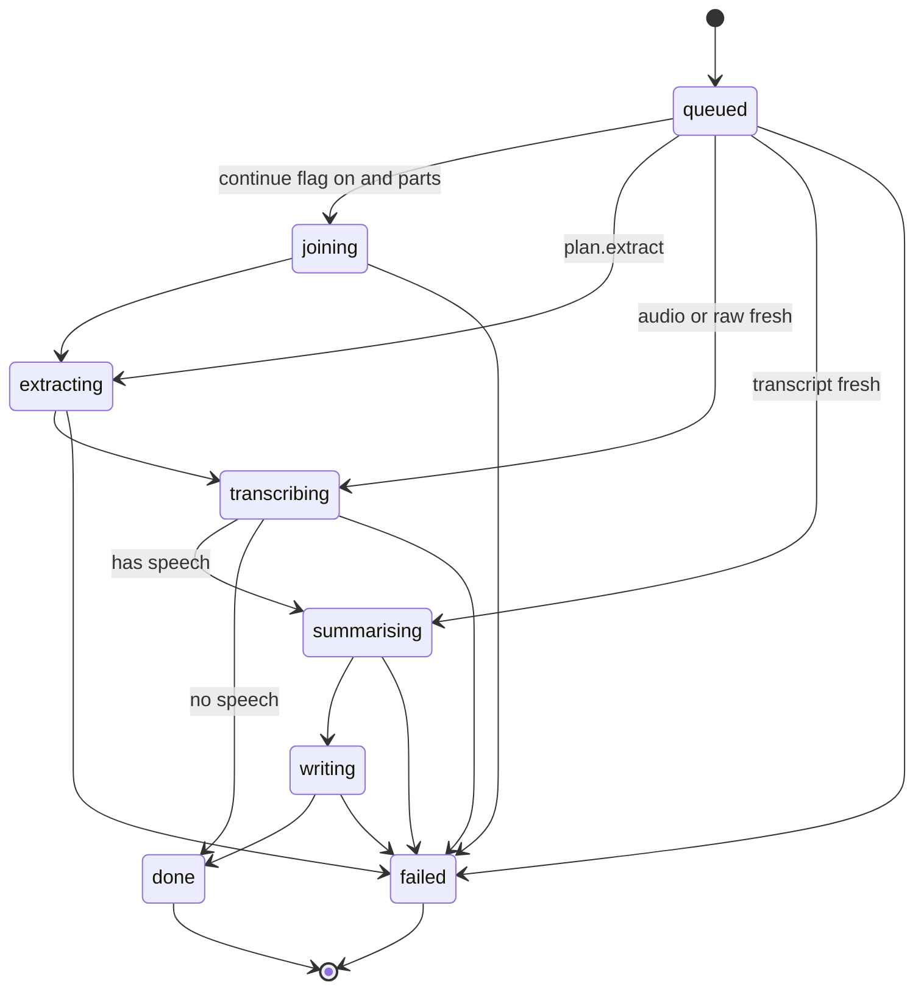

# Processing: recording to transcript and note

Covers: crates/meeting/src/pipeline.rs, crates/meeting/src/store.rs (as the pipeline uses it), crates/meeting/src/plan.rs, crates/meeting/src/extract.rs, crates/meeting/src/join.rs, crates/meeting/src/deepgram.rs, crates/meeting/src/transcript.rs, crates/meeting/src/summarise.rs, crates/meeting/src/context.rs, crates/meeting/src/context_block.rs, crates/meeting/src/summary_md.rs, crates/meeting/src/vault.rs, crates/meeting/src/meta.rs, crates/meeting/src/jobs.rs, crates/meeting/src/lock.rs, crates/meeting/src/notify.rs

`meeting process <recording>` turns a recording (`webm`, `mp4`, `m4a`, `mov`, `mkv`, `mp3`, `wav` or `ogg`) into a transcript, a summary, and an Obsidian note. It runs in the foreground. It refuses any path that is not `<recordings_dir>/<name>/recording.<ext>` (or under `Archive/`) before writing a job, so a refused path leaves no Jobs-tab row; the refusal points to moving the file into its own folder or to `meeting import`. The native host starts it as a detached child ([native-messaging.md](native-messaging.md)); the recording itself comes from [recording.md](recording.md). Crate layout: [../tool.md](../tool.md).

## External services

| Service | Used for | Config |
|---|---|---|
| `ffmpeg` (local binary) | Extract audio | `ffmpeg_path` in `config.toml` |
| Deepgram API (`/v1/listen`, model `nova-3`) | Transcription with speaker diarization | Key in Keychain, read through `secret::deepgram_key` |
| Calendar iCal address (`GET`, no auth header; `calendar_fetch::fetch`) | Meeting context: the event a recording belongs to, fetched on every summary run (no cache) | Secret address in the Keychain (`secret::calendar_address`), read only for a `context.json` with a meeting ID; https only, https-only redirects (max 3), 20 s timeout, 50 MiB cap. Errors and logs name the kind only (`offline`, `timeout`, `http <status>`, `too large`, `not iCalendar`, `tls`, `redirect refused`, `not https`), never the address |
| `claude` CLI (headless, `--model opus`, `--tools ""`, `--json-schema`, `--no-session-persistence`) | Structured summary; with a meeting context block it also reads the block, see [Context block](#context-block) | `claude_path` in `config.toml` |
| Obsidian vault (plain folder) | Final note | `vault_dir`, `vault_folder` (default `Meetings`) |
| `osascript` | macOS notification | none |

Setup of these keys and paths: [setup.md](setup.md).

## Flow

```mermaid
sequenceDiagram
    participant M as main.rs
    participant P as Pipeline::run
    participant FS as files in the recording folder
    participant X as ffmpeg
    participant D as Deepgram
    participant C as claude
    participant V as Vault
    M->>P: recording, retranscribe, language, job_id, continuing
    opt --continue (continue flag on)
        P->>FS: lock::stop_holder (stop the earlier run, reuse its job id)
    end
    P->>FS: write job (queued)
    P->>FS: Lock::acquire(lock)
    P->>FS: load meta.json, context.json (either flag on)
    opt desktop flag on
        P->>P: store start_run (row processing)
    end
    opt continue flag on and parts or a join journal (joining)
        P->>X: join recording + parts (stream copy)
    end
    P->>FS: plan::plan(mtimes; a join forces re-transcription)
    P->>FS: save meta + job
    opt plan.extract
        P->>X: webm to .audio.ogg
    end
    opt plan.transcribe
        P->>D: POST audio (retries)
        P->>FS: deepgram.json
    end
    opt plan.render
        P->>FS: transcript.md
    end
    alt transcript has speech
        opt context flag on and context.json valid
            alt desktop flag on and calendar_event present
                Note over P: the event is the match, no Keychain read, no fetch
            else meeting_id and an address stored
                P->>P: calendar_fetch, ical::parse, calendar::pick
            end
            P->>P: context_block::build
        end
        P->>C: block (if any) + transcript on stdin (summarising)
        P->>FS: summary.md (writing)
        opt desktop flag on
            P->>P: store merge_run (row done, edits kept)
        end
        P->>V: note from the merged row, else from Claude's output (replace if same recording)
    else no speech
        Note over P: title "No speech detected", no Claude, no note (row no_speech)
    end
    P->>FS: delete audio.ogg and deepgram.json, job done
    M->>M: notify::notify
```

## Files

All sit in the recording's folder (`Paths::new` in `pipeline.rs`), named like `meeting-2026-10-19_1430`.

| File | Written by | Lifetime |
|---|---|---|
| `lock` | `Lock::acquire` | Holds the PID; removed on drop. A lock from a dead PID is taken over; `--continue` stops a live holder first, see [Continuing](#continuing). |
| `meta.json` | `Meta::save` | Kept. Language, `recorded_at`, `duration_s`, title, speakers, run history (`runs`), `parts_joined` (0 when absent), and `joining_parts` with `joining_size` only while a join is in flight. |
| `recording-part-<N>.<ext>` | the extension or the desktop app (continue recording) | Only with the continue flag on: joined onto the recording and deleted, see [Joining parts](#joining-parts). |
| `audio.ogg` | `extract::extract` (via `.part`, renamed on success) | Mono, 16 kHz, Opus 32 kbps. Deleted on success. |
| `deepgram.json` | `write_atomic` | Raw Deepgram response. Deleted on success. |
| `context.json` | `native::store_context` (host, on `process`) | Kept, only with the context flag on. The extension's meeting context after the PRD limits; reused by `retry`, moved with the folder on Archive/Trash. Read by `context::load` once per run with either flag on; a file that fails `context::check` is ignored and logged by rule name only. The desktop app writes it too, with `platform: "desktop"` and an optional `calendar_event`; see [Notes store](#notes-store-desktop-flag-on). |
| `transcript.md` | `transcript::render` | Kept. Lines `[hh:mm:ss] Speaker N: text`, header with language and speaker count. |
| `summary.md` | `summary_md::render` | Kept. Always Claude's unedited output: the vault note's body, unless the note was edited in the desktop app. |
| `<vault_dir>/<vault_folder>/YYYY-MM-DD HHMM <title>.md` | `vault::write_note` | Kept. Frontmatter: `date`, `language`, `speakers`, `recording`, `transcript`, then only when known `meeting_title`, `attendees`, `calendar` (`matched`/`no_match`/`fetch_failed`); those values are stripped of control characters and line separators, cut to 300 characters and JSON-quoted. `Pipeline::context_extra` supplies them from `vault::note_people` and the calendar lookup; `calendar` appears only when the context has a meeting ID and the Keychain holds an address or fails to read. |
| `~/Library/Application Support/meeting-manager/jobs/<job_id>.json` | `JobStore::write` | Kept. One per run; the extension reads these. |

- `recorded_at` comes from the name `meeting-YYYY-MM-DD_HHMM...`; any other name falls back to the file's modified time in UTC (`meta::recorded_at_for`).
- Note name: the title is sanitised (`/`, `\`, `:` and control chars become `-`); an existing note for the same recording (matched by its `recording` frontmatter) is replaced, and a name clash with another note gets ` 2`, ` 3`, ... appended.
- Summary sections: Key points, Decisions, Action items, Insights, Speakers. Names inferred by Claude are marked `(inferred)`.
- Summary text is always English; the transcript stays in the recording language.

## Notes store (desktop flag on)

With `FEATURE_DESKTOP_APP=1` in the tool build (`Pipeline.desktop`), every run also writes the recording's row in the notes store (`store.rs`, `notes.sqlite`; PRD `docs/prds/desktop-app.md` FR-12, FR-13, FR-19). Off, no store file or directory is created and `claude`'s arguments and stdin and the note bytes are unchanged.

| When | Store call | Row |
|---|---|---|
| Lock held, `meta.json` and `context.json` read | `start_run` | `processing`, `failed_stage` and `error` cleared; `source`, `recorded_at`, language, `attendees` |
| `writing`, after `summary.md` | `merge_run`, then `set_vault_note_path` | `done`: title, `body_md` (the summary without its `# title` line), speakers, language, `duration_s`, transcript (the utterance lines), event link, `attendees`, note path |
| No speech | `merge_run` | `no_speech`, title `No speech detected`, empty transcript, no body, `attendees` |
| Any failure after the lock | `merge_run` from `State::fail` | `failed`, `failed_stage` (the stage name) and `error` (the first line of the reason, without the stage prefix); an earlier title, body, speakers and transcript stay; `attendees` is rewritten |

- A run refused before the lock is held (bad path, missing recording, `already processing`) never touches the row.
- `source` is `browser` for `recording.webm`, `desktop` when a valid `context.json` has `platform: "desktop"`, else `import`.
- Reruns keep edits: `merge_run` keeps a title, body or speaker name edited in the app and never changes "My notes". The vault note is then written from the merged row (`vault::compose_body`: `# <title>`, the body, `## My notes` when not empty; `speakers` from `store::shown_name`), so the note file follows an edited title. Job title, notification and `done` title are the note's title. `summary.md` and `meta.json` keep Claude's output.
- `calendar_event` in `context.json` becomes the row's `event` (`occurrence_id`, `series_id`, `title`, `start`, `end`, `calendar`), with the context flag on or off. With the context flag also on it is the calendar match: the Keychain is not read, nothing is fetched, and the context block and the note's `meeting_title`, `attendees` and `calendar: "matched"` are built as from an iCal match, even when the context also has a meeting ID. The event's `calendar` name goes only to the store. With the desktop flag off the event is ignored.
- `calendar_event` limits (`context::check`): an empty or over-255-character `occurrence_id` or `series_id`, a `start` or `end` that is not ISO 8601 with an offset, or a wrong type, missing or unknown field drops only the event (logged as `calendar_event dropped: <rule>`). `title` is cut to 300 characters, `organizer`, `calendar` and attendee names to 100, `description` to 20,000, attendees to 200, and an attendee whose name contains `@` is removed; any cut lists `calendar_event` in `truncated` (so the block says `partial: calendar_event`).
- `attendees` (`context::attendee_names`, PRD `docs/prds/note-view-upgrades.md` FR-3) is read from `context.json`, with the context flag on or off: the `calendar_event` attendees who did not decline, else the `participants` roster (`self` included); trimmed, blanks skipped, cut to 100 characters, deduplicated ignoring case (first spelling kept), at most 200, in file order. It is `[]` when the file is missing or fails a rule (only the rule is logged, by `context::load`). Every run rewrites it from the current file. It is never sent to Claude or written to the vault by this feature (the note's own `attendees:` frontmatter still needs the context flag).
- A store that cannot be opened or written never fails the run: it is logged as `store open|start|merge|note path failed: <kind>` (`store::error_kind`) and the note is written from Claude's output.

## Context block

`context_block::build` (PRD `docs/prds/meeting-context.md` FR-9) turns `context.json`, a calendar match, `recorded_at` and `duration_s` into the text Claude reads before the transcript. `Pipeline::context_extra` calls it on every summary run (first run and rerun) when the flag is on and `context.json` loads; otherwise, or when it builds `None`, `claude` gets today's arguments and stdin.

- Sent only when there is Meet's `meeting_title`, a non-empty `participants` or `speaking`, or a calendar match (from the iCal address, or a desktop `calendar_event`). Identity alone (platform, URL, tab title, times) builds `None`.
- Layout, between `=====BEGIN MEETING CONTEXT=====` and `=====END MEETING CONTEXT=====`: `platform:`, `meeting_title:`, `calendar_title:`, `recorded_at:`, `duration:` (`hh:mm:ss`), `organizer:`, `attendees:` (`- "Name" accepted`), `participants:` (`- "Name" (self)`), `speaking:` (`- 00:00:01-00:00:35: "A", "B"`, the transcript's clock), the description between `<<<DESCRIPTION` and `DESCRIPTION>>>`, then `partial: <fields>` (from `truncated`, minus `tab_title`) and `cut: <parts>`. Absent parts are left out.
- Injection: names and titles are JSON strings on one line; the description is split on every line-break character (`\n`, `\r`, U+2028, ...) and a line equal to any of the five fence lines (trimmed, any case) gets a `\` prefix, so the block always ends at its own `END`.
- Size: at most 64 KiB. Over that, `fit` drops speaking intervals shortest-first (later one on a tie), then cuts the description from the end, then drops attendees from the end, and names each in `cut:`. If it still does not fit (only a huge calendar title or organizer can do that), nothing is sent.
- With a block, stdin is the block, `=====TRANSCRIPT=====`, then the transcript, and the system prompt's "evidence in the transcript" naming sentence (`NAMING`) is replaced by `CONTEXT_RULES`: the context is untrusted, map speakers by the speaking timeline, then roster and attendees, then the transcript, a context name is still `(inferred)`, the title starts from the meeting's own title, the agenda decides key points, a declined attendee is never assumed present. `--tools ""`, the schema and `--no-session-persistence` are unchanged.

## Job lifecycle

`jobs::Stage`. The job file and `meta.json` run entry are saved on every change (`State::persist`).



- A stage is skipped when the plan says its output is already fresh. A run with a fresh transcript goes straight to `summarising`.
- `Job.error` is `"<stage>: <first line of the error>"`; with the desktop flag on the store row gets the same stage and reason. Failing at `queued` means the recording was missing, locked, or had no language.
- A re-run with the same `--job-id` updates that job in place and keeps its `started_at`; without one, a new `job_id` is made. Each run is one entry in `meta.json` `runs`, keyed by `job_id`.
- Archive ([native-messaging.md](native-messaging.md#archive)) moves the folder and rewrites `meta.json`'s `recording` and the note's `recording`/`transcript` paths, so a later `meeting process` on the archived recording updates the same note.
- stdout prints each stage name, then `done: <summary path>` (or `done: No speech detected`).

## Joining parts

Continue recording (PRD `docs/prds/continue-recording.md` FR-10, FR-11, FR-14). Only with `FEATURE_CONTINUE_RECORDING=1` in the tool build (`Pipeline.continue_recording`); off, parts are never looked for and every run is as above.

- Under the lock, before the plan, `Pipeline::join_parts` lists `recording-part-<N>.<ext>` in the folder (`join::parts_of`; `join::part_number` is the one parser: N >= 2, digits, no leading zero, the recording's extension). Look-alikes (`recording-part-1.webm`, `recording-part-2.webm.part`, ...) are ignored. With no part and no journal nothing changes and no `joining` stage is shown.
- With parts the job enters `joining`; `join::join` checks each part opens in ffmpeg, then joins `recording.<ext>` and the parts in ascending N with the concat demuxer by stream copy (`webm` as `-f webm`, `m4a` as `-f ipod`; other formats are refused) into `recording.<ext>.part`, through the list file `recording.<ext>.join.txt`.
- A join forces re-transcription: `transcript.md` and `deepgram.json` are deleted as soon as the join returns, and the plan gets `retranscribe || joined > 0`, so a Retry without a language still transcribes the whole recording again; the same note and store row are updated, keeping edits as any rerun.
- Refused, with nothing changed: a part in another format (both names in the error), a part that is not a regular file (a symlink), a part ffmpeg cannot open (the error ends with the part's name), ffmpeg missing. Each part is opened by ffmpeg before the concat, because the concat demuxer skips a part it cannot open and still exits 0 (`-xerror` is not used: it fails valid m4a joins on AAC's non-monotonic DTS). A part whose streams differ from the recording's (say audio only after audio and video) is not detected; both surfaces record one layout. The job fails at `joining`; running again tries again. Without a stored language or `--language`, a run with parts fails at `queued`.
- Only the part count and seconds are logged.

The journal (`meta.json` `joining_parts` and `joining_size`) makes a crash at any point safe:

1. Write `recording.<ext>.part`, give it the recording's permission bits, fsync it.
2. Save `joining_parts` (the part names) and `joining_size` (the temp file's size) to `meta.json`.
3. Rename the temp file over `recording.<ext>`, fsync the folder.
4. Remove the list file, delete the parts in ascending N.
5. Clear the journal and add the count to `parts_joined`, in one save. A failure in recovery leaves the journal in place for the next run.

| A run finds | Crash was | It does |
|---|---|---|
| `joining_parts` and the temp file, or a recording whose size is not `joining_size` | before the rename: the original is intact (the temp file may have been removed by something else) | removes the temp file, the list file and the journal, then joins afresh |
| `joining_parts`, no temp file, the recording has `joining_size` | after the rename | deletes the listed parts (only names that are parts of this recording), clears the journal, counts them in `parts_joined`, and re-transcribes; nothing is joined twice |
| a temp file and no journal | before step 2 | overwrites the temp file in a fresh join |

## Continuing

`meeting process <recording> --continue` (continue flag on; built without it the flag is hidden and refused with `unexpected argument '--continue'`) is how a continuation starts its run at once instead of waiting for, or failing on, the earlier one. `spawn::continue_detached` starts it detached for the native host and the desktop app (`<exe> process <recording> --continue [--language bn|en] [--job-id <id>]`, own process group, null stdio).

Before the job is written, `lock::stop_holder` reads the PID in the folder's `lock`:

| Lock holds | What happens |
|---|---|
| nothing, garbage, a dead PID, a zombie, or this process | Nothing; `Lock::acquire` handles it as for any run. |
| a live process whose `ps` command line is not `meeting process <this recording>` (a reused PID, another recording, `meeting import`) | Nothing is signalled; the lock is removed as stale (log: `lock was stale`). |
| a live `meeting process` run of this recording | SIGTERM (`/bin/kill`) to its process group when it leads one (`pgid == pid`, as every spawned run does, so ffmpeg and `claude` end too), else to the PID alone (a run started from a shell shares the shell's group). After `stop_grace` (10 s) SIGKILL, then one more wait. Once it is gone the lock is removed and the run takes it as usual (log: `stopping earlier run: TERM`/`KILL`, `stopped earlier run`). |
| a holder still alive after SIGKILL | The run fails at `queued`, no job written: `cannot stop the earlier run (process <pid>); stop it and run again`. The lock is left. |

The identity check (`is_process_run`): ` process ` right after a word ending in `meeting`, then an absolute path, cut at the first ` --`, that canonicalises to the recording. A killed run never removes its own lock or writes again; the new run owns the job and the store row.

Without `--job-id`, `--continue` reuses the id of the newest job whose `recording` is this recording (`JobStore::list`), so the Jobs list keeps one row per meeting and `started_at` is kept; with no earlier job a new id is made.

A run killed while its starter lives on (the host, the desktop app) stays a zombie until reaped, so `stop_holder` reads `ps -o stat=` and counts a `Z` process as ended.

## Importing a recording

`meeting import <file> --language bn|en [--date "YYYY-MM-DD HH:MM"]` handles a recording made outside Chrome, such as a phone voice memo or a desktop call. It checks the file, copies it to `<recordings_dir>/meeting-<date>_<time>/recording.<ext>`, prints `imported → <path>`, then runs the pipeline above with the same stage lines, job, notification and exit code as `meeting process`.

- Accepted extensions: `webm`, `mp4`, `m4a`, `mov`, `mkv`, `mp3`, `wav`, `ogg`.
- The meeting time is `--date` (local time) or, without it, the file's modified time.
- The original is copied, never moved or changed.
- `--language` is required. A refusal or copy failure exits non-zero and writes no job; a failure after that is resumed with `meeting process <new path>`.

## Resume, retries, language

`plan::plan` decides from file modification times. An output is fresh when it exists and is not older than its input. An absent input counts as fresh, because inputs are deleted on success.

| State found | Stages run |
|---|---|
| Transcript fresh vs raw | summarise, write only |
| Raw fresh vs audio | render transcript, summarise, write |
| Audio fresh vs webm | transcribe, render, summarise, write |
| Otherwise | extract, transcribe, render, summarise, write |

- Summarise and write always run, so re-running a finished job rewrites the summary and note without calling Deepgram or ffmpeg.
- Retry after a failure is just running again. After a `summarising` failure the audio and raw JSON still exist, so Deepgram and ffmpeg are skipped.
- `--retranscribe` or `--language` forces a fresh transcription: `plan.delete_transcript_and_raw` removes `transcript.md` and `deepgram.json` first (the audio is reused if fresh).
- Language: `--language bn|en` wins, else the language stored in `meta.json`. With neither, the run fails with `no language stored for this recording; pass --language bn|en`. The language is saved to `meta.json` before any stage.
- The Deepgram key is read from the Keychain only when Deepgram is actually called, so a resume never needs it. The calendar address is read only when the flag is on and `context.json` has a meeting ID and no usable `calendar_event`, so older recordings, imports, Teams, other sites and desktop recordings started from an event never touch it.

## Failure handling

| Stage | Failure | Behaviour |
|---|---|---|
| join | ffmpeg missing, a part it cannot open, a non-zero exit; a part in another format or not a regular file | `recording.<ext>`, every part and `parts_joined` unchanged; temp and list files removed. Error carries the last stderr line or names the files. |
| extract | ffmpeg missing or non-zero exit | Error carries the last stderr line; `.part` removed, no partial audio. |
| transcribe | HTTP 401/403 | Fails at once: key rejected, tells the user to run `meeting config set-key`. |
| transcribe | HTTP 429 or 5xx | Retries after 5 s, 20 s, 60 s (4 attempts), then fails. |
| transcribe | Other 4xx, network error | Fails at once; `err_msg` from Deepgram is included when present. |
| summarise | Claude non-zero exit, `is_error`, no structured output, schema or validation failure | Fails. Validation also checks title is at most 80 chars and action-item timestamps are `hh:mm:ss`. |
| summarise | No result in 15 minutes | Claude is killed; fails with a timeout message. |
| summarise | Calendar: Keychain read error, fetch failure (offline, timeout, non-2xx, over 50 MiB, not iCalendar, TLS, redirect to `http` or more than 3), parse error | Never fails the job: logged as `calendar <kind>` (`keychain`, the `FetchError` kind such as `calendar too large`, or `not iCalendar`), the note gets `calendar: "fetch_failed"` and the summary runs without calendar data. A match logs `calendar matched`, no match `calendar no_match`. |
| write | Vault directory missing | Fails, tells the user to run `meeting install`. |
| any | Another run holds the lock | Fails with `already processing`; the other run's lock and store row are left alone. With `--continue` the other run is stopped first instead ([Continuing](#continuing)). |
| any | Notes store cannot be opened or written (desktop flag on) | Never fails the job: logged as `store <operation> failed: <kind>`; the note is written from Claude's output. |

- On failure the job becomes `failed` (and, with the desktop flag on, the store row), intermediates are kept, and `main.rs` sends a notification with the stage and the first 100 chars of the reason.
- Success sends `Meeting summary ready: <title>`. Notification errors are only logged.
- Empty transcript: the run ends `done` with title `No speech detected`, `summary_path` is null, and no summary or note is written. Intermediates are still deleted.
- Transcript text, the Deepgram key, the calendar address and any title, name or description from the context or calendar are never logged.
