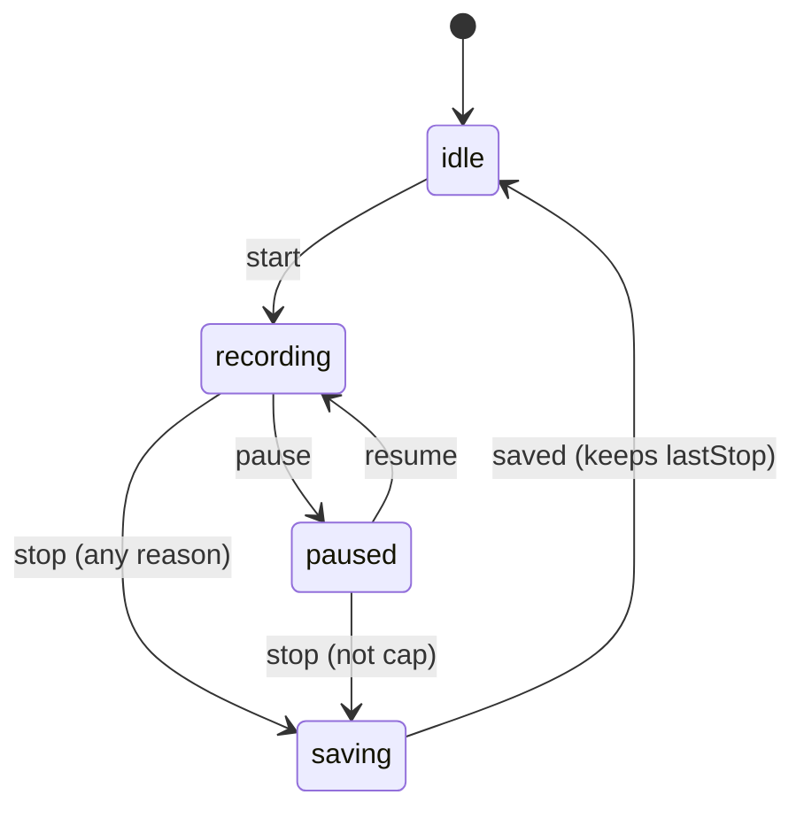
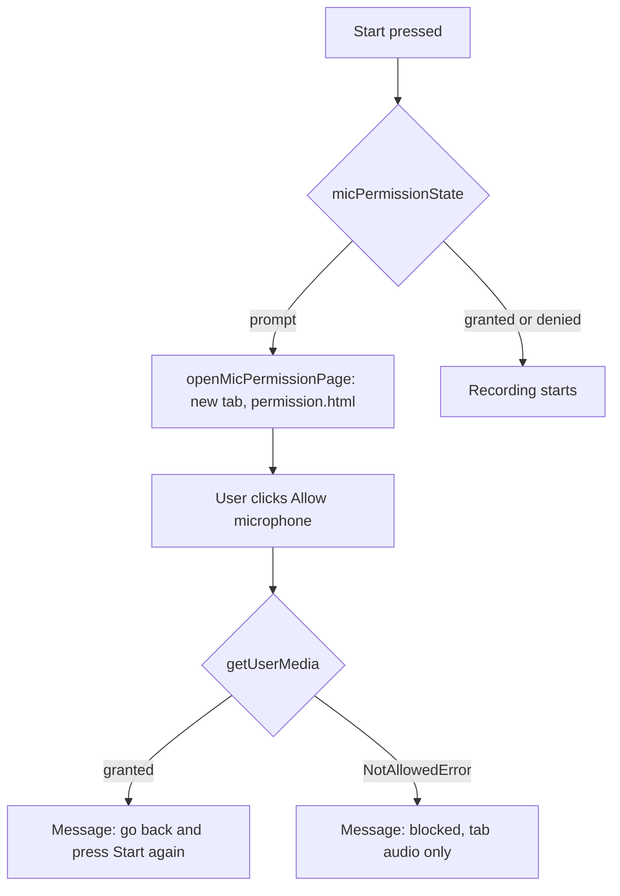

# Recording a meeting

Covers: extension/src/popup/RecordTab.tsx, extension/src/popup/useRecorderStatus.ts, extension/src/popup/Popup.tsx, extension/src/popup/main.tsx, extension/src/popup/index.html, extension/src/background/, extension/src/offscreen/, extension/src/permission/, extension/src/shared/messages.ts, extension/src/shared/recordingState.ts, extension/src/shared/recordingFile.ts, extension/src/shared/micPermission.ts

The user presses Start in the popup. The extension records the active tab and the mic, saves a `recording.webm` to `Downloads/Meetings/<name>/`, and asks the `meeting` tool to process it. Component overview: [extension.md](../extension.md). What happens after the hand-off: [processing.md](processing.md). Native call details: [native-messaging.md](native-messaging.md).

## Who does what

| Part | File | Responsibility |
|---|---|---|
| Record tab | `popup/RecordTab.tsx` | Large `H:MM:SS` timer (dimmed `0:00:00` when idle), round "Start recording" button, then REC (pulsing dot, static under Reduce motion) or Paused label with Pause / Resume and Stop & save, the "বাংলা \| English" radio group (disabled unless idle), "Saving…", messages, context line (flag on). Sends `PopupCommand`. |
| Status hook | `popup/useRecorderStatus.ts` | Live `RecorderStatus` from `chrome.storage.session`. |
| Context hook | `popup/useMeetingContext.ts` | Live `meeting_context` from `chrome.storage.session`, flag on only. |
| Control | `background/recordingControl.ts` | Owns state, badge, offscreen lifecycle, stop and save orchestration. |
| Recorder | `offscreen/recorder.ts` | `getUserMedia` for tab and mic, mix, `MediaRecorder`, chunk writes, 3 h cap timer. |
| File | `shared/recordingFile.ts` | `recordings/<startedAt>.webm` in the origin-private file system. |
| Save | `background/save.ts` | Download, delete temp file, native `process` call. With `FEATURE_MEETING_CONTEXT=1`, Start stores the tab identity in `storage.session` `meeting_context` and the `process` message carries it as `context` (trimmed to 256 KiB); the key is cleared after hand-off. Recovered recordings send none. |
| Context session | `background/contextSession.ts` | Flag on: sends `context_start` / `context_stop` to a Meet tab, keeps the recording segments and merges content-script batches into `meeting_context`. See [extension.md](../extension.md). |
| Recover | `background/recover.ts` | Re-save leftovers at browser start. |
| Mic page | `permission/MicPermission.tsx` | Grants mic permission once. |

## Start, stop, save

```mermaid
sequenceDiagram
  participant P as RecordTab
  participant SW as recordingControl
  participant O as offscreen recorder
  participant FS as OPFS file
  participant D as chrome.downloads
  participant T as meeting tool
  P->>SW: start {language}
  SW->>SW: mic permission == prompt? open permission page, return
  SW->>SW: tabCapture.getMediaStreamId(active tab)
  SW->>O: ensureOffscreen, then offscreen_start
  SW->>SW: status = recording (badge REC)
  SW->>SW: flag on: meeting_context with the first segment; Meet tab: context_start (2 s max)
  O->>O: tab stream + mic stream, mix, MediaRecorder(5 s chunks)
  O-->>SW: offscreen_started {micIncluded}
  loop every 5 s
    O->>FS: appendChunk
  end
  P->>SW: stop
  SW->>SW: status = saving, close the open segment
  SW->>O: offscreen_stop
  O->>FS: flush last chunk
  O-->>SW: offscreen_stopped {startedAt, reason}
  SW->>SW: Meet tab, not tab_closed: context_stop, merge the final batch (2 s max)
  SW->>O: offscreen_file_url
  O-->>SW: blob URL
  SW->>D: download Meetings/name/recording.webm
  D-->>SW: complete, absolute path
  SW->>SW: flag on: storage.local last_recording
  SW->>FS: deleteRecordingFile
  SW->>T: sendNative process {path, language, context?} (only if >= 10 s)
  T-->>SW: reply
  SW->>SW: status = idle + Notice, closeOffscreen
```

Rules:

- Start only works from `idle`. It records the active tab of the last focused window.
- Stop before `offscreen_started` is deferred: status becomes `saving`, and `offscreenStarted` sends `offscreen_stop` once the recorder is up.
- Pause and Resume before `offscreen_started` change the status at once; the recorder gets nothing until it is up, then `offscreenStarted` sends `offscreen_pause` if the status is `paused`.
- Segments (flag on): Start opens the first, pause sets its `wallEnd`, resume opens `{ wallStart, wallEnd: null, offsetMs: recordedMs }`, stop closes the open one (a `cap` or `capture_ended` stop in `offscreenStopped`, which also runs without `requestStop`). They map the content script's wall-clock speaking changes onto the recording clock.
- Recordings under `MIN_PROCESS_MS` (10 s) are saved but not sent to the tool (`Notice` `too_short`). Recovered recordings are always sent.
- Folder name: `recordingName(startedAt)` gives `meeting-YYYY-MM-DD_HHmm`; the recording is saved as `Meetings/<name>/recording.webm`. `nextFreeName` adds `-2`, `-3` for folder names Chrome's download history already has (`takenNames`). Folders Chrome did not create are invisible to this check, so `conflictAction: 'uniquify'` may produce `recording (1).webm` in the existing folder.
- The temp file is deleted only after the download completes. A failed delete is ignored.
- A save error keeps the temp file. It is retried by recovery at the next browser start.
- If the status already holds an `error` notice, the save result does not overwrite it.
- Last recording (`FEATURE_CONTINUE_RECORDING=1` only): after the download completes, and before the temp file is deleted, `saveRecording` writes `last_recording` to `chrome.storage.local` (`shared/lastRecording.ts`): download id, absolute path, folder name, recorded time, language, `stopped_at` (when `offscreenStopped` ran), stop reason, `parts: 1`. Short recordings are remembered too; a failed download writes nothing. Start removes it right after the status turns `recording`, so only the newest recording can be continued. A failed write or removal is logged with a fixed text and never fails the save or Start. `canContinue` (pure) allows a continuation while idle, within 2 h of `stopped_at` (inclusive), with the saved file still in Chrome's download history (`lastRecordingExists`) and under 3 h recorded. Flag off: nothing is read, written or removed.

## Stop reasons

| `StopReason` | Source |
|---|---|
| `user` | Stop & save button |
| `cap` | Offscreen timer, `RECORDING_CAP_MS` (3 h of recorded time, pauses excluded) |
| `tab_closed` | SW `tabs.onRemoved` for `status.tabId` |
| `capture_ended` | Tab video track `ended`, or a chunk write failed |

`offscreen_stopped.reason` is informational for state: the SW keeps the reason it set when it moved to `saving`. The popup shows `cap`, `tab_closed` and `capture_ended` as a message after the return to `idle` (`lastStop`).

## Recording state

Pure reducer: `transition()` in `shared/recordingState.ts`. An event not allowed in the current phase returns the same state object. Both the SW and the offscreen recorder use it.



- `elapsedMs` excludes paused time and is capped at `RECORDING_CAP_MS`.
- The cap timer is cleared on pause and re-armed on resume (`armCap`).
- The status the popup reads is `RecorderStatus` (`shared/messages.ts`) under `RECORDER_STATUS_KEY` in `storage.session`. The badge shows `REC` or `II`.
- The popup ticks its own clock each second while `recording`; it does not poll the SW.

## Audio and video capture

- Tab: `getUserMedia` with `chromeMediaSource: 'tab'` and the stream ID, video up to 1280x720.
- Mic: `getUserMedia({ audio: true })`. If it fails the recording is tab audio only and `micIncluded` is `false`; the popup shows a warning.
- Mixing: both audio sources feed one `AudioContext` destination. Tab audio is also routed to the speakers because tab capture mutes the tab. The mic is not.
- Output: `video/webm;codecs=vp8,opus` at 1 Mbit/s video, chunks every `CHUNK_MS` (5 s), each appended and closed so a crash keeps earlier chunks.
- A chunk write error emits `offscreen_error` and stops with `capture_ended`.

## Mic permission flow



- The page does not start a recording. The user must press Start again.
- `denied` does not open the page; the recording proceeds without mic.

## Recovery of leftovers

`recoverLeftovers()` (`background/recover.ts`) runs through `serial()` on `runtime.onStartup` and `runtime.onInstalled`, not on SW wake.

1. List `recordings/<digits>.webm`. Skip the file of a recording in progress (`status.state.startedAt`).
2. Delete empty files.
3. Create an offscreen document with reason `BLOBS`.
4. For each file: name `<recordingName>-recovered` (`recoveredName`, plus `nextFreeName`), then `saveRecording` with `process: true` and the last language from `storage.local` (`bn` if unset).
   Flag on, a saved leftover becomes `last_recording` with `stopped_at` = the recovery time, `stop_reason: null` and `recorded_ms` estimated as the file's last write minus its start (paused time included), capped at 3 h (`estimatedRecordedMs`).
5. Show each result as a `Notice` in the status. Close the offscreen document only if the status is still `idle`.

## Errors and notices

`Notice` kinds, shown in `RecordTab` (`role="status"`):

| Kind | Text source | Cause |
|---|---|---|
| `saved` | "Saved, sent for processing" | Native `process` accepted |
| `too_short` | "Under 10 seconds..." | Saved, not processed |
| `setup` | Reply message | Native code `host_missing` or `not_configured`. See [setup.md](setup.md) |
| `error` | Message | Capture, write, disk full (`FILE_NO_SPACE`), download or native failure |

- A failed Start (`resetWithError`) closes the offscreen document, resets to `idle` and sets an `error` notice. `start` also rethrows, which the SW logs.
- `offscreen_error` before `offscreen_started` resets like a failed Start. After it, only the notice is set and `offscreen_stopped` follows.
- If the popup cannot reach the SW, `RecordTab` shows "Could not reach the recorder".
- **Context line** (`FEATURE_MEETING_CONTEXT` on, phases `recording` and `paused` only; FR-5 in [meeting-context.md](../prds/meeting-context.md)): first in the status region, from `meeting_context`.

  | Platform, `capture` | Text |
  |---|---|
  | Meet, `reading` | "Meet: reading participants…" |
  | Meet, `captured` | "<meeting title or tab title> · N seen" (N = stored participants; "N seen" with no title); with N = 0 adds " · open the people panel to capture names" |
  | Meet, `unavailable` | "Meet details unavailable — names won't be captured. Recording is fine." plus " Reload the Meet tab next time." when `reloadHint`, otherwise " Open the people panel to capture names." |
  | Other | "<tab title> · names are captured on Google Meet only" (no prefix when the title is null) |

  The visible line is `aria-hidden`; a visually hidden sibling (`.srOnly`) carries state-only text ("Meet details captured" for captured, "Meet details captured · open the people panel to capture names" while 0 are seen), so screen readers hear state changes, not a rising N. `reloadHint` stays `true` after capture recovers, so it is read only while `unavailable`.
