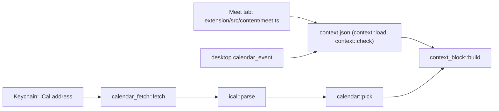

# Meeting context

Covers: crates/meeting/src/context.rs, crates/meeting/src/context_block.rs, crates/meeting/src/calendar.rs, crates/meeting/src/calendar_fetch.rs, crates/meeting/src/ical.rs

PRD: [context/meeting-context](../../prds/context/meeting-context.md). Behind `FEATURE_MEETING_CONTEXT` (`FLAGS.md`). Where the block enters the pipeline: [meeting-recorder.md](../recorder/meeting-recorder.md).

## Sources

| Module | Job |
|---|---|
| `context.rs` | Loads `context.json` next to the recording and checks it against the PRD's limits table: a reject rule drops the whole context, a cut rule trims the field and lists it in `truncated`. Only rule names are logged. A bad desktop `calendar_event` drops just the event |
| `calendar_fetch.rs` | Downloads the secret iCal address with `Policy::REAL`: https only, at most 3 redirects, 20 s, 50 MiB. `FetchError` holds no strings, so the address cannot leak through an error |
| `ical.rs` | Reads only what the match needs, keeps times raw (no time-zone conversion), and errors (never panics) on malformed input without echoing it |
| `calendar.rs` | `pick`: candidates by meeting ID, then the instance within 12 hours, else the latest series. Pure, no I/O, returns no email address |

The Meet side (roster, title, who is speaking, batching) is in [extension.md](../../extension.md). The pipeline fetches the calendar on every run when the flag is on, a meeting ID is known and an address is stored (`Pipeline` in `pipeline.rs`).

## Context block

`context_block::build` (PRD `docs/prds/context/meeting-context.md` FR-9) turns `context.json`, a calendar match, `recorded_at` and `duration_s` into the text Claude reads before the transcript. `Pipeline::context_extra` calls it on every summary run (first run and rerun) when the flag is on and `context.json` loads; otherwise, or when it builds `None`, `claude` gets today's arguments and stdin.

- Sent only when there is Meet's `meeting_title`, a non-empty `participants` or `speaking`, or a calendar match (from the iCal address, or a desktop `calendar_event`). Identity alone (platform, URL, tab title, times) builds `None`.
- Layout, between `=====BEGIN MEETING CONTEXT=====` and `=====END MEETING CONTEXT=====`: `platform:`, `meeting_title:`, `calendar_title:`, `recorded_at:`, `duration:` (`hh:mm:ss`), `organizer:`, `attendees:` (`- "Name" accepted`), `participants:` (`- "Name" (self)`), `speaking:` (`- 00:00:01-00:00:35: "A", "B"`, the transcript's clock), the description between `<<<DESCRIPTION` and `DESCRIPTION>>>`, then `partial: <fields>` (from `truncated`, minus `tab_title`) and `cut: <parts>`. Absent parts are left out.
- Injection: names and titles are JSON strings on one line; the description is split on every line-break character (`\n`, `\r`, U+2028, ...) and a line equal to any of the five fence lines (trimmed, any case) gets a `\` prefix, so the block always ends at its own `END`.
- Size: at most 64 KiB. Over that, `fit` drops speaking intervals shortest-first (later one on a tie), then cuts the description from the end, then drops attendees from the end, and names each in `cut:`. If it still does not fit (only a huge calendar title or organizer can do that), nothing is sent.
- With a block, stdin is the block, `=====TRANSCRIPT=====`, then the transcript, and the system prompt's "evidence in the transcript" naming sentence (`NAMING`) is replaced by `CONTEXT_RULES`: the context is untrusted, map speakers by the speaking timeline, then roster and attendees, then the transcript, a context name is still `(inferred)`, the title starts from the meeting's own title, the agenda decides key points, a declined attendee is never assumed present. `--tools ""`, the schema and `--no-session-persistence` are unchanged.
