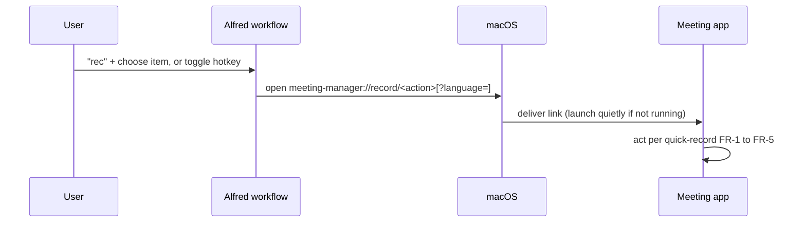

# PRD — Alfred workflow for quick record

**Status:** Approved · **Date:** 2026-11-19 · **Slug:** `alfred-workflow` · **Owner:** Siam · **Priority:** low · **Repo:** masnun-siam/meeting-manager

This document is the source of truth for this change, from request to delivery: the tasks and every issue are derived from it, and a decision that is not written here has not been made. Once `Approved` it is locked; a later change is a new PRD or task. What is live afterwards is in the business documentation (`docs/business/`). It builds on [quick-record.md](quick-record.md) (Approved) and changes none of its requirements; it uses the links that PRD defines, per [quick-record.md](quick-record.md) FR-1 to FR-3.

## Overview

A ready-made Alfred workflow, `Meeting.alfredworkflow`, published with every release. After a double-click to import it, typing `rec` in Alfred lists the recorder actions (toggle, start, pause, resume, stop), and one hotkey slot toggles recording. Each action opens the desktop app's existing `meeting-manager://record/…` link; nothing in the app changes.

Today:
- The desktop app handles five links, `meeting-manager://record/start`, `/stop`, `/pause`, `/resume`, `/toggle`, with `?language=bn|en` on `start` and `toggle` (quick-record FR-1 to FR-3, FR-12). A link that does not apply in the current state does nothing.
- The quick record guide explains the links and how to put them on Raycast Quicklinks with a hotkey (quick-record FR-11). That is the closest pattern: the launcher only opens a link; all behaviour is in the app.
- Each release publishes `Meeting.app.tar.gz`, its `.sig` and `latest.json` from a pushed `vX.Y.Z` tag.
- There is no Alfred support: an Alfred user has to build their own workflow by hand from the guide's link table.

## Problem

An Alfred user (rather than a Raycast user) has no ready way to start or stop a recording from the keyboard. Building a workflow by hand means wiring seven objects and typing the links correctly; a typo fails silently, because unknown links do nothing (quick-record FR-12).

## Users

Siam, the single user of the desktop app on their own Mac (desktop-app Users), using Alfred 5 with the Powerpack (Alfred workflows need it). No roles, no other accounts.

## Goals

- Import one file from the release and start, pause, resume or stop a recording from Alfred without opening Meeting.
- Put toggle on a hotkey by recording a key, with no other setup.
- The workflow's links can never drift from the links the app accepts.

## Non-goals

- Any change to the desktop app, its link scheme, the recorder or the floating pill. New actions need a new quick-record-style PRD first.
- A state-aware list (hiding Pause when idle, showing the timer): links stay one-way (quick-record non-goals), so the list is static (D3).
- Publishing to Alfred Gallery or Packal, or an auto-update mechanism for the workflow; a newer release's file is re-imported by hand.
- A Raycast extension (quick-record D3 stands for Raycast).
- Support for Alfred without the Powerpack, or Alfred versions before 5.
- Hotkeys assigned by default, or hotkey slots for actions other than toggle (D5).
- Scripts in the workflow: it uses only Alfred's built-in objects (D7).
- Changes to the Chrome extension, the `meeting` CLI or processing.

## Requirements

- **FR-1 Workflow file.** Every release publishes `Meeting.alfredworkflow` as a release asset next to the app. It imports into Alfred 5 by double-click, under the name "Meeting", by "Masnun Siam", with the app's icon, a one-line description ("Start, pause, resume and stop Meeting recordings") and version equal to the release's `X.Y.Z`. Its bundle id is `com.masnunsiam.meeting-manager.alfred`, so importing a newer release replaces the older one instead of adding a copy.
  - Acceptance: download the asset from release `vX.Y.Z`, double-click → Alfred shows the import sheet named "Meeting", version `X.Y.Z`, with the Meeting icon; importing the next release's file updates the same workflow.
- **FR-2 Keyword action list.** Typing the keyword `rec` in Alfred shows exactly these seven items, in this order, filterable by typing after the keyword:

  | Title | Subtitle | Opens |
  |---|---|---|
  | Toggle recording | Start when idle, stop when recording or paused | `meeting-manager://record/toggle` |
  | Start recording | In the last used language | `meeting-manager://record/start` |
  | Start recording in English | Language: English | `meeting-manager://record/start?language=en` |
  | Start recording in Bangla | Language: Bangla | `meeting-manager://record/start?language=bn` |
  | Pause recording | Pause a running recording | `meeting-manager://record/pause` |
  | Resume recording | Resume a paused recording | `meeting-manager://record/resume` |
  | Stop recording | Stop and save | `meeting-manager://record/stop` |

  Choosing an item opens its link through macOS, which hands it to Meeting; the app then behaves exactly as quick-record FR-2 to FR-5 say (including the quiet cold launch). The keyword can be changed by the user in Alfred.
  - Acceptance: with Meeting quit, `rec`, choose "Start recording in English" → a recording starts with language `en`, no Meeting window; `rec stop` + Enter → state `saving`; `rec pause` while idle → nothing happens and nothing is shown.
- **FR-3 Toggle hotkey slot.** The workflow has one hotkey trigger, unassigned on import, wired to `meeting-manager://record/toggle`. After the user records a key for it in Alfred, pressing the key toggles recording.
  - Acceptance: import, record ⌃⌥R on the hotkey, press it → recording starts; press again → state `saving`.
- **FR-4 Links match the app.** Every `meeting-manager:` link in the workflow is one the app acts on (never ignored per quick-record FR-12), and all seven links of FR-2 are present. A change that breaks this fails CI before merge.
  - Acceptance: change one link in the workflow source to `meeting-manager://record/start?language=fr` → the desktop Rust test run fails naming that link; restore it → passes.
- **FR-5 Alfred guide.** The quick record guide gains an Alfred section: Powerpack needed, where to download the file, how to import it, the `rec` keyword and its items, how to set the toggle hotkey, and how to change the keyword. README's quick-record line mentions Alfred.
  - Acceptance: following the guide on a Mac with Alfred 5 Powerpack and Meeting installed, the toggle hotkey starts a recording.

*The workflow only opens a link; everything after macOS is the existing quick-record behaviour.*

## Edge cases

- **Meeting not installed or never opened.** macOS has no handler for `meeting-manager:` and shows its own "no application set to open the URL" error; the guide says to install and open Meeting once first (as the existing guide does for Raycast).
- **Action that does not apply** (pause while idle, start while recording, anything while saving): the app does nothing and shows nothing (quick-record FR-2, FR-3). The workflow shows no confirmation of its own.
- **Concurrency.** Two items or hotkey presses in quick succession are two links; the app serialises them (quick-record Edge cases). The workflow adds no state.
- **Older app.** An app older than quick record (v0.3.0) has no handler; the guide states the minimum app version.
- **Workflow from an older release.** Its links are a subset of what newer apps accept, since the scheme is unchanged; a re-import updates it in place (FR-1).
- **Keyword clash.** If another workflow also uses `rec`, Alfred shows both; the user can change the keyword (FR-5).
- **Empty states.** None: the list is static.
- **Access and data isolation.** Single user, own Mac. The workflow carries only the seven links: no paths, notes, tokens or meeting data, and it reads nothing. It cannot do more than any other app opening those links (quick-record Threats).
- **Existing data.** None to migrate. A hand-built workflow the user already has is untouched; importing ours adds a separate workflow.

## Technical design

### Data

Not affected: no store, settings, config, meeting folder or log change. The workflow source holds no data beyond the seven links (public).

### API

Not affected: the workflow is a client of the existing link contract (quick-record "API › Links"), which does not change. The workflow's own contract is FR-2's table.

**Release asset (FR-1).** `Meeting.alfredworkflow` is added to the GitHub Release beside `Meeting.app.tar.gz`, `Meeting.app.tar.gz.sig` and `latest.json`. `latest.json` and the updater are unchanged and do not reference it.

### Backend

- **Workflow source (FR-1 to FR-3).** Kept in the repo, under `desktop/`, as plain, reviewable files: Alfred's `info.plist` (objects, connections, metadata) and the icon copied from the app's icon. It uses only Alfred built-in objects: one List Filter (keyword `rec`, the seven items of FR-2, each item's argument its link), one Hotkey trigger (unassigned), and Open URL actions that open the link they receive or, for the hotkey, the toggle link (D7, D8). No script object. The `version` in source is a placeholder; the release writes the real one.
- **Packing (FR-1, D6).** `release.yml`, after the version check, lints the workflow's `info.plist` with `plutil -lint`, writes the tag's `X.Y.Z` into its `version`, zips the source folder's contents (not the folder) into `Meeting.alfredworkflow`, and passes it to `gh release create` as a fourth asset. A lint failure fails the release before anything is published, like the existing version check.
- **Drift check (FR-4, D9).** A Rust test in the desktop crate reads the workflow source, extracts every `meeting-manager:` link, runs each through the app's existing link parser and fails, naming the link, if any is ignored; it also fails unless the seven FR-2 links are all present. No new crate: string extraction, not a plist parser. The `tool` CI workflow's path filter also triggers on the workflow source folder so a workflow-only change runs the test.

### Frontend

Not affected (no app UI change). The "UI" is Alfred's list, specified by FR-2.

### Realtime and other components

None. The app, the `meeting` tool, the extension and the updater are unchanged. Docs that change with it: the quick record guide (FR-5), README, `docs/README.md`'s guides line, and `docs/development.md`'s release asset list.

### Non-functional

- Alfred 5 with Powerpack on macOS 14.4+ (the app's minimum); Meeting v0.3.0 or later.
- The packed file stays under 1 MB (the icon is the only binary).

### Threats and mitigations

Recordings are confidential (desktop-app Data), but the workflow touches none; it only opens links.

| Threat | Mitigation |
|---|---|
| A tampered workflow file that opens other links or runs code | Built in CI from reviewed source and downloaded from the repo's own release over HTTPS, like the app; it has no script object (D7), and Alfred's import sheet shows its objects |
| A workflow starting a recording unnoticed | Same as any link: the pill, menu-bar mark and macOS indicators show it (quick-record D10) |

### Testing

| FR | Test |
|---|---|
| FR-4 | Rust test of the workflow source against the link parser (all links accepted, seven present); CI |
| FR-1 | Release: `plutil -lint` before packing; manual: import the asset from a test tag's release, check name, version, icon, bundle id; re-import replaces |
| FR-2, FR-3 | Manual on a Mac with Alfred 5 Powerpack and a bundled Meeting: each of the seven items in idle, recording and paused; cold launch from an item; record a toggle hotkey and press it twice |
| FR-5 | Manual: follow the guide from a clean Alfred install |

## Rollout and cost

- No feature flag (D10): the workflow lives outside the app; the user opts in by importing it. Nothing changes for anyone who does not.
- No provider cost.
- Release: the first release after merge carries the file; its tag notes mention it.
- Rollback: delete the workflow in Alfred; a release without the asset is harmless.
- Watch after release: the app log's `link ignored` lines (should stay at zero from Alfred).

## Success metrics

None formally defined. Informally: recordings are started and stopped from Alfred without opening the window.

## Epics

- **E1 Alfred workflow for quick record** — covers FR-1 to FR-5. Issue: #250

## Decisions

- 2026-11-19 **D1 Monorepo, base `main`, PRD flat in `docs/prds/`** — as quick-record D1; no `staging` branch exists. Decided by: Siam, "Monorepo, base main (Recommended)" (quick-record D1, unchanged).
- 2026-11-19 **D2 Ship a ready-made workflow: source in the repo, packed into `Meeting.alfredworkflow` and attached to every release** — one double-click to import; differs from quick-record D3 (no launcher code) for Alfred only, because Alfred has no equivalent of Raycast Quicklinks with hotkeys. Decided by: Siam, "Workflow file + release (Recommended)".
- 2026-11-19 **D3 One keyword, a static list of all actions** — links are one-way (quick-record non-goals), so state awareness would need a new interface; a link that does not apply does nothing. Decided by: Siam, "One keyword, action list (Recommended)" and "Static list (Recommended)".
- 2026-11-19 **D4 Default keyword `rec`** — short; changeable in Alfred. Decided by: Siam, "rec (Recommended)".
- 2026-11-19 **D5 One unassigned hotkey trigger, for toggle** — one key starts and stops, like the guide's Raycast example; shared workflows ship hotkeys unassigned. Decided by: Siam, "Toggle only (Recommended)".
- 2026-11-19 **D6 The release stamps the tag's version into the workflow** — no fourth version to bump; follows the one-version rule (desktop-app D46). Decided by: Siam, "Stamp tag version (Recommended)".
- 2026-11-19 **D7 Items open their link with Alfred's built-in Open URL action, no script** — nothing to maintain or audit; the manual test confirms macOS routes the custom scheme to Meeting. Decided by: Siam, "Alfred's Open URL action (Recommended)".
- 2026-11-19 **D8 Seven items: toggle, start, start English, start Bangla, pause, resume, stop** — every link and language variant of quick-record FR-1. Decided by: Siam, following D3's "One keyword, action list (Recommended)" (item set proposed in that option).
- 2026-11-19 **D9 CI drift check: a desktop Rust test runs every workflow link through the app's link parser; the release lints the plist** — no new crate. Decided by: Siam, "Rust test + plutil lint (Recommended)".
- 2026-11-19 **D10 Priority low, no feature flag, one epic** — additive and opt-in by import. Decided by: Siam, "Low, no flag, 1 epic (Recommended)".
- 2026-11-19 **D11 Business doc: a new rule R-5 in the quick-record business doc** — same feature, same links, beside R-4. Decided by: Siam, "New rule in quick-record doc (Recommended)".

## Open questions

None.

## Related

- [quick-record.md](quick-record.md) FR-1 to FR-5, FR-11, FR-12, D3, D10.
- [desktop-app.md](desktop-app.md) D46 (one version), release assets (FR-24).
- Business doc: [docs/business/desktop/quick-record.md](../business/desktop/quick-record.md) R-5.
- [docs/guides/quick-record.md](../guides/quick-record.md), [docs/development.md](../development.md) › Releasing.
