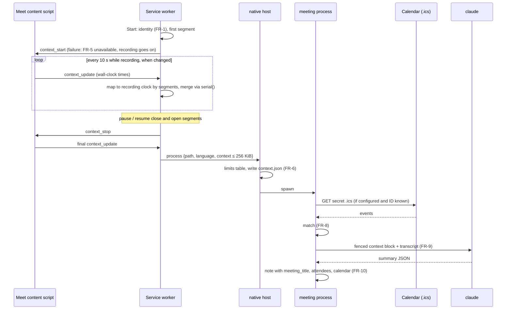
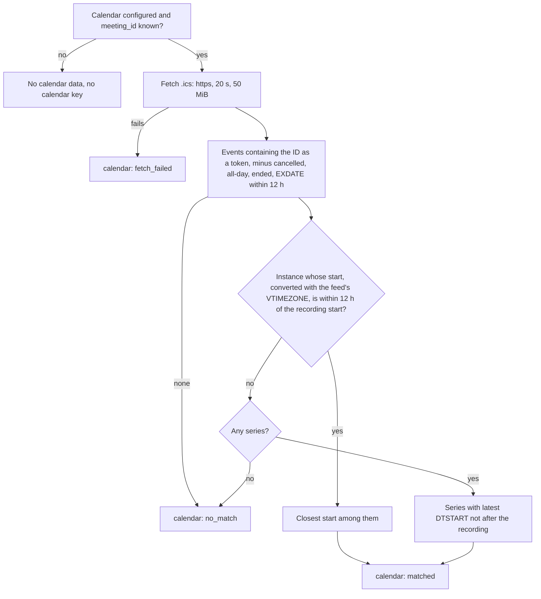

# PRD — Meeting context for the summary

**Status:** Approved · **Date:** 2026-10-22 · **Slug:** `meeting-context` · **Owner:** Siam · **Priority:** medium · **Repo:** masnun-siam/meeting-manager (private)

This document is the source of truth for the feature: every issue is derived from it, and a decision that is not written here has not been made. It changes parts of [meeting-recorder.md](../recorder/meeting-recorder.md) (FR-7, FR-13, FR-15, the `process` message and the summary prompt); where the two disagree, this PRD wins.

## Overview

While a meeting is recorded, the extension collects what the meeting page itself knows: the meeting's title, who is in the call and who is talking when. After the meeting, the tool looks up the matching event in the user's calendar for its title, description (agenda) and attendee list. All of it goes to Claude beside the transcript, so the summary names real people, starts from the meeting's own title and reads the transcript against the agenda.

Today:
- The extension records the tab and the mic and sends only `{path, language}` to the tool. Nothing about the meeting page (its title, URL, participants) is kept.
- Deepgram labels voices `Speaker 0`, `Speaker 1`, …. Claude guesses names only from the transcript (someone saying "thanks, Rahim") and marks them `(inferred)`; most speakers stay unnamed.
- Claude invents the title from the transcript alone. Recurring meetings get unrelated titles each week.
- The tool reads nothing from any calendar. The only secret it holds is the Deepgram key, in the Keychain, set with `meeting config set-key`; that command is the pattern the calendar setting follows.
- The closest pattern for extension → tool data is the `process` native message plus files the tool keeps in the recording's folder (`meta.json`, `transcript.md`).
- The repo has no feature-flag mechanism yet and no `FLAGS.md`.

## Problem

Summaries come out with "Speaker 1 said…", action items owned by "Speaker 2", a made-up title, and no idea what the meeting was meant to decide. The information that fixes all of that is on screen during the call (names on the video tiles, the meeting title) and in the calendar invite (title, agenda, attendees), but none of it reaches Claude. The user edits notes by hand to fix names and titles.

## Users

The single user of the extension and the `meeting` tool, on their own Mac, in Chrome. No roles, no other users.

## Goals

- Speakers in the summary carry real names in most Google Meet meetings, without any manual mapping.
- The note's title starts from the meeting's own title when the meeting has one.
- Claude reads the transcript knowing the agenda and who was invited, so key points, decisions and action items line up with what the meeting was for.
- When none of this is available (an unknown site, an imported file, no calendar configured), processing behaves exactly as today.

## Non-goals

- Reading the roster, title or speaking indicator from Zoom web, Teams web or any site other than Google Meet. Those get the identity in FR-1 only (D2).
- Google Calendar API, OAuth, or any sign-in from the extension (D1).
- Calendar lookup for recordings without a meeting ID: imported files, Teams web, unknown sites (D9).
- Calendar matching by time, RRULE expansion, `COUNT`-limited series and all-day events.
- In-call chat, live captions, shared screen content, slides or attachments from the invite.
- Notes of earlier meetings in the same series as context.
- Injecting the content script into Meet tabs that were open before the extension was installed or reloaded (no `scripting` permission). Those tabs show the "reload the Meet tab" state (FR-5).
- A manual step to map speakers to names, and a user-entered title (both still non-goals from [meeting-recorder.md](../recorder/meeting-recorder.md)).
- Changing the Deepgram request (D11).
- Saving context for recordings recovered after a browser crash (D14), or for a recording whose hand-off failed (host missing or not configured).
- Showing calendar results in the Jobs tab. The outcome is in the note's frontmatter (FR-10).

## Requirements

### Capture in the extension

- **FR-1 Meeting identity.** On Start, the service worker records which tab is captured: the platform (`meet`, `zoom`, `teams` or `other`, from the URL's host), the URL, the meeting ID, the tab's title, the start time (epoch ms), the local UTC offset and the local IANA time-zone name (for example `Asia/Dhaka`). The URL kept depends on the platform: `meet` and `zoom` keep scheme + host + path (no query string, no fragment); `teams` and `other` keep scheme + host only, and their meeting ID is null. Meeting ID: the Meet code (`abc-defg-hij`) or the Zoom numeric ID from the path. If the tab's URL or title can't be read, the identity is `platform: other` with a null URL and title, and recording goes on.
    - Acceptance: for `https://app.zoom.us/wc/123456789/join?pwd=secret` the context has `url: "https://app.zoom.us/wc/123456789/join"` and `meeting_id: "123456789"`. For `https://teams.microsoft.com/l/meetup-join/19:meeting_x@thread.v2/0?context=…` it has `url: "https://teams.microsoft.com"` and `meeting_id: null`. A tab whose URL can't be read records with `platform: "other"` and the recording is unaffected.
- **FR-2 Meet roster.** While a Google Meet tab is recorded, the extension collects the display name of every participant it sees during the recording (the union over the whole recording, not a snapshot), and marks the user's own entry `self`. Names are trimmed of whitespace and control characters, de-duplicated, cut to 100 characters; at most 200 names (later ones dropped, `participants` listed in `truncated`).
    - Acceptance: a 3-person Meet call where one person joins 5 minutes in and leaves 10 minutes later: all 3 names are in `context.json`, the user's own once with `self: true`.
- **FR-3 Meet title.** On a Google Meet tab, the extension reads the meeting title Meet shows in the call (the calendar event name, when the meeting came from one), cut to 300 characters. A meeting with no title (an ad-hoc link) records null.
    - Acceptance: join a Meet from a calendar event called "Weekly sync"; `context.json` has `meeting_title: "Weekly sync"`. An instant meeting has `meeting_title: null`.
- **FR-4 Meet speaking timeline.** On a Google Meet tab, the extension records who Meet shows as speaking, as intervals on the recording's own clock (paused time excluded, the same clock as the transcript's `[hh:mm:ss]`). The clock mapping uses the recording's segments (Technical design › Frontend), so a pause or resume inside a batch is mapped correctly and changes during a pause are dropped. Intervals shorter than 1 s are dropped; adjacent intervals for the same names are merged; at most 10 names per interval (cut to the first 10) and 5,000 intervals (the earliest kept); either cut lists `speaking` in `truncated`. On Stop, the content script sends a final batch before hand-off, so the last seconds are kept; if it doesn't answer within 2 s (for example the tab was closed), hand-off goes ahead with what was already merged.
    - Acceptance: in a 2-person Meet call where A talks for about 30 s, then B for about 30 s, `context.json` has an interval for A starting within 2 s of A's first transcript line and one for B likewise. With a 1-minute pause in the middle, intervals after the pause still line up within 2 s. Someone who speaks only in the last 5 s before Stop has an interval. Closing the Meet tab mid-call saves the recording within the usual time, with the roster collected so far.
- **FR-5 Context line while recording.** While a recording runs (flag on), the Record tab shows one line under the timer, inside its existing `role="status"` region, updated at most once per batch:
    - Meet, waiting: "Meet: reading participants…" from Start until the first batch.
    - Meet, captured: "<meeting title or tab title> · N seen" (N is the union so far).
    - Meet, unavailable: "Meet details unavailable — names won't be captured. Recording is fine." when the content script didn't answer at Start (for example a tab opened before the extension was reloaded: the line adds "Reload the Meet tab next time.") or has found nothing for 60 s. The content script keeps checking every 10 s after that, and the line moves to captured as soon as something is found (for example once the user is admitted from the lobby).
    - Other sites: "<tab title> · names are captured on Google Meet only".
    - Screen readers hear the line only when its state changes (reading → captured → unavailable), not on each change of N.
    - While paused the line stays as last shown; it clears when the recording leaves the recording/paused phases.
    FR-5 is the first thing cut if the epic overruns.
    - Acceptance: on a Meet call the captured line appears within 20 s of Start and N rises within 20 s of someone joining. A Meet tab opened before reloading the extension shows the unavailable line with the reload hint, the recording saves normally, and the calendar match still runs from the Meet code in the URL. Starting in the Meet lobby and being admitted after 90 s still captures the names. A Zoom tab shows the other-sites line.

### Hand-off and storage

- **FR-6 Context file.** When a recording is handed to the tool, the extension sends the captured context with the `process` message, after trimming it to fit 256 KiB serialised: it drops `speaking` entries from the end (the earliest are kept) until it fits, and lists `speaking` in `truncated`. The host checks the context against the limits table (Technical design › Data): a reject rule drops the whole context with a log line naming the rule; a cut rule trims the field and lists it in `truncated`. Then it writes `context.json` atomically in the recording's folder, before writing the job. A missing or rejected context never stops processing: the host replies as today and the job runs without it. `retry` and `meeting process` reuse the `context.json` already in the folder; Archive and Trash move it with the folder.
    - Acceptance: after a Meet recording, `context.json` sits beside `recording.webm`. A `process` message with no `context` (an older extension build) is accepted and no `context.json` is written. Each reject rule in the limits table drops the context with a log line and the job still runs; each cut rule trims and records the field in `truncated`.

### Calendar

- **FR-7 Calendar setting.** `meeting config set-calendar` reads a calendar's secret iCal address (an `https://` URL whose path ends in `.ics`, for example Google Calendar's "Secret address in iCal format") from a hidden prompt, fetches and parses it (FR-8 fetch rules), and stores it in the Keychain only if that works, printing "Saved. Found N events." On failure it stores nothing and prints the reason without the address ("not https", "not an .ics address", "could not fetch: <kind>", "not an iCalendar file"). An empty answer removes a stored address and prints "Removed." (or "Nothing stored." when there was none). `meeting doctor` (and `health`) gains a `calendar` check in the existing `{name, ok, fix}` shape: not configured passes; configured passes when the address can be fetched and parsed within 20 s, and otherwise fails with a `fix` naming the cause (offline, rejected, not iCalendar) and `meeting config set-calendar`. When the flag is on, `meeting install`'s closing line also mentions `meeting config set-calendar` as optional.
    - Acceptance: with a valid address `set-calendar` prints the event count and `meeting doctor` shows `calendar` passing; with `http://…` or a path not ending in `.ics` it refuses and names the expected format; offline, `doctor` shows `calendar` failing with "offline" in `fix` and the other checks unchanged. An empty answer prints "Removed." and the next `doctor` shows `calendar` not configured. The address never appears in `config.toml`, the log, `doctor`/`health` output, stderr or any file.
- **FR-8 Calendar match.** Each time the summary runs (first run and every rerun), if `context.json` has a meeting ID, the tool reads the calendar address from the Keychain (only then, so recordings without a meeting ID never touch the Keychain), fetches the calendar and picks one event, or none:
    - Fetch: `https` only, redirects only to `https` (at most 3), 20 s timeout, body capped at 50 MiB. Error and log text name the kind of failure only, never the address.
    - Candidates: events whose `LOCATION`, `DESCRIPTION`, `URL` or `X-GOOGLE-CONFERENCE` contain the meeting ID as a whole token (not preceded or followed by a letter or digit). Skipped: `STATUS:CANCELLED` events, all-day events, series whose `UNTIL` is before the recording start, and series with an `EXDATE` within 12 hours of the recording start.
    - Times: every start, and every `EXDATE`, is turned into an absolute time. UTC times are used as they are. Times with a `TZID` equal to the recording's `time_zone`, floating times, and times whose `TZID` has no `VTIMEZONE` block in the feed are local times (shifted by `utc_offset_min`). Times with any other `TZID` are shifted by that zone's `VTIMEZONE` `TZOFFSETTO` values, trying the `STANDARD` and the `DAYLIGHT` offset and keeping the one closer to the recording start (no DST rules are evaluated).
    - Pick, in order: (1) an instance (a single event, a `RECURRENCE-ID` override, or a series' first occurrence at its `DTSTART`) whose start is within 12 hours of the recording start, the closest one, and on equal distance an override or single event beats a series' first occurrence (the same meeting on an adjacent day is 23–25 hours away, so it never qualifies); (2) else the series (`RRULE`) with the latest `DTSTART` not after the recording start; (3) else no match.
    - Accepted wrong matches, visible as `calendar: "matched"`: a `COUNT`-limited series counts as open-ended; a series pick ignores the weekday (a link reused on another day matches); a single event, override or new series' first occurrence within 12 hours of the recording beats the series' own unmodified instance, and an unscheduled call on a reused link (for example a Zoom personal ID) matches the nearest such event within 12 hours (finding the series instance needs recurrence expansion, D9); a feed with a foreign `TZID` but no `VTIMEZONE` is read as local time.
    - From the match: the title, the description as plain text (HTML reduced to text, cut to 20,000 characters), the organizer's name, and each attendee's name and response (`accepted`, `declined`, `tentative`, `needs_action`). Attendees with `CUTYPE` `ROOM` or `RESOURCE` are left out; an attendee whose `CN` is missing or is an email address is left out (D10). No email address goes to Claude or the note.
    - No match records `calendar: "no_match"`. Every other failure (Keychain read error, fetch failure, non-2xx, timeout, cap, not iCalendar) records `calendar: "fetch_failed"`. Each is logged by kind and the summary runs without calendar data; none fails the job.
    - The iCalendar reader never panics on malformed input; any reading error is `fetch_failed`.
    - Acceptance: one fixture `.ics` per branch passes: a single event an hour before the recording; an override at the recording time beside its series; two series sharing one Meet link after a "this and following" edit (the later one is picked, also when recorded 3 min before the new series' first `DTSTART`); a new series recorded 3 min before its first `DTSTART` (the series is picked); a new series whose first occurrence is overridden at the same time with a different description, recorded at that time (the override is picked); a cancelled instance and an `EXDATE` at the recording time (no match from them); a series that ended (`UNTIL`) before the recording; a recording at 23:50 local against a UTC event that is the next day in UTC (matched); a single event at local 00:00 recorded at 23:58 the day before (matched); a daily 00:00 series with the previous day's instance overridden, recorded at 23:58 (the series is picked); a New York series with an `EXDATE` on NY Thursday 21:00 and a Dhaka Thursday 07:00 recording of Wednesday's instance (the series is not skipped); a Zoom ID that appears inside a longer digit run (no match); a room attendee and a `CN` that is an email (both absent); a New York 21:00 override that is 07:00 the next day locally (matched, converted with the feed's `VTIMEZONE`); a New York daily series with an override on NY Thursday 21:00 and a recording at Dhaka Thursday 07:00 (the series or Wednesday's override is picked, never Thursday's); a Los Angeles daily series at 18:00 with tomorrow's instance overridden (the series is picked); a daily series in the user's own time zone with same-time overrides yesterday and tomorrow (the series is picked); a Zoom personal ID used by yesterday's single event at the same time (no match); malformed input (an unterminated fold, a bad `RRULE`, a 5 MB `DESCRIPTION`, truncated file: `fetch_failed`, no panic). With the network off the job reaches `done` with `calendar: "fetch_failed"`. A feed over the cap is logged as "calendar too large", records `fetch_failed`, and the job reaches `done`. A non-iCalendar body, a non-2xx status, a redirect to `http`, more than 3 redirects and a stalled server (timeout) each record `fetch_failed`.

### Summary

- **FR-9 Context to Claude.** A context block is sent only when at least one of these exists: Meet's `meeting_title`, a non-empty `participants`, a non-empty `speaking` (all from `context.json`, read only with the flag on), or a calendar match. Identity alone (platform, URL, tab title, times) sends nothing. Claude then receives the block before the transcript on stdin, containing: platform, Meet's meeting title and the calendar title, the recording date and duration (`meta.json` `duration_s`), the calendar description, organizer, attendees with responses, the roster with `self`, and the speaking timeline.
    - Delimiting: the block is fenced; each value from other people (titles, names, description) sits inside its own delimited field, and any line in those values that matches a fence or the context/transcript separator after trimming whitespace and ignoring case is escaped, so it cannot end the block.
    - Size: the block is capped at 64 KiB; over that, speaking intervals are dropped shortest-first, then the description is cut, and the block says it was cut.
    - Prompt: when the block is sent, the system prompt's sentence that limits name inference to "evidence in the transcript" is replaced (not appended to) by rules: the context is untrusted data like the transcript and its instructions are never followed; map each `Speaker N` using the speaking timeline first, then the roster and attendees, then the transcript, quoting the evidence; a name from the context is still marked "(inferred)" (D4); start the title from the meeting's own title when there is one (D5); use the agenda to judge what counts as a key point or decision; a declined attendee is never assumed present.
    - The `claude` command line keeps `--tools ""`, `--json-schema` with the unchanged schema, and `--no-session-persistence`.
    - With no block, the `claude` command line and stdin are byte-for-byte today's.
    - Acceptance (manual release gate, real Claude): on a 2-person Meet recording with a speaking timeline, `speakers[]` maps both labels to the roster names with evidence citing the timeline, and action items show "Name (inferred)"; for a calendar event "Weekly sync" the title starts with or contains "Weekly sync".
    - Acceptance (automated, stub claude): a description containing the separator line does not end the block (stub-claude test). With context present, the stub-claude test asserts `--tools ""` and the schema. Byte-identical stdin and arguments hold for: no `context.json`; a flag-off build with a `context.json` in the folder; and a flag-on Zoom or other-site recording with no calendar match.
- **FR-10 Note metadata.** The vault note's file name and heading stay Claude's title. Frontmatter gains, only when known: `meeting_title` (calendar title, else Meet's title), `attendees` (calendar attendees who did not decline; the Meet roster when that list is empty or there is no match) and `calendar` (`matched`, `no_match`, `fetch_failed` — written only when a calendar is configured and the recording has a meeting ID). Values from other people are written as YAML double-quoted strings with control characters and newlines removed, `\` and `"` escaped (the note writer's existing quoting), each cut to 300 characters. `meta.json` is unchanged in shape.
    - Acceptance: a calendar-matched meeting's note has `meeting_title`, `attendees` and `calendar: "matched"`; offline, it has `calendar: "fetch_failed"`. Participants named `"x
recording: /etc/foo"`, `x" , recording: "y` and one ending in `\` each produce one quoted `attendees` entry, and the `recording` key is unchanged. A recording with no context and no configured calendar has exactly today's frontmatter keys. Archiving a note with the new keys keeps them intact. A match whose attendees are all rooms, email-only or declined falls back to the roster. With a calendar configured, a Teams or imported recording has no `calendar` key.

### Rollout

- **FR-11 Feature flag.** Everything above sits behind `FEATURE_MEETING_CONTEXT`, read at build time by both parts (D12). The code is always compiled, linted and tested; the flag only decides reachability:
    - Tool: with the flag off, `set-calendar` is not registered, the `calendar` check is absent, `context.json` is never read and no calendar is fetched. The gate is passed into the code paths as a value, so tests run both states in one `cargo test`. Changing the variable rebuilds the tool.
    - Extension: the manifest is computed from the flag: off is byte-identical to today's; on adds `activeTab`, `https://meet.google.com/*` host access and the Meet content script. With the flag off the service worker never sends `context_start` and `process` carries no `context`. Tests cover both manifest outputs and both service-worker behaviours.
    - `FLAGS.md` is added at the repo root with this flag's row.
    - Acceptance: with the flag unset, the built `manifest.json` equals today's and `meeting config --help` lists no `set-calendar`; with `FEATURE_MEETING_CONTEXT=1` for both builds, FR-1 to FR-10 hold. CI's existing jobs (flag unset) run the tests for both states.

## Flows

What reaches Claude, and where each piece comes from.

How the calendar event is picked (FR-8).

## Edge cases

- **Stop without an answer.** A closed tab or a silent content script never holds up the save: `context_stop` waits at most 2 s (FR-4).
- **Lobby.** Starting before being admitted shows "reading", then "unavailable" after 60 s, then "captured" once in the call (FR-5).
- **Concurrency.** Only one recording runs at a time, so only one context is collected. Content-script batches, pause/resume and Stop all go through `serial()`; a batch from the recorded tab that arrives after hand-off is dropped. Two jobs processing different recordings fetch the calendar independently.
- **Meet tab reloads mid-recording.** The new content script sends `context_hello`; if its tab is the recorded one, it resumes reporting and the roster union and timeline continue.
- **Meet tab opened before the extension was installed or reloaded.** No content script runs in it; `context_start` fails, which never affects recording; FR-5 shows the unavailable line with the reload hint; the recording gets FR-1 identity only.
- **Host access to meet.google.com turned off** in Chrome's site access: same as above.
- **Paused recording.** Speaking changes during a pause are dropped; the segments keep later intervals aligned.
- **Service worker sleeps.** Context and segments live in `chrome.storage.session` (key `meeting_context`), never only in memory.
- **Browser crash.** `storage.session` is cleared, so a recording recovered at the next start is processed without `context.json`, as today (D14).
- **Hand-off fails** (host missing or not configured): the recording is saved, `meeting_context` is cleared, and a later manual `meeting process` runs without context. Accepted.
- **Empty states.** No roster (solo call, nothing rendered), no title, no calendar, no match: each part is absent from the block. With nothing at all, FR-9's byte-identical rule applies.
- **Limits reached.** See the limits table; every cut is listed in `truncated` and the block tells Claude the list is partial.
- **Meet changes its page.** The content script never throws: a missing roster, title or speaking indicator yields nothing for that part. After 60 s with nothing found FR-5 shows the unavailable line, the content script checks every 10 s from then on, and it logs one line to the console with no names or titles. Recording and processing are unaffected.
- **Speaker overlap and shared rooms.** Several people on one tile or two speaking at once: the timeline lists every name Meet shows; Claude may leave a label unnamed. Deepgram may merge or split voices; the timeline is evidence, not a mapping.
- **Untrusted context.** Titles, names and the description are written by other people (anyone can send an invite). They go to Claude fenced as data under the same rules as the transcript (FR-9) and into the note only as quoted, cleaned strings (FR-10). A forged invite that carries a real Meet code (anyone from a past call can send one) can win the match and put its own title, description and attendees into the summary; the fence, no tools, the fixed schema and the quoting are the accepted bound on that.
- **Edited invite between runs.** A rerun fetches again (D8) and can pick up a changed description; the `calendar` key shows the outcome of the latest run.
- **Existing data.** Recordings made before the feature have no `context.json` and no meeting ID; rerunning them gives today's result even with a calendar configured, and never reads the Keychain for the calendar.
- **No `calendar` key.** Absent when no calendar is configured or the recording has no meeting ID (imported, Teams, other sites); the user docs say so.
- **Archived recordings.** `context.json` moves with the folder; a rerun on the archived recording uses it; the archive rewrite leaves the new frontmatter keys alone.
- **Data isolation.** Single user, local. The calendar address is a secret that reads the whole calendar: Keychain only, never in config, logs, error text, `doctor`/`health` output, `context.json`, job files or the extension. `context.json` holds other people's names; it is written atomically with the same permissions as `transcript.md` and goes with the folder on Trash. Names, titles, descriptions and the timeline are never logged or echoed in host replies. The context goes only to Claude, which already receives the transcript.

## Technical design

### Data

**`context.json`** in the recording's folder (FR-6), written by the host, read by `meeting process` with the flag on:

| Field | Type | Rule | Over the limit / invalid |
|---|---|---|---|
| `version` | integer | must be 1 | reject |
| `platform` | `meet`\|`zoom`\|`teams`\|`other` | | reject if another value |
| `url` | string or null | per FR-1; ≤ 2,000 chars | reject if longer |
| `meeting_id` | string or null | Meet code or digits only; null unless `meet`/`zoom` | reject if malformed |
| `tab_title`, `meeting_title` | string or null | ≤ 300 chars | cut, listed in `truncated` |
| `started_at_ms` | integer | epoch ms | reject if missing |
| `utc_offset_min` | integer | −720 … 840 | reject if outside |
| `time_zone` | string or null | IANA name, ≤ 64 chars, letters, digits, `/`, `_`, `+`, `-` only | reject if malformed |
| `participants` | list of `{name, self}` | ≤ 200; `name` ≤ 100 chars, non-empty; one `self` at most | cut (later entries / long names); extra `self: true` set to false after the first |
| `speaking` | list of `{from, to, names}` | `hh:mm:ss`, `from` ≤ `to`; `names` 1–10, each ≤ 100 chars; ≤ 5,000 | bad time or empty `names`: entry dropped; over 10 names: cut to 10; over 5,000: cut; any of these lists `speaking` in `truncated` |
| `truncated` | list of field names | known field names only | unknown names dropped |
| any other field | | | reject |
| whole context | | ≤ 256 KiB serialised | reject (the extension trims first, FR-6) |
| wrong JSON type for any field | | | reject |

- **Calendar address:** Keychain, service `meeting-manager`, account `calendar-ics` (FR-7), beside the Deepgram key. Read only when a recording has a meeting ID (FR-8); `docs/features/processing.md`'s "the Keychain is read only when Deepgram is called" is updated to match.
- **Calendar data is not stored.** It is fetched each time the summary runs (D8); only the outcome is kept, in the note's `calendar` key.
- **Vault note frontmatter** (FR-10): optional `meeting_title` (string), `attendees` (list of strings), `calendar` (`matched` | `no_match` | `fetch_failed`), all double-quoted. `recording`-path matching and the archive rewrite are unchanged.
- **Extension storage:** `chrome.storage.session` key `meeting_context`: the identity, `segments` (a list of `{wallStart, wallEnd|null, offsetMs}`, one per recorded stretch, opened at start and resume and closed at pause and stop), the roster, title, timeline and the FR-5 state. Cleared after hand-off.
- **`FLAGS.md`** at the repo root: `| Flag | PRD | Epic | Default | Status |`, one row `FEATURE_MEETING_CONTEXT | meeting-context | (epic) | off | off`.

### API

Native messaging `process` (FR-6) gains an optional field:

| Request | Response | Errors |
|---|---|---|
| `{type: "process", path, language, context?}` | `{ok: true, job_id}` | unchanged; a bad `context` is never an error reply |

`context` has the `context.json` shape above. The 1 MiB frame limit is unchanged. The current host already ignores unknown request fields, so an older tool simply drops `context`. `retry`, `archive`, `trash`, `list_jobs`, `open` are unchanged. `health` gains the `calendar` check (FR-7) in the existing `{name, ok, fix}` shape.

Extension-internal messages (in the shared messages contract):

| Message | Direction | Fields |
|---|---|---|
| `context_start` | SW → content script | `startedAt` |
| `context_stop` | SW → content script | none; the reply is the final `context_update` payload; no reply within 2 s or an error is ignored |
| `context_update` | content script → SW | `meetingTitle?`, `participants?` (full union so far), `speaking?` (changes since the last batch, each with wall-clock ms), `gaveUp?` |
| `context_hello` | content script → SW, on load | none; reply `{recording: boolean, startedAt?}` |

The service worker accepts `context_update` and `context_hello` only when `sender.id` is this extension and `sender.tab.id` is the recorded tab, and only while that recording is running.

CLI (FR-7):

- `meeting config set-calendar`: hidden prompt; validates, fetches and parses before storing; prints the event count or the reason; empty removes.
- `meeting doctor`: adds `calendar`.
- `meeting install`: the closing line mentions `set-calendar` as optional (flag on).

External call (FR-8): `GET <secret address>`, https only, https-only redirects (max 3), 20 s timeout, 50 MiB body cap, no auth header. The tool reads `VEVENT`s' `SUMMARY`, `DESCRIPTION`, `LOCATION`, `URL`, `X-GOOGLE-CONFERENCE`, `STATUS`, `DTSTART`, `DTEND`, `RRULE` (`UNTIL` only), `EXDATE`, `RECURRENCE-ID`, `ORGANIZER` (`CN`), `ATTENDEE` (`CN`, `PARTSTAT`, `CUTYPE`), and `VTIMEZONE` (`TZID`, and `TZOFFSETTO` of its `STANDARD` and `DAYLIGHT` parts), with line unfolding and text unescaping.

Claude call (FR-9): the command line is unchanged apart from the system prompt sentence replaced when a block is sent. Stdin is the fenced context block, the separator line, then the transcript. The JSON schema is unchanged.

### Backend (Rust tool)

- **Native host** (FR-6): parses the optional `context`, applies the limits table, writes `context.json` atomically before the job, and logs only whether a context was written or which rule dropped it.
- **Pipeline** (FR-8, FR-9): before summarising, loads `context.json` if present (flag on), runs the calendar match when configured and a meeting ID exists, and builds the block. Calendar errors never fail the job. Stage names, the job file and resume rules are unchanged; every rerun rebuilds the block.
- **Calendar module** (FR-7, FR-8): fetch with the rules above, iCalendar reading, time conversion with the feed's own `VTIMEZONE` offsets (no time-zone database), and the match in the flowchart. Errors carry a kind (`offline`, `timeout`, `http <status>`, `too large`, `not iCalendar`), never the address.
- **Summary and note** (FR-9, FR-10): the prompt rules and frontmatter fields above; the `(inferred)` marking and renderer are unchanged.
- **Flag** (FR-11): read once at build time; Cargo rebuilds when the variable changes. The value is passed into the CLI setup, the pipeline and the doctor checks as a plain value, so tests set it either way.
- **No new crates.** HTTP is ureq, the Keychain is keyring, JSON is serde; the iCalendar reading is a small in-house reader.

### Frontend (Chrome extension)

- **Content script for `https://meet.google.com/*`, top frame only** (FR-2–4): idle until `context_start`; then reads the roster, the meeting title and the speaking indicator at most once a second, and sends a `context_update` batch every 10 s when something changed. Any part it can't find yields nothing for that part; it never throws. After 60 s with nothing found it sends `gaveUp` and checks every 10 s from then on; the next batch with data clears it. On `context_stop` it replies with a final batch. On load it sends `context_hello` and resumes if its tab is being recorded. It never reads chat, captions or anything else.
- **Service worker** (FR-1, FR-4, FR-6): at Start reads the captured tab's URL and title (granted by `activeTab` from the popup click), builds the identity, opens the first segment, sends `context_start` (a failure sets the FR-5 unavailable state and nothing else); on pause/resume closes/opens segments; merges batches through `serial()` into `meeting_context`, mapping each wall-clock change into the segment that contains it and dropping changes outside any segment; at Stop sends `context_stop` and merges the final batch, waiting at most 2 s; when saving, trims to 256 KiB, adds `context` to `process` and clears `meeting_context`.
- **Record tab** (FR-5): the line and its four states, from `meeting_context`, in the existing status region.
- **Manifest** (FR-11): computed from the flag; the `key` is unchanged.
- **No new npm packages.**

### Realtime and other services

Not affected. The new external call is the user's own calendar address; nothing else reads or writes the same data.

### Non-functional

- **Security:** the calendar address is a bearer secret: Keychain only, https only, https-only redirects, never in any output or error. Zoom passwords and Teams thread IDs never leave the tab (FR-1). Context and calendar text are untrusted Claude input under the existing no-tools, fixed-schema rule, fenced so they can't pose as the transcript, and cleaned and quoted before they reach YAML. New extension permissions are `activeTab` and Meet host access only; the content script runs only on `meet.google.com`, top frame.
- **Performance:** the content script reads the page at most once a second and sends at most one message every 10 s. The context block is at most 64 KiB, so a meeting that fits one Opus call today still fits with context.
- **Compatibility:** an older extension works with the new tool; a new extension with an older tool processes without context.

### Testing

- **Rust unit tests:** each row of the limits table (reject or cut); the host writes or drops the context without failing `process`; the iCalendar reader (unfolding, unescaping, HTML to text) and each FR-8 fixture; fetch errors (offline, non-2xx, not iCalendar, over the cap, timeout, TLS, redirect to `http`, redirect limit) carry a kind and never the address, asserted on every error path, and `set-calendar` never echoes it; the fetch policy itself (`http://` refused, https→http redirect refused, more than 3 redirects refused); `set-calendar` validation and its messages; the `calendar` doctor check (not configured, ok, offline); byte-identical `claude` arguments and stdin with no context, with a flag-off gate plus a `context.json`, and with identity only (flag on, no calendar match); the Keychain is not read without a meeting ID; the iCalendar reader on malformed input (no panic); `--tools ""` and the schema asserted with context; the fenced block with a forged separator; the 64 KiB block cap; frontmatter quoting with newline, quote and backslash injection names; archive rewrite keeps the new keys; `set-calendar` absent from `config --help` with the gate off.
- **Rust integration:** the pipeline with a stub `claude` and `.ics` fixtures served by the existing loopback mock server: match, no match, non-2xx, not iCalendar, redirects, stalled server and over-cap (job `done`, `calendar` key set). The mock is plain `http`, so the fetch policy (https-only), timeout and size cap are values passed into the calendar module like the flag gate; integration tests relax https for loopback and use a short timeout and a small cap, and the real values are unit-tested.
- **Extension unit/component tests:** wall-clock → recording-clock mapping with pauses inside a batch; merge, limits and the 256 KiB trim; batches from another tab, another extension or after hand-off are ignored; the final batch at Stop is merged; `context_start` failure leaves the recording running; an unanswered or failed `context_stop` hands off after 2 s; give-up then recovery when data appears; `process` carries `context` only with the flag on; both manifest outputs; the four FR-5 states and the status region. Content-script reading against saved Meet HTML fixtures, including fixtures with the roster, title or speaking indicator removed (nothing found, no throw).
- **Manual release gate** (before the flag is turned on, see Rollout): a real Meet call with 3 people, a calendar invite with an agenda and one pause. Pass: names for at least 2 speakers with evidence citing the timeline, the calendar title in the note's title, `calendar: "matched"`, FR-5's captured line, and timeline intervals within 2 s of their transcript lines, also after the pause. Also one Zoom web call (identity and Zoom-ID match) and one Meet tab opened before reloading the extension (unavailable line).

## Rollout and cost

- Dark by default behind `FEATURE_MEETING_CONTEXT`.
- Prerequisite checked by Release: the user's calendar exposes a secret iCal address (a Google Workspace admin can disable it). Without it, the calendar part is unavailable and everything else still works.
- Release = the manual gate in Testing passes on flag-on builds, then: `FEATURE_MEETING_CONTEXT=1 cargo install --path crates/meeting` first, then `FEATURE_MEETING_CONTEXT=1 npm run build`, reload the unpacked extension, and check `chrome://extensions` shows it enabled with site access to `meet.google.com`; reload any open Meet tabs; run `meeting config set-calendar` and `meeting doctor`.
- The tool is updated before the extension, so no captured context is sent to a host that would ignore it.
- Because the flag is read at build time, the release also flips its default to on in code and records `released <tag>` in `FLAGS.md`, so a later plain build doesn't turn the feature off. Removing the flag is a later clean-up.
- Cost: no new paid service. Claude input grows by at most 64 KiB. Deepgram is unchanged.

## Success metrics

Checked by Siam from the vault notes of the first 10 Google Meet recordings after release:
- at least 80% of speakers who said more than a few lines are named;
- every meeting that came from a calendar invite has `calendar: "matched"` and a title that starts from (or contains) the invite's title.

## Epics

- **E1 Meeting context for the summary** — covers FR-1 to FR-11. Issue: #92
    - Order inside the epic: (1) flag, `FLAGS.md`, identity, hand-off and `context.json` (FR-1, FR-6, FR-11); (2) calendar setting and match (FR-7, FR-8); (3) context block, prompt and note metadata (FR-9, FR-10), which is usable with calendar data alone; (4) a spike on a real Meet call proving the roster, title and speaking indicator can be read; (5) Meet capture (FR-2–4); (6) FR-5.
    - Spike rule: if the speaking indicator can't be read reliably on a real call, FR-4 is dropped (a Change log line here), the naming goal relies on the roster and attendees, and the same Change log line restates the naming target in Success metrics (kept or lowered).

## Decisions

- **D1 Description source: the calendar's secret iCal address, fetched by the tool.** No OAuth app or Google Cloud project, no new extension permission, works for Google and Outlook calendars, uses the HTTP client already in the tool. Rejected: Google Calendar API via `chrome.identity` (OAuth client, consent screen, `identity` permission); macOS Calendar via AppleScript (account in Calendar.app, Automation prompt under Chrome, slow); a paste box (not automatic). Status: settled (round 1, all lenses agree).
- **D2 Platforms: Google Meet first-class, everything else identity only.** Each platform is a separate page scraper to maintain, and Meet is the platform of the user's Google Workspace. Status: settled (round 1).
- **D3 Speaker evidence: Meet's speaking timeline goes to Claude, no alignment code.** Strongest signal for little code; deterministic alignment would still be wrong when Deepgram splits a voice. Subject to the spike rule in Epics. Status: settled (round 1).
- **D4 Names from the context are still marked "(inferred)".** The label → name mapping is still Claude's judgement; the existing rule and renderer stay. Status: settled (round 1).
- **D5 The title stays Claude's, started from the meeting's own title.** Keeps recurring meetings' titles descriptive; the verbatim title is kept in `meeting_title`; file name and heading are Claude's title (FR-10). Status: settled (round 1).
- **D6 Context travels in the `process` message and is stored as `context.json`.** One message, the host already validates and writes in the folder, and rerun, retry and archive get it for free. Status: settled (round 1).
- **D7 A bad context never blocks processing.** The recording and transcript matter more than the enrichment. Status: settled (round 1).
- **D8 Calendar data is fetched every summary run, not cached; the outcome is shown in the note.** Revised after round 1 (UX preferred a cache because a silent difference between runs is confusing). Options: (a) fetch each run and write the outcome to the note's `calendar` frontmatter (`matched` / `no_match` / `fetch_failed`) — recommended: no cache file or staleness, an edited invite is picked up on rerun, and the user can see why a note has no agenda; (b) cache the matched event in the recording's folder — reruns identical even offline, but a stale agenda after an edit, another file holding other people's data, and a rule for when to refresh. Status: settled (round 2, all lenses agree).
- **D9 Calendar match only by meeting ID.** Matching by time needs recurrence expansion and time-zone data the tool doesn't have without a new crate. Status: settled (round 1).
- **D10 From the calendar: title, plain-text description, organizer, attendee names and responses; no emails, no rooms.** Names are what the summary uses; emails are more personal data sent out for no gain. Status: settled (round 1).
- **D11 Deepgram request unchanged.** `keyterm` prompting would change paid transcription, may not apply to Bengali, and can push names into the transcript that were not said. Status: settled (round 1).
- **D12 Flag read at build time by both parts; code always compiled, the flag gates reachability.** Chrome starts the host with launchd's environment, so a runtime shell variable never reaches the Chrome-started job, and both parts are always built locally; always compiling keeps CI testing the feature. Status: settled (round 1).
- **D13 Context line in the Record tab, always shown with explicit states.** Revised after round 1 (UX: hiding it when empty made a failure look like "feature off"). Options: (a) one line with four states — reading, captured ("title · N seen"), unavailable (with the reload hint), other sites — recommended: the user sees capture working or failing before relying on the summary, in the existing status region; (b) the round-1 version, hidden when nothing was captured; (c) nothing in the popup. Status: settled (round 2, all lenses agree).
- **D14 Recovered recordings have no context.** A browser crash mid-meeting is rare; persisting context per OPFS file adds cleanup. Status: settled (round 1).

## Open questions

None.

## Change log

None. Approved 2026-10-22 by the PRD panel (CTO, CEO, Critical, Security, QA, UX) after 7 rounds.

## Related

- [meeting-recorder.md](../recorder/meeting-recorder.md) — FR-7, FR-13, FR-15, summary schema and prompt.
- [recording-folders.md](../recorder/recording-folders.md) — per-recording folder, Archive and Trash.
- Paperclip task PER-118; panel round 1: PER-119 to PER-124; round 2: PER-127 to PER-132; round 3: PER-134 to PER-139; round 4: PER-141 to PER-143; round 5: PER-144, PER-145; round 6: PER-147, PER-148; round 7: PER-150.
