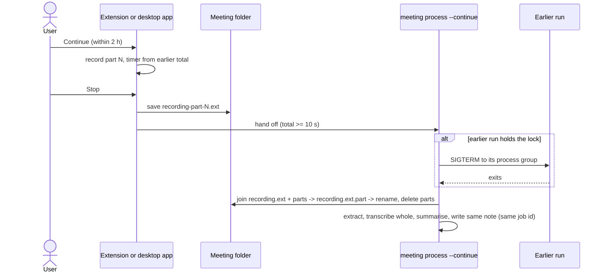
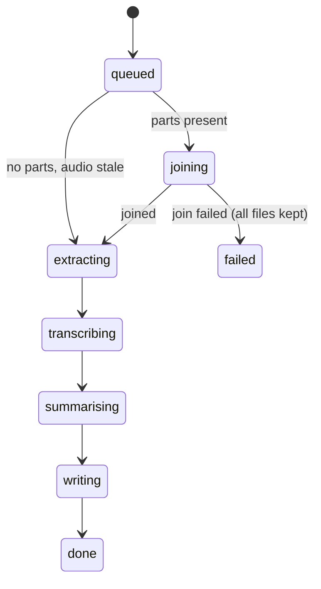

# PRD — Continue a recording, dismissable messages and a new extension look

**Status:** Approved · **Date:** 2026-11-20 · **Slug:** `continue-recording` · **Owner:** Siam · **Priority:** high · **Repo:** masnun-siam/meeting-manager

This document is the source of truth for this change, from request to delivery: the tasks and every issue are derived from it, and a decision that is not written here has not been made. Once `Approved` it is locked; a later change is a new PRD or task. What is live afterwards is in the business documentation (`docs/business/`). It builds on [meeting-recorder.md](meeting-recorder.md), [desktop-app.md](desktop-app.md), [quick-record.md](quick-record.md) and [alfred-workflow.md](alfred-workflow.md) (all Approved) and changes their behaviour only where "Changes to existing behaviour" says so.

## Overview

Three changes to the Chrome extension and the desktop app. Every message under the recording controls gets a × to close it. A recording that was stopped by mistake (Stop pressed, tab closed, browser or app quit) can be **continued**: the new part goes into the same meeting, and the whole meeting is transcribed and summarised again into the same note. And the extension's popup gets a new look of its own, in light and dark. Mockups: [Extension popup directions](https://claude.ai/artifact/TMspUajbjocWBpayqhv7qE), board "C · New identity" (chosen).

Today:
- **Messages.** The desktop window's recording bar shows, under "Ready to record", the language select and Start, a start error with a Dismiss button (quick-record FR-5), and below it the recorder's notice ("Saved, sent for processing", "Under 10 seconds…", "Recovered N recording(s)", setup and error texts), a command error and a connection error. Only the start error can be dismissed; the notice stays until the next successful Start. The extension's Record tab shows the notice, the stop reason ("Stopped because the recorded tab was closed." etc.), the microphone warning and a send error, none dismissable.
- **Stopping.** Every Stop, tab close, cap, capture failure, sleep or quit ends the recording; the next Start makes a new meeting folder (`meeting-YYYY-MM-DD_HHMM`), a new job and a new note. Nothing can add to a meeting once it is stopped.
- **Re-running.** `meeting process` re-run on a recording replaces the same vault note and keeps edits made in the app (title, body, speakers, My notes); a fresh recording file makes it extract and transcribe again (the plan compares file times). The closest pattern for "add to an existing meeting" is this re-run.
- **Extension look.** A 320 px popup in the system font, plain buttons, a blue tab underline, grey and red text lines, no dark mode. The desktop app has a full design system (tokens in its theme stylesheet) but the extension shares none of it.

## Problem

- An alert under the desktop recording controls cannot be closed and sits there until the next recording, pushing the controls around and hiding newer problems.
- A meeting that is stopped by mistake mid-way ends up as two meetings: two folders, two transcripts, two notes, each with half the context, and speaker numbers that do not match between them. The summary of each half misses decisions made in the other.
- The extension popup looks unfinished next to the desktop app and is hard to read at a glance (state, timer and messages all look alike).

## Users

One person, the owner of the Mac, using the Chrome extension (meetings in a browser tab) and the desktop app (any audio, in-person meetings). No accounts, roles or other users: everything runs locally.

## Goals

- Every message under the recording controls can be closed with one click, in the app and the extension.
- After an accidental stop, one click (or one Raycast/Alfred hotkey) continues the same meeting, and the result is one note covering the whole meeting.
- The extension popup has a distinct, polished look, readable in light and dark, with the same behaviour as today.

## Non-goals

- Continuing a recording from the other surface (an extension recording from the desktop app, or the reverse) (D11).
- Continuing anything but the last recording of that surface, or after 2 hours (D4). No list of past meetings to continue from.
- Choosing the language of a continued part (D9); it is the earlier part's.
- Stopping the earlier run on its own, or cancelling a run from the UI; a run is only stopped as part of a continuation (D7).
- Meeting context (`FEATURE_MEETING_CONTEXT`) for a continued part: participants, title and speaking times are not captured during part 2 or later; the existing `context.json` is kept as it is.
- Removing or re-ordering parts, or undoing a join.
- A live audio level meter or per-stage progress bar in the extension (boards B), and any new message between extension parts for the look (D12).
- Changing the desktop app's look, the floating pill's design, or any extension behaviour other than what FR-1 to FR-16 name.
- Picking a calendar event when continuing in the desktop app; the earlier part's event, if any, stays.

## Requirements

### Dismissable messages

- **FR-1 Close button on every desktop message.** Every message line under the desktop recording bar's controls (the start error, the recorder's notice, a command error and the connection error) has a close button (×) at its end, named "Dismiss message". The start error's × does what its Dismiss button does today and replaces it. The notice's × clears the notice in the recorder, so the menu-bar item's first line and the floating pill's outcome drop it too; the Retry button that belongs to an error notice goes with it (the kept WAV is still recovered at the next launch). A command error or connection error is hidden by its × and shows again on the next failure.
  - Acceptance: after a 20 s recording, "Saved, sent for processing" shows with ×; clicking × removes it from the window, and a later poll does not bring it back. With ffmpeg broken, the error notice shows with Retry and ×; × removes both from the window, the menu bar's first line and the pill. A refused link start's error × clears it in the window and the menu bar.
- **FR-2 Close button on every extension message.** Every message line in the extension's Record tab (the notice, the stop reason, the microphone warning, a send error) has the same × button. The notice and the stop reason are cleared in the recorder status, so reopening the popup does not show them; the microphone warning stays hidden for the rest of that recording; a send error is hidden until the next one. The meeting context line (flag on) is information, not a message, and has no ×.
  - Acceptance: close the recorded tab → "Stopped because the recorded tab was closed." and "Saved, sent for processing" show, each with ×; close both, close and reopen the popup → neither shows. Start without microphone access → the warning shows; × hides it; reopening the popup during the same recording does not show it again.
- **FR-3 Accessible close.** The × is a real button, reachable by keyboard (Tab, then Enter or Space), with the accessible name "Dismiss message", at least 24 × 24 px, and a visible focus ring. Closing a message moves focus to the next message or, with none left, to the main record control.
  - Acceptance: with VoiceOver, each × reads "Dismiss message, button"; keyboard-only, a message can be closed and focus lands on the next control.

### Continue a recording

- **FR-4 What can be continued.** Each surface remembers its own last recording: the extension the last recording it saved, the desktop app the last recording it saved. It can be continued while all of these hold: the surface is idle; at most 2 hours have passed since that recording stopped (for a recording saved by start-up or launch recovery: since it was recovered); its meeting folder and its `recording.<ext>` are still where they were saved (not archived, trashed, moved or deleted); and its recorded time is under 3 hours. Starting a new recording (Start, a `start` or `toggle` link, the menu bar's Start) makes that new recording the last one, so the earlier one can no longer be continued. A continued recording can be continued again (part 3 and so on) under the same rules, the 2 hours counted from its latest stop.
  - Acceptance: stop a recording, wait 1 minute → Continue is offered; at 2 h 1 min → it is not; archive the meeting from the Jobs tab → it is not; Start and stop a new recording → only the new one is offered.
- **FR-5 Continue in the extension.** When something can be continued (FR-4), the idle Record tab shows a Continue card: "Continue last recording", the meeting folder name, its recorded time (`H:MM:SS`) and "stopped N min ago", plus the stop reason when it was not the Stop button ("tab closed", "capture ended"), and a Continue button. Continue records the active tab of the last focused window, exactly as Start does, including the microphone permission flow. The language control shows the earlier part's language and cannot be changed while continuing.
  - Acceptance: record 1 min in Meet, close the tab, reopen the meeting, open the popup → the card shows the folder, `0:01:00`, "stopped 0 min ago · tab closed"; Continue → recording starts on the Meet tab with the timer at `0:01:00`.
- **FR-6 Continue in the desktop app.** When something can be continued, the idle recording bar shows a Continue button with the same facts as FR-5 (no stop reason), and the menu-bar menu has an enabled "Continue last recording" item under Start recording (disabled otherwise). Both continue with the same start checks as Start (configuration, permissions, capture) and the same refusals and messages.
  - Acceptance: stop a desktop recording → the bar shows Continue with the folder and time, the menu's item is enabled; choose it → recording, the timer continues from the earlier total; with the microphone denied → the same permission message as Start.
- **FR-7 Continue link.** The desktop app handles `meeting-manager://record/continue` (no query parameters; any parameter is `unknown_param`, as for `stop`). Idle with something to continue: it continues, as FR-6. Idle with nothing to continue: it is a refused start (quick-record FR-5) with the start error "Nothing to continue: the last recording stopped more than 2 hours ago, or was moved." (code `nothing_to_continue`), the main window shown and focused. Recording, paused or saving: nothing, no error. `toggle` and `start` are unchanged and always make a new recording.
  - Acceptance: `open "meeting-manager://record/continue"` 5 min after a stop → recording, no window; with nothing to continue → the window shows the start error with ×; while recording → no change.
- **FR-8 Recording a continued part.** While a continued part records, the timer, the menu-bar title, the floating pill and the badge show the meeting's total recorded time (the earlier parts plus this one), and the UI says "Continuing · part N" beside the state. The 3-hour cap applies to the total: the part stops at a total of 3 h with the cap's usual message. Pause, Resume, Stop and every automatic stop work as for any recording.
  - Acceptance: continue a recording of `0:42:10` → the timer starts at `0:42:10` and the UI says "Continuing · part 2"; continue one of `2:59:00` → it stops by the cap after 60 s of recording.
- **FR-9 Saving a continued part.** A stopped part is saved into the same meeting folder as `recording-part-N.<ext>` (N = 2, 3, …; `.webm` from the extension, `.m4a` from the desktop app), never as a new meeting folder. It is handed off for processing when the meeting's total recorded time is at least 10 seconds; the notice is then "Saved, sent for processing" as today, else the existing too-short notice.
  - Acceptance: after continuing and stopping, the meeting folder holds `recording.webm` and `recording-part-2.webm` until processing joins them; no new `meeting-…` folder exists.
- **FR-10 One meeting, processed again.** Processing a meeting with a part first stops any processing run still going for that meeting (D7), joins every part onto `recording.<ext>` in order, deletes the joined parts, then runs the whole pipeline again in the meeting's language: the whole recording is transcribed again, summarised again, and the same vault note and the same notes-store row are updated. Edits made in the desktop app (title, body, speaker names, My notes) are kept, as for any re-run. The Jobs tab and the desktop notes list show one row for the meeting, which goes back to queued and through the stages again (D14). Playback in the desktop note view plays the whole joined recording.
  - Acceptance: a meeting processed to "Done", continued for 2 min and stopped → its single Jobs row returns to Queued, shows "Joining", then the usual stages, then Done; the vault note's transcript covers both parts with consistent speaker numbers and its title or My notes edits are unchanged; playback runs past the end of part 1 into part 2. Continuing while part 1 is still summarising → that run ends and the joined run starts at once.
- **FR-11 A failed join loses nothing.** `recording.<ext>` is replaced only by a fully written joined file. If the join fails, the recording and every part are kept unchanged and the job fails at the stage "joining" with the reason (for example ffmpeg's last line). Retrying the job (Jobs tab Retry, or a re-run from the desktop app) tries the join again.
  - Acceptance: with a corrupt part file, the job fails at "joining"; `recording.<ext>` plays as before and the part is still in the folder; replacing the part with a good file and pressing Retry joins it and finishes.
- **FR-12 Crashes while continuing.** If the browser or the app ends while a continued part is recording, the leftover is saved into its meeting folder as the next part and processed as in FR-10, not as a new `-recovered` meeting, when that folder still exists; when it does not, today's recovery into a new folder applies. The recovered meeting becomes the last recording (FR-4).
  - Acceptance: quit Chrome during part 2 → at the next Chrome start the meeting folder gets `recording-part-2.webm` and the meeting is processed again; no `-recovered` folder. Force-quit the desktop app during part 2 → at the next launch the same happens with `recording-part-2.m4a`.
- **FR-13 Alfred and the guide.** The Alfred workflow's `rec` list gets "Continue last recording", which opens `meeting-manager://record/continue`. The quick-record guide documents the link and the Alfred item.
  - Acceptance: import the release's `Meeting.alfredworkflow`, choose "Continue last recording" from `rec` after a stop → the recording continues.
- **FR-14 Behind a flag.** Continuation is built only with `FEATURE_CONTINUE_RECORDING=1` (extension, tool and desktop app builds). Built without it: no Continue card, button or menu item, the `continue` link is `unknown_route`, and the tool never looks for parts or stops a run; everything behaves as today. FR-1 to FR-3 and FR-15 to FR-19 are not behind the flag.
  - Acceptance: a build without the flag shows no Continue anywhere, and `meeting process` on a folder holding a `recording-part-2.webm` leaves the part untouched.

### New extension look

- **FR-15 Identity.** The popup, its two tabs and the microphone permission page use one new visual identity, as on board "C · New identity": the wordmark "meeting." with an amber dot, Space Grotesk for the wordmark, timer and headings, Inter for text, an amber accent, a red record colour, generous rounded shapes. It follows macOS light or dark (D13) and has a light palette and a dark palette. The popup is 360 px wide. Fonts ship inside the extension (D15).
  - Acceptance: in macOS dark mode the popup is dark, in light mode light; both match the board's layout; with the network off, the fonts still render.
- **FR-16 Record tab.** Idle: the large timer at `0:00:00` (dimmed), a large round record button (accessible name "Start recording"), the language as a two-choice control "বাংলা | English" (keeps the last choice as today), the Continue card when FR-5 applies, then the messages (FR-2). Recording: a pulsing REC label, the running timer, "Continuing · part N" when FR-8 applies, Pause and "Stop & save" buttons, the context line (flag on). Paused: a "Paused" label, the timer still, Resume and "Stop & save". Saving: "Saving…" with no buttons. Could not reach the recorder: a message with ×.
  - Acceptance: each state renders as described, in both themes; the timer ticks each second while recording; every control works as today.
- **FR-17 Jobs tab.** Each job is a card: title (or folder name), date and time, a stage chip coloured by stage (queued, working stages, done, failed), the error line for a failed job, and its actions as today (Open summary, Open folder, Retry, Archive, Trash with its confirm step). The empty state reads "No meetings processed yet"; loading, host-missing and setup states keep today's texts in the new style.
  - Acceptance: a done, a running and a failed job each show the right chip and actions; Trash still needs a second click to confirm.
- **FR-18 Motion and access.** The REC pulse and any transition stop when macOS Reduce motion is on. Text and controls meet WCAG 2.1 AA contrast in both palettes; every control is a real button or input with a name; the keyboard focus is visible; tests find elements by role and name.
  - Acceptance: with Reduce motion on, nothing pulses; an automated contrast check of both palettes passes; the whole popup can be used with the keyboard.
- **FR-19 Same behaviour.** The redesign changes no extension behaviour, message, storage key or wire request; all texts stay as they are except the names this PRD adds or changes ("Start recording", "Dismiss message", "Stop & save", the Continue card).
  - Acceptance: every existing extension test passes after only selector or text updates this PRD names.

## Changes to existing behaviour

- meeting-recorder FR-4 and the "one recording per folder" rule: a meeting folder may also hold `recording-part-N.<ext>` files until they are joined (FR-9, FR-10).
- desktop-app recording bar: the notice is no longer kept until the next Start; it can be dismissed (FR-1). The start error's Dismiss button becomes a × (FR-1).
- quick-record FR-1 and FR-5: one more link, `continue`, and one more start-error code, `nothing_to_continue` (FR-7). FR-8 (pill outcome): a notice dismissed in the window also ends the pill's outcome (FR-1).
- alfred-workflow: one more item in `rec` (FR-13).
- Processing: a re-run on a folder with parts joins them first; a new job stage `joining` (FR-10, FR-11).

## Edge cases

- **Continue while the earlier part is still processing:** the earlier run is stopped and replaced (FR-10, D7). A run already past writing the note is simply overwritten by the joined run.
- **Continue while the earlier part is still saving:** not offered (the surface is not idle).
- **Earlier part was too short (< 10 s) and never processed:** it can be continued; the meeting is processed once the total reaches 10 s.
- **Earlier part failed processing** (e.g. Deepgram key rejected): it can be continued; the joined run starts from the join.
- **Desktop earlier part whose conversion failed** (WAV kept, no `recording.m4a`): not continuable; Retry or launch recovery handle it as today.
- **Two quick Continue presses / Continue and Start together:** the recorder takes one; the other is refused as "already recording" (same rule as Start).
- **Archive or Trash of the meeting while a part records:** archive and trash are refused while the meeting's processing lock is held; while only recording (no lock), the folder can be moved. The part then cannot be saved into it; it is saved and processed as a new meeting, as a Start would, with the error notice "Could not add to <folder>: it was moved; saved as a new meeting." Nothing is lost (D17).
- **A part and the recording in different formats:** cannot happen (each surface continues only its own recordings, D11); the tool refuses to join a part whose extension differs from `recording.<ext>`.
- **Different tab size between parts (extension video):** joined by stream copy; a VP8 stream may change resolution mid-way, which Chrome plays; the desktop note view plays the audio. A join that ffmpeg refuses fails as FR-11.
- **Total reaches 3 h:** nothing more can be continued (FR-4).
- **Clock changes:** the 2-hour window is measured on the wall clock from the stored stop time; a manual clock change can shorten or lengthen it by the size of the change. Accepted.
- **Empty states:** nothing to continue shows no card or button; messages area empty shows nothing.
- **Access and data isolation:** single user; all data stays on the Mac. The extension only ever names a part inside the configured recordings folder; the tool re-checks every path.
- **Existing data:** no migration. Existing meetings have no parts; they can be continued only if they are the last recording of their surface and within 2 hours of the release.

## Technical design

### Data

All local; recordings, transcripts and notes are **confidential**, settings and job files **internal**.

| Store | Change | Serves |
|---|---|---|
| Meeting folder | New files `recording-part-N.<ext>` (N ≥ 2, same `<ext>` as `recording.<ext>`), deleted after a successful join. Desktop: a part records into `recording-part-N.partial.wav` (same format and flush rules as `recording.partial.wav`) and converts to `recording-part-N.m4a`. Temp join output `recording.<ext>.part` renamed over `recording.<ext>`. Files keep the folder's existing modes (`0600` for desktop files) | FR-9, FR-10, FR-11, FR-12 |
| `meta.json` | `duration_s` recomputed from the joined recording; a new `parts_joined` count (number of parts joined so far, 0 when absent) | FR-10 |
| Job file | Stage enum gains `joining` (between `queued` and `extracting`) | FR-10, FR-11 |
| Extension `chrome.storage.local` | New key `last_recording`: `{download_id, path, folder, ext: "webm", recorded_ms, language, stopped_at, stop_reason, parts}` (`parts` = number of files so far, 1 for a plain recording). Written after each save (including recovery), replaced by every new recording. Survives a browser restart | FR-4, FR-5, FR-12 |
| Extension `chrome.storage.session` recorder status | `RecorderStatus` gains `continuing: {folder, part, base_ms} \| null` (`base_ms` = earlier total) and a dismissed flag for the microphone warning; the notice and `lastStop` can be cleared by the popup (through the service worker) | FR-2, FR-8 |
| Extension OPFS | A part records into `recordings/<startedAt>.webm` as today; the link to its meeting is kept in `chrome.storage.local` `continuing_parts`: `{<startedAt>: {folder, part, language}}`, removed after its save | FR-12 |
| Desktop settings store | New key `last_recording`: `{folder, recorded_s, language, stopped_at, parts}`; written at each save hand-off and by launch recovery, replaced by every new recording | FR-4, FR-6 |
| Notes store row | No schema change: the same row (keyed by `recording_path`) goes back to `processing` and is merged as on any re-run | FR-10 |

### API

**Native messaging (extension → host), new request** (flag on only; flag off it is `bad_request`):

| Request | Fields | Reply | Errors |
|---|---|---|---|
| `process_part` | `path` (absolute path of `recording-part-N.<ext>`), `language` (`bn`\|`en`) | `{ok, job_id}` (the meeting's existing latest job id when there is one, else a new one) | `invalid_path` (not `<recordings_dir>/<name>/recording-part-N.<ext>` with N ≥ 2, no `recording.<same ext>` beside it, under `Archive/`, outside the folder after canonicalising), `not_configured`, `bad_request` |

It spawns `meeting process <folder>/recording.<ext> --continue --language <l> --job-id <id>` detached, as `process` does. `list_jobs` replies may carry stage `joining`; the extension's job types mirror it.

**CLI** (flag on only):

- `meeting process <recording> [--continue]`: every run, with or without `--continue`, first joins any `recording-part-N.<ext>` files in the folder in ascending N (FR-10, FR-11). `--continue` additionally: when another run holds the meeting's lock, stop it (Backend) and take the lock instead of failing with `already processing`; and reuse the meeting's latest job id unless `--job-id` is given.

**Desktop commands** (Tauri; flag on only; flag off they do not exist):

| Command | Reply | Errors |
|---|---|---|
| `recorder_status` | Adds `continuable: {folder, name, recorded_s, stopped_at} \| null` and, while recording a part, `part: N \| null`; `elapsed_s` is the meeting total | none |
| `recorder_continue` (new) | `{folder}` | `nothing_to_continue`, `already_recording`, and Start's codes (`not_configured`, `permission_mic`, `permission_audio`, `capture_failed`) |
| `recorder_dismiss_notice` (new, not flagged) | `{}`; clears the notice (already clear is fine); announced through the existing change listeners | none |

**Link:** `meeting-manager://record/continue` (FR-7), routed like `start` but calling continue; `nothing_to_continue` is a start error.

**Extension popup → service worker** (`PopupCommand`): `continue` (no fields; language comes from `last_recording`) and `dismiss {what: "notice" | "stop" | "mic"}`.

### Backend

- **Join (tool, FR-10, FR-11).** Under the meeting's lock, before the plan: list the parts, check each has the same extension, join `recording.<ext>` and the parts in order with ffmpeg's concat demuxer by stream copy (no re-encode) into `recording.<ext>.part`, then rename over `recording.<ext>`, then delete the parts and add their count to `meta.json`. The job shows `joining` during this. Any failure removes the temp file, keeps everything else and fails the job at `joining` with ffmpeg's last stderr line. After the join the recording is newer than the audio and transcript, so the existing plan extracts, transcribes, renders, summarises and writes again; the language comes from `--language` (which also forces re-transcription) or `meta.json`.
- **Stopping the earlier run (`--continue`, FR-10, D7).** Read the PID in the lock; confirm that process is a `meeting process` run for this same recording (its command line), then send SIGTERM to its process group (spawned runs have their own group, so ffmpeg and `claude` end too), wait up to 10 s, then SIGKILL the group; then take the lock over as for a dead PID. If the PID is not such a process, treat the lock as stale. The killed run writes nothing more; the new run owns the job (same id) and the store row.
- **Extension service worker (FR-2, FR-4, FR-5, FR-8, FR-9, FR-12).** `continue` runs through the same serialised start path as `start`, with `continuing` set from `last_recording` after re-checking FR-4 (the download item still `exists`, folder not moved). The cap timer and elapsed time use `base_ms`. At save, the part downloads to `Meetings/<folder>/recording-part-N.webm` and the hand-off is `process_part` when the total is ≥ 10 s. If the download lands elsewhere (the folder was moved) or fails, the part is saved as a new meeting as today with an error notice (Edge cases). Start-up recovery checks `continuing_parts` for each leftover first.
- **Desktop recorder (FR-1, FR-4, FR-6, FR-8, FR-9, FR-12).** `recorder_continue` runs Start's checks, except the folder is the existing meeting folder and the WAV is `recording-part-N.partial.wav`; the recorded-time counter starts at the earlier total so the cap and `elapsed_s` count the meeting. At stop it converts to `recording-part-N.m4a`, deletes the WAV and spawns `meeting process <folder>/recording.m4a --continue --language <l>` when the total is ≥ 10 s. Launch recovery also picks up `recording-part-N.partial.wav` leftovers in a folder that has `recording.m4a`, converts them to the part and hands off the same way. The meeting folder of a continuing session is held like a starting one so recovery skips it. `recorder_dismiss_notice` clears the notice under the existing lock and announces the change.
- **Link and menu bar (FR-6, FR-7).** The link parser gains `continue`; the dispatcher calls continue; a `nothing_to_continue` refusal becomes the start error and focuses the window as for other refused link starts. The menu gains "Continue last recording", enabled from `continuable`.

*The continuation flow, shared by both surfaces from the hand-off on.*

*Job stages with the new `joining` stage (other existing transitions unchanged).*

### Frontend

- **Desktop recording bar (FR-1, FR-6, FR-8).** Each message line gets a trailing × ("Dismiss message"); the notice's × calls `recorder_dismiss_notice`, the start error's × the existing dismiss command, the other two hide locally until their next failure. Idle with `continuable`: a Continue button beside Start with the folder, `H:MM:SS` and "stopped N min ago"; the language select shows the earlier language and is disabled while continuing. Recording a part: "Continuing · part N" beside the REC label. The floating pill needs no change beyond the total time it already reads from `elapsed_s`, and hides its outcome when the notice is cleared.
- **Extension popup (FR-2, FR-5, FR-15 to FR-19).** Rebuilt in the new identity: design tokens as CSS custom properties in one shared stylesheet for the popup and the permission page, with a light and a dark set switched by `prefers-color-scheme`; component styles stay in CSS modules. Fonts are bundled woff2 files (Space Grotesk, Inter) with their OFL licence text, loaded by `@font-face` from the extension package. Record tab and Jobs tab as FR-16 and FR-17; the Continue card as FR-5. Loading, empty and error states keep today's texts.

### Realtime and other components

- The extension popup reads `RecorderStatus` and `last_recording` changes through `storage.onChanged`, as today; no new push.
- The desktop window, menu bar and pill read `recorder_status` as today; `recorder_dismiss_notice` triggers the existing change listeners so the menu bar and pill update at once.
- The tool's job files are read by the extension's Jobs tab (`list_jobs`, every 3 s) and the desktop notes list; both must accept the stage `joining`.
- The Alfred workflow (release asset) gets one item (FR-13).

### Non-functional

- Joining by stream copy takes seconds even for a 3-hour recording; no re-encode.
- Re-transcribing the whole meeting costs Deepgram time for the earlier parts again (about $0.26 per recorded hour, D3); Claude summarises once per run as today.
- Bundled fonts add about 100 KB to the extension; the popup opens without a visible delay compared with today (manual check).
- macOS + Chrome 116+ as today; no new permission in the manifest.

### Threats and mitigations

The feature touches confidential recordings and transcripts.

| Threat | Mitigation |
|---|---|
| A crafted `process_part` path makes the host join or delete files outside the recordings folder | The host accepts only `<recordings_dir>/<name>/recording-part-N.<ext>` after canonicalising (no `..`, no symlinks out, not `Archive/`), with `recording.<same ext>` beside it; only the pinned extension origin can call the host, as today |
| `--continue` kills an unrelated process whose PID reused the lock's PID | The process is signalled only after confirming its command line is `meeting process` for the same recording; otherwise the lock is treated as stale |
| A failed or interrupted join destroys the original recording | The join writes to a temp file and renames only on success; parts are deleted only after the rename; a crash mid-join leaves the original and parts untouched and the next run joins again |
| Transcript text from the joined meeting reaches logs | No new logging of content: join and kill steps log only kinds and counts; the transcript stays untrusted input to `claude`, which still runs with no tools and a JSON schema |
| A web page triggers Continue | Continue only comes from the popup, the desktop window, the menu bar or the custom link, the same trust as Start (quick-record D10) |

### Testing

| Requirement | Test |
|---|---|
| FR-1 | Desktop component tests of the recording bar: each line's ×, notice dismiss calls `recorder_dismiss_notice`; Rust test: dismiss clears the notice and fires the change listeners; menu-bar state with no notice |
| FR-2, FR-3 | Extension component tests: × on each line, by role and name; service-worker tests for `dismiss` clearing notice, stop reason and mic warning; focus moves after closing |
| FR-4 | Pure tests of the "can continue" rule on both surfaces with a fixed clock: 2 h boundary, moved folder, 3 h total, replaced by a new recording |
| FR-5, FR-8, FR-9 | Service-worker tests: `continue` starts with `base_ms`, cap at total 3 h, part download name, `process_part` only at total ≥ 10 s, folder-moved fallback |
| FR-6, FR-7 | Rust tests: `recorder_continue` checks and refusals; link parse and dispatch of `continue`, `nothing_to_continue` start error; menu state |
| FR-10, FR-11 | Rust tests with real ffmpeg: join of 2 and 3 webm and m4a parts, duration in `meta.json`, failure keeps all files, retry joins; `--continue` stops a fake earlier run in its own group and reuses the job id; `process_part` path checks in the native host tests |
| FR-12 | Extension recovery test with a `continuing_parts` entry; desktop recovery test with a `recording-part-2.partial.wav` |
| FR-13 | Manual: import the workflow and run the item |
| FR-14 | Build tests with the flag off: no Continue UI, link `unknown_route`, parts untouched by the tool |
| FR-15 to FR-19 | Extension component tests by role and name in each state; automated contrast check of both palettes; manual visual check in light, dark and Reduce motion |
| End to end, manual | Meet call: record, close tab, reopen, Continue, stop → one note with both parts; desktop: record, quit, relaunch, Continue via Raycast link → one note |

## Rollout and cost

- One epic. FR-1 to FR-3 and FR-15 to FR-19 ship as soon as they are merged. Continuation (FR-4 to FR-14) merges dark behind `FEATURE_CONTINUE_RECORDING` (added to `FLAGS.md`, default off) in the extension, tool and desktop builds, and a release turns it on (D10).
- Cost: Deepgram re-transcribes earlier parts of a continued meeting (D3); nothing else changes.
- Operations: none before release. After release, update the extension and the `meeting` tool together (the new `process_part` request needs both); an old tool answers `bad_request` and the extension shows the error notice.
- Rollback: rebuild without the flag; parts left in folders are untouched by a flag-off tool and can be joined later by a flag-on run.
- Watch: jobs failing at `joining` in the log; reports of lost or doubled audio.

## Success metrics

None formally defined. Informally: no more split meetings after an accidental stop, and no message stuck under the controls.

## Epics

One epic (D10).

- **E1 Continue a recording, dismissable messages and a new extension look** — covers FR-1 to FR-19. Issue: #265

## Decisions

- 2026-11-20 **D1 PRs for this PRD target `main`** — the repo has no `staging` branch and its CLAUDE.md names `main`, as for every earlier PRD. Decided by: Siam, "main (Recommended)".
- 2026-11-20 **D2 A × on every message, in the app and the extension; a dismissed notice is cleared in the recorder** — so the menu bar and pill drop it too. Decided by: Siam, "Every message, app + extension (Recommended)".
- 2026-11-20 **D3 Continuing joins the parts into one meeting and re-processes it whole into the same note** — consistent speaker numbers across parts; edits are kept; extra Deepgram cost for earlier parts accepted. Decided by: Siam, "One meeting, re-processed whole (Recommended)".
- 2026-11-20 **D4 Only the last recording of a surface, for 2 hours after it stopped** — covers the accidental stop with one click and few edge cases. Decided by: Siam, "The last one, within 2 hours (Recommended)".
- 2026-11-20 **D5 Desktop: Continue in the window, the menu bar and a `continue` link** (and the Alfred item, D8). Decided by: Siam, "Window + menu bar + link".
- 2026-11-20 **D6 The timer shows the meeting total and the 3-hour cap counts the total** — it feels like a continuation and a meeting never exceeds today's limit. Decided by: Siam, "Total time, 3 h cap on total (Recommended)".
- 2026-11-20 **D7 Continuing stops a processing run still going for the earlier part** — the joined run starts at once instead of waiting. Decided by: Siam, "Stop the earlier run".
- 2026-11-20 **D8 The Alfred workflow gets "Continue last recording"** — the item list stays in sync with the links. Decided by: Siam, "Yes, add it (Recommended)".
- 2026-11-20 **D9 A continued part uses the earlier part's language; it cannot be changed** — one meeting, one transcription language. Decided by: Siam, "Locked to the original (Recommended)".
- 2026-11-20 **D10 One epic; continuation behind the build flag `FEATURE_CONTINUE_RECORDING`** — it rewrites recordings and stops runs, so it ships dark until a release turns it on. Priority high. Decided by: Siam, "1 epic, flag on continuation"; "high (Recommended)".
- 2026-11-20 **D11 A surface continues only its own recordings; the extension continues by recording the active tab, as Start does** — formats differ (webm video vs m4a audio). Decided by: Siam, "No, same surface only (Recommended)"; "The active tab, like Start (Recommended)".
- 2026-11-20 **D12 The extension gets a new identity (board C), not the desktop app's look** — chosen after seeing boards A, B and C. Decided by: Siam, "C: New identity".
- 2026-11-20 **D13 The new look has light and dark palettes, following macOS** — Decided by: Siam, "Light and dark".
- 2026-11-20 **D14 The tool joins parts into `recording.<ext>` by stream copy, and the joined run reuses the meeting's job id** — the note, store row and playback stay keyed to the same file; one Jobs row per meeting. Decided by: Siam, "Tool joins into recording.<ext> (Recommended)"; "One row per meeting (Recommended)".
- 2026-11-20 **D15 Fonts are bundled as files in the extension, not loaded from Google, no npm package** — works offline and sends nothing to Google. Decided by: Siam, "Bundle the font files (Recommended)".
- 2026-11-20 **D16 `continue` with nothing to continue is a start error that shows the window** — a hotkey press never silently looks like it worked. Decided by: Siam, "Start error, show window (Recommended)".
- 2026-11-20 **D17 A part whose meeting folder was moved while it recorded is saved as a new meeting, with an error notice** — nothing is lost, and the tool needs no knowledge of what is recording. Decided by: Siam, "Save as a new meeting + error (Recommended)".

## Open questions

None.

## Related

- [meeting-recorder.md](meeting-recorder.md) FR-3, FR-4 (pause, stop and save), [desktop-app.md](desktop-app.md) (recording bar, notices, recovery), [quick-record.md](quick-record.md) FR-1 to FR-5, FR-8 (links, start error, pill outcome), [alfred-workflow.md](alfred-workflow.md) (item list).
- Business doc changed: [docs/business/desktop/quick-record.md](../business/desktop/quick-record.md) R-1, R-2, R-5. The extension and processing have no business doc yet.
- Mockups: [Extension popup directions](https://claude.ai/artifact/TMspUajbjocWBpayqhv7qE).
