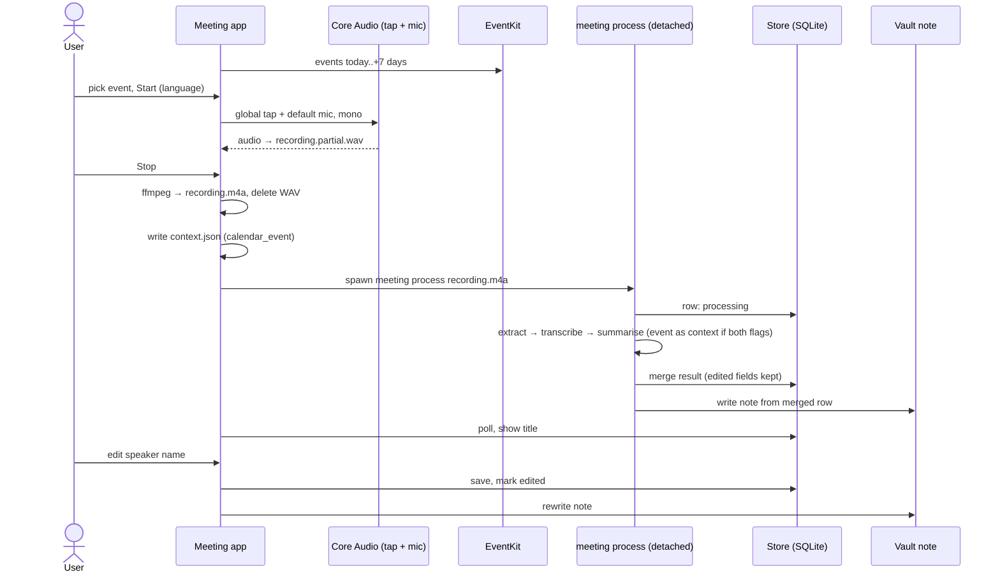
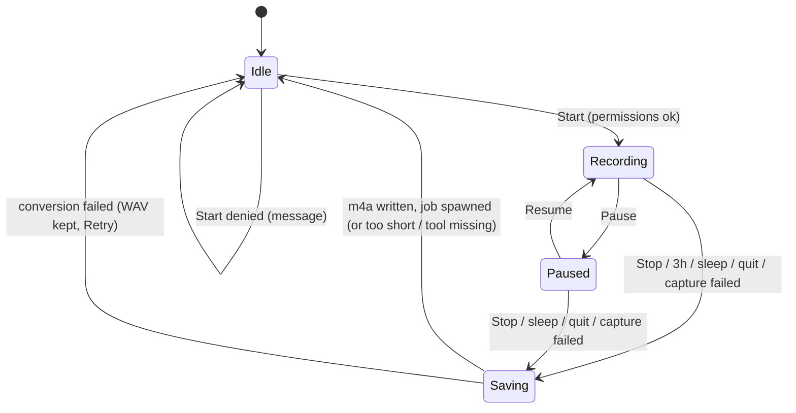
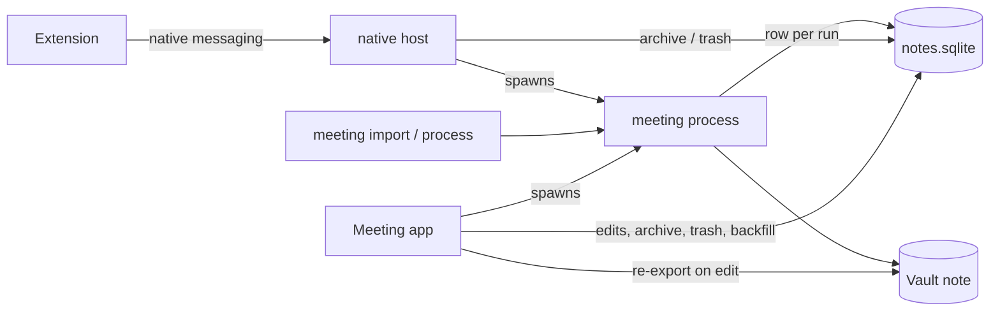

# PRD — Meeting desktop app

**Status:** Approved · **Date:** 2026-11-13 · **Slug:** `desktop-app` · **Owner:** Siam · **Priority:** medium · **Repo:** masnun-siam/meeting-manager (private)

This document is the source of truth for the feature: every issue is derived from it, and a decision that is not written here has not been made. It adds to [meeting-recorder.md](meeting-recorder.md), [recording-folders.md](recording-folders.md), [recording-import.md](recording-import.md) and [meeting-context.md](meeting-context.md) without changing their behaviour while `FEATURE_DESKTOP_APP` is off; with it on, the changes listed under "Changes to existing behaviour" apply and win over those PRDs.

## Overview

Meeting is a macOS desktop app that records calls happening outside the browser (a Slack huddle, a WhatsApp call, a Zoom desktop call) as audio only: everything the Mac plays plus the microphone. It shows the user's calendar so a recording can be started from an event, and it keeps every meeting note (from the app, the Chrome extension and `meeting import`) in its own searchable store, where the title, summary, speaker names and the user's own notes can be edited. Processing is the existing `meeting` pipeline; the Obsidian vault note is still written and now follows the app's edits.

Today:
- The Chrome extension records a browser tab's video and audio plus the mic; Stop saves `Meetings/<name>/recording.webm` and hands it to the tool over native messaging, which spawns a detached `meeting process` job.
- `meeting import <file>` turns any audio or video file (including `.m4a` and `.wav`) into a meeting folder and runs the same pipeline (recording-import FR-1 to FR-5).
- Processing writes `transcript.md`, `summary.md` and `meta.json` in the meeting folder and one Obsidian vault note matched by its `recording` frontmatter. There is no store of notes besides those files; nothing can be searched or edited except by hand in Obsidian.
- The Jobs tab in the extension popup lists jobs and has Retry, Open, Archive and Trash (recording-folders FR-5 to FR-9).
- Calendar data comes from one secret iCal address in the Keychain, matched by meeting ID, behind `FEATURE_MEETING_CONTEXT`, which is off (meeting-context FR-7, FR-8, FR-11).
- The closest pattern: the native host's hand-off (save the recording into its own folder, write `context.json`, spawn a detached `meeting process`).
- Not built yet: any desktop UI, system-audio capture, EventKit access, a notes database.

## Problem

Calls in desktop apps (Slack huddles, WhatsApp, Zoom desktop) can't be recorded at all: the extension only sees browser tabs, and `meeting import` needs a file someone else already made. Past notes live as loose vault files: there is no way to find a meeting by what was said, fix a wrongly inferred speaker once, or see what was decided last time in the same recurring meeting. Starting a recording means remembering which tool to open, with no link to the calendar event the call belongs to.

## Users

The single owner, on their own Mac (macOS 14.4 or later, for Core Audio process taps), with the Meeting app, the `meeting` tool and optionally the Chrome extension installed. No roles, no other users, no sharing.

## Goals

- Record any call on the Mac (audio only) from a calendar event or ad hoc, and get the same transcript, summary and vault note as a browser meeting, without further action.
- Find any past meeting, from any source, by searching its title, summary, transcript or own notes.
- Fix a note once (title, summary, speaker names, own notes) and have the vault note follow.
- See earlier notes of the same recurring meeting when opening an event.

## Non-goals

- Video or screen capture of any kind.
- A per-app audio picker or excluding other apps' sounds: all system audio is recorded (D2).
- Separate channels for the mic and the call, multichannel transcription or a `self_name` setting (D20).
- Automatic call detection, reminders before events, or auto-start (D7).
- Calendar sources other than macOS Calendar (EventKit): no iCal address, Google or Microsoft API in the app (D3). The tool's iCal matching for extension recordings is unchanged.
- Creating, editing or responding to calendar events. The app reads them only.
- Sending earlier notes of the same series to Claude (D19).
- Editing transcript text; editing in Obsidian flowing back into the app (D5, D9).
- Changes to the Chrome extension or the native-messaging protocol (D8).
- Signed or notarized builds, a DMG, auto-update, or running on someone else's Mac (D12).
- Windows, Linux, Intel-only code paths beyond what Tauri gives by default, macOS earlier than 14.4.
- Live or streaming transcription, chunked summarisation, meetings over 3 hours (unchanged from meeting-recorder).
- Several recordings at once in the app.
- Sync of the store to another device, export other than the vault note, or encryption beyond macOS FileVault.

## Requirements

### Recording

- **FR-1 Start a recording.** The app starts a recording from the main window (ad hoc, or from an event per FR-11) or from the menu-bar item (ad hoc). The language select offers Bengali and English and defaults to the last one used. Start creates `<recordings_dir>/meeting-YYYY-MM-DD_HHMM/` from the local start time (`-2`, `-3`… on a clash, as recording-folders FR-1) and begins capturing all system audio plus the default microphone, mixed into one mono track. Only one app recording runs at a time; Start is disabled while one runs.
  - Acceptance: start ad hoc while a Slack huddle plays audio and you speak. After Stop, the folder holds `recording.m4a` in which both the huddle audio and your voice are audible. Start is disabled until Stop.
- **FR-2 Permissions.** On first Start the app asks macOS for Microphone and System Audio Recording permission. If either is denied, nothing is recorded, no folder is created, and the window (and the menu-bar menu) shows a message naming the pane: "Allow Meeting in System Settings › Privacy & Security › Microphone" or "… › Screen & System Audio Recording". Start works again once permission is granted, without restarting the app.
  - Acceptance: with System Audio Recording denied, Start shows the second message and no meeting folder appears. After allowing it in System Settings, the next Start records.
- **FR-3 Recording indicator, pause and resume.** While recording, the menu-bar item shows a recording mark with the elapsed recorded time (paused time excluded) and the window shows the same timer. Pause stops adding audio; Resume continues the same file; the menu-bar item shows a paused mark while paused.
  - Acceptance: record 1 min, pause 1 min, record 1 min. The timer reads about 2:00 and the final `recording.m4a` lasts about 2 minutes.
- **FR-4 Stop and save.** Stop (window or menu bar) finishes the file, converts it to `recording.m4a` in the meeting folder with the configured ffmpeg, deletes the temporary WAV, and hands the meeting to processing (FR-6). The window shows "Saved, sent for processing". A recording under 10 seconds of recorded time is saved but not processed, and the window says it was too short.
  - Acceptance: after Stop, the folder holds `recording.m4a` and no `recording.partial.wav`, and a job for it appears (store status `processing`, FR-15) within 5 seconds. A 5-second recording leaves `recording.m4a`, no job, and the "too short" message.
- **FR-5 Automatic stops.** Recording stops and saves as in FR-4 when recorded time reaches 3 hours, when the Mac goes to sleep, when the app is quit (after a confirmation dialog while recording), or when capture fails (for example the tap or mic device disappears and can't be rebuilt within 5 seconds). The window's last message says which. A change of default input or output device during recording is followed without stopping; a gap of up to 1 second is allowed.
  - Acceptance: a recording left running stops at 3:00:00 recorded time and is processed. Closing the lid while recording leaves a saved, processed meeting. Plugging in headphones mid-call keeps recording in the same file.
- **FR-6 Hand-off to processing.** After saving, the app writes `context.json` in the meeting folder (`platform: "desktop"`, the start time, the time zone, and the chosen event when there is one; Technical design › Data) and spawns `<meeting_path> process <folder>/recording.m4a --language <bn|en>` detached in its own process group with no stdio, as the native host does. The pipeline's stages, lock, job file, retention, notification and vault note are unchanged. Quitting the app does not stop the job. If `meeting_path` is missing from the config or not executable, the meeting is still saved and the window shows "Processing tool not found — run `meeting install`".
  - Acceptance: stop a recording, quit the app at once; the macOS "Meeting summary ready" notification still arrives and the vault note exists. With `meeting_path` removed from the config, Stop saves `recording.m4a` and shows the install message.
- **FR-7 Crash recovery.** Audio is appended to `recording.partial.wav` in the meeting folder while recording, flushed at least every 5 seconds. On launch, the app looks for meeting folders in the recordings directory that hold `recording.partial.wav` and no other `recording.<ext>`; for each it repairs the WAV header from the file length, converts it as in FR-4 and processes it (or not, if under 10 seconds). It reports "Recovered N recording(s)".
  - Acceptance: force-quit the app (`kill -9`) 2 minutes into a recording, relaunch: the meeting folder gets a `recording.m4a` of about 2 minutes, the job runs, and the window shows "Recovered 1 recording". A conversion failure keeps the WAV and shows the ffmpeg error with a Retry button.

### Calendar

- **FR-8 Calendar access.** The app reads events from macOS Calendar (every account synced into Calendar.app) through EventKit, after asking for full calendar access on first open of the calendar view. If access is denied, the calendar view shows "Allow Meeting in System Settings › Privacy & Security › Calendars" and ad-hoc recording still works.
  - Acceptance: with access granted, events from a Google account and an iCloud calendar both appear. With access denied, the message shows and ad-hoc Start still records.
- **FR-9 Upcoming list.** The calendar view lists events from the start of today to the end of the 7th following day, grouped by day, today first, in local time, from every calendar except those hidden in Settings (FR-20). All-day events and events the user declined are not shown. Today's events that already started or ended are listed and can still be picked. The list refreshes when Calendar reports a change and when the window gains focus.
  - Acceptance: an event created in Calendar.app for tomorrow 10:00 appears within 10 seconds without restarting. An all-day event and a declined event do not appear. Hiding a calendar in Settings removes its events from the list.
- **FR-10 Event view.** Selecting an event shows its title, time, calendar name, organizer, attendees with response (accepted, declined, tentative, no response; names only, no email addresses), its notes text, and a Start recording button with the language select. Below it, "Earlier notes" lists the stored meetings linked to the same recurring event (FR-12), newest first, at most 20, each opening its note.
  - Acceptance: for a weekly event with two earlier recorded occurrences, both appear under "Earlier notes" and open their notes. An attendee whose only name is an email address is not listed.
- **FR-11 Start from an event.** Start recording on an event begins FR-1 and records the event in the meeting's `context.json` (`calendar_event`): its title, start, end, organizer name, attendees (name and response, rooms and resources and email-only names left out), its notes text (cut to 20,000 characters), its occurrence identifier and its series identifier. Events whose start is more than 7 days away cannot be started.
  - Acceptance: start from an event titled "Weekly sync"; `context.json` holds `calendar_event.title: "Weekly sync"` and the attendee names, and contains no `@` from an email address.
- **FR-12 Event in the note.** A meeting started from an event is linked to it in the store (occurrence and series identifiers, title, start). With `FEATURE_MEETING_CONTEXT` also on, the pipeline uses `calendar_event` as the calendar match for that meeting: it does not read the iCal address or fetch any calendar, the context block sent to Claude is built from it exactly as from an iCal match (meeting-context FR-9), and the vault note gets `meeting_title`, `attendees` and `calendar: "matched"` (meeting-context FR-10). With `FEATURE_MEETING_CONTEXT` off, nothing about the event reaches Claude or the vault note; the store link (FR-10's "Earlier notes") still works.
  - Acceptance (both flags on, stub claude): the stub receives a context block containing the event title and attendees, and no iCal fetch is logged. The vault note has `calendar: "matched"`. With the context flag off, the stub's stdin is byte-for-byte what it is today for a recording without context.

### Notes store

- **FR-13 Every meeting lands in the store.** With `FEATURE_DESKTOP_APP` on in the tool build, every `meeting process` run (started by the app, the native host, `meeting import` or the CLI) creates or updates the meeting's row in the store: at the start of the run with status `processing`, and at the end with `done`, `no_speech` or `failed` (with the failed stage and reason) plus the title, summary body, speakers, language, duration and transcript. A store that can't be opened or written is logged by kind and never fails the job; the vault note is still written.
  - Acceptance: process one meeting from the extension, one from `meeting import` and one from the app; all three appear in the app's list with their titles. With the store file made read-only, a job still reaches `done` and the vault note exists.
- **FR-14 Backfill.** On first launch (store has no `backfill_done` setting), and when the user presses Settings › Rescan folders, the app reads every meeting folder directly inside the recordings directory and `Archive/` that holds a `recording.<ext>` on the recording-import FR-2 list, and creates or updates its row from `meta.json`, `summary.md` and `transcript.md` (status `done` when `summary.md` exists, `no_speech` when the transcript says "No speech detected", else `failed`). Rows are matched by recording path; a rescan never overwrites an edited field or "My notes". Flat legacy recordings (not in their own folder) are skipped. Progress shows "Loading meetings… N of M"; it can't be cancelled and the app stays usable.
  - Acceptance: with 30 processed meetings in the recordings folder and 5 in `Archive/`, first launch lists all 35 with their titles. Editing one title and pressing Rescan folders keeps the edited title. A folder holding only `recording.webm` and a failed job's `meta.json` appears with status `failed`.
- **FR-15 Notes list.** "All notes" lists every row newest first by recorded time: title (or the folder name until there is one), date and time, duration, language, source (Browser, Import, Desktop), and status (`processing` shows the job's current stage from its job file; `failed` shows the reason). It refreshes when the store changes (checked at least every 3 seconds while the window is visible). Empty state: "No meetings yet — start a recording or run `meeting import`."
  - Acceptance: while an app recording processes, its row shows `transcribing` then `summarising` then the title, without user action. A failed job shows its stage and reason.
- **FR-16 Search.** A search box above the list filters it to rows whose title, summary body, "My notes", speaker names or transcript contain all the typed words (case-insensitive; Bengali and English text; prefix match on the last word), results ordered by relevance then date, updated as the user types (after a 200 ms pause). Clearing the box restores the full list.
  - Acceptance: typing a word said only in one meeting's transcript lists that meeting alone. Typing a Bengali word from a Bengali transcript finds it. "budg" finds a meeting whose summary says "budget".
- **FR-17 Note view.** Selecting a row shows the note: title, date, duration, language, source, linked event (if any); the summary body rendered from markdown; the speakers (label, name, "(inferred)" when not confirmed, evidence); the transcript with speaker labels shown as their current names; "My notes"; and actions Open in Obsidian, Open folder, Rerun summary, Archive, Trash. Raw HTML in any markdown is shown as text, never rendered.
  - Acceptance: a summary containing `` shows that text literally and runs nothing. Open in Obsidian opens the vault note; Open folder opens the meeting folder in Finder.
- **FR-18 Editing.** Title, summary body (as markdown text), each speaker's name, and "My notes" are editable for a `done` note. Saving happens 1 second after typing stops and on leaving the field. A save writes the store, marks that field as edited, and rewrites the vault note (the note body plus a "## My notes" section when "My notes" is not empty, frontmatter `speakers` from the current names), renaming the note file when the title changed (matched by `recording`, as meeting-recorder FR-15). Renaming a speaker replaces every whole-word occurrence of their previous shown name (with or without "(inferred)", or the `Speaker N` label) in the title and body with the new name, and the new name is shown without "(inferred)". A vault write failure keeps the store change and shows "Vault note not updated: <reason>" with a Retry. Transcript text is not editable. Notes in `processing`, `failed` or `no_speech` are not editable except "My notes".
  - Acceptance: rename "Speaker 1" (shown as "Rahim (inferred)") to "Rahim Uddin"; the body's action items now read "Rahim Uddin", the transcript view shows "Rahim Uddin:", and the vault note's body and `speakers` frontmatter match. Renaming "Speaker 1" does not change "Speaker 10". Typing in "My notes" adds a "## My notes" section to the vault note.
- **FR-19 Reruns keep edits.** Rerun summary in the app runs `meeting process <recording>` detached (FR-6). If any field was edited, a dialog first offers "Keep my edits" or "Replace with new summary"; Replace clears the edited marks (not "My notes") before spawning. Any rerun, from anywhere, keeps each edited field's stored value and replaces only unedited ones, keeps edited speaker names per label, and never changes "My notes"; the vault note is written from the merged result. `summary.md` in the folder is always Claude's unedited output.
  - Acceptance: edit the title, then run `meeting process` on that recording in a terminal; the store and the vault note keep the edited title and get the new summary body. Pressing Rerun summary → Replace produces Claude's new title. "My notes" survives both.
- **FR-20 Settings.** Settings show: the calendars from Calendar.app with a checkbox each (hidden ones leave FR-9), Rescan folders (FR-14), the recordings directory and vault folder (read-only, from `config.toml`, with "change with `meeting install`"), and the `meeting` tool's health checks (same as `meeting doctor`) with their fixes. The last language and hidden calendars are kept in the store.
  - Acceptance: unchecking a calendar removes its events at once and stays unchecked after relaunch. With `claude` missing, the health list shows that check failing with its fix.

### Archive and trash

- **FR-21 Archive and Trash in the app.** Done, `no_speech` and failed notes have Archive and Trash. Both follow recording-folders FR-5 to FR-9 and recording-import FR-6 exactly (same moves, vault frontmatter rewrite, job removal, refusal while processing, own-folder and missing-recording rules). Trash asks "Confirm trash" for 3 seconds as in FR-6 there. Archive updates the row's recording path; Trash removes the row. Archive or Trash done from the extension's Jobs tab updates the store the same way.
  - Acceptance: archive a note in the app; the folder is in `Archive/`, the note stays in the list with its new path, and Open folder opens the archived folder. Trash a note from the extension's Jobs tab; it disappears from the app's list within 3 seconds. Archive while processing shows "already processing" and moves nothing.

### Install and rollout

- **FR-22 Install records the tool path.** `meeting install` stores its own absolute, canonical path as `meeting_path` in `config.toml`, and `meeting doctor` gains a check that `meeting_path` exists and is executable (fails when the key is absent or not executable, with the fix "run `meeting install`"; D30). Existing configs without the key keep working for the extension.
  - Acceptance: after `meeting install`, `config.toml` has `meeting_path` pointing at the installed binary. Deleting the key makes the app's Stop show FR-6's message and `doctor` show the fix.
- **FR-23 Feature flag.** Everything above sits behind the build-time flag `FEATURE_DESKTOP_APP`, default off, added to `FLAGS.md`. The code is always compiled, linted and tested; the flag decides reachability. Tool built off: no store is opened or written, `meeting_path` is not written and its doctor check is absent; behaviour is byte-identical to today. App built off: it opens one window saying "Built without FEATURE_DESKTOP_APP" and does nothing else. FR-12's use of the event for Claude also needs `FEATURE_MEETING_CONTEXT` on.
  - Acceptance: with the flag unset, `meeting process` writes no store file and `config.toml` gains no key; the existing Rust and extension tests pass unchanged. With the flag on in both builds, FR-1 to FR-22 hold.

## Flows

Recording from an event to a stored note.



App recording lifecycle (D13, D14).



Who writes the store.



## Changes to existing behaviour

Only with `FEATURE_DESKTOP_APP` on in the tool build:

- **meeting-recorder FR-15 / recording-folders:** the vault note body is written from the store's merged row (edited fields, "## My notes"), not straight from Claude's output, when a row exists. `summary.md` stays Claude's output.
- **meeting-recorder FR-18:** `meeting install` writes `meeting_path`; `doctor` and `health` gain the `meeting_path` check.
- **recording-folders FR-5, FR-6:** Archive and Trash also update the store.
- **meeting-context FR-1, FR-6, FR-8:** `context.json` accepts `platform: "desktop"` and an optional `calendar_event`; when present (and the context flag is on), it is the calendar match and no iCal fetch happens.

## Edge cases

- **Concurrency.** One app recording at a time (FR-1). An extension recording may run at the same time; the app then also captures the browser's audio, which is allowed and not detected. The store is opened in WAL mode with a 5-second busy timeout by every writer (several `meeting process` jobs, the native host, the app); each write is one short transaction. A pipeline merge and an app edit of the same row are ordered by the database: the pipeline reads the edited marks inside the transaction that writes, so an edit saved before that transaction is kept, and an edit saved after it is applied on top. Two app windows are not possible (single instance; a second launch focuses the first).
- **Empty states.** No events in range: "Nothing on your calendar for the next 7 days." No meetings: FR-15's empty text. No search results: "No meetings match." Calendar access denied: FR-8. No speech: the row shows `no_speech` with the title "No speech detected" (as meeting-recorder) and is not editable except "My notes".
- **Limits.** 3-hour cap (FR-5). Earlier notes: 20 (FR-10). Event notes text 20,000 characters (FR-11). The `calendar_event` limits are checked by the tool like the rest of `context.json` (Technical design › Data); a rejected event drops only `calendar_event`, logs the rule, and the job runs. "My notes" has no cap beyond 1 MB; a longer paste is refused with a message.
- **Disk full** while recording stops the recording, keeps the WAV written so far and shows the error; recovery (FR-7) converts it when space is free. Disk full while converting keeps the WAV.
- **Permissions revoked mid-recording** behave as "capture failed" (FR-5).
- **Echo.** With speakers instead of headphones the call is captured twice (tap and mic); macOS voice processing on the mic input reduces it. No further handling (D20).
- **Missing data.** A row whose folder was moved or deleted in Finder shows "Recording missing"; Open folder and Rerun are disabled; Archive and Trash follow recording-folders FR-9 (row removed). A rescan removes rows whose recording no longer exists anywhere under the recordings directory.
- **Event deleted or changed after recording.** The note keeps the event details captured at Start; "Earlier notes" matches by series identifier, so a renamed series still links.
- **Vault not configured or missing.** Edits save to the store; the vault write fails with FR-18's message.
- **Store corrupt or from a newer version.** The app shows "Notes database can't be opened: <reason>" with Rescan folders (which rebuilds into a new file after moving the old one aside as `notes.sqlite.broken-<UTC timestamp>`); edits stored only in the broken file are lost. The tool logs and carries on (FR-13).
- **Access and data isolation.** Single user, local only. The store, `context.json` and the vault are readable only by the user's account (store file mode 0600). Attendee email addresses are never stored, sent to Claude or written to the vault. Transcript text, event titles, notes and attendee names are never logged.
- **Existing data.** No migration of files. Existing meetings enter the store through backfill (FR-14). Existing `config.toml` files without `meeting_path` keep working; the app asks to run `meeting install` (FR-6, FR-22). `context.json` files written by the extension are read unchanged.

## Technical design

### Data

All local; classification **confidential** for the store, recordings, transcripts and event data (meeting content and attendee names), **internal** for settings.

- **Store:** SQLite file `~/Library/Application Support/meeting-manager/notes.sqlite`, mode 0600, WAL, busy timeout 5 s, schema version in `PRAGMA user_version`, migrations run by whichever process opens it first (the same library code in the tool and the app). FR-13 to FR-21.
  - `meetings`: `id` integer primary key; `recording_path` text unique (absolute, current location); `source` text (`browser` when the recording is `.webm`, `desktop` when `context.json` has `platform: "desktop"`, else `import`); `recorded_at` text (local `YYYY-MM-DDTHH:MM`, from the folder name as today); `duration_s` integer null; `language` text (`bn`|`en`) null; `status` text (`processing`|`done`|`no_speech`|`failed`); `failed_stage` text null; `error` text null; `title` text null; `title_edited` bool; `body_md` text null (the summary body as written to the vault, without its leading `# <title>` line; D28); `body_edited` bool; `speakers` JSON text (`[{label, name|null, evidence, name_edited}]`); `my_notes` text default `''`; `transcript` text null (the `transcript.md` lines, for search and display); `event` JSON text null (`{occurrence_id, series_id, title, start, end, calendar}`); `vault_note_path` text null; `created_at`, `updated_at` UTC `YYYY-MM-DDTHH:MM:SSZ`.
  - Index on `event` series id (generated column `series_id`) and on `recorded_at`.
  - `meetings_fts`: FTS5 over `title`, `body_md`, `my_notes`, speaker names and `transcript`, kept in step by triggers; tokenizer `unicode61` with `remove_diacritics 0` and `categories 'L* N* Co Mn Mc'` so Bengali text is kept whole-word (D34).
  - `settings`: `key` text primary key, `value` text: `language`, `hidden_calendars` (JSON list of calendar identifiers), `backfill_done`.
  - Backup: none beyond the user's own Time Machine; the files in meeting folders remain the source a rescan rebuilds from (edits and "My notes" exist only in the store and the vault note).
- **`context.json` (meeting-context's file, extended):** `platform` gains `desktop`. Desktop recordings set `url`, `meeting_id`, `tab_title` null and `participants`, `speaking` empty. New optional `calendar_event`: `{occurrence_id ≤ 255, series_id ≤ 255, title ≤ 300, start, end (ISO 8601 with offset), organizer ≤ 100 | null, calendar ≤ 100 | null (D31), attendees: [{name ≤ 100, response: accepted|declined|tentative|needs_action}] ≤ 200, description ≤ 20,000}`. The tool's limits table adds these as reject rules for identifiers and type errors and cut rules for lengths and counts (`calendar_event` listed in `truncated` when cut). Written atomically by the app before it spawns the job.
- **Meeting folder:** adds `recording.partial.wav` (mono, 48 kHz, 16-bit PCM; about 1 GB per 3 hours) while recording; deleted after a good conversion to `recording.m4a` (AAC, mono, 64 kbps; about 85 MB per 3 hours).
- **Config:** `config.toml` gains `meeting_path` (absolute path; no secret).
- **No migration** of existing files; backfill fills the store (FR-14).

### API

No change to the native-messaging protocol or the extension.

- **CLI:** unchanged commands. `meeting process <recording>` accepts the app's `recording.m4a` already (recording-import FR-5). `meeting install` writes `meeting_path`; `meeting doctor` adds the `meeting_path` check (FR-22).
- **App → tool:** a detached process `<meeting_path> process <recording> --language <bn|en>`, arguments passed as an argument list (no shell), own process group, null stdio (FR-6, FR-19). Progress is read from the job file and the store, not from the process.
- **App UI ↔ app Rust side (Tauri commands):** the contract the React UI builds against. Every command returns `{ok: true, ...}` or `{ok: false, code, message}`; `message` never contains transcript text or secrets.

| Command | Request | Response | Error codes |
|---|---|---|---|
| `recorder_status` | — | `{state: idle\|recording\|paused\|saving, elapsed_s, language, folder\|null, notice\|null}` | — |
| `recorder_start` | `{language, event_occurrence_id\|null}` | `{folder}` | `permission_mic`, `permission_audio`, `already_recording`, `not_configured`, `event_too_far`, `unknown_event`, `calendar_denied`, `capture_failed` (D33) |
| `recorder_pause` / `recorder_resume` / `recorder_stop` | — | `{state}` | `not_recording` |
| `calendar_status` | — | `{access: granted\|denied\|not_asked}` | — |
| `calendar_events` | — | `{days: [{date, events: [{occurrence_id, series_id, title, start, end, calendar, has_notes}]}]}` | `calendar_denied` |
| `calendar_event` | `{occurrence_id}` | `{event: {...as context's calendar_event, calendar}, earlier: [{id, title, recorded_at}]}` | `calendar_denied`, `unknown_event` |
| `calendars` / `set_hidden_calendars` | — / `{ids}` | `{calendars: [{id, title, account, hidden}]}` | — |
| `notes_list` | `{query\|null}` | `{notes: [{id, title, folder_name, recorded_at, duration_s, language, source, status, stage\|null, error\|null, recording_missing}]}` | `store_unavailable` |
| `note_get` | `{id}` | `{note: {...row, body_html, recording_missing}}` | `unknown_note`, `store_unavailable` |
| `note_update` | `{id, title?, body_md?, my_notes?, speaker?: {label, name}}` | `{note, vault: ok\|failed, vault_error\|null}` | `unknown_note`, `not_editable`, `too_large`, `store_unavailable` (D41) |
| `note_rerun` | `{id, replace_edits: bool}` | `{ok}` | `unknown_note`, `already_processing`, `tool_missing`, `recording_missing`, `store_unavailable` (D41) |
| `note_archive` / `note_trash` | `{id}` | `{ok}` | `already_processing`, `invalid_path`, `archive_failed` / `trash_failed` (same rules as the host), `unknown_note`, `store_unavailable` (D41) |
| `note_open` | `{id, what: obsidian\|folder}` | `{ok}` | `missing_file`, `open_failed`, `store_unavailable` (D41) |
| `rescan` | — | `{started: true}`; progress through `rescan_status` → `{running, done, total}`; a broken store is moved aside and rebuilt (D33) | `not_configured` (no readable `config.toml`) |
| `health` | — | `{checks: [{name, ok, fix}]}` (as `meeting doctor`) | — |
| `settings_info` (D33) | — | `{recordings_dir, vault_dir, vault_folder, store: {ok: true} \| {ok: false, message}}` | `not_configured` |
| `recorder_retry` (D33) | `{folder}` | `{state}` | `not_found`, `already_recording` |

### Backend

- **`meeting` crate as a library (D24).** The crate gains a library target exposing the pipeline's store writes, the vault writer, config, jobs, archive/trash and doctor checks; the `meeting` binary and the app both use it. Archive and Trash become callable by recording path (the host keeps its job-id messages and calls the same code).
- **Store module (FR-13, FR-14, FR-18, FR-19, FR-21).** Opens and migrates the database, upserts a row by recording path, merges a run's result with the edited marks in one transaction, applies edits, renames speakers by whole-word replacement, runs search, and records archive moves and trash removals. Every store failure in the tool is logged by kind and swallowed (FR-13).
- **Pipeline (FR-12, FR-13, FR-19).** With the desktop flag on: upserts `processing` at run start; at `writing`, merges into the row, then renders the vault note from the merged row (body, "## My notes", speakers) instead of the raw summary. With both flags on and `calendar_event` in `context.json`: uses it as the match and skips the Keychain read and iCal fetch; the vault and Claude paths are meeting-context's.
- **Recorder (app, FR-1 to FR-7).** A Core Audio global process tap (all processes except the app itself, mixed down to mono) and the default input device are joined in one private aggregate device with drift correction, so both arrive in one I/O callback; the callback mixes them, applies no gain beyond clipping protection, and hands samples to a writer thread that appends to `recording.partial.wav` and flushes every 5 seconds. Default device changes rebuild the aggregate device without closing the file (FR-5). Sleep and quit notifications trigger Stop. The 3-hour cap and the 10-second minimum use recorded (unpaused) time. Conversion runs the configured ffmpeg with an argument list, writes to a temporary name and renames.
- **Calendar (app, FR-8 to FR-11).** EventKit full-access request; events fetched for the 8-day window; occurrence identifier is EventKit's event identifier plus the occurrence start, series identifier is the calendar item's external identifier (shared by all occurrences of a series, stable across devices). Attendee email-only names, rooms and resources are dropped before anything leaves the calendar module. Change notifications refresh the list.
- **Processing spawn (FR-6, FR-19).** Uses `meeting_path` from config, never `PATH`; the app checks the path is absolute and executable before spawning.
- **Single instance.** A second launch focuses the running app.
- **Logging.** The app logs to the same log file and directory with the same rules (no transcript, event values, names or note text; stage and error kinds only).

### Frontend

React 19 + strict TS + CSS modules in `desktop/`, tests colocated (`*.test.tsx`), Biome, as in the extension. Accessible: every control reachable by keyboard and labelled; status text in `role="status"` regions; WCAG 2.1 AA contrast.

- **Main window:** sidebar with Upcoming (FR-9), All notes with search (FR-15, FR-16) and Settings (FR-20); a recording bar at the top showing state, timer, language, Pause/Resume and Stop (FR-3, FR-4).
- **Upcoming:** day groups; loading "Loading calendar…"; empty and denied states per Edge cases and FR-8.
- **Event view:** FR-10, with Start recording disabled while recording.
- **Notes list:** FR-15; loading "Loading meetings…"; backfill progress (FR-14).
- **Note view:** read mode shows `body_html` (rendered by the Rust side with `pulldown-cmark`, raw HTML disabled, D25); edit mode is a markdown textarea; speakers panel with rename fields; transcript tab; "My notes" textarea; actions per FR-17; Rerun dialog (FR-19); Trash confirm (FR-21); vault failure banner with Retry (FR-18).
- **Menu-bar item:** idle, recording (mark + timer) and paused marks; menu items Start recording (ad hoc, last language), Pause/Resume, Stop, Open Meeting, Quit (confirms while recording).
- **Webview security:** strict content security policy with no remote content; no Tauri plugins exposed to the webview beyond the commands above; no shell, file-system or HTTP access from the UI.

```
┌──────────────┬───────────────────────────────────────────┐
│ ● REC 00:12:40  English  [Pause] [Stop]                  │
├──────────────┼───────────────────────────────────────────┤
│ Upcoming     │ Weekly sync              Thu 10:00–10:30  │
│ All notes    │ Work · Organizer: Rahim                    │
│ Settings     │ Attendees: Rahim ✓, Karim ?, …             │
│              │ [Bengali ▾] [Start recording]              │
│              │ Earlier notes                              │
│              │  · 6 Nov — Budget follow-up                │
│              │  · 30 Oct — Q4 planning                    │
└──────────────┴───────────────────────────────────────────┘
```

### Realtime and other components

- **Native host:** Archive and Trash update the store (FR-21); `health` gains the `meeting_path` check. Messages and their shapes are unchanged.
- **`meeting process` (any caller):** writes the store (FR-13) and merges edits (FR-19).
- **Chrome extension:** not affected.
- No push between processes: the app polls the store and job files (at least every 3 s while visible).

### Non-functional

- **Compatibility:** macOS 14.4 or later on Apple silicon; ffmpeg with AAC (Homebrew's build); current Tauri 2.
- **Performance:** recording uses under 5% of one core and under 100 MB of app memory, flat over 3 hours (audio is written, not held). Search over 1,000 meetings answers in under 200 ms. The list renders 1,000 rows without visible lag. App launch to usable window under 2 seconds (backfill runs in the background).
- **Security:** see Threats. The store file is 0600; the app never reads the Deepgram key; only the tool calls Deepgram and Claude, as today.
- **Size:** about 85 MB of `recording.m4a` per 3 hours; the WAV (about 1 GB per 3 hours) exists only while recording.

### Threats and mitigations

| Threat | Mitigation |
|---|---|
| Prompt injection through an event's notes, title or attendee names reaching Claude | Same as meeting-context FR-9: fenced, delimited, escaped, untrusted; Claude runs with no tools and a JSON schema; size caps on `calendar_event`. |
| Script injection in the webview from a summary, transcript, event text or "My notes" | Markdown rendered in Rust with raw HTML disabled; React escapes all other text; strict CSP; no remote content. |
| A compromised webview calling privileged actions | Only the listed commands exist; none takes a path or a command line from the UI (notes and events are referenced by id); archive and trash re-check the own-folder rules. |
| Spawning an attacker-chosen binary | `meeting_path` comes only from `config.toml` written by `meeting install`; must be absolute and executable; arguments passed as a list, no shell. |
| Another local user or app reading meeting content | Store 0600 in the user's Library; recordings and vault keep today's protections; relies on FileVault for encryption at rest (as the existing files do). |
| Attendee email addresses or names leaking | Emails dropped in the calendar module and never stored; names and event text never logged. |
| Recording without the user knowing | Recording only starts by an explicit Start; menu-bar mark always visible while recording; macOS shows its own system-audio and mic indicators. |

### Testing

- **Rust unit tests (in-file, real temp dirs and a temp SQLite file):** store migrations from empty and from version 1; upsert by path; merge keeps edited fields, speaker names and "My notes" (FR-19); speaker rename whole-word replacement including `Speaker 1` vs `Speaker 10` (FR-18); FTS search with English, Bengali and prefix terms (FR-16); backfill parsing of done, failed and no-speech folders and skipping flat files (FR-14); archive and trash updating rows (FR-21); `context.json` `platform: "desktop"` and `calendar_event` limits (reject and cut rules); pipeline with a `calendar_event` skips the iCal fetch and builds the context block (stub claude, FR-12); flag off leaves stdin, files and config byte-identical (FR-23); WAV header repair from file length (FR-7); `meeting_path` written by install and checked by doctor (FR-22); store unavailable never fails a job (FR-13).
- **Rust integration:** the pipeline against a short fixture `recording.m4a` with the Deepgram mock and stub claude, writing a row and a vault note from the merged row.
- **Tauri command tests:** each command's success and error codes against a temp store and fake recorder and calendar (injected as struct fields, per the crate's convention).
- **Frontend (Vitest, colocated):** notes list states (loading, empty, processing stage, failed), search debounce, note view edit and autosave, rerun dialog, trash confirm, event view and earlier notes, permission and denied messages, recording bar.
- **CI:** the Rust job covers the new workspace member (building the desktop frontend first when the Tauri build needs it); a new path-filtered job for `desktop/` runs build, typecheck, Biome and Vitest. The gate commands in CLAUDE.md and docs/development.md gain the desktop line.
- **Manual (needs real permissions and devices):** a Slack huddle and a WhatsApp call recorded end to end (both voices audible, transcript correct); permission prompts and denied states (FR-2, FR-8); pause/resume timing (FR-3); 3-hour cap shortened by a debug build constant; sleep, quit and `kill -9` recovery (FR-5, FR-7); headphones plugged mid-call; an event from Google and iCloud calendars (FR-8, FR-9); both flags on with a real event (FR-12).

## Rollout and cost

- Personal tool, one user. Code merges dark behind `FEATURE_DESKTOP_APP` (off); turned on by building the tool and the app with it set, then running `meeting install` once (to write `meeting_path`) and launching the app (backfill).
- Install: `npm run tauri build` in `desktop/`, move `Meeting.app` to `/Applications`, open it once (right-click → Open for an ad-hoc signed app), grant permissions. Documented in the installation guide.
- Cost: Deepgram per audio minute as today (mono, one channel); Claude through the user's plan, one call per meeting as today. No new service.
- Rollback: rebuild the tool without the flag; the store is then ignored and the extension works as today. Edits made in the app remain in the vault notes already written.
- Watch after release: the log for store errors and conversion failures; that every recorded call gets a note.

## Success metrics

None formally defined. Informally: every Slack and WhatsApp call recorded for two weeks gets a note without manual steps, and past meetings are found by search instead of browsing Obsidian.

## Epics

- **E1 Meeting desktop app** — covers FR-1 to FR-23. Issue: #134

## Decisions

- 2026-11-13 **Base branch and Documentation Repo for this PRD: `main`, this repo.** The repo has no `staging` and no `.blubird/` map; the owner chose to proceed as the earlier PRDs did. Decided by: Siam, "Proceed with main (Recommended)".
- 2026-11-13 **D1 Stack: Tauri with a React UI.** The Rust side links the existing `meeting` crate (pipeline, vault, config) instead of shelling out, and the UI uses the same React 19 + strict TS stack as the extension. Decided by: Siam, "Tauri + React (Recommended)".
- 2026-11-13 **D2 Audio: all system audio plus the microphone.** No per-app picker; any sound the Mac plays during the recording is captured. Decided by: Siam, "All system audio + mic".
- 2026-11-13 **D3 Calendars: macOS Calendar through EventKit.** Every account already synced into Calendar.app, after one permission prompt; recurrence expanded by macOS. Changes meeting-context D1 for the desktop app only. Decided by: Siam, "macOS Calendar (EventKit)".
- 2026-11-13 **D4 Notes: the app owns a notes store.** The app keeps its own store of notes with search and editing; the Obsidian vault becomes an export. Decided by: Siam, "App owns a notes store".
- 2026-11-13 **D5 Store: one SQLite database; the vault is a one-way export.** The pipeline writes every finished note to SQLite (full-text search) and still writes the vault note; an edit in the app rewrites the vault note, and edits made in Obsidian are overwritten on the next export. Decided by: Siam, "SQLite, vault one-way (Recommended)".
- 2026-11-13 **D6 Every meeting is in the store, with a one-time backfill.** Meetings from the extension, `meeting import` and the app all land in the store; on first launch the existing meetings in the recordings folder and `Archive/` are loaded once. Decided by: Siam, "All, with backfill (Recommended)".
- 2026-11-13 **D7 Recording starts by hand, from a calendar event or ad hoc.** A chosen event's details go to Claude as context; there is no automatic call detection and no reminder. Decided by: Siam, "Manual, event optional (Recommended)".
- 2026-11-13 **D8 The Chrome extension is unchanged and coexists.** Browser meetings keep using it; its meetings appear in the app through the store. Decided by: Siam, "Unchanged, coexists (Recommended)".
- 2026-11-13 **D9 Editable: title, summary body, speaker names and a "My notes" field.** Renaming a speaker replaces that label everywhere in the note; transcript text is read-only; a summary rerun asks before replacing edited fields. Decided by: Siam, "Title, body, speakers, my notes (Recommended)".
- 2026-11-13 **D10 App recordings are processed by a detached `meeting process`.** The app saves the recording into its own meeting folder and spawns the job in its own process group, as the native host does, so quitting the app never kills a job and lock, job file, notification and Jobs tab behave as today. Decided by: Siam, "Detached `meeting process` (Recommended)".
- 2026-11-13 **D11 Gated by a new build-time flag `FEATURE_DESKTOP_APP`; event context also needs `FEATURE_MEETING_CONTEXT`.** Pipeline and store changes merge dark per FLAGS.md; a chosen event reaches Claude only when both flags are on. Decided by: Siam, "Own flag, needs context flag (Recommended)".
- 2026-11-13 **D12 Installed as a local, ad-hoc signed build.** Built on the user's Mac and moved into `/Applications` by hand; no developer account, notarization or auto-update. Decided by: Siam, "Local build, ad-hoc signed (Recommended)".
- 2026-11-13 **D13 Recording rules match the extension.** Language `bn`/`en` (last used), Start, Pause/Resume, Stop, a 3-hour cap on recorded time, under 10 s saved but not processed, one recording at a time; audio only. Decided by: Siam, "Same as extension (Recommended)".
- 2026-11-13 **D14 Audio is appended to a WAV while recording and converted to `recording.m4a` on Stop.** Crash-safe; the WAV is deleted after a good conversion and a leftover one is recovered on the next launch. Decided by: Siam, "Chunked WAV → m4a (Recommended)".
- 2026-11-13 **D15 A main window plus a menu-bar item.** The window holds the calendar list, notes and search; the menu-bar item shows the recording state and Start/Stop with the window closed. Decided by: Siam, "Window + menu-bar item (Recommended)".
- 2026-11-13 **D16 Priority medium, one epic.** Decided by: Siam, "Medium, one epic (Recommended)".
- 2026-11-13 **D17 A rerun keeps edits.** From the app a dialog offers "Keep my edits" or "Replace with new summary"; from the CLI or the extension edited fields are kept and unedited ones replaced; "My notes" is never touched by a rerun. Decided by: Siam, "Keep edits, app asks (Recommended)".
- 2026-11-13 **D18 Archive and Trash in the app follow recording-folders FR-5 to FR-8.** The store row follows the folder (path updated on Archive, row removed on Trash). Decided by: Siam, "Archive + Trash like extension (Recommended)".
- 2026-11-13 **D19 An event shows earlier notes of the same recurring event; nothing extra goes to Claude.** "Earlier notes as context" stays a non-goal as in meeting-context. Decided by: Siam, "Show, don't send (Recommended)".
- 2026-11-13 **D20 One mixed mono track, as in the extension.** Stereo with Deepgram multichannel was rejected: Deepgram bills each channel, doubling the cost, and the mic channel picks up the call through speakers. All speakers stay `Speaker N` and Claude infers names; no `self_name` setting. Decided by: Siam, "Mixed mono".
- 2026-11-13 **D21 The calendar list shows today and the next 7 days from every Calendar.app calendar,** with a setting to hide calendars; all-day events are hidden and today's past events can still be picked to start late. Decided by: Siam, "Today + next 7 days (Recommended)".
- 2026-11-13 **D22 New dependencies approved.** Rust: `tauri` 2 and `tauri-build`; `rusqlite` with bundled SQLite and FTS5; `objc2`, `objc2-foundation`, `objc2-core-audio`, `objc2-av-foundation`, `objc2-event-kit` and `block2` for the Core Audio tap, the microphone and EventKit. npm: `@tauri-apps/api` and `@tauri-apps/cli`. Nothing else without a new decision. Decided by: Siam, "Approve the set (Recommended)".
- 2026-11-13 **D23 Start is blocked when System Audio Recording or Microphone permission is denied,** with a message naming the System Settings pane. A call recorded without the other side is not useful. Decided by: Siam, "Block Start, name the fix (Recommended)".
- 2026-11-13 **D24 The app lives in `desktop/`; its Rust side is a second workspace member that links a new library target of the `meeting` crate; `meeting install` records its own absolute path as `meeting_path` in `config.toml`, and the app spawns that binary.** One binary runs the pipeline, so the app and the extension never run different builds of it. Decided by: Siam, "desktop/ + meeting_path in config (Recommended)".
- 2026-11-13 **D25 Markdown is rendered on the Rust side with `pulldown-cmark`, raw HTML disabled.** Nothing from a transcript or summary can inject script; edit mode is a plain markdown textarea. Adds `pulldown-cmark` to D22's set. Decided by: Siam, "Render in Rust, add pulldown-cmark (Recommended)".
- 2026-11-13 **D26 "My notes" is written into the vault note as a `## My notes` section when not empty.** Obsidian search finds it too. Decided by: Siam, "Yes, as a '## My notes' section (Recommended)".
- 2026-11-13 **D27 Smaller rules set while writing, proposed by Claude for the owner's review in this PRD's review:** macOS 14.4 minimum (Core Audio process taps); sleep, quit (after confirm) and capture failure stop and save; AAC mono 64 kbps for `recording.m4a`; store file mode 0600 and FileVault as encryption at rest, like the existing files; "My notes" capped at 1 MB; at most 20 earlier notes; a corrupt store is moved aside and rebuilt by Rescan; Rescan drops rows whose recording no longer exists; single app instance; the app polls the store and job files every 3 s while visible; occurrence and series identifiers from EventKit's event identifier and external identifier. Team proposal, no source. Confirmed by: Siam on approval, "approve it".
- 2026-11-13 **D28 `body_md` holds the summary body without its leading `# <title>` line.** The vault note is rendered as `# <title>`, a blank line, `body_md`, then `## My notes` when not empty, so a title edit also changes the heading; `summary.md` stays Claude's full output. Decided by: Siam during issue refinement, "body_md excludes the H1 (Recommended)".
- 2026-11-13 **D29 An app edit's vault rewrite copies the `meeting_title`, `attendees` and `calendar` frontmatter lines from the current note.** The store does not hold them; only `speakers` and the body are replaced. When no note exists for the recording they are omitted. Decided by: Siam during issue refinement, "Copy from existing note (Recommended)".
- 2026-11-13 **D30 With `FEATURE_DESKTOP_APP` on, the `meeting_path` doctor check fails when the key is absent or not executable,** with the fix "run `meeting install`". The tool cannot tell whether the app is in use; with the flag off the check does not exist. Replaces FR-22's "pass when the app isn't in use and the key is absent". Decided by: Siam during issue refinement, "Fail with the fix (Recommended)".
- 2026-11-13 **D31 `calendar_event` in `context.json` gains an optional `calendar` (calendar name, ≤ 100, cut rule).** The pipeline copies it into the store's `event` JSON; it is never sent to Claude or written to the vault. Decided by: Siam during issue refinement, "Add `calendar` to calendar_event (Recommended)".
- 2026-11-13 **D32 Two more crates approved: `tauri-plugin-single-instance` (Rust side only, never exposed to the webview) and `objc2-app-kit` (NSWorkspace sleep notification, NSAlert quit confirmation).** Extends D22. Decided by: Siam during issue refinement, "Approve both (Recommended)".
- 2026-11-13 **D33 Tauri contract additions:** `settings_info` → `{recordings_dir, vault_dir, vault_folder, store: {ok: true} | {ok: false, message}}`; `notes_list` rows gain `recording_missing`; `recorder_status.notice` is `{kind, message, folder|null}` or null; `recorder_retry {folder}` retries a failed conversion (FR-7), error codes `not_found`, `already_recording`; `recorder_start` adds error codes `unknown_event`, `calendar_denied`, `capture_failed`; `rescan` works when the store is broken (moves it aside and rebuilds) and never returns `store_unavailable`. Decided by: Siam during issue refinement, "Add all six (Recommended)".
- 2026-11-13 **D34 FTS5 tokenizer `unicode61 remove_diacritics 0 categories 'L* N* Co Mn Mc'`.** The default categories split Bengali words at vowel signs (Mn/Mc), which breaks FR-16's Bengali and prefix search. Decided by: Siam during issue refinement, "Add categories (Recommended)".
- 2026-11-13 **D35 A rerun re-applies edited speaker names to the new unedited title and body** with FR-18's whole-word rule, so a rename survives reruns without freezing the body. Decided by: Siam during issue refinement, "Re-apply edited names (Recommended)".
- 2026-11-13 **D36 System Audio Recording denial is detected by tap creation failure.** Start creates the process tap (macOS prompts on first use); a failed tap or aggregate-device creation returns `permission_audio`. macOS has no public status API on 14.4; a tap that delivers silence instead of failing is not detected (checked in the manual test). Decided by: Siam during issue refinement, "Tap creation failure (Recommended)".
- 2026-11-13 **D37 Open in Obsidian runs `/usr/bin/open <vault note path>`,** as the extension's Open summary does (the default app for `.md`). Decided by: Siam during issue refinement, "/usr/bin/open <file>".
- 2026-11-13 **D38 The app's `health` runs `<meeting_path> doctor` (argument list, no shell, 10 s timeout) and parses its ✓/✗ lines,** so only the tool reads the Keychain; with `meeting_path` missing the app reports that check failing itself. Decided by: Siam during issue refinement, "Run `meeting doctor` (Recommended)".
- 2026-11-13 **D39 "My notes" edited on a `processing`, `failed` or `no_speech` note is saved to the store only;** the vault is written only for `done` notes, and the next successful run writes `## My notes` (FR-19 keeps it). Decided by: Siam during issue refinement, "Store only until done (Recommended)".
- 2026-11-13 **D40 Backfill reads a valid `calendar_event` from `context.json`** (same checks as the pipeline) to fill the row's `event`, so a rebuilt store keeps "Earlier notes". Decided by: Siam during issue refinement, "Yes, read it (Recommended)".
- 2026-11-13 **D41 More error codes:** `store_unavailable` on `note_update`, `note_rerun`, `note_open`, `note_archive`, `note_trash`; `unknown_note` on `note_archive`, `note_trash`; `archive_failed`, `trash_failed` passed through from the host's rules; `open_failed` when `/usr/bin/open` fails. Decided by: Siam during issue refinement, "Add them (Recommended)".

## Open questions

None.

## Change log

- 2026-11-13: D28 and D29 added during issue refinement of #134 (store body without its H1; app vault rewrite keeps context frontmatter). Affects #137, #139, #143, #144.
- 2026-11-13: D30 (doctor `meeting_path` check fails when absent with the flag on; FR-22 text updated) and D31 (`calendar_event.calendar`; Data updated) added during issue refinement. Affect #138, #139, #141, #142.
- 2026-11-13: D32–D35 added during issue refinement (two crates; API additions in the table; Bengali tokenizer; rename survives reruns). Affect #136, #137, #139, #141, #142, #143, #144, #145, #146, #147, #148.
- 2026-11-13: D36–D41 added during issue refinement (audio permission detection, Open in Obsidian, health via `meeting doctor`, My notes on unfinished notes, backfill event link, error codes in the table). Affect #140, #141, #143, #144, #145, #147.

## Related

- [meeting-recorder.md](meeting-recorder.md), [recording-folders.md](recording-folders.md), [recording-import.md](recording-import.md), [meeting-context.md](meeting-context.md) (FR-9, FR-10 context block and note metadata reused; D1 changed for the app only by D3 here).
- [FLAGS.md](../../FLAGS.md) (`FEATURE_DESKTOP_APP` row added when the flag lands).
- Apple: Core Audio process taps (`CATapDescription`, macOS 14.2+), EventKit full calendar access (macOS 14+). Tauri 2 docs. SQLite FTS5.
