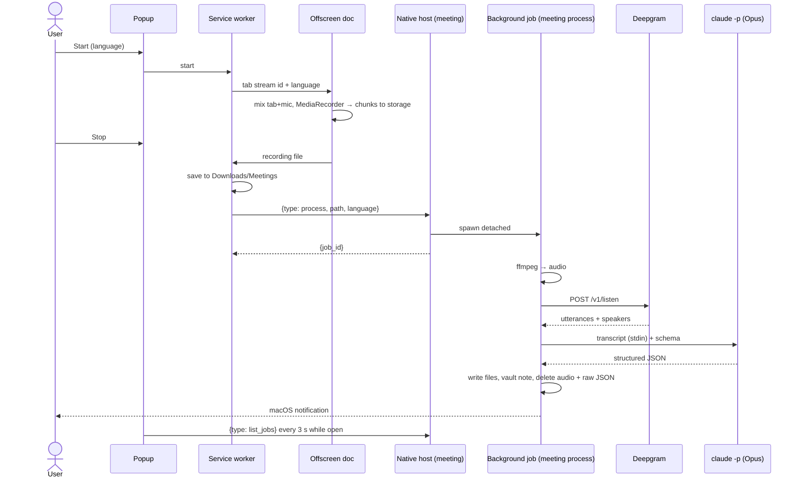
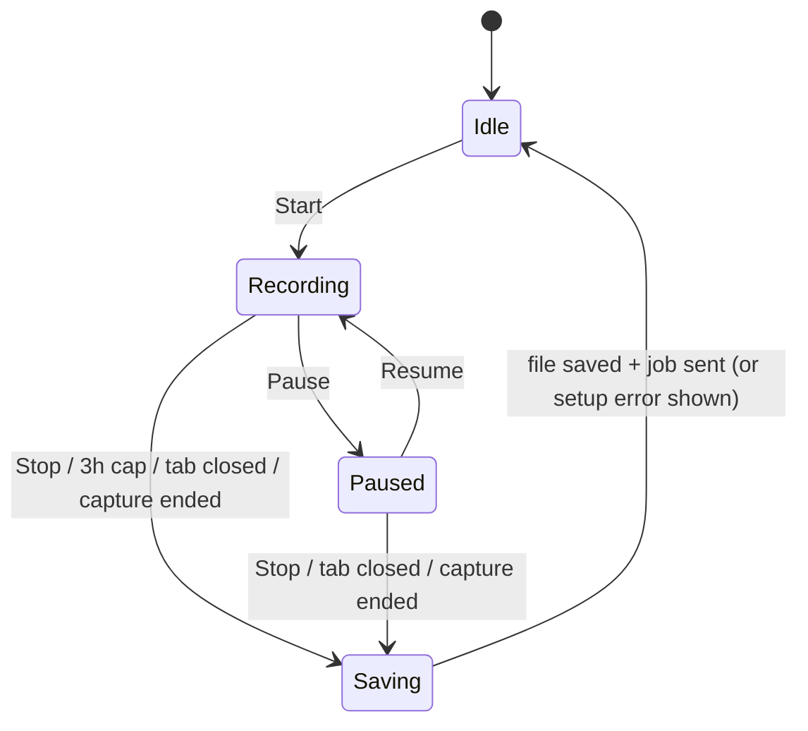
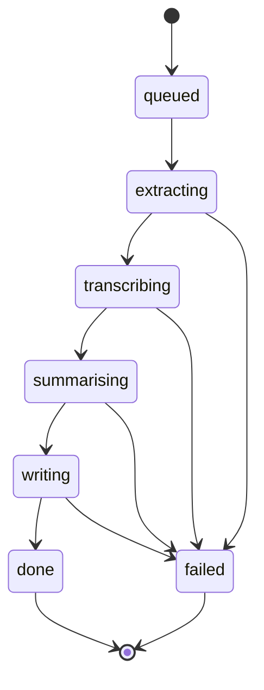

# PRD — Meeting recorder and summariser

**Status:** Approved · **Date:** 2026-10-19 · **Slug:** `meeting-recorder` · **Owner:** Siam · **Priority:** medium · **Repo:** masnun-siam/meeting-manager (private)

This document is the source of truth for the feature: every issue is derived from it, and a decision that is not written here has not been made.

## Overview

A Chrome extension records a browser meeting (the tab's video and audio plus the user's microphone). When recording stops, a local tool written in Rust is started automatically. It extracts the audio and transcribes it with Deepgram Nova-3 in Bengali or English with speaker diarization. Claude Code (Opus) then writes a summary, action points and insights. The results land next to the recording and in the user's Obsidian vault.

Today:

- Nothing exists. The repository is empty.
- No earlier pattern to follow. The closest external precedents are Chrome's tab-capture-in-offscreen-document recipe and Chrome native messaging.
- Not built yet: the extension, the native host, the processing pipeline and the vault export.

## Problem

Meetings, many of them in Bengali, are not recorded or summarised. Decisions and action points live in memory or in scattered notes, and nothing is searchable afterwards. Hosted note-takers either don't handle Bengali well or send the recording to a third-party bot that joins the call.

## Users

One user (the owner), on macOS, in Google Chrome. Meetings run in browser tabs (Google Meet, Zoom web, Teams web). No accounts, no sharing, no server.

## Goals

- Start and stop a recording of a browser meeting from the toolbar, choosing Bengali or English.
- Get, without further action, a speaker-labelled transcript and an English summary with action points and insights in the Obsidian vault.
- Rerun any recording when something failed or the wrong language was picked.

## Non-goals

- Live or streaming transcription during the meeting. The Deepgram key never enters the browser.
- Mic mute toggle while recording.
- Recording desktop apps (Zoom/Teams desktop), whole-screen capture or system audio.
- Browsers other than Google Chrome (Edge, Brave, Arc), and operating systems other than macOS.
- Bengali-English code-switching mode. Nova-3's `multi` option does not include Bengali, so each recording is transcribed in one selected language.
- A manual step to map speakers to names. Opus suggests names; nothing asks the user.
- Meetings longer than 3 hours of recorded time, and chunked summarisation.
- Editing transcripts or summaries in the extension, search across meetings, sharing, multi-user use.
- A user-entered meeting title. Opus names every meeting.
- Clicking the macOS notification to open the summary (see Decisions). Opening is done from the popup.

## Requirements

### Recording (extension)

- **FR-1 Start recording.** The popup's Record tab has a language select (Bengali, English; defaults to the last one used) and a Start button. Start captures the active tab's video (scaled to at most 1280×720, about 1 Mbps) and the tab's audio mixed with the default microphone into one WebM file. The user keeps hearing the tab while it is captured.
    - Acceptance: start on a tab playing a video while speaking into the mic. The saved file plays back both the tab audio and the voice, with picture, and the tab stayed audible during recording.
- **FR-2 Recording indicator.** While recording, the toolbar badge shows `REC` (or `II` when paused). The Record tab shows elapsed recorded time, which excludes paused time.
    - Acceptance: pause for 1 minute during a 5-minute recording. The timer shows about 4:00, and the badge changed to `II` while paused.
- **FR-3 Pause and resume.** Pause stops adding media to the recording and Resume continues the same file. Paused time is not recorded.
    - Acceptance: record 1 min, pause 1 min, record 1 min. The output file lasts about 2 minutes and is one file.
- **FR-4 Stop and save.** Stop finalises the file and saves it to `Downloads/Meetings/meeting-YYYY-MM-DD_HHMM.webm`, using the local start time (`-2`, `-3`… is appended on a clash), without a Save-as dialog. It then hands the absolute path and the selected language to the tool (FR-7). The Record tab shows "Saved, sent for processing".
    - Acceptance: after Stop, the file exists at that path and a job for it appears in the Jobs tab within 5 seconds.
- **FR-5 Recording stays flat in memory.** Media is written to extension storage in chunks while recording, not held in RAM, so a 3-hour recording does not grow the browser's memory with its length.
    - Acceptance: during a 60-minute recording, the offscreen document's memory in Chrome's task manager stays within 150 MB of its value at minute 1.
- **FR-6 Automatic stops.** Recording stops and saves as in FR-4 when recorded time reaches 3 hours, when the captured tab is closed, or when tab capture ends for any other reason. The popup's last message explains which of these happened.
    - Acceptance: closing the recorded tab produces a saved file and a job. A recording left running stops at exactly 3:00:00 recorded time.

### Handoff and status

- **FR-7 Automatic processing.** After saving, the extension sends `{path, language}` to the native host. The host starts a background job and replies at once with a job id. Processing does not depend on the popup, the browser or the service worker staying open.
    - Acceptance: quit Chrome right after Stop. The summary still appears in the vault.
- **FR-8 Jobs tab.** The Jobs tab lists the 10 most recent jobs, newest first, each with the Opus title (or the file name before there is one), date, current stage, and the reason when it failed. Done jobs have Open summary and Open folder buttons. Failed jobs have Retry, which reruns FR-14 without `--retranscribe`. The list refreshes every 3 seconds while the popup is open.
    - Acceptance: a job's stage changes from transcribing to summarising to done in the list without reopening the popup. Retry on a failed job starts a new run of the same recording.
- **FR-9 Notifications.** When a job ends, a macOS notification says "Meeting summary ready: <title>" or "Meeting processing failed: <stage> – <short reason>".
    - Acceptance: both notifications appear, the second one after forcing a failure such as an invalid key.
- **FR-10 Setup errors are visible.** If the native host is not installed, or the tool is not configured (no key, no vault, ffmpeg or claude missing), Start still records, but the Record tab and the job show a clear message naming the fix (`meeting install` or `meeting config set-key`). The recording is never lost.
    - Acceptance: with the host uninstalled, a recording is saved and the popup says the tool is not installed, with the command to fix it.

### Processing (tool)

- **FR-11 Audio extraction.** The tool extracts mono 16 kHz Opus audio (about 32 kbps) from the recording with ffmpeg.
    - Acceptance: a 60-minute recording produces an audio file of roughly 15–30 MB, and ffmpeg errors fail the job at stage `extracting`.
- **FR-12 Transcription.** The tool sends the audio to Deepgram's pre-recorded API with model `nova-3`, the selected language (`bn` or `en`), diarization, utterances, punctuation and smart formatting. It writes a speaker-labelled transcript: one line per utterance, in the form `[hh:mm:ss] Speaker N: text`.
    - Acceptance: a two-person English recording produces a transcript whose lines alternate between at least two speaker labels with timestamps. A Bengali recording produces Bengali text.
- **FR-13 Summarisation.** The tool runs Claude Code headless with Opus, no tools, and a fixed JSON schema (see Technical design). The output is in English whatever the meeting language. It contains a title, a summary, key points, decisions, action items (task, owner or "unassigned", due date if one was said, timestamp), insights (risks, disagreements, open questions, notable signals) and speakers. For each speaker it gives the label, the inferred name or null, and the evidence. Inferred names are marked "(inferred)" wherever they appear.
    - Acceptance: on a recording where one person says "thanks, Rahim", the speaker list maps a label to Rahim with evidence, and action items owned by that speaker show "Rahim (inferred)".
- **FR-14 Reprocess CLI.** `meeting process <recording>` runs the pipeline for any recording. If its transcript already exists, it reuses it and only redoes the summary and outputs. `--retranscribe` forces a new Deepgram transcript, and `--language bn|en` overrides the stored language (which implies `--retranscribe`). If a recording has no stored language and none is given, the command fails asking for `--language`.
    - Acceptance: rerunning on a done recording makes no Deepgram request (verified in the log) and rewrites the summary. `--language en` on a recording first done in `bn` produces an English transcript.
- **FR-15 Outputs.** On success these sit next to the recording: the recording, `<name>.transcript.md`, `<name>.summary.md` and `<name>.meta.json` (language, timestamps, job history). The vault gets `<vault>/<folder>/YYYY-MM-DD HHMM <title>.md`, where the folder is configurable and defaults to `Meetings`. The vault note has frontmatter (`date`, `language`, `speakers`, `recording`, `transcript`) and the same body as the summary. A rerun overwrites the existing vault note for the same recording, matched by its `recording` frontmatter, even if the title changed.
    - Acceptance: after one run, exactly those files exist next to the recording and one note exists in the vault. After a rerun that produces a new title, there is still one note.
- **FR-16 Retention.** The extracted audio and Deepgram's raw response are kept while the job runs and until it succeeds, so a failed run can resume from them. Both are deleted when a job succeeds. The recording, transcript, summary and meta file are never deleted by the tool.
    - Acceptance: a job that fails at `summarising` leaves the audio and raw response in place, and the rerun doesn't call Deepgram or ffmpeg. After the rerun succeeds, both files are gone.
- **FR-17 One job per recording.** A second run on a recording whose job is still running is refused with "already processing". Different recordings may process at the same time.
    - Acceptance: starting `meeting process` on a recording that's mid-transcription exits non-zero with that message. Two different recordings processed together both finish.

### Install and config

- **FR-18 Install.** `meeting install` registers the native host for the extension's fixed ID in Chrome only. It resolves and stores absolute paths for `ffmpeg` and `claude`, asks for the vault path and folder, and checks that `claude` is logged in. `meeting config set-key` stores the Deepgram key in the macOS Keychain. `meeting doctor` reports every check as pass or fail.
    - Acceptance: on a clean machine, after `meeting install` and `meeting config set-key`, `meeting doctor` passes every check and FR-7 works from Chrome.

## Flows

The end-to-end record → process flow; the extension's part ends as soon as the host replies.



Recording lifecycle in the extension.



Job lifecycle in the tool. Each stage is skipped when its output already exists (FR-14, FR-16).



## Edge cases

- **Concurrency.** Two recordings can't be made at once, because Start is disabled while recording. Two jobs on different recordings run in parallel and each has its own files. The same recording is guarded by a lock file next to it (FR-17). A lock left by a crashed process is treated as stale when its PID isn't running.
- **Browser crash or extension reload mid-recording.** Chunks already in extension storage survive. On the next extension start, the extension saves any leftover chunks as `meeting-…-recovered.webm` and processes them as usual.
- **Empty or silent recording.** If Deepgram returns no words, the job ends as done with a transcript saying "No speech detected". Opus is not called, and no vault note is written.
- **Recording under 10 seconds.** It is saved but not processed. The popup says it was too short.
- **One speaker.** It works as normal, with all lines labelled `Speaker 0`.
- **Wrong language picked.** This is recovered with `meeting process <file> --language <other>` (FR-14).
- **Mic permission denied.** Recording continues with tab audio only, and the popup warns that the mic is not included.
- **Tab has no audio.** It records anyway. The transcript may be empty, which is handled as the empty case above.
- **Disk full** while saving or writing outputs fails with a clear message. The recording chunks stay in extension storage until a save succeeds.
- **Deepgram errors.** 401/403 fail the job naming the key, with no retry. 429 and 5xx are retried 3 times with backoff (5 s, 20 s, 60 s). The request timeout is 15 minutes.
- **Claude errors.** Not logged in, non-zero exit, timeout (15 min) or output that fails the schema each fail the job at `summarising`, with the transcript kept.
- **Prompt injection.** The transcript is untrusted. Claude runs with all tools disabled, the system prompt says to treat the transcript as data, and only schema-valid JSON is accepted.
- **Native host path checks.** The host accepts only an existing `.webm` file under the configured recordings directory. Any other path, and any message from an origin other than the extension's fixed ID, is rejected.
- **Data isolation.** There is a single user and everything is local. The Deepgram key never leaves the Keychain and the tool, and it is never written to logs, meta files or the extension. Transcript text is never logged.
- **Existing data.** None. Nothing to migrate.

## Technical design

### Data

All files are local. There is no database.

- **Recordings directory:** `~/Downloads/Meetings/` (configurable). Per recording `<name>` (for example `meeting-2026-10-19_1430`):
    - `<name>.webm` holds the recording (FR-4).
    - `<name>.audio.ogg` holds the extracted audio. It is temporary and deleted on success (FR-11, FR-16).
    - `<name>.deepgram.json` holds Deepgram's raw response. It is temporary and deleted on success (FR-12, FR-16).
    - `<name>.transcript.md` has a header with the language and speaker count, then utterance lines `[hh:mm:ss] Speaker N: text` (FR-12). This file is what FR-14 reuses.
    - `<name>.summary.md` holds the rendered summary (FR-15).
    - `<name>.meta.json` has the fields `recording`, `language` (`bn`|`en`), `recorded_at` (ISO 8601), `duration_s`, `title` (null until summarised), `speakers` (`[{label, name|null, evidence}]`) and `runs` (`[{job_id, started_at, ended_at, stage, error|null}]`, one entry per job, updated as the job moves through its stages, with `ended_at` null while it runs). It's written by the tool, not the extension (FR-14, FR-15).
    - `<name>.lock` exists while a job runs and holds its PID (FR-17).
- **Jobs store:** `~/Library/Application Support/meeting-manager/jobs/<job_id>.json` with `{job_id, recording, title|null, stage, error|null, started_at, updated_at, summary_path|null}`. It's written at every stage change and is the only source for `list_jobs` (FR-8). There is no cleanup in v1, since one file per job is a few hundred bytes.
- **Config:** `~/.config/meeting-manager/config.toml` with `recordings_dir`, `vault_dir`, `vault_folder` (default `Meetings`), `ffmpeg_path`, `claude_path`, `extension_id`. The file holds no secrets (FR-18).
- **Secret:** the Deepgram key is in the macOS Keychain, service `meeting-manager`, account `deepgram` (FR-18).
- **Logs:** `~/Library/Logs/meeting-manager/meeting.log` records stage transitions, timings, HTTP status codes and errors. It never holds the key or transcript text.
- **Extension storage:** recording chunks live in the extension's origin-private file system until saved (FR-5, recovery edge case). The last-used language is kept in `chrome.storage.local`.
- **Summary JSON schema** (FR-13), passed to `claude --json-schema`:
    - `title` is a string of up to 80 characters.
    - `summary` is a string: 1–3 paragraphs of markdown.
    - `key_points` is a list of strings.
    - `decisions` is a list of strings.
    - `action_items` is a list of `{task, owner, due, timestamp}`. `owner` is a speaker name, "(inferred)" or "unassigned". `due` is a string or null. `timestamp` is `hh:mm:ss`.
    - `insights` is a list of `{kind, text}`, where `kind` is one of `risk`, `disagreement`, `open_question` or `signal`.
    - `speakers` is a list of `{label, name, evidence}`. `name` is a string or null.

### API

Native messaging between the extension and the host, using Chrome's JSON stdio protocol. The host is `com.meeting_manager.host`, and `allowed_origins` names only the extension's fixed ID. Every message is a request/response over `chrome.runtime.sendNativeMessage`, with no long-lived port.

| Request                                             | Response                                                                                             | Errors                                                                               |
| --------------------------------------------------- | ---------------------------------------------------------------------------------------------------- | ------------------------------------------------------------------------------------ |
| `{type: "process", path, language: "bn"\|"en"}`     | `{ok: true, job_id}`                                                                                 | `{ok: false, code: "not_configured"\|"invalid_path"\|"already_processing", message}` |
| `{type: "retry", job_id}`                           | `{ok: true, job_id}` (new id)                                                                        | as above, plus `unknown_job`                                                         |
| `{type: "list_jobs", limit: 10}`                    | `{ok: true, jobs: [{job_id, recording, title, stage, error, started_at, updated_at, summary_path}]}` | none                                                                                 |
| `{type: "open", job_id, what: "summary"\|"folder"}` | `{ok: true}`                                                                                         | `unknown_job`, `missing_file`                                                        |
| `{type: "health"}`                                  | `{ok: true, checks: [{name, ok, fix}]}`                                                              | none                                                                                 |

`stage` is one of `queued`, `extracting`, `transcribing`, `summarising`, `writing`, `done`, `failed`. If the host is missing, Chrome's own error (`Specified native messaging host not found`) is mapped to FR-10's message.

CLI (FR-14, FR-18):

- `meeting process <recording> [--retranscribe] [--language bn|en]` runs in the foreground and prints each stage. It exits 0 on done and non-zero on failure.
- `meeting install` registers the host and writes the config.
- `meeting config set-key` reads the key from a hidden prompt.
- `meeting doctor` prints the same checks as `health`.
- `meeting native-host` is the entry point Chrome launches. It isn't for direct use.

External calls:

- **Deepgram:** `POST https://api.deepgram.com/v1/listen?model=nova-3&language=<bn|en>&diarize=true&utterances=true&punctuate=true&smart_format=true`, with `Authorization: Token <key>`, `Content-Type: audio/ogg` and the raw audio as the body. The tool reads `results.utterances[]` (`start`, `speaker`, `transcript`).
- **Claude Code:** `claude -p --model opus --tools "" --output-format json --json-schema <schema> --no-session-persistence --system-prompt <fixed prompt>`, with the transcript on stdin. The tool reads the structured result from the JSON envelope. The fixed prompt states the English output, the inferred-name rule and that the transcript is untrusted data.

### Backend (Rust tool)

One binary, `meeting`, with these responsibilities:

- **Native host mode** validates each message (origin, path inside the recordings directory, `.webm`, file exists). For `process` and `retry`, it creates the job file in the `queued` stage, spawns `meeting process` detached in its own session so it outlives Chrome closing the pipe, and replies at once. For the other messages, it reads job files and opens files with the system `open`.
- **The pipeline** takes the per-recording lock, then runs extract → transcribe → summarise → write. Each stage is skipped when its output already exists and is newer than its input. A stage forced by `--retranscribe`/`--language` deletes the transcript and the raw response first. Each stage updates the job file and the job's entry in `meta.json` `runs`. On success it deletes the audio and raw response, removes the lock and notifies. On failure it records the stage and reason, removes the lock and notifies.
- **The vault writer** finds an existing note whose frontmatter `recording` matches this recording and overwrites it, renaming it if the title changed. Otherwise it creates the note. The write is atomic: write to a temporary file, then rename.
- **Notifications** use `osascript` `display notification`, so no extra dependency is needed.
- **The environment** is minimal: Chrome launches the host with a bare `PATH`, so all external programs come from the absolute paths in the config.
- **New dependencies** (Rust crates): `clap` (derive) for the CLI, `serde`, `toml` and `serde_json` for config, job and meta files, `anyhow` for errors, `tracing` and `tracing-subscriber` for the log file, `ureq` for HTTP (blocking, with no async runtime, because the pipeline is sequential) and `keyring` with its macOS native backend for the Keychain. The home directory comes from `std::env::home_dir`.
- **Repository layout:** the repo root is a Cargo workspace, and the `meeting` crate lives in `crates/meeting/`. The extension is an npm project in `extension/`.

### Frontend (Chrome extension)

Manifest V3, React with Vite (CRXJS) and strict TypeScript, with a fixed extension ID set through a manifest `key` so the native host manifest can trust it. The ID is `obbaikcmcdooakogedoiiflflbbhpgdh`. Only the public key is kept, in the manifest, because the extension is only ever loaded unpacked. Permissions: `tabCapture`, `offscreen`, `downloads`, `nativeMessaging`, `storage`.

- **Service worker** is the state owner. It starts and stops the offscreen document, sets the badge, saves the file through `downloads` (without a Save-as dialog) and resolves the saved file's absolute path. It then sends `process`, and on startup it recovers leftover chunks.
- **Offscreen document** is where capture happens. It takes the tab stream from its stream id, mixes tab audio and mic audio into one track, plays tab audio back to the speakers and runs MediaRecorder (WebM, about 1 Mbps video, 720p cap). It writes 5-second chunks to origin-private storage and enforces the 3-hour cap on recorded time.
- **Mic permission page** is a one-time extension page opened on first Start when mic permission has not been granted, because an offscreen document can't show the permission prompt.
- **Popup** has two tabs, as in the mockup below.
    - **Record tab:** the language select, Start, Pause/Resume, Stop & save, the timer, and status or error messages (FR-1–4, FR-10).
    - **Jobs tab:** the list from `list_jobs`, with Open summary, Open folder and Retry (FR-8). Loading shows "Loading…". The empty state shows "No meetings processed yet". If the host is missing, the FR-10 message is shown.

```
┌ [Record] | Jobs ────────────┐
│ Language [Bengali ▾]        │
│ ● REC 00:42:13              │
│ [ Pause ]  [ Stop & save ]  │
└─────────────────────────────┘
```

### Realtime and other services

Not affected. The only external services are Deepgram (transcription) and Anthropic through the user's own Claude Code login (summary).

### Non-functional

- **Size:** recordings are about 450 MB per hour at 720p and 1 Mbps. The upload to Deepgram is the extracted audio only, about 15–30 MB per hour.
- **Time:** processing a 1-hour meeting should take under 10 minutes end to end, mostly Deepgram and Opus time.
- **Context:** a 3-hour Bengali transcript must fit in one Opus call. If Claude reports the input is too long, the job fails at `summarising` with that reason, and there is no chunking in v1.
- **Security:** the key is held only in the Keychain. The native host trusts one extension ID and checks paths. Claude runs with no tools. Nothing is uploaded except the audio (to Deepgram) and the transcript (to Anthropic).
- **Compatibility:** macOS, current stable Chrome, ffmpeg built with libopus (Homebrew's build is).

### Testing

- **Rust unit tests:**
    - Rendering utterances into the transcript format (FR-12).
    - Deciding which stages to skip (FR-14, FR-16).
    - Native message validation and path checks (edge cases).
    - Matching and overwriting vault notes (FR-15).
    - Stale lock detection (FR-17).
    - Mapping the Deepgram response and the Claude envelope, with recorded fixtures.
- **Rust integration tests:** the pipeline against a short fixture recording. Deepgram is replaced by a local mock server through a configurable base URL, and `claude` by a stub script that returns fixture JSON. They cover success, failures at each stage and resuming (FR-11–17).
- **Native messaging protocol test:** a framed stdin/stdout round-trip for each message type (API table).
- **Extension:** Vitest component tests for the popup tabs (states, empty, error, host missing), and unit tests for the recording state machine (FR-2, FR-3, FR-6).
- **CI:** GitHub Actions runs one path-filtered job per part. The tool job runs `cargo fmt --check`, `cargo clippy -- -D warnings` and `cargo test` on macOS. The extension job runs the build, `tsc --noEmit`, `biome check` and `vitest run`.
- **Manual** (it can't be automated, because tab capture needs a real user gesture):
    - FR-1, FR-5, FR-6 and FR-7 in real Chrome with a Meet call.
    - One real Bengali and one real English meeting end to end against live Deepgram and Opus, checking diarization quality and inferred names.

## Rollout and cost

- Personal tool, everyone at once (one user). Installed by building the extension, loading it unpacked and running `meeting install` and `meeting config set-key`.
- Deepgram bills Nova-3 pre-recorded audio per minute, at current pricing on deepgram.com/pricing. Reprocessing reuses transcripts, so each recording is normally billed once.
- Claude: Opus usage counts against the user's Claude Code plan. A 1-hour meeting is one call.
- Prerequisites: ffmpeg with libopus, a logged-in Claude Code, a Deepgram API key, and an Obsidian vault path.

## Success metrics

None formally defined. Informally, every meeting recorded for two weeks has a vault note without manual steps, and Bengali transcripts are good enough that the summaries need no correction.

## Epics

- **E1 Meeting recorder and summariser** covers FR-1 to FR-18. Issue: #1

## Decisions

- **Capture tab video and audio plus the mic, as WebM:** this captures both sides of a browser call and keeps a video to rewatch. The tool extracts the audio, as requested.
- **Chrome only; macOS only:** one native-host location to install and test, on the user's platform.
- **Handoff by native messaging, auto-run:** fully automatic processing after Stop. The host spawns a detached job and replies at once, so Chrome closing the pipe or the MV3 worker sleeping can't kill it.
- **Tool in Rust:** the user's choice.
- **Extension in React with Vite (CRXJS) and strict TS:** the user's choice, consistent with the React stack.
- **Outputs next to the recording and in the Obsidian vault**, with the vault folder configurable and defaulting to `Meetings/`: portable files plus notes in the vault.
- **Summary always in English:** consistent, searchable notes. Opus reads Bengali transcripts directly.
- **The Deepgram key lives in the macOS Keychain:** Chrome launches the host without the shell environment, and it avoids plaintext secrets on disk.
- **Speakers:** the transcript keeps `Speaker N`, and Opus suggests names marked "(inferred)". There is no manual mapping step, so the flow stays automatic.
- **Feedback through both a macOS notification and the popup's Jobs tab:** the user's choice. The notification has no click action, because that would need a new dependency, so opening the summary is done from the popup.
- **v1 includes the reprocess CLI and pause/resume.** The mic mute toggle and live transcript are non-goals.
- **The popup has two tabs, Record and Jobs:** the user's choice.
- **Titles are generated by Opus only.** Files use timestamp names, and the vault note uses the Opus title.
- **720p at about 1 Mbps, with a 3-hour cap,** and chunks written to storage while recording: this keeps memory flat and file size moderate, and keeps a long Bengali transcript inside one Opus call.
- **Retention:** all intermediates are kept while a job runs. After success only the recording, transcript, summary (and meta) remain, so failed runs can resume without paying again.
- **Reprocessing reuses the transcript and redoes the summary,** with `--retranscribe` or `--language` to force a new transcript, so Deepgram isn't paid twice.
- **The languages are `bn` and `en` only, one per recording:** these are what was asked for. Nova-3 supports both, and its `multi` code-switching option excludes Bengali.
- **Claude runs headless with no tools and a JSON schema:** the transcript is untrusted input, and the schema makes the output parseable.
- **Priority is medium,** with a private GitHub repo and one epic on approval.
- **No date/time crate.** The vault note's date and time and `meta.json` `recorded_at` come from the recording name `meeting-YYYY-MM-DD_HHMM` (the local start time, FR-4), as `YYYY-MM-DDTHH:MM`. A recording with any other name uses its file's modified time in UTC. Job and run timestamps (`started_at`, `updated_at`, `ended_at`) are UTC, `YYYY-MM-DDTHH:MM:SSZ`.
- **`meta.json` `runs` has one entry per job,** updated in place as the job moves. Per-stage timings go to the log.

## Open questions

None.

## Change log

- 2026-10-19: Settled while refining #2 and #3. The repository layout is a root Cargo workspace with `crates/meeting/` and `extension/`. The Rust crates are named. The fixed extension ID is `obbaikcmcdooakogedoiiflflbbhpgdh`. CI runs one GitHub Actions job per part. Affects #2, #3 and #27, and every later tool issue through the crate choice.
- 2026-10-19: Settled while refining #4–#14. No date/time crate: local dates come from the recording name, other timestamps are UTC. `meta.json` `runs` holds one entry per job. Affects #4, #12 and #20.

## Related


- Deepgram docs: models and languages (Nova-3 `bn`, `en`; `multi` excludes Bengali), pre-recorded audio (`/v1/listen`, 2 GB max, 10-minute processing timeout), diarization (all Nova batch models).
- Chrome docs: `chrome.tabCapture` with offscreen documents, native messaging.
