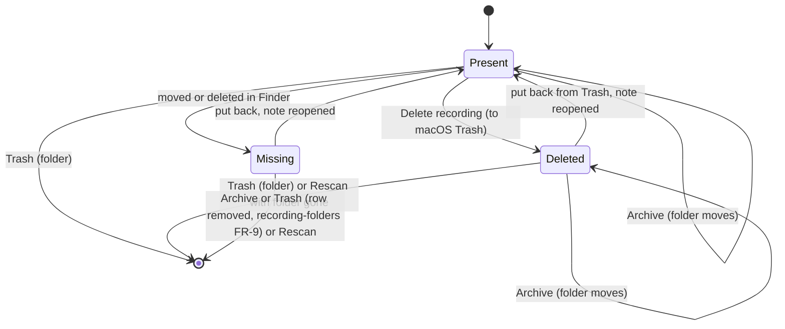
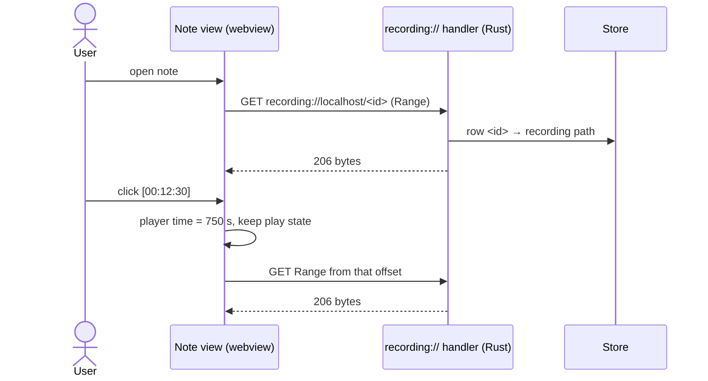

# PRD — Note view: copy, speaker picker, playback and redesign

**Status:** Approved · **Date:** 2026-11-17 · **Slug:** `note-view-upgrades` · **Owner:** Siam · **Priority:** medium · **Repo:** masnun-siam/meeting-manager

This document is the source of truth for the feature: every issue is derived from it, and a decision that is not written here has not been made. It changes the desktop app's note view ([desktop-app.md](desktop-app.md) FR-17, FR-18, FR-21) as listed under "Changes to existing behaviour"; everything else there stands.

## Overview

Four improvements to a meeting's note in the Meeting desktop app: copy the whole note as markdown or as formatted text to paste into Slack or a doc; pick a speaker's name from the meeting's attendees or names used before instead of typing it; listen to the recording inside the app and jump to any transcript line, open a video recording in the system player, and delete the recording while keeping the note; and a redesigned note page where "My notes" has room to write.

Today:
- The note view shows the title (edited in place), a facts line, actions (Open in Obsidian, Open folder, Rerun summary, Archive, Trash), Summary and Transcript tabs, and a 300 px side column with "My notes" (a small textarea) above the speakers (desktop-app FR-17, FR-18; layout reworked in #183).
- Speaker names are typed into a free-text field per speaker; there is no list to pick from.
- Attendee names exist only in the meeting folder's `context.json` (calendar event attendees from the app, the Meet roster from the extension); the store does not keep them.
- Transcript lines are `[hh:mm:ss] Name: text`, the time being the offset into the recording (meeting-recorder FR-12). They are plain text.
- The recording can only be reached through Open folder. Recordings are `recording.<ext>` with `<ext>` one of `webm`, `mp4`, `m4a`, `mov`, `mkv`, `mp3`, `wav`, `ogg` (recording-import FR-2): `.webm` from the extension (video), `.m4a` from the app (audio), anything on that list from `meeting import`.
- A recording that disappears makes the note "Recording missing": Open folder and Rerun are disabled, Archive and Trash only remove the row (recording-folders FR-9), and Rescan drops the row (desktop-app Edge cases).
- The webview cannot read local files: the content security policy allows only the app itself, and no command takes a path from the UI.
- Closest patterns: `note_open` (opening a file with `/usr/bin/open`), Trash's 3-second confirm, and the Rust-side markdown renderer with raw HTML disabled (D25 there).

## Problem

Sharing a meeting means opening Obsidian and copying from there; pasting raw markdown into Slack shows `##` and `**`. Naming speakers means retyping names the app already knows from the calendar invite or from earlier meetings. Checking what was really said at a moment in the transcript means finding the file in Finder and scrubbing by hand. Old recordings take disk space and can only be removed by trashing the whole note. On the note page, "My notes" is a narrow box beside the summary that is impractical to write in, and the page's scrolling is awkward with long notes.

## Users

The single owner on their own Mac, in the Meeting desktop app's note view. No roles, no sharing.

## Goals

- Copy a meeting note in one click, either as raw markdown or so it pastes formatted into Slack, Notion or Google Docs.
- Name a speaker by picking from the meeting's attendees or names used before, or by typing.
- Listen to any recording in the app and jump to a transcript line by clicking its time; watch a video recording in the system player.
- Delete a recording to free space and keep its note.
- Write "My notes" in a full-size editor, on a page that scrolls naturally.

## Non-goals

- Copying the transcript (D1), copying to a file, or sharing to Slack directly through an API.
- Video playback inside the app (D3), a waveform, playback of a recording while it is still recording or processing its first run.
- Highlighting or auto-scrolling the transcript line being played; playing from a summary's action-item timestamp.
- Deleting only some of a meeting's files other than the recording (transcript, summary, `meta.json` stay), compressing a recording, or deleting recordings in bulk.
- Changes to the Chrome extension, its Jobs tab, the native-messaging protocol or the vault note format.
- Suggesting names from a contacts list, from Claude-inferred names the user never confirmed (D11), or from other meetings' attendees.
- Rich-text editing of "My notes" or the summary (both stay markdown text).

## Requirements

### Copy

- **FR-1 Copy markdown.** The note view has a "Copy markdown" action. It puts on the clipboard, as plain text: `# <title>` (or the folder name when there is no title), a blank line, one line `<date and time> · <duration> · <language> · <source>` (parts that are unknown left out) and, when linked, a line `Event: <event title> · <event start>`; a blank line; the summary body as stored (`body_md`, edits included) when there is one; `## Speakers` with one `- <shown name>` line per speaker when there are speakers; `## My notes` and its text when it is not empty. The transcript is never included (D1). It works for every status. The button reads "Copied" for 2 seconds after success.
  - Acceptance: on a done note with an edited title, two speakers (one renamed) and "My notes", paste into a plain-text editor gives the edited title as `# ` heading, the facts line, the summary markdown, both speakers' current names under `## Speakers`, and `## My notes`; no transcript line appears. On a failed note with only "My notes", the paste holds the heading, the facts line and `## My notes`.
- **FR-2 Copy formatted.** A "Copy formatted" action puts the same content on the clipboard twice: as HTML rendered from FR-1's markdown (raw HTML in it shown as text, as the note view does) and as FR-1's markdown as the plain-text fallback. "Copied" shows as in FR-1. A failed clipboard write shows "Couldn't copy: <reason>".
  - Acceptance: paste into Slack's message box shows the heading, bullet lists and bold text formatted, with no `#`, `-` or `**` characters visible; paste into TextEdit (plain text mode) gives FR-1's markdown. A summary containing `<b>x</b>` pastes that text literally.

### Speaker picker

- **FR-3 Attendees kept with the note.** Each note keeps a list of attendee names: from `context.json`, the `calendar_event` attendees whose response is not `declined`; when that gives none, the names in `participants` (the Meet roster). At most 200 names of at most 100 characters each, duplicates (ignoring case) removed, order as in the file. The list is set by every `meeting process` run, by backfill and Rescan, and once for existing notes at the first launch of this version; a note with no usable `context.json` has an empty list. It is read whether or not `FEATURE_MEETING_CONTEXT` is on, and is never sent to Claude or written to the vault by this feature.
  - Acceptance: a note recorded from a calendar event with attendees Rahim (accepted), Karim (declined) and Nadia (no response) has attendees Rahim and Nadia. A Meet recording with a roster of three and no calendar match has those three. An existing note from before this version gets its list after the first launch, without a rerun.
- **FR-4 Pick a speaker's name.** Each speaker's rename field on a done note is a combobox: typing is still free text, and focusing it or typing opens a list of suggestions filtered by the typed text (case-insensitive, matching anywhere in the name): first "Attendees" (FR-3, in their order), then "Used before" (names the user typed for speakers in any note, this one included (D14), newest first, at most 50, without names already under Attendees). Choosing a suggestion (click, or arrow keys and Enter) sets the name and saves at once, exactly as a typed rename (desktop-app FR-18). Escape closes the list and keeps the typed text. With no suggestions, no list opens.
  - Acceptance: on a note whose attendees are Rahim and Nadia, focusing Speaker 1's field lists Rahim and Nadia under Attendees and earlier typed names under Used before; typing "na" leaves Nadia (and earlier names containing "na"); pressing Enter on Nadia renames Speaker 1 to Nadia in the body, transcript and vault note. Typing "Someone New" and leaving the field saves "Someone New" as today. A note with no attendees and no earlier names opens no list.

### Playback

- **FR-5 Audio player.** When the note's recording exists, the note view shows a player: play/pause, a seek bar, the current time and the duration (`h:mm:ss`), and a speed choice (1×, 1.25×, 1.5×, 2×; default 1×). It plays the recording's sound for every recording type (D3). It stays visible while the page scrolls and while switching tabs (D6), and keeps playing across tab switches. Leaving the note (Back, another note, Archive, Trash, Delete recording) stops it. While the note is `processing` for its first run (no transcript yet) the player is still shown.
  - Acceptance: on an app recording (`.m4a`) and on an extension recording (`.webm`), Play produces sound and the time advances; dragging the seek bar to the middle continues from there; 2× plays at double speed. Switching to Transcript and back keeps it playing. Back stops the sound.
- **FR-6 Jump from the transcript.** Each transcript line's time is a button. Clicking it (or Enter or Space on it) moves the player to that time; a playing player keeps playing from there, a paused one stays paused there (D7). With no player (recording deleted, missing or not playable), the times are plain text.
  - Acceptance: while playing, clicking `[00:12:30]` continues playback at 12:30. While paused, clicking `[00:05:00]` shows 5:00 and stays paused; Play then starts at 5:00.
- **FR-7 Open video.** A note whose recording is a video type (`webm`, `mp4`, `mov`, `mkv`) has "Open video", which opens the recording with macOS's default app for it. If no app can open it, the message from macOS is shown ("Couldn't open the recording: <reason>").
  - Acceptance: on an imported `.mp4` note, Open video starts QuickTime Player (or the user's default) with the recording. An `.m4a` note has no Open video.
- **FR-8 Unplayable recording.** When the app cannot play a recording's format, the player is replaced by "This recording can't be played in Meeting." with an "Open recording" button (macOS's default app), and FR-6's times stay plain text.
  - Acceptance: an imported `.mkv` (or any file the webview rejects) shows the message and Open recording opens it externally.

### Deleting the recording

- **FR-9 Delete recording.** A note whose recording exists has "Delete recording" (done, `no_speech` and failed notes; not while processing, "already processing"). The first click turns it into "Confirm delete" for 3 seconds; a second click in that time moves the recording file (only `recording.<ext>`) to the macOS Trash. The transcript, summary, `meta.json`, the vault note, the store row and its edits and "My notes" stay. The note then shows "Recording deleted" in place of the player; Rerun summary is disabled with "The recording was deleted."; Open video is gone; Open folder, Open in Obsidian, copy, editing, Archive and Trash work. The notes list shows the note as usual, without "Recording missing".
  - Acceptance: delete the recording of a done `.webm` note: the file is in the macOS Trash and can be put back with Finder; the folder still holds `transcript.md`, `summary.md` and `meta.json`; the note shows "Recording deleted", its edits and "My notes" are unchanged, and Rerun is disabled. While the note is processing, Delete recording is disabled.
- **FR-10 Notes without their recording.** A note whose recording was deleted (FR-9) keeps working with its folder: Archive moves the meeting folder to `Archive/` as recording-folders FR-5 and FR-8 say (same naming, vault frontmatter and `meta.json` rewrite) and the row follows it; Trash moves the folder to the macOS Trash and removes the row; Rescan keeps the row while its folder exists and removes it when the folder is gone. A recording deleted or moved outside the app (Finder) is still "Recording missing" as today. If a recording is put back from the Trash into its folder, the note shows the player again (checked when the note opens).
  - Acceptance: delete a note's recording, then Archive: the folder is in `Archive/`, the note stays listed with "Recording deleted" and Open folder opens the archived folder. Rescan afterwards keeps the note. Trash then removes the folder and the note. Putting the file back from the Trash and reopening the note shows the player.

### Note page redesign

- **FR-11 Layout.** The note page has, top to bottom: Back; the title (edited in place, as today); the facts line; status, save line and vault banner (as today); the actions toolbar; then a bar holding the tab row (Summary | Transcript | My notes) and the player (FR-5), which sticks to the top of the window once scrolled to; then the selected tab beside a speakers column. The page has one scroll (D6): no part of it has its own scroll area, so the mouse wheel scrolls the page wherever the pointer is. Below a window width of 900 px the speakers column moves under the tab content. The default tab is Summary; the chosen tab is kept while the note is open.
  - Acceptance: on a note with a 300-line transcript and 20 speakers, scrolling with the pointer over the speakers column scrolls the page; the tab bar and player stay at the top while scrolling; every speaker can be reached by scrolling. At 800 px wide the speakers appear below the tab content.
- **FR-12 My notes tab.** "My notes" is the third tab (D5): an editor as wide as the tab content, at least 60% of the window's height, growing with its text (no inner scroll bar), with the same autosave, 1 MB cap and rules as desktop-app FR-18 and D39 there. It is editable for every status. The tab label shows a dot when "My notes" is not empty.
  - Acceptance: typing 100 lines into My notes grows the editor and the page scrolls; the text saves 1 second after typing stops and appears in the vault note's `## My notes`. A note with My notes text shows a dot on the tab.
- **FR-13 Actions toolbar.** The toolbar shows Copy markdown, Copy formatted and Open in Obsidian as buttons, and a "More" menu with Open folder, Open video (FR-7), Rerun summary, Archive, Delete recording (FR-9) and Trash. The menu is keyboard operable (arrow keys, Enter, Escape) and each item's disabled reason (processing, recording missing or deleted) is shown in the menu. The two confirms (Trash, Delete recording) keep the menu open showing "Confirm …" for 3 seconds.
  - Acceptance: with the keyboard only, open More, choose Trash, choose "Confirm trash": the note is trashed. On a processing note, Archive, Delete recording and Trash are disabled with "Not available while the note is processing" (D15).

## Flows

The recording's states as seen by a note (FR-9, FR-10).

Playing and jumping (FR-5, FR-6).

## Changes to existing behaviour

- **desktop-app FR-17:** the note view's actions, tabs and side column change as FR-11 to FR-13 say; "My notes" moves from the side column to a tab.
- **desktop-app FR-18:** a speaker's rename field gains suggestions (FR-4); saving is unchanged.
- **desktop-app FR-21 and recording-folders FR-9 (app only):** a note whose recording was deleted by FR-9 is archived and trashed by its folder, not removed (FR-10). A recording missing for any other reason is unchanged.
- **desktop-app Edge cases, "Missing data":** Rescan keeps deleted-recording rows while their folder exists.
- **desktop-app FR-13 and FR-14:** each run and each backfill also set the row's attendees (FR-3).

## Edge cases

- **Concurrency.** Delete recording is refused while the recording's job lock is held ("already processing"), and Rerun is refused once the recording is deleted (`recording_deleted`), so a job never starts on a file being deleted. A `meeting process` started by hand on a deleted recording fails as today (file missing) and does not change the row's deleted state. Playing while Archive or Delete runs: the player stops first. Two app windows are not possible (single instance).
- **Empty states.** No attendees and no earlier names: the rename field is a plain text field (no list). No speakers: no speakers column. No summary: copy holds what exists (FR-1). No transcript: the Transcript tab says "No transcript." as today and nothing is clickable.
- **Limits.** Attendees: 200 names × 100 characters. Used before: 50 names. My notes: 1 MB as today. Copy has no size cap beyond those of its parts.
- **Missing or moved data.** A recording missing at open: no player, "Recording missing" as today. A recording that disappears while playing: the player shows "Recording missing" and stops. The `recording://` handler re-reads the row's path on every request, so an archived note plays from its new place.
- **Formats.** FR-8 covers anything the webview can't decode (expected: `mkv`, `ogg`; to be confirmed in the manual test for each of the eight extensions).
- **Access and data isolation.** Single user, local only. The `recording://` handler serves only the recording of a store row, by id, after checking the path is a `recording.<ext>` in its own folder under the recordings directory (recording-folders FR-8 and recording-import FR-5), and answers nothing for any other path. Attendee names are confidential like the rest of the note: never logged, never sent to Claude or written to the vault by this feature. Copy puts note content on the system clipboard only on an explicit click.
- **Existing data.** A store migration adds the new fields; existing rows get their attendees once at first launch (FR-3) and `recording_deleted` false. No file is moved or rewritten.

## Technical design

### Data

All local; classification **confidential** (meeting content and names) except the setting, **internal**.

- **Store `meetings` gains:**
  - `attendees` JSON text, null until filled: a list of names (FR-3). Filled by the pipeline at the start and end of each run, by backfill and Rescan, and by the one-time fill; null is shown as an empty list.
  - `recording_deleted_at` text null, UTC `YYYY-MM-DDTHH:MM:SSZ`: set by Delete recording (FR-9), cleared when the note is opened and the file is back (FR-10).
  - The schema version (`PRAGMA user_version`) goes up by one; the migration adds both columns and runs in whichever process opens the store first, as today.
- **Store `settings` gains `attendees_filled`** (`true` once the one-time fill finished; FR-3).
- **"Used before" names (FR-4):** derived on request from `speakers` across all rows, names with `name_edited` true, ordered by the row's `updated_at` newest first, case-insensitive distinct, at most 50. No new table.
- **Files:** no new file; Delete recording moves `recording.<ext>` to the macOS Trash (`~/.Trash`, through the system's trash call, so Finder's Put Back works).
- **Vault note, `context.json`, `meta.json`:** unchanged.

### API

The Tauri command contract (desktop-app Technical design › API) changes as follows. Every command still returns `{ok: true, ...}` or `{ok: false, code, message}`; no message carries note text.

| Command | Request | Response | Error codes |
|---|---|---|---|
| `note_get` (changed) | `{id}` | `note` gains `attendees: string[]`, `recording_deleted: bool`, `media: {kind: "audio"\|"video", playable_hint: bool} \| null` (null when the recording is missing or deleted; `kind` by extension: `webm`, `mp4`, `mov`, `mkv` video, else audio) | as today |
| `notes_list` (changed) | as today | rows gain `recording_deleted` (`recording_missing` is false when it is true) | as today |
| `note_copy` (new) | `{id, format: "markdown"\|"rich"}` | `{ok}` | `unknown_note`, `store_unavailable`, `clipboard_failed` |
| `speaker_suggestions` (new) | `{id}` | `{attendees: string[], earlier: string[]}` (earlier excludes names in attendees, case-insensitive) | `unknown_note`, `store_unavailable` |
| `note_open` (changed) | `{id, what: obsidian\|folder\|recording}` | `{ok}` | as today; `missing_file` when the recording is missing or deleted |
| `note_delete_recording` (new) | `{id}` | `{note}` | `unknown_note`, `already_processing`, `recording_missing`, `delete_failed`, `store_unavailable` |
| `note_rerun` (changed) | as today | as today | adds `recording_deleted` (checked after `unknown_note`) |
| `note_archive` / `note_trash` (changed) | as today | as today | for a deleted-recording row they act on the folder (FR-10) |

`playable_hint` is false for `mkv` and `ogg`; the UI still tries to play and falls back to FR-8 on a media error, so the hint only avoids a flash.

**`recording://` scheme (FR-5, FR-6).** URL `recording://localhost/<note id>`. `GET` only. Honours a single `Range: bytes=a-b` (or `a-`) with `206` and `Content-Range`; no Range gives `200` with the whole file when it is at most 1 MiB, otherwise a `206` of the first 1 MiB; every body is at most 1 MiB (a longer Range is answered short, with a `Content-Range` saying so) (D15); `Accept-Ranges: bytes` always. `Content-Type` by extension (`audio/mp4` for `m4a`, `video/webm`, `video/mp4`, `video/quicktime`, `video/x-matroska`, `audio/mpeg`, `audio/wav`, `audio/ogg`). `404` for an unknown id, a missing or deleted recording, or a path that fails the own-folder check; `416` for an unsatisfiable range; `405` for other methods. Each response reads at most 1 MiB from the file, never the whole file. The content security policy gains `media-src recording:` (and the equivalent dev policy).

### Backend

- **Store (FR-3, FR-4, FR-9, FR-10).** Migration; read and write `attendees`; set and clear `recording_deleted_at`; the "used before" query; Rescan keeps rows with `recording_deleted_at` set while their folder exists.
- **Pipeline (FR-3).** Reads `context.json` (when present and valid by the existing limits) for attendee names whatever the context flag, and writes `attendees` with its row updates; a malformed file gives an empty list and is logged by kind.
- **One-time fill (FR-3).** At app launch, after the tool swap and before the notes list loads, when `attendees_filled` is absent: for every row with null `attendees`, read its folder's `context.json`; then set the setting. Runs in the background; a failure on one row leaves it null (empty list) and carries on.
- **Copy (FR-1, FR-2).** Builds FR-1's markdown from the row (shown speaker names as the note view shows them); renders HTML with the existing renderer (raw HTML as text); writes the macOS general pasteboard: plain text only for `markdown`; HTML and plain text for `rich` (D10). Pasteboard access is through the existing `objc2-app-kit` crate with its pasteboard feature turned on; no new crate.
- **Delete recording (FR-9).** Under the recording's job lock (refused when held): check the own-folder rule, move the file to the macOS Trash with the system's trash call (through the existing `objc2-foundation` crate, file-manager feature turned on), then set `recording_deleted_at`. If the move fails, nothing changes (`delete_failed` with the system's reason). If the store write fails after the move, the next open finds the file gone and shows "Recording missing" (accepted; logged).
- **Archive and Trash of deleted-recording rows (FR-10).** The app resolves the meeting folder from the row's path and applies recording-folders FR-5 to FR-8's rules to the folder (own folder, not already archived, no lock), without requiring the recording file. The native host's behaviour is unchanged.
- **Open recording (FR-7, FR-8).** `/usr/bin/open <recording path>` with an argument list, as `note_open` does today.
- **`recording://` handler (FR-5).** Registered on the Rust side; resolves the id to the row on every request; never accepts a path. Each body is at most 1 MiB (D15).
- **Logging.** Kinds only; no names, note text or paths of recordings beyond today's rules.

### Frontend

- **Note page (FR-11).** Layout per FR-11 with one page scroll; the sticky bar holds the tab row and player; speakers column on the right (moves below under 900 px). Removes the side-column pinning logic from #183.
- **Tabs (FR-12).** Summary | Transcript | My notes (ARIA tabs as today); My notes editor auto-grows; dot on the tab label when not empty.
- **Player (FR-5, FR-8).** A media element pointed at `recording://localhost/<id>` with the app's own controls (play/pause, seek bar, time, speed), labelled for screen readers; loading state "Loading recording…"; error state FR-8; "Recording deleted" or "Recording missing" when `media` is null.
- **Transcript (FR-6).** Times become buttons when a player is ready; plain text otherwise.
- **Speaker combobox (FR-4).** ARIA combobox with a listbox in two labelled groups; fetches `speaker_suggestions` when the note opens.
- **Toolbar (FR-13).** Copy markdown, Copy formatted, Open in Obsidian, and a More menu (ARIA menu) with the rest; confirms as FR-9 and Trash.
- **States.** "Copied" for 2 s; copy and delete errors in the note's status line as other action errors are.

### Realtime and other components

- **`meeting process` (any caller):** writes `attendees` (FR-3). No other change.
- **Native host and Chrome extension:** not affected. The Jobs tab's Archive and Trash on a deleted-recording meeting behave as recording-folders FR-9 (its job rows are cleared; the folder does not move). The app still shows the note.
- No push between processes: the app keeps polling as today.

### Non-functional

- **Performance:** opening a note with a 3-hour recording starts playback within 1 second; seeking answers within 300 ms; the handler reads at most 1 MiB per request (D15), so memory does not grow with recording size. The one-time attendee fill over 1,000 notes finishes in under 10 seconds without blocking the window. Suggestions open within 100 ms.
- **Compatibility:** macOS 14.4+ WKWebView media support; formats confirmed in the manual test (FR-8 covers the rest).
- **Dependencies:** none new; cargo features turned on in `objc2-app-kit` (pasteboard) and `objc2-foundation` (file manager).

### Threats and mitigations

| Threat | Mitigation |
|---|---|
| The webview reading arbitrary local files through `recording://` | The URL carries only a note id; the handler resolves it in the store and checks the own-folder rule before reading; anything else is `404`. CSP allows `recording:` only for media. |
| Script in the clipboard HTML reaching another app | HTML comes from the Rust renderer with raw HTML shown as text; the pasting app's own sanitising applies on top. |
| Deleting the wrong file | Delete takes a note id, moves only `recording.<ext>` from its own folder, to the macOS Trash (recoverable), under the job lock, after a 3-second confirm. |
| Attendee names leaking | Kept in the store (0600) only; never logged; not sent to Claude or the vault by this feature. |

### Testing

- **Rust unit (in-file, temp dirs and store):** migration from the current version; attendee extraction (declined left out, roster fallback, caps, malformed file); one-time fill sets the setting and skips filled rows; "used before" ordering, dedupe and cap; copy markdown for done, failed and processing rows (no transcript, edited names); HTML has no raw HTML; `recording://` Range parsing, 200/206/404/416/405, own-folder refusal, deleted row 404; delete recording refused under lock, file moved, row marked, store failure path; archive and trash of a deleted-recording row move the folder; rescan keeps deleted rows and drops them once the folder is gone; rerun refused with `recording_deleted`.
- **Tauri command tests:** each new and changed command's success and error codes, with the pasteboard and trash calls injected as fn pointers.
- **Frontend (Vitest):** toolbar and More menu (keyboard, disabled reasons, confirms); copy states; combobox filtering, groups, Enter, Escape, empty; player controls and FR-8 fallback; transcript time buttons keep play state (D7); My notes tab growth and dot; layout at 800 px; "Recording deleted" state.
- **Manual:** paste into Slack, Notion, Google Docs and TextEdit; play each of the eight formats; seek in a 3-hour recording; Open video for `.webm` and `.mp4`; delete and Put Back from Finder; wheel scrolling over every part of the page with 20 speakers.

## Rollout and cost

- Ships in the next desktop release; no new flag (D8). The migration and one-time fill run on first launch of the new version.
- No provider cost. Disk space is freed only by Delete recording, and only once the macOS Trash is emptied.
- Rollback: install the previous release. The added columns are ignored by older builds; a deleted recording stays in the macOS Trash and can be put back.
- Watch: the log for trash, pasteboard and handler errors.

## Success metrics

None formally defined. Informally: notes are shared to Slack from the app, and speakers are named by picking rather than typing.

## Epics

- **E1 Note view: copy, speaker picker, playback and redesign** — covers FR-1 to FR-13. Issue: #194

## Decisions

- 2026-11-17 **D1 Copy covers the note without the transcript:** title, date line, summary, speakers and My notes, as the vault note. A transcript is too long for one Slack message. Decided by: Siam, "Note without transcript (Recommended)".
- 2026-11-17 **D2 The speaker picker offers event attendees (not declined), else the Meet roster, plus speaker names used in other notes.** Decided by: Siam, "Attendees + names used before".
- 2026-11-17 **D3 Every recording gets the in-app audio player with transcript seeking; video recordings also get "Open video" in the default macOS player.** A format the app can't play shows a message and Open. Decided by: Siam, "In-app audio + Open video (Recommended)".
- 2026-11-17 **D4 Delete recording moves the file to the macOS Trash and keeps the note** (transcript, summary, My notes); the note shows "Recording deleted" and Rerun summary is off. Decided by: Siam, "To macOS Trash, keep note (Recommended)".
- 2026-11-17 **D5 "My notes" moves to a third tab (Summary | Transcript | My notes) with a full-width editor that grows with its text;** the speakers stay in the side column. Decided by: Siam, "Third tab, full height (Recommended)".
- 2026-11-17 **D6 The note view keeps one page scroll;** only the tab row and the player stick to the top. Decided by: Siam, "One page scroll".
- 2026-11-17 **D7 Clicking a transcript timestamp moves the player there and keeps its play state:** playing keeps playing from there, paused stays paused. Decided by: Siam, "Jump, stay paused".
- 2026-11-17 **D8 Priority medium, one epic, no new flag** (the app is already behind `FEATURE_DESKTOP_APP` and released with it on). Decided by: Siam, "Medium, one epic, no flag (Recommended)".
- 2026-11-17 **D9 The player reads the recording through an app URL scheme `recording://localhost/<note id>` with Range support,** served by the Rust side; the CSP gains `media-src recording:`. No new crate, and no path ever comes from the UI. Rejected: tauri's asset protocol (the UI would build paths). Decided by: Siam, "App URL scheme by note id (Recommended)".
- 2026-11-17 **D10 Copy writes the macOS pasteboard from Rust** (`note_copy {id, format}`) through `objc2-app-kit` (already a dependency; one cargo feature): plain text for markdown, HTML plus a plain-text fallback for formatted. Rejected: the web Clipboard API (fragile in WKWebView) and `tauri-plugin-clipboard-manager` (new crate). Decided by: Siam, "Rust writes NSPasteboard (Recommended)".
- 2026-11-17 **D11 Attendee names are a new store field filled by the pipeline, backfill and a one-time fill; "Used before" is names the user typed for speakers in any note (D14), newest first, at most 50, attendees first and duplicates removed ignoring case.** Claude-inferred names the user never confirmed are not suggested. Decided by: Siam, "Store column + typed names (Recommended)".
- 2026-11-17 **D12 After Delete recording, Archive and Trash act on the meeting folder and Rescan keeps the note while its folder exists.** A recording missing for other reasons keeps recording-folders FR-9. Decided by: Siam, "Archive and Trash still work (Recommended)".
- 2026-11-17 **D13 Smaller rules set while writing, proposed by Claude for the owner's review in this PRD's review:** the copy's facts line and `## Speakers` section; "Copied" for 2 s; player speeds 1×–2× and `h:mm:ss`; the player stops when leaving the note; video kind by extension (`webm`, `mp4`, `mov`, `mkv`); Delete recording's 3-second confirm and its place in a More menu; Copy markdown, Copy formatted and Open in Obsidian as visible buttons, the rest under More; the tab bar and player stick together; speakers below the content under 900 px; My notes editor at least 60% of the window height and a dot on its tab; attendees read whatever `FEATURE_MEETING_CONTEXT` says (local only); a 1 MB streaming chunk. Team proposal, no source. Confirmed by: Siam on approval, "Approve + epic + PR (Recommended)".
- 2026-11-18 **D14 Rules settled while refining the epic's issues:** "Used before" draws on every note's typed speaker names, this note's included (FR-4 said "other notes"; the Data section said "all rows"); marking a recording deleted does not change the row's `updated_at`; the one-time attendee fill runs on a background thread at launch and sets `attendees_filled` even when some rows failed (those fill on their next run, backfill or Rescan); an unreadable `context.json` gives an empty list; the Meet roster fallback includes the owner's own entry; Archive or Trash of a deleted-recording note whose folder is already gone clears the row as recording-folders FR-9 does; the player pauses before the Archive and Delete recording requests are sent; transcript times stay plain text until the player has loaded the recording's metadata; a media error is told apart from a vanished recording by reloading the note (`media` null means "Recording missing", otherwise FR-8); Open video's error text "Couldn't open the recording: " is added by the UI; the rename field is always a combobox (no list opens without suggestions); Copy saves pending edits first and copies even if a save failed; a failed `speaker_suggestions` call counts as no suggestions, with no message. Decided by: Siam, "Accept all (Recommended)".
- 2026-11-18 **D15 Settled while refining:** the `recording://` handler caps every response body at 1 MiB, because Tauri's URI-scheme responder takes the whole body at once and cannot stream; a request with no Range gets `200` only for a file of at most 1 MiB, otherwise a `206` of the first 1 MiB, and the player fetches the rest by Range (WebKit's handling of short `206` answers is checked in the manual test). Copy's facts line uses the notes list's formats (`desktop/src/notes/list/format.ts`: date and time `YYYY-MM-DD HH:MM` local, duration `h:mm:ss` or `m:ss`, language name, source Browser, Import or Desktop) and the event start as stored. Items disabled while processing show the app's existing "Not available while the note is processing"; "already processing" is only the error code's name. Decided by: Siam, "Cap bodies at 1 MiB (Recommended)", "Match the notes list (Recommended)", "Keep existing text (Recommended)".

## Open questions

None.

## Change log

- 2026-11-17: Approved by Siam with D13 confirmed; epic #194 created.
- 2026-11-18: D14 added while refining the epic's issues; FR-4 "Used before" now covers every note. D15 added: `recording://` bodies capped at 1 MiB, copy facts-line formats, disabled-reason text.

## Related

- [desktop-app.md](desktop-app.md) (FR-13, FR-14, FR-17, FR-18, FR-21, D25, D39), [recording-folders.md](recording-folders.md) (FR-5 to FR-9), [recording-import.md](recording-import.md) (FR-2, FR-5), [meeting-context.md](meeting-context.md) (FR-2, FR-10 attendee rule), [meeting-recorder.md](meeting-recorder.md) (FR-12 transcript times).
- #183 (the earlier note view layout fix this replaces).
