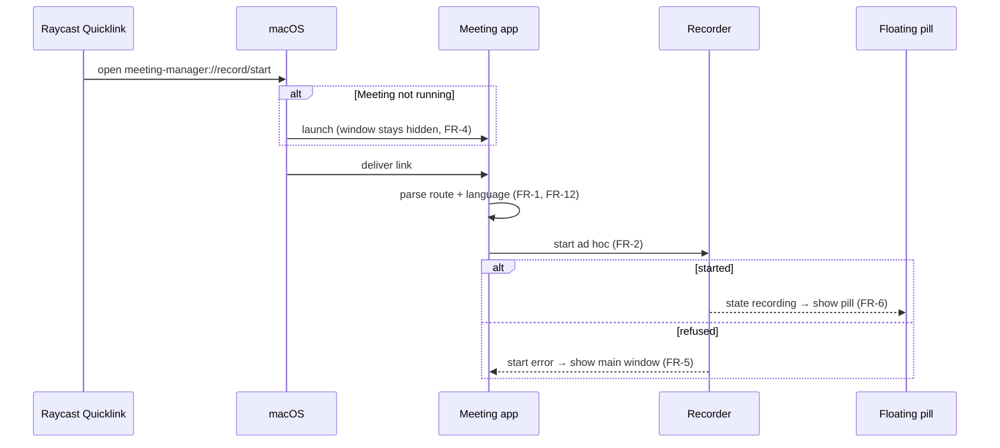
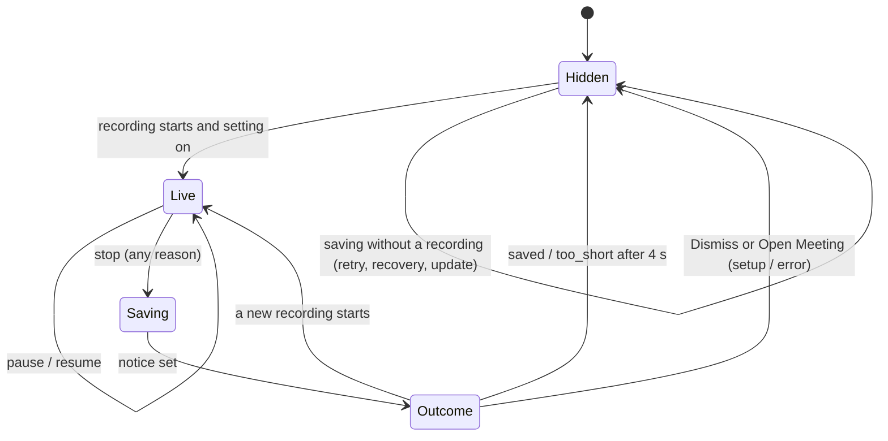

# PRD — Quick record and floating indicator

**Status:** In review · **Date:** 2026-11-18 · **Slug:** `quick-record` · **Owner:** Siam · **Priority:** medium · **Repo:** masnun-siam/meeting-manager

This document is the source of truth for this change, from request to delivery: the tasks and every issue are derived from it, and a decision that is not written here has not been made. Once `Approved` it is locked; a later change is a new PRD or task. It adds to [desktop-app.md](desktop-app.md) (Approved) without changing any of its requirements, except where "Changes to existing behaviour" says so.

## Overview

Two additions to the Meeting desktop app that cut the steps to start a recording, mostly for in-person meetings in the office: a `meeting-manager://` link that starts, pauses, resumes or stops a recording from Raycast (or Shortcuts, Alfred, a script) without opening the window, and a small floating pill that is on screen for the whole recording, showing the recorded time with Pause/Resume and Stop.

Today:
- The desktop app records the default microphone mixed with all system audio, one recording at a time, started from the main window's recording bar (ad hoc or from a calendar event) or from the menu-bar item's Start recording (ad hoc, last language). Pause, Resume and Stop are in the window and the menu bar; Stop converts to `recording.m4a` and hands it to `meeting process`.
- The menu-bar item is the closest pattern: it shows the state and timer, offers the controls with the window closed, and shows the last Start error as its first line.
- The app opens its main window on launch; closing it only hides it (desktop-app D15).
- Nothing outside the app can start or stop a recording, and nothing on screen shows a recording except the window's bar and the menu-bar mark.

## Problem

Starting a recording takes several steps: find and open the app, pick the language, click Start. For an in-person meeting that starts the moment people sit down, that friction means the start is late or forgotten. While recording, the only sign is a small menu-bar mark, and stopping or pausing needs the menu or the window.

## Users

Siam, the single user of the app on their own Mac (desktop-app Users). No roles, no other accounts.

## Goals

- Start a recording with one Raycast command or hotkey, whether Meeting is running or not, without the window coming up.
- See at a glance, over any app and any Space, that a recording is running, for how long, and pause or stop it with one click.
- Stop, pause or toggle from Raycast too.

## Non-goals

- A Raycast Store extension or any Raycast code in this repo: Raycast uses its built-in Quicklinks (D3).
- A global keyboard shortcut inside the app: Raycast's own hotkey on a Quicklink covers it (D2).
- A microphone-only source or any change to capture: a quick start records exactly what Start records today (D4).
- A live input level meter in the pill (D7).
- A secret token or confirmation for links (D10).
- Linking a link-started recording to a calendar event; links start ad hoc only.
- Automatic call detection or auto-start (unchanged, desktop-app D7).
- Changing the language from the pill, or any pill control other than Pause/Resume, Stop, opening the window and dismissing a result.
- A link that returns state to its caller (links are one-way).
- Changes to the Chrome extension, the `meeting` CLI or processing.

## Requirements

- **FR-1 Link scheme.** The app registers the URL scheme `meeting-manager` with macOS. It acts on exactly these links, host `record`: `meeting-manager://record/start`, `/stop`, `/pause`, `/resume`, `/toggle`. `start` and `toggle` take an optional `language` query parameter, `bn` or `en`. Scheme, host and path are matched case-insensitively; a trailing slash is allowed.
  - Acceptance: with the bundled app installed, `open "meeting-manager://record/start"` in Terminal starts a recording; macOS lists Meeting as the handler of `meeting-manager:`.
- **FR-2 Start from a link.** `start` when the recorder is idle starts an ad hoc recording (no calendar event) exactly as the menu bar's Start recording does: same checks, same folder, same capture, in the `language` from the link if given, else the last used language; the chosen language becomes the last used, as with any Start. When the recorder is not idle (starting, recording, paused or saving), `start` changes nothing.
  - Acceptance: idle + `start?language=en` → a recording runs with `recorder_status.language` `en`; while recording, a second `start` leaves the same folder recording and creates no folder.
- **FR-3 Stop, pause, resume and toggle from a link.** `stop` while recording or paused stops and saves as the Stop button does; `pause` while recording pauses; `resume` while paused resumes; `toggle` starts (as FR-2, with its `language`) when idle and stops when recording or paused. In any other state each does nothing and reports no error.
  - Acceptance: recording + `pause` → `paused`; paused + `resume` → `recording`; recording + `toggle` → `saving`; idle + `stop` → still idle, nothing shown.
- **FR-4 Cold launch from a link.** When a link launches Meeting (it was not running), the main window is not shown; the menu-bar item and the pill (FR-6) appear as usual and the link is acted on. A normal launch (Dock, Finder, Spotlight, a second launch) shows the window as today. The app decides within 1 second of launch whether a link caused it.
  - Acceptance: quit Meeting, run `open "meeting-manager://record/start"` → recording starts, the pill shows, no Meeting window appears; quit and open Meeting from Finder → the window appears.
- **FR-5 A refused start opens the window.** When a Start from a link or from the menu bar is refused (`permission_mic`, `permission_audio`, `not_configured`, `capture_failed`), the app keeps that refusal as the recorder's start error. For a link start, the main window is shown and focused. The window's recording bar shows the start error's message (the same FR-2 permission texts and messages as today) with a Dismiss button until it is dismissed or a Start succeeds; the menu-bar item shows the same error as its first line, as it does today for its own starts. A refusal because the recorder is not idle is not a start error (FR-2).
  - Acceptance: with the microphone denied, `start` from a link → the window comes to front showing "Allow Meeting in System Settings › Privacy & Security › Microphone"; Dismiss clears it in the window and the menu bar; a later successful Start also clears it.
- **FR-6 Floating indicator for the whole session.** When the setting is on (FR-10), a floating pill appears whenever a recording starts, from any source (link, window, event view, menu bar), and stays while it is recording, paused and saving, then shows the outcome (FR-8). A `saving` state not preceded by a recording (a `recorder_retry`, crash recovery, or the updater holding the recorder) does not show it.
  - Acceptance: Start from the window → pill visible; Stop → pill shows "Saving…" then the outcome; `recorder_retry` from the window → no pill.
- **FR-7 Indicator content and controls.** The pill shows a red recording dot (pulsing while recording, steady and grey with "Paused" while paused; no pulse when macOS Reduce motion is on), the recorded time as `H:MM:SS` from `elapsed_s` (paused time excluded, as everywhere), a Pause/Resume button named after what it does, and a Stop button. Stop takes one click: it saves, never discards. Clicking the time shows and focuses the main window. While saving, the buttons are gone and the pill reads "Saving…". Buttons have accessible names "Pause recording", "Resume recording", "Stop recording", "Open Meeting"; the time is a timer named "Recorded time".
  - Acceptance: click Pause → state `paused`, the button reads Resume; click Stop → state `saving`; click the time → the main window is in front; VoiceOver reads the four names.
- **FR-8 Outcome after stop.** When saving ends, the pill shows the recorder's notice message (`saved`: "Saved, sent for processing"; `too_short`; `setup`; `error`, as desktop-app FR-4 and FR-7 word them). `saved` and `too_short` hide after 4 seconds. `setup` and `error` stay, with Open Meeting and Dismiss buttons, until one is clicked or a new recording starts. Stops by the cap, sleep, a capture failure or a full disk end the same way.
  - Acceptance: a 20 s recording stopped → "Saved, sent for processing" for 4 s, then no pill; ffmpeg path broken → the error stays until Dismiss.
- **FR-9 Indicator placement and window behaviour.** The pill floats above other windows on every Space and over full-screen apps, never takes keyboard focus or activates Meeting when shown or when its buttons are clicked (only Open Meeting and clicking the time activate the app), and does not appear in the Dock, Cmd-Tab or Mission Control as a window. It first appears centred horizontally, 12 points below the menu bar of the screen with the menu bar. It can be dragged anywhere by its body; its position is remembered across recordings and launches. A remembered position no longer on any connected screen falls back to the first position.
  - Acceptance: typing in another app while starting from a link keeps the text cursor there; with Zoom full screen on another Space, the pill is visible over it; drag the pill, stop, start again → same place; unplug the external display it sat on → it comes back top-centre.
- **FR-10 Indicator setting.** Settings gains a Recording section with "Show floating indicator while recording", on by default. A change is saved at once and applies from the next recording start; a pill already on screen stays until its session's outcome ends. A failed save returns the checkbox to the last saved value with its message, as the auto-update checkbox does.
  - Acceptance: uncheck, start → no pill, the menu-bar mark still shows; relaunch → still unchecked; with an unwritable store the checkbox flips back and shows the error.
- **FR-11 Raycast setup guide.** The user guide documents the five links, the `language` parameter, and how to add each as a Raycast Quicklink with a hotkey (and that the first use may show macOS's open-app prompt from a browser, not from Raycast).
  - Acceptance: following the guide on a clean Raycast install, a Quicklink with a hotkey starts a recording.
- **FR-12 Unknown links.** A `meeting-manager:` link with another host or path, a `language` other than `bn` or `en`, or extra query parameters does nothing and shows nothing; the log records only that a link was ignored and why (`unknown_route`, `bad_language`, `unknown_param`), never the link text.
  - Acceptance: `open "meeting-manager://record/start?language=fr"` → idle, no folder, one log line `link ignored: bad_language`.

*A link from Raycast to a running recording, cold or warm launch.*

*When the pill is on screen.*

## Changes to existing behaviour

- desktop-app FR-1 and D15: a launch caused by a link does not show the main window (FR-4).
- desktop-app menu-bar item: its "last Start error" line now reads the recorder's start error (FR-5), so a refused link start shows there too, and Dismiss in the window clears it.

## Edge cases

- **Concurrency.** Two links in quick succession: the recorder's existing state lock serialises them; a `start` while the first is still starting finds it not idle and does nothing (FR-2). A link and a click (pill, window or menu) at the same moment: whichever reaches the recorder first wins; the other gets `not_recording` or `already_recording`, which the pill and links ignore and the window shows as today. `toggle` pressed twice fast: start then stop; a stop under 10 s is saved but not processed, as today.
- **Saving.** Every link does nothing while saving, including `toggle` and `start`.
- **First use.** The first link start may show macOS's Microphone and System Audio prompts; Start blocks off the main thread until answered, as today. A denial is a start error (FR-5).
- **Cold launch and recovery.** Crash recovery runs at launch on its own thread and never changes the state, so a link start right after launch works.
- **Sleep, quit, cap.** Unchanged stops; the pill shows their outcome (FR-8). Quit while recording still asks for confirmation; the pill goes with the app.
- **Update install.** The updater holds the recorder in `saving` without a recording, so no pill (FR-6); a link start then does nothing.
- **Setting off.** No pill; the menu-bar mark and macOS's microphone indicator still show. Turning it off mid-recording leaves the current pill until its outcome ends (FR-10).
- **Displays.** A remembered position off every screen falls back to top-centre (FR-9). Positions are in logical points of the global screen space.
- **Empty states.** No notice after saving (should not happen): the pill hides when the state is idle.
- **Access and data isolation.** Single user on their own Mac; no data leaves it. A link carries no path, event or note id, only a route and a language, so it cannot read or touch notes. The pill shows only state, time and the notice message, never a title or transcript.
- **Existing data.** None migrated. New store settings `indicator_enabled` and `indicator_position` are absent until written; absent means on and the first position.

## Technical design

### Data

Store `settings` table (internal), new keys:

| Key | Value | Absent |
|---|---|---|
| `indicator_enabled` | `true` \| `false` (FR-10) | on; any other value is on |
| `indicator_position` | JSON `{x, y}`, logical points, top-left of the pill (FR-9) | the first position; unreadable JSON is treated as absent |

The start error (FR-5) lives in the recorder's memory only, never stored. No change to `config.toml`, meeting folders, `context.json` or the `meetings` table.

### API

**Links (FR-1 to FR-4, FR-12)**, the contract Raycast and the guide build against:

| Link | Idle | Starting | Recording | Paused | Saving |
|---|---|---|---|---|---|
| `meeting-manager://record/start[?language=bn\|en]` | start | — | — | — | — |
| `…/record/stop` | — | — | stop | stop | — |
| `…/record/pause` | — | — | pause | — | — |
| `…/record/resume` | — | — | — | resume | — |
| `…/record/toggle[?language=bn\|en]` | start | — | stop | stop | — |

"—" is nothing, no message. Anything else is ignored per FR-12.

**Tauri commands.** Same reply shape as every command (`{ok: true, ...}` / `{ok: false, code, message}`). The contract grows from 29 to 33 commands; `api.ts` and the contract test follow.

| Command | Request | Response | Error codes |
|---|---|---|---|
| `recorder_status` (changed) | — | adds `start_error: {code, message} \| null` (FR-5) | — |
| `recorder_dismiss_start_error` (new) | — | `{}` (clears it; already clear is fine) | — |
| `indicator_settings` (new) | — | `{enabled}` | `store_unavailable` (the reply then also carries `enabled: true`) |
| `set_indicator_enabled` (new) | `{enabled: bool}` | `{enabled}` | `store_unavailable` |
| `indicator_dismiss` (new) | — | `{}` (hides the pill; no-op while recording, paused or saving) | — |
| `window_open_main` (new) | — | `{}` (shows and focuses the main window) | — |

Every other command is unchanged. The pill page uses `recorder_status`, `recorder_pause`, `recorder_resume`, `recorder_stop`, `indicator_dismiss` and `window_open_main`.

### Backend

- **Scheme registration (FR-1, D14, D15).** The scheme is declared in the bundle's `Info.plist` (`CFBundleURLTypes`, one scheme `meeting-manager`). Opened links arrive through Tauri's built-in macOS "opened URLs" run event; no new crate. A development run (not bundled) does not receive links; tests call the link handler directly.
- **Link handler (FR-1 to FR-3, FR-12).** A pure parser turns a link into an action (`start{language?}`, `stop`, `pause`, `resume`, `toggle{language?}`) or an ignore reason. The action runs on a background thread (Start may block on a permission prompt) against the recorder using the state table above. `already_recording` and `not_recording` from the recorder are swallowed. Logs carry the action and outcome kind only.
- **Start error (FR-5).** The recorder holds one `start_error` set by any refused Start that came from a link or the menu bar (not from the window, whose own reply already shows it), cleared by a successful Start or `recorder_dismiss_start_error`, and announced through the existing `on_change`. The menu-bar item reads it instead of keeping its own. For a link start, a refusal also shows and focuses the main window.
- **Cold launch (FR-4, D18).** At launch the app learns whether the launch was caused by a link (the pending open-URL event at launch) and, if so, skips showing the main window; it decides within 1 second so a normal launch is not visibly delayed. All other launch hooks run as today.
- **Indicator window (FR-6 to FR-9, D6 to D9, D17).** A second webview window, label `indicator`, loading a second page of the same UI build. Created hidden at launch (flag on), shown and hidden by the Rust side from the recorder's `on_change`: shown on entering `recording` when `indicator_enabled` was on at that moment; kept through `paused` and `saving`; after saving it stays for the page to show the outcome and then call `indicator_dismiss`; a `saving` without a preceding recording never shows it. Window properties: borderless, transparent (the `macos-private-api` feature of the existing `tauri` crate, D17), no shadow from the system (the page draws its own), always on top at a level above full-screen apps, joins all Spaces, full-screen auxiliary, non-activating (an `NSPanel`-style window that never becomes key or main), excluded from the window list, Dock and Cmd-Tab. Any `objc2-app-kit` class it needs is a feature of the existing crate. Drag end saves `indicator_position` (debounced 500 ms); show validates it against the current screens.
- **Failure.** A failed position or setting write is logged by kind; the pill keeps working with defaults. If the indicator window cannot be created, recording is unaffected and the error is logged once.

### Frontend

- **Pill page (FR-7, FR-8).** Polls `recorder_status` every second (as the recording bar does), latest request wins. Shows dot, `H:MM:SS`, Pause/Resume and Stop; "Saving…" while saving; then the notice message, with a 4 s timer that calls `indicator_dismiss` for `saved`/`too_short`, or Open Meeting and Dismiss for `setup`/`error`. Control replies `not_recording`/`already_recording` are ignored; any other error reply shows its message in the pill for 4 s. The whole pill except its buttons is the drag region. Light and dark from macOS, Reduce motion respected, no inline styles (CSP). Approx. 220 × 40 points; wider for an outcome message, truncating with the full text in its accessible name.
- **Recording bar (FR-5).** Shows `recorder_status.start_error` message as its alert with a Dismiss button (`recorder_dismiss_start_error`), next to its existing error and notice lines.
- **Settings (FR-10).** A Recording section with the checkbox, `indicator_settings` on mount, `set_indicator_enabled` on change; shows at once, latest save wins, failure returns to the last confirmed value with its message in a `role="status"` line (the Updates section's pattern).
- **Guide (FR-11).** A section in the user guide (docs/guides) and a line in README.

### Realtime and other components

- The pill is driven by the existing recorder `on_change` (Rust side) and its own 1 s poll; no new event to the webviews.
- The capability file that today lists only the `main` window also lists `indicator`; both may invoke the app's own commands and no plugin.
- No change to the `meeting` tool, the store schema, the Chrome extension or native messaging.

### Non-functional

- A link start reaches `recording` in the time a menu-bar Start takes today (dominated by capture start); the parser and dispatch add under 50 ms.
- The pill adds no work on the real-time audio thread; its poll is 1 per second.
- macOS 14.4+ as the app. The private-API transparency is accepted because the app is never App-Store distributed (desktop-app D12).

### Threats and mitigations

Recordings are confidential (desktop-app Data).

| Threat | Mitigation |
|---|---|
| A web page or another app opens `meeting-manager://record/start` to record the room without the user knowing | Browsers ask before opening an app link; the pill (on by default), the red menu-bar mark and macOS's own microphone and screen-audio indicators show at once; a link cannot hide the pill. Accepted without a token (D10) |
| A link that stops or toggles a recording the user wants | Stop always saves, never discards; the pill shows the outcome |
| A link used to read or reach notes or files | Links carry only a route and a language; anything else is ignored (FR-12); no path, id or note is accepted |
| Link text or meeting content in logs | Logs carry action, outcome kind and ignore reason only |
| The indicator page invoking other commands | It is the app's own bundled page under the same CSP (no remote origin, no inline script); the capability grants app commands only, no plugin |

### Testing

| FR | Test |
|---|---|
| FR-1, FR-12 | Rust unit tests of the parser: every route, case and trailing-slash variants, each ignore reason, extra and repeated parameters |
| FR-2, FR-3 | Rust tests of the dispatcher against a recorder with the fake capture (existing `Deps`), every cell of the state table |
| FR-5 | Rust tests: refused link and menu starts set `start_error`; success and dismiss clear it; window starts don't set it; component test of the recording bar's alert and Dismiss |
| FR-6, FR-8 | Rust tests of the pure show/hide decision over status transitions (start from each source, retry, recovery, updater hold, setting off) |
| FR-7, FR-8 | Vitest component tests of the pill page with `mockApi`: names, pause/resume, stop, saving, each notice kind, the 4 s timer with fake timers |
| FR-10 | Rust tests of the setting (absent, values, store failure); component test of the Settings section's revert |
| Contract | The existing `api.ts` contract test at 33 commands; the security tests also check `Info.plist` declares only the `meeting-manager` scheme and the capability lists only `main` and `indicator` with no permission |
| FR-1, FR-4, FR-9, FR-11 | Manual, bundled build: cold and warm `open` of each link; no focus stolen while typing in another app; full-screen Zoom on another Space; drag, relaunch, unplug a display; VoiceOver names; Raycast Quicklink with hotkey |

## Rollout and cost

- No new flag (D13): built as part of the desktop app, which releases with `FEATURE_DESKTOP_APP` on; built off, neither the link handler nor the indicator exists. The pill has its own off switch (FR-10).
- No provider cost; no change to Deepgram or Claude usage beyond the recordings the user makes.
- Release: as any desktop release; macOS registers the scheme when the updated app is first launched.
- Rollback: install the previous release; links then open nothing; stored settings are ignored.
- Watch after release: the log's `link ignored` lines and indicator-window errors.

## Success metrics

None formally defined. Informally: in-person meetings are started from Raycast without opening the window.

## Epics

- **E1 Quick record and floating indicator** — covers FR-1 to FR-12. Issue: —

## Decisions

- 2026-11-18 **D1 This repo is its own Documentation Repo, base branch `main`, PRDs flat in `docs/prds/`** — matches CLAUDE.md and the six existing PRDs; no `staging` branch or repo map exists. Decided by: Siam, "Monorepo, base main (Recommended)".
- 2026-11-18 **D2 Quick start is a URL scheme, no global hotkey in the app** — macOS launches the app if it is closed; Raycast, Shortcuts and Alfred can all open a link. Decided by: Siam, "URL scheme meeting://".
- 2026-11-18 **D3 No Raycast extension; Raycast uses Quicklinks** — follows from D2: nothing to build or maintain on the Raycast side. Decided by: Siam, "URL scheme meeting://".
- 2026-11-18 **D4 A quick start records what Start records today (microphone plus system audio)** — no capture change; works for in-person and online meetings. Decided by: Siam, "Same as today (Recommended)".
- 2026-11-18 **D5 Separate start, stop, pause, resume and toggle links; `start` does nothing while not idle** — one hotkey can toggle, others can be precise. Decided by: Siam, "Separate start/stop/pause/toggle".
- 2026-11-18 **D6 The pill is shown for the whole session, from any start source, until the outcome** — simplest rule, always visible. Decided by: Siam, "Whole session (Recommended)".
- 2026-11-18 **D7 Pill content: dot, timer, Pause/Resume, one-click Stop; the time opens the window; no level meter** — Stop always saves, so no confirm. Decided by: Siam, "Timer, Pause, Stop (Recommended)".
- 2026-11-18 **D8 Draggable, remembered, on every Space and over full-screen apps, never takes focus** — stays visible during full-screen calls. Decided by: Siam, "Draggable, all Spaces (Recommended)".
- 2026-11-18 **D9 A Settings toggle for the pill, on by default, applied at the next start** — Decided by: Siam, "Settings toggle, on (Recommended)".
- 2026-11-18 **D10 Links need no token; the visible pill, menu-bar mark and macOS indicators are the guard** — zero setup in Raycast; browsers prompt before opening an app link. Decided by: Siam, "Visible indicator only (Recommended)".
- 2026-11-18 **D11 Links use the last language, overridable with `?language=bn|en`** — Decided by: Siam, "Last used, optional param (Recommended)".
- 2026-11-18 **D12 After Stop the pill shows Saving… then the outcome; success hides after 4 s, errors stay until dismissed** — Decided by: Siam, "Show result, then hide".
- 2026-11-18 **D13 No new feature flag; priority medium; one epic** — additive and switchable off in Settings; the desktop app already ships with its flag on. Decided by: Siam, "No new flag, medium, 1 epic".
- 2026-11-18 **D14 Links are received through Tauri's built-in macOS opened-URL event and an `Info.plist` scheme entry; no new crate** — Decided by: Siam, "Built-in, no new crate".
- 2026-11-18 **D15 The scheme is `meeting-manager`** — unique; `meeting` is generic enough to clash. Decided by: Siam, "meeting-manager://".
- 2026-11-18 **D16 A refused link start opens and focuses the main window with the error** — Decided by: Siam, "Open the main window".
- 2026-11-18 **D17 The pill is a transparent window through `tauri`'s `macos-private-api` feature** — a real rounded pill; the app is never App-Store distributed. Decided by: Siam, "Enable macos-private-api".
- 2026-11-18 **D18 A launch caused by a link does not show the main window** — keeps quick start from stealing focus. Decided by: Siam, "No window, just record".

## Open questions

None.

## Related

- [desktop-app.md](desktop-app.md) FR-1 to FR-4 (recording, permissions, indicator, stop), D7, D12, D15; menu-bar item.
- [docs/features/desktop-recorder.md](../features/desktop-recorder.md), [docs/desktop.md](../desktop.md).
- Business docs: none yet (`docs/business/` does not exist).
