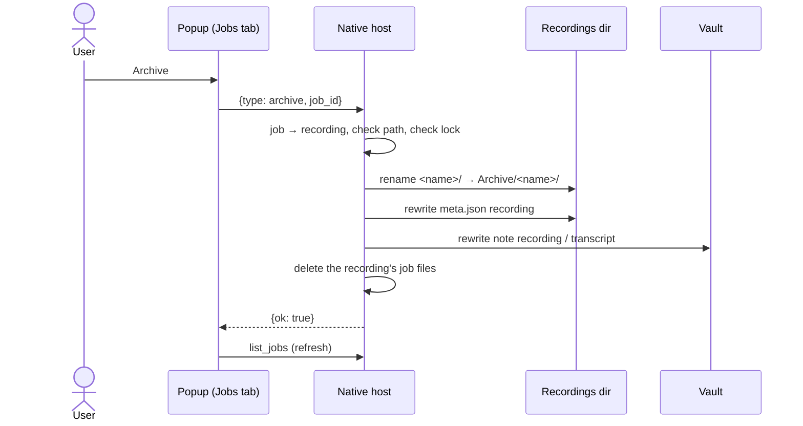

# PRD — Recording folders, Trash and Archive

**Status:** Approved · **Date:** 2026-10-19 · **Slug:** `recording-folders` · **Owner:** Siam · **Priority:** medium · **Repo:** masnun-siam/meeting-manager (private)

This document is the source of truth for the feature: every issue is derived from it, and a decision that is not written here has not been made. It changes parts of [meeting-recorder.md](meeting-recorder.md) (FR-4, FR-8, FR-14, FR-15 and the recordings directory layout); where the two disagree, this PRD wins.

## Overview

Each meeting gets its own folder under the recordings directory, holding the recording and everything the tool makes from it. From the popup's Jobs tab, the user can archive a finished meeting (move its folder to `Meetings/Archive/`) or trash it (move its folder to the macOS Trash).

Today:
- Stop saves `~/Downloads/Meetings/<name>.webm`. The tool writes `<name>.transcript.md`, `<name>.summary.md`, `<name>.meta.json` (and, while it runs, `<name>.audio.ogg`, `<name>.deepgram.json`, `<name>.lock`) next to it, so every meeting's files are mixed in one flat folder.
- The Jobs tab lists the 10 most recent jobs, with Open summary / Open folder on done jobs and Retry on failed ones. Each button sends one native-messaging request that names a `job_id`. That's the pattern the new buttons follow.
- The vault note's frontmatter holds the absolute `recording` and `transcript` paths, and a rerun finds the note again by its `recording` path.
- Nothing removes or moves a meeting. The user does it in Finder, which leaves stale jobs in the Jobs tab.

## Problem

After a few meetings, `~/Downloads/Meetings/` is a pile of files with similar names, and there's no way to clear out meetings from the extension. Cleaning up by hand in Finder means picking out six files per meeting and leaves the Jobs tab pointing at files that are gone ("the file or folder no longer exists").

## Users

The single user of the extension and the `meeting` tool, on their own Mac. There are no roles and no other users.

## Goals

- One folder per meeting, with short, predictable file names.
- Clear a finished meeting out of the way, keeping it (Archive) or throwing it away recoverably (Trash), in two clicks from the popup.
- The Obsidian note keeps working: it stays after Trash, and after Archive it points at the new location.

## Non-goals

- No archive view, no Unarchive, no restore from the extension. Archived meetings are in Finder under `Meetings/Archive/`; trashed ones are in the macOS Trash.
- No permanent delete and no emptying of the Trash.
- No automatic migration of existing flat recordings. The single existing one is moved by hand (see Rollout).
- The vault note is never deleted or moved by Trash or Archive.
- No bulk select, and no Trash/Archive for a job that's still running.
- No toolbar right-click menu. The buttons are only in the Jobs tab.

## Requirements

- **FR-1 One folder per recording.** Stop saves the recording to `Downloads/Meetings/<name>/recording.webm`, where `<name>` is `meeting-YYYY-MM-DD_HHMM` from the local start time, with `-2`, `-3`… appended on a clash with an existing folder name. A recovered recording uses `<name>-recovered` as the folder name. No Save-as dialog, as today.
  - Acceptance: after Stop, `~/Downloads/Meetings/meeting-2026-10-19_1430/recording.webm` exists. A second recording started in the same minute lands in `meeting-2026-10-19_1430-2/`.
- **FR-2 Short side-file names.** The tool writes its files in the recording's folder under fixed names: `transcript.md`, `summary.md`, `meta.json`, and while a job runs, `audio.ogg`, `deepgram.json` and `lock`. FR-16 retention in meeting-recorder.md is unchanged: `audio.ogg` and `deepgram.json` are deleted when a job succeeds.
  - Acceptance: after one successful run, the folder holds exactly `recording.webm`, `transcript.md`, `summary.md` and `meta.json`.
- **FR-3 Only foldered recordings.** The tool (native host and `meeting process`) processes only a file named `recording.webm` whose folder is directly inside the recordings directory or directly inside `Archive/`. Anything else is refused with a message that says to move it into its own folder as `<name>/recording.webm`; `meeting process` refuses before writing any job, so a refused path leaves no row in the Jobs tab. The meeting's date and time come from the folder name (`meeting-YYYY-MM-DD_HHMM[…]`); any other folder name falls back to the file's modified time, as today.
  - Acceptance: `meeting process ~/Downloads/Meetings/old.webm` exits non-zero with that message. `meeting process ~/Downloads/Meetings/meeting-2026-10-19_1430/recording.webm` dates the note 2026-10-19 14:30.
- **FR-4 Jobs tab label.** Until a job has a title, its row shows the folder name (e.g. `meeting-2026-10-19_1430`), not `recording.webm`. A job whose file is not named `recording.webm` (an old flat recording) shows its file name, as today.
  - Acceptance: a queued job's row reads `meeting-2026-10-19_1430`.
- **FR-5 Archive.** Done and failed rows in the Jobs tab have an Archive button. It moves the recording's folder to `Meetings/Archive/<name>/`, appending `-2`, `-3`… if that name is taken. It rewrites the vault note's `recording` and `transcript` frontmatter, and `meta.json`'s `recording` field, to the new paths. It removes every job for that recording from the Jobs tab. A missing vault note is not an error, and neither is a missing `meta.json` (a job that failed before its first stage has none).
  - Acceptance: after Archive, the folder is at `~/Downloads/Meetings/Archive/<name>/`, the row is gone within one refresh (3 s), and the vault note's `recording:` holds the new path. Running `meeting process` on the archived recording updates that same note rather than creating a second one.
- **FR-6 Trash.** Done and failed rows have a Trash button. The first click turns it into "Confirm trash" for 3 seconds. A second click in that time moves the recording's folder to the macOS Trash. It removes every job for that recording from the Jobs tab. The vault note is left untouched.
  - Acceptance: after Confirm trash, the folder is in `~/.Trash` and no longer in `~/Downloads/Meetings/`. The vault note still exists. One click with no second click within 3 s changes nothing and the button returns to "Trash".
- **FR-7 Running jobs are protected.** Archive and Trash are not shown on queued or running rows, and the tool refuses either action while any job for that recording holds its lock. The Jobs tab then shows "already processing".
  - Acceptance: a request to trash a recording mid-transcription returns `already_processing` and moves nothing.
- **FR-8 Only a recording's own folder moves.** Archive and Trash act only on a folder that holds `recording.webm` and sits directly inside the recordings directory (for Trash, also directly inside `Archive/`). They never act on the recordings directory itself, on `Archive/`, or on a path outside the recordings directory. Archive refuses a folder that's already in `Archive/` ("already archived").
  - Acceptance: a job whose recording is a flat `Meetings/x.webm`, or whose recording path is outside the recordings directory, returns `invalid_path` and nothing moves. Archive on an archived recording returns `invalid_path` with "already archived".
- **FR-9 Missing recording.** If the job's recording file no longer exists (moved or deleted in Finder, or a flat recording moved by hand), Archive and Trash move nothing, remove its jobs and reply success, so a stale row can be cleared. This check comes before FR-8.
  - Acceptance: delete a meeting's folder in Finder, press Trash then Confirm trash, and the row disappears with no error.

## Edge cases

- **Concurrency:** A Trash or Archive racing a Retry on the same recording: whichever reaches the lock check first wins. If the move goes first, Retry fails with `invalid_path` because the file is gone. If Retry goes first, the move gets `already_processing`. The popup sends one request per click and shows the reply.
- **Double click on Confirm trash:** the second request finds the job gone and gets `unknown_job`, which the popup shows as a status line. Nothing else moves.
- **Name clash in Archive:** `-2`, `-3`… is appended, as for recording names.
- **Trash fails** (for example the trash command is missing or the volume has no Trash): the reply is an error naming the reason, nothing is moved, and the jobs stay.
- **Archive half done:** the folder is moved first, then `meta.json`, the vault note and the jobs are updated. If a later step fails, the folder stays in `Archive/`, the reply is an error naming what failed, and the jobs stay so the row is still there. Pressing Archive again is refused with "already archived", and rerunning `meeting process` on the archived recording rewrites the note with the right paths.
- **Empty state:** after the last job is archived or trashed, the Jobs tab shows its existing empty text, "No meetings processed yet".
- **Data isolation:** single user, local files only. Not applicable.
- **Existing data:** old flat recordings aren't processed any more (FR-3), and their old job rows stay in the Jobs tab until cleared with Archive or Trash once the file has been moved (FR-9). Today's only one, `meeting-2026-10-19_2237`, is moved by hand (see Rollout).

## Technical design

### Data

Recordings directory (`recordings_dir`, default `~/Downloads/Meetings/`) after this change (FR-1, FR-2, FR-5):

```
Meetings/
  meeting-2026-10-19_1430/
    recording.webm
    transcript.md
    summary.md
    meta.json
    audio.ogg        (while a job runs or after it fails)
    deepgram.json    (while a job runs or after it fails)
    lock             (while a job runs)
  Archive/
    meeting-2026-10-18_0900/
      recording.webm
      ...
```

The recordings directory holds folders as a fixed layout; the folder name is the meeting's name.

- File contents and fields are unchanged from meeting-recorder.md. `meta.json`'s `recording` and the vault note's `recording` and `transcript` frontmatter hold absolute paths, and Archive rewrites them (FR-5).
- `Archive` is a reserved name: a recording folder is never called `Archive`, and every generated name starts with `meeting-`.
- Jobs store: unchanged shape. Archive and Trash delete every job file whose `recording` is the acted-on recording (FR-5, FR-6).
- No migration (see Rollout).

### API

Native messaging, same framing, origin check and error envelope `{ok: false, code, message}` as today. Two new requests:

| Request | Reply on success | Errors |
|---|---|---|
| `{type: "archive", job_id}` | `{ok: true}` | `unknown_job` (no such job or bad id), `invalid_path` (FR-8, including "already archived"), `already_processing` (FR-7), `archive_failed` (move or update failed; message names the step and the path) |
| `{type: "trash", job_id}` | `{ok: true}` | `unknown_job`, `invalid_path` (FR-8), `already_processing` (FR-7), `trash_failed` (message names the reason) |

- Both act on the job's recording folder, not on a path sent by the extension, so the extension can never name an arbitrary folder.
- A missing recording file is success (FR-9).
- `process` keeps its contract. Its `path` must now be `<recordings_dir>/<name>/recording.webm` (FR-3); anything else gets `invalid_path`. `retry` keeps its contract, and an archived recording can still be retried from the CLI.
- `list_jobs` and `open` are unchanged. `open` with `folder` opens the meeting's own folder.

### Backend

The `meeting` tool:

- Side-file paths come from the recording's folder with the fixed names (FR-2). One rule serves the pipeline, the meta file and the lock.
- Path checks: the native host's recording check becomes "an existing `recording.webm` whose canonical folder is directly inside the canonical recordings directory or its `Archive/`" (FR-3, FR-8). `meeting process` applies the same shape check, so the CLI can't write `transcript.md` into the recordings directory root.
- `recorded_at` comes from the folder name instead of the file stem (FR-3).
- Archive (FR-5): check the job, the path and the lock, then rename the folder within the same volume into `Archive/` with a free name. Then rewrite `meta.json`'s `recording`, find the vault note by its old `recording` path and rewrite its two path fields in place (atomic write, rest of the note untouched), and finally delete the recording's job files. Steps run in that order, so a failure leaves the folder archived and the jobs present (see Edge cases).
- Trash (FR-6): check the job, the path and the lock, then run macOS's `/usr/bin/trash -s` on the folder (absolute path, since Chrome starts the host with a bare `PATH`; `-s` makes a failed move exit non-zero). Then delete the recording's job files. The trash command is injected like the existing `open`, so tests don't touch the real Trash.
- Lock check: the folder's `lock` is checked immediately before the move. A job can't start between the check and the move, because Retry and Process also check the lock and a job started after the move can't find the file.
- Logging: the request type only, as today; never transcript text.

### Frontend

- Save and recovery download to `Meetings/<name>/recording.webm`. The free-name check matches folder names in Chrome's download history, as it matches file names today (FR-1).
- Jobs tab rows (FR-4 to FR-7): label falls back to the folder name. Done and failed rows get Archive and Trash after the existing buttons. Trash is a two-step button: the first click shows "Confirm trash" for 3 s, then it reverts. Queued and running rows show neither. After a successful Archive or Trash the list refreshes at once. An error reply shows in the existing status line.

```
Status update: Deshi Commerce…
19/10/2026, 22:37 · done
[Open summary] [Open folder] [Archive] [Trash]
                    ↓ click Trash
[Open summary] [Open folder] [Archive] [Confirm trash]
```

Archive and Trash on a done row; Trash asks for a second click.



Archive, end to end. Trash replaces the three rewrite steps with one call to the trash command.

### Realtime and other services

Not affected. The vault note is the only file outside the recordings directory that's touched, and only by Archive.

### Non-functional

- Security: the host still accepts requests only from the extension's fixed origin. Archive and Trash take a `job_id`, never a path. The path checks in FR-8 run on canonical paths, so a symlink can't point a move outside the recordings directory.
- Compatibility: `/usr/bin/trash` ships with macOS 15 and later. On an older macOS, Trash fails with `trash_failed` naming the missing command, and Archive still works.
- Performance: both actions are a rename plus a few small file writes; the reply is immediate.

### Testing

- Rust unit tests (in-file, real temp dirs): side-file names; path checks accept `<dir>/<name>/recording.webm` and `<dir>/Archive/<name>/recording.webm` and refuse flat files, the root, `Archive` itself and symlinks out (FR-3, FR-8); `recorded_at` from the folder name; Archive moves the folder, picks a free name, and rewrites `meta.json` and the note's two fields while keeping the body; Trash calls the injected trash command with the folder; both refuse under a held lock, succeed on a missing recording, and delete only that recording's jobs (FR-5 to FR-9).
- Extension unit tests: the download path and free-name check (FR-1); the Jobs tab label, which buttons appear per stage, the 3 s confirm and its reset, and that each button sends the right request and refreshes (FR-4 to FR-7).
- Manual: one real recording through Stop → done → Archive (check Finder and the vault note), and one through Trash (check `~/.Trash`; note whether Put Back is offered).

## Rollout and cost

- One user, everyone at once. No third-party cost change.
- Before using the new build, move today's one flat recording by hand:
  ```
  cd ~/Downloads/Meetings && n=meeting-2026-10-19_2237 && mkdir "$n" && mv "$n.webm" "$n/recording.webm" && mv "$n.transcript.md" "$n/transcript.md" && mv "$n.summary.md" "$n/summary.md" && mv "$n.meta.json" "$n/meta.json"
  ```
  The existing vault note still points at the old path, so a rerun wouldn't find it. Delete that note, then run `meeting process ~/Downloads/Meetings/meeting-2026-10-19_2237/recording.webm` once to write a fresh one with the new paths. The transcript is reused, so Deepgram isn't called. Its old job stays in the Jobs tab pointing at the old path until it's trashed (FR-9).
- Rebuild the extension and run `meeting install` to put the new tool in place.

## Success metrics

None formally defined.

## Epics

- **E1 Recording folders, Trash and Archive** — covers FR-1 to FR-9. Issue: #63

## Decisions

- Short file names inside the folder (`recording.webm`, `transcript.md`, …) — chosen by the user. The folder name carries the meeting's identity.
- Trash moves the folder to the macOS Trash and keeps the vault note — recoverable from the Trash, and the note is the long-term record.
- Archive moves the folder to `Meetings/Archive/<name>/` and rewrites the note's paths — the note keeps pointing at real files, and reruns still find it.
- Buttons on done and failed rows in the Jobs tab, not on running ones — follows the existing per-row actions. A running job holds files that a move would break.
- Old flat recordings aren't supported, and the one existing recording is moved by hand — one layout in the code, no migration for a single file. Refusing flat files also means "the recording's folder" can never resolve to the recordings directory itself.
- Archive and Trash delete the recording's job files rather than flag them — `list_jobs` and the job shape stay unchanged, and the run history is kept in `meta.json`.
- Trash confirms with an inline second click within 3 s — `confirm()` is unreliable in an extension popup.
- No archive view or Unarchive in this version; priority medium — Finder covers it.
- Trash uses macOS's `/usr/bin/trash` — the system's own move-to-Trash, with no new dependency and no Finder automation permission. Whether Finder's Put Back works for items it trashes is checked in the manual test, not promised. Absolute path because the host runs with a bare `PATH`.
- Archive and Trash take a `job_id`, not a path — the extension can only act on recordings the tool already knows.
- Archive moves the folder before updating files — a failure leaves the meeting archived and recoverable by a rerun, never half-moved.
- `meeting process` checks the path before it writes a job — a typo or an old flat file doesn't leave a failed row in the Jobs tab; the CLI error and the failure notification are enough.
- An untitled job whose file isn't `recording.webm` keeps showing its file name — otherwise old flat rows would all read "Meetings".
- Archive skips a missing `meta.json` — there is nothing to rewrite, as with a missing vault note.

## Open questions

None.

## Change log

- 2026-10-19: Settled while refining #64–#70. `meeting process` refuses a bad path before writing a job (FR-3); untitled old flat rows show the file name (FR-4); Archive skips a missing `meta.json` (FR-5). Affects #65, #67 and #68.
- 2026-10-20: [recording-import.md](recording-import.md) (approved) lets the recording file be `recording.<ext>` for `webm`, `mp4`, `m4a`, `mov`, `mkv`, `mp3`, `wav` or `ogg`, not only `recording.webm`, and overrides this PRD where they differ: FR-3 and FR-8 (the recording rule), FR-4 (the Jobs tab label) and FR-5 (Archive keeps the real file name). Implemented under that PRD's epic; no closed issue here is reopened.

## Related

- [meeting-recorder.md](meeting-recorder.md): FR-4, FR-8, FR-14, FR-15 and "Recordings directory" are amended by this PRD; its change log points here.
- [../features/recording.md](../features/recording.md), [../features/processing.md](../features/processing.md), [../features/native-messaging.md](../features/native-messaging.md): docs to update with the implementation.
