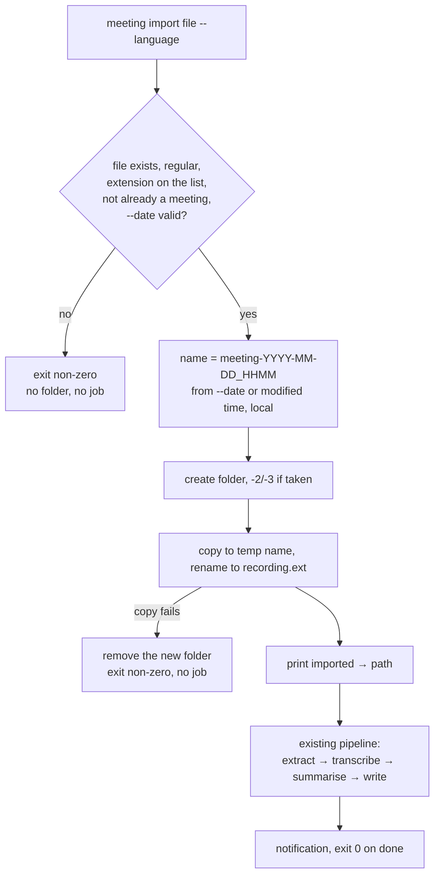

# PRD — Import an existing recording

**Status:** Approved · **Date:** 2026-10-20 · **Slug:** `recording-import` · **Owner:** Siam · **Priority:** medium · **Repo:** masnun-siam/meeting-manager (private)

This document is the source of truth for the feature: every issue is derived from it, and a decision that is not written here has not been made. It changes parts of [recording-folders.md](recording-folders.md) (FR-3, FR-4, FR-5, FR-8: the recording file may be `recording.<ext>`, not only `recording.webm`); where the two disagree, this PRD wins.

## Overview

The `meeting` tool gets a new command, `meeting import <file> --language bn|en`. It takes an audio or video recording made anywhere else (a phone voice memo, a Zoom desktop recording, a file someone sent you), copies it into its own meeting folder under the recordings directory, and runs the same transcribe → summarise → vault-note pipeline as a browser recording. The Chrome extension is not needed.

Today:
- Only the extension creates meetings. Stop saves `Meetings/<name>/recording.webm` and hands it to the tool.
- `meeting process <path>` already runs the whole pipeline from the terminal, but it refuses anything that isn't `<recordings_dir>/<name>/recording.webm` (or under `Archive/`), and tells the user to move the file into its own folder by hand.
- Audio extraction with ffmpeg already reads any container ffmpeg understands, and drops the video track.
- The folder name `meeting-YYYY-MM-DD_HHMM` gives the meeting's date and time. Any other folder name falls back to the file's modified time in UTC.
- The Jobs tab lists every job file, including jobs started from the CLI. Its Retry, Open, Archive and Trash buttons each act on a job's recording folder.

## Problem

A meeting that wasn't recorded in Chrome (a desktop Zoom or Teams call, an in-person meeting on a phone) can't get a transcript, summary or vault note. The only workaround is to hand-make a folder under `~/Downloads/Meetings/`, convert the file to WebM and name it `recording.webm`. It's slow, easy to get wrong, and the note's date then comes out as the conversion time in UTC.

## Users

The single user of the `meeting` tool, on their own Mac, in a terminal. There are no roles and no other users.

## Goals

- Turn any common audio or video file into a meeting note with one command.
- The imported meeting behaves exactly like a browser recording afterwards: it shows in the Jobs tab, can be rerun with `meeting process`, archived and trashed.
- The original file is left where it was, untouched.

## Non-goals

- Importing from the extension popup (no file picker, no upload over native messaging).
- Several files in one command. Run `meeting import` once per file.
- An import-only mode (`--no-process`). Import always processes.
- Probing the file before import (no `ffprobe`): no up-front check for an audio stream or for the 3-hour limit.
- Moving the original instead of copying it.
- Converting the file to another format.
- Detecting duplicates. Importing the same file twice makes two meetings.
- A user-entered title. Opus names the meeting, as today.
- Changing `meeting process`: it still refuses a file that isn't already in its own folder.

## Requirements

- **FR-1 Import command.** `meeting import <file> --language bn|en [--date "YYYY-MM-DD HH:MM"]` copies `<file>` into a new meeting folder (FR-3, FR-4) and then runs the existing pipeline on it in the foreground, exactly as `meeting process` does: same stages, outputs, retention, lock, job file, `meta.json` and macOS notification. It first prints `imported → <new recording path>`, then the same stage lines as `meeting process`. It exits 0 when the job is done and non-zero otherwise. `--language` is required.
  - Acceptance: `meeting import ~/Desktop/call.m4a --language en` prints the new path, then `extracting`, `transcribing`, `summarising`, `writing` and `done: 
`. The folder ends up holding `recording.m4a`, `transcript.md`, `summary.md` and `meta.json`, one vault note exists, and `~/Desktop/call.m4a` is unchanged.
- **FR-2 Accepted files.** The source must be an existing regular file whose extension, ignoring case, is one of `webm`, `mp4`, `m4a`, `mov`, `mkv`, `mp3`, `wav` or `ogg`. The command refuses, before creating any folder or job, when: the file is missing or isn't a regular file; the extension isn't on the list (the message lists the accepted ones); `--language` is missing; `--date` doesn't parse; or the source is already a meeting recording that the tool would process (the message says to run `meeting process <path>` instead).
  - Acceptance: `meeting import notes.txt --language en` exits non-zero naming the accepted extensions, and neither a new folder nor a new Jobs-tab row appears. Importing `~/Downloads/Meetings/meeting-2026-10-19_1430/recording.webm` is refused and names `meeting process`.
- **FR-3 Copy, never touch the original.** The file is copied to `<recordings_dir>/<name>/recording.<ext>`, with the extension in lower case. The copy is written under a temporary name and renamed into place only once it is complete, so an interrupted import never leaves a half-copied `recording.<ext>` that the tool would accept. The original is never moved, changed or deleted.
  - Acceptance: after an import, the source file's size, modified time and contents are unchanged. Interrupting with Ctrl-C during the copy of a large file leaves no `recording.<ext>` in the new folder.
- **FR-4 Meeting date and folder name.** `<name>` is `meeting-YYYY-MM-DD_HHMM` in local time. By default the time is the source file's modified time; `--date "YYYY-MM-DD HH:MM"` (local time) overrides it. If that folder name is taken, `-2`, `-3`… is appended, as for browser recordings. The vault note's date and `meta.json`'s `recorded_at` therefore come from the folder name, as for any browser recording.
  - Acceptance: a file last modified at 09:30 local time on 18 October 2026 lands in `meeting-2026-10-18_0930/` and its note is dated 2026-10-18 09:30. With `--date "2026-10-01 14:00"` it lands in `meeting-2026-10-01_1400/`. A second import with the same date lands in `meeting-2026-10-01_1400-2/`.
- **FR-5 Recording file name rule.** Wherever the tool accepts a meeting recording (`meeting process`, the native host's `process` and `retry`, and the Archive and Trash checks), the file may be `recording.<ext>` for any extension on the FR-2 list, not only `recording.webm`. All other parts of that rule from recording-folders FR-3 and FR-8 are unchanged: the folder sits directly inside the recordings directory or `Archive/`, paths are checked after resolving symlinks, and flat files are refused.
  - Acceptance: `meeting process <recordings_dir>/meeting-2026-10-18_0930/recording.m4a` is accepted and reuses its transcript. `<recordings_dir>/m/recording.txt` and `<recordings_dir>/x.m4a` are refused as today.
- **FR-6 Archive keeps the file name.** Archive moves an imported meeting's folder as today and points `meta.json` and the vault note at the moved file under its real name (for example `Archive/<name>/recording.m4a`), not at `recording.webm`.
  - Acceptance: archive an imported `.m4a` meeting from the Jobs tab. The note's `recording:` frontmatter ends in `Archive/<name>/recording.m4a`, and `meeting process` on that path updates the same note.
- **FR-7 Jobs tab label.** Until a job has a title, its row shows the folder name for any recording file named `recording.<ext>`, not only `recording.webm`. Every other Jobs tab behaviour (Retry, Open summary, Open folder, Archive, Trash) applies to imported meetings unchanged.
  - Acceptance: while an imported `.mp4` meeting is transcribing, its row reads `meeting-2026-10-18_0930`, not `recording.mp4`. After it is done, Archive and Trash work on it.

## Flows

`meeting import`: every check runs before anything is written; after the copy it is the existing pipeline.

## Edge cases

- **Concurrency.** Two imports for the same minute both get a folder: the folder is created with an operation that fails if the name exists, and the next suffix is tried. Two imports of different files then process in parallel, as two recordings do today. Once copied, the meeting's lock guards it as for any recording (`already processing`).
- **Same file imported twice.** Two separate meetings are made (`…_0930` and `…_0930-2`). No duplicate detection.
- **File with no audio, or corrupt.** The copy succeeds, and the job fails at `extracting` with ffmpeg's last error line, as today. The folder and its failed job stay; the user clears them with Trash.
- **Longer than 3 hours.** Not checked. If Claude rejects the transcript as too long, the job fails at `summarising` with that reason, as for a browser recording (meeting-recorder non-functional "Context").
- **Under 10 seconds.** Processed. The 10-second rule belongs to the extension's Stop, not the tool. A file with no speech ends as "No speech detected", as today.
- **Copy fails** (disk full, unreadable source). The new folder, holding only the temporary copy, is removed; no job is written; the command exits non-zero naming the cause. If even that removal fails, the error names the folder to delete.
- **Interrupted import.** Ctrl-C during the copy leaves at most a folder with a temporary file that no command accepts as a recording. Ctrl-C during processing is the same as interrupting `meeting process`: the job stays at its stage and a rerun with `meeting process <new path>` resumes.
- **Source inside the recordings directory.** A flat file such as `Meetings/old.webm` is imported like any other file (this is the supported way to bring an old flat recording into the folder layout). A file that already is a meeting recording is refused (FR-2).
- **Tool not configured.** The same "run `meeting install`" error as `meeting process`, before anything is written. A resumed or first transcription needs the Deepgram key, as today.
- **Empty state.** Not applicable; the Jobs tab's empty text is unchanged.
- **Data isolation.** Single user, local files only. Not applicable. The audio and transcript leave the machine only as they do today (Deepgram and Claude).
- **Existing data.** Nothing to migrate. Existing `recording.webm` meetings are still accepted (FR-5).

## Technical design

### Data

- Meeting folder (FR-3, FR-5): unchanged except the recording's name, `recording.<ext>` with `<ext>` from the FR-2 list in lower case. Side files keep their fixed names (`transcript.md`, `summary.md`, `meta.json`, `audio.ogg`, `deepgram.json`, `lock`). `recording.ogg` and `audio.ogg` don't clash.
- `meta.json`, the job file and the vault note: unchanged fields. `recording` holds the absolute path of `recording.<ext>`.
- The temporary copy uses a name that the recording rule never accepts (for example a `.part` suffix, as audio extraction does).
- No migration.

### API

CLI (new):

- `meeting import <file> --language bn|en [--date "YYYY-MM-DD HH:MM"]`. Foreground. stdout: `imported → <path>`, then the `meeting process` stage lines and `done: 
` (or `done: No speech detected`). Exit 0 on done, non-zero on any refusal or failure. Errors name the fix, following the crate's convention.

Unchanged CLI: `meeting process` keeps its flags and contract. It now accepts `recording.<ext>` (FR-5).

Native messaging: no new request and no new field. `process` and `retry` accept a `recording.<ext>` path under the same rule (FR-5). The extension never sends one itself, but `retry` on an imported meeting's job does. `archive`, `trash`, `list_jobs`, `open` keep their contracts; Archive's rewritten paths keep the file's real name (FR-6).

### Backend (Rust tool)

- **Import command (FR-1–FR-4):** validates everything before writing, picks and creates the folder, copies through a temporary name, then calls the existing pipeline with the new path and the given language, and notifies like `process`. It adds no new pipeline stage, and the job only starts once the copy is in place, so an import failure before that leaves no job.
- **Local time for the folder name (FR-4):** the tool has no time crate and only formats UTC. The source's modified time (or the `--date` value) is formatted in local time by calling macOS `/bin/date` with an absolute path, like the other subprocesses. `--date` is checked for the `YYYY-MM-DD HH:MM` shape and a valid calendar date before use.
- **Copying:** the standard library copy is used. On APFS it clones the file when source and destination are on the same volume, so a large video imports instantly and takes no extra space. Across volumes it is a full copy.
- **One recording rule (FR-5):** the single shared check that decides what is a meeting recording learns the extension list. The import command, `meeting process`, the native host and Archive/Trash all go through it, so the list lives in one place. The "move it into its own folder" refusal message now also suggests `meeting import`.
- **Archive (FR-6):** the moved recording path keeps the original file name instead of being rebuilt as `recording.webm`.
- **Dependencies:** none new (CLAUDE.md: no new crate without a PRD decision, and none is needed).
- **Logging:** stage transitions and the source and destination paths only; never transcript text or the key.

### Frontend (Chrome extension)

- Jobs tab label only (FR-7): an untitled job whose file name starts with `recording.` shows its folder name. Nothing else in the extension changes: it still records and saves `recording.webm`.

### Realtime and other services

Not affected. Deepgram and Claude are called exactly as for a browser recording.

### Non-functional

- **Security:** the import source may be any path the user can read, but it is only read. Everything written goes to a new folder that passes the existing recording rule. The native host still never takes a source path from the extension. The transcript stays untrusted input to `claude` with no tools, unchanged.
- **Performance:** a same-volume import is an instant clone. Processing time is the same as for a browser recording of the same length.
- **Compatibility:** macOS only, as today. `/bin/date` ships with macOS. Any format on the list that the user's ffmpeg can decode works; Homebrew's ffmpeg decodes all of them.

### Testing

- **Rust unit tests (in-file, real temp dirs):**
  - extension list and case handling;
  - refusal before writing for each FR-2 case (no folder, no job file);
  - folder name from a modified time and from `--date`, the `-2` suffix, and invalid `--date` values (FR-4);
  - the recording rule accepts `recording.<ext>` for every listed extension and still refuses the cases it refuses today (FR-5);
  - a failed copy removes the folder (FR-3);
  - Archive of a `recording.m4a` meeting rewrites `meta.json` and the note with `recording.m4a` (FR-6).
- **Pipeline test:** import a short audio-only fixture (an `.m4a` generated from the existing WebM fixture with ffmpeg and checked in) through the mock Deepgram and stub `claude`. Check the folder contents, the job reaching `done`, one vault note, and the source left unchanged (FR-1, FR-3).
- **CLI parse tests:** `import` requires `--language` and accepts `--date`.
- **Extension unit test:** the Jobs tab label for `…/meeting-x/recording.mp4` is `meeting-x` (FR-7).
- **Manual:** import one real phone voice memo (`.m4a`) and one real desktop-call video (`.mp4`), in Bengali and English. Check the note date, the Jobs tab row, then Archive one and Trash the other.

## Rollout and cost

- One user, everyone at once. Rebuild, then run `meeting install` to put the new binary in place, and reload the extension for the label fix.
- Cost: Deepgram bills each imported minute once, the same as a browser recording. A rerun reuses the transcript. Claude: one Opus call per meeting on the user's plan.
- Docs to update with the implementation: `docs/features/processing.md`, `docs/tool.md`, `docs/features/native-messaging.md` (recording rule), `docs/guides/quickstart.md` and `README.md` (the new command).

## Success metrics

None formally defined. Informally: non-browser meetings (desktop calls, phone recordings) end up in the vault with one command.

## Epics

- **E1 Import an existing recording** — covers FR-1 to FR-7. Issue: #79

## Decisions

- **A new `meeting import` command, not a looser `meeting process`.** `process` keeps the recording-folders rule that it only runs on meetings already in their own folder, and import is the one way in from outside. Afterwards an imported meeting is an ordinary meeting.
- **Copy, never move.** The original stays where the user had it. On the same APFS volume the copy is a clone, so it costs neither time nor space.
- **A fixed list of extensions (`webm`, `mp4`, `m4a`, `mov`, `mkv`, `mp3`, `wav`, `ogg`), kept as `recording.<ext>`.** The path rule stays strict, and Finder and QuickTime open the file by its real type. There is no format conversion.
- **Date from the source file's modified time in local time, with `--date` to override.** The note date matches how browser recordings work. The modified time is often the meeting's end, and `--date` covers a file whose modified time is a download or copy time. Local time comes from `/bin/date`, so no time crate is needed.
- **Imported meetings are fully managed from the Jobs tab.** Retry, Open, Archive and Trash work on them. That needs Archive to keep the real file name and the label to recognise any `recording.<ext>`.
- **Only cheap pre-checks (file, extension, flags).** A file with no audio, or one that is too long, fails at the existing stage with the existing message. Probing with ffprobe would add a config path, install and doctor changes for a rare case.
- **Import always processes, one file per command, CLI only.** Batch import, `--no-process` and a popup file picker are out of this version.
- **`--language` is required.** An imported file has no stored language, and `bn` and `en` are the only options (meeting-recorder decision).
- **A source that already is a meeting recording is refused, pointing at `meeting process`,** so a mistaken import doesn't duplicate a meeting. A flat file inside the recordings directory may be imported, which gives old flat recordings a supported way into the folder layout.
- **A copy failure removes the new folder and writes no job.** The Jobs tab only shows meetings whose recording exists.
- **Priority medium, one epic.**
- **When this PRD is approved, add a change-log line to [recording-folders.md](recording-folders.md)** pointing here for the `recording.<ext>` change to its FR-3, FR-4, FR-5 and FR-8, as meeting-recorder.md points to recording-folders.md.

## Open questions

None.

## Change log

- (none yet)

## Related

- [meeting-recorder.md](meeting-recorder.md): the pipeline, outputs, retention and CLI this feature reuses unchanged.
- [recording-folders.md](recording-folders.md): the folder layout and recording rule (FR-3, FR-4, FR-5, FR-8) amended by FR-5 to FR-7 here.
- [../features/processing.md](../features/processing.md), [../tool.md](../tool.md), [../features/native-messaging.md](../features/native-messaging.md): docs to update with the implementation.
