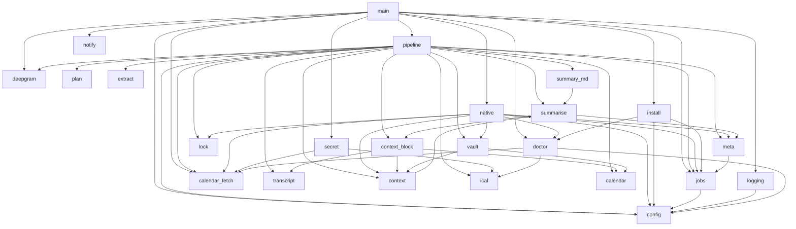

# Rust crate: `meeting`

Covers: crates/meeting/Cargo.toml, crates/meeting/src/ (lib.rs, main.rs, calendar.rs, calendar_fetch.rs, pipeline.rs, plan.rs, jobs.rs, meta.rs, lock.rs, extract.rs, import.rs, deepgram.rs, transcript.rs, summarise.rs, summary_md.rs, context.rs, context_block.rs, ical.rs, vault.rs, notify.rs, logging.rs, test_support.rs, config.rs, secret.rs, install.rs, doctor.rs, native.rs), crates/meeting/tests/

One crate (`meeting`, edition 2024) with a library (`src/lib.rs`, linked by the desktop app) and the `meeting` binary (`src/main.rs`). Dependencies: `clap`, `serde`, `serde_json`, `toml`, `anyhow`, `tracing`, `tracing-subscriber`, `ureq` (HTTP), `keyring` (Keychain), `rusqlite` (bundled SQLite with FTS5, for the desktop app's store). External programs: `ffmpeg`, `claude`, `osascript`. See [architecture.md](architecture.md) for how the crate fits with the extension.

## CLI subcommands

Defined in `crates/meeting/src/main.rs` (`Cli`, `Command`, `run`).

| Command | Does | Details |
|---|---|---|
| `meeting process <recording> [--retranscribe] [--language bn\|en] [--job-id <id>]` | Builds a `Pipeline`, runs it in the foreground, sends a macOS notification at the end. `--job-id` is hidden: the native host passes it. | [features/processing.md](features/processing.md) |
| `meeting install` | Registers the native host, writes config. | [features/setup.md](features/setup.md) |
| `meeting config set-key` | Stores the Deepgram key in the Keychain (hidden prompt). | [features/setup.md](features/setup.md) |
| `meeting config set-calendar` | Only with `FEATURE_MEETING_CONTEXT=1`: checks, fetches and parses the secret iCal address (hidden prompt), then stores it in the Keychain; empty answer removes it. | [features/setup.md](features/setup.md) |
| `meeting import <file> --language bn\|en [--date "YYYY-MM-DD HH:MM"]` | Copies the file into a new meeting folder (`import::import`), prints `imported → <path>`, then runs the same foreground pipeline and notification as `process`. | [features/processing.md](features/processing.md) |
| `meeting doctor` | Prints one line per check; exits non-zero if any failed. | [features/setup.md](features/setup.md) |
| `meeting native-host [origin]` | Entry point Chrome launches (as `meeting <origin>`, rewritten by `chrome_args`). | [features/native-messaging.md](features/native-messaging.md) |

- `Language` (`bn`, `en`) is defined in `lib.rs` and imported by `deepgram`, `meta`, `native`, `plan`, `transcript`, `vault`.
- `run` dispatches with a chain of `if let` blocks, each returning. The trailing `bail!("... not implemented yet")` is unreachable for current commands.

## Module map

| Module | Responsibility | Key symbols |
|---|---|---|
| `lib.rs` | Library root: every module below as `pub mod`, `Language` | `Language` |
| `main.rs` | CLI parsing (gate-dependent via `cli`), wiring, exit code; imports the library as `meeting::` | `Cli`, `Command`, `cli`, `run`, `fetch_calendar`, `context_enabled`, `desktop_enabled` |
| `pipeline.rs` | Orchestrates one `process` run; saves job and meta on every stage change. Before summarising, with `context` on, loads `context.json`, looks the meeting up in the calendar and builds the context block (`context_extra`, `look_up`); calendar errors never fail the job | `Pipeline` (fields `key`, `context`, `desktop`, `calendar`, `calendar_policy`), `Pipeline::run`, `Ending`, `State` |
| `plan.rs` | Pure function: which stages to skip, from file mtimes | `plan`, `Plan`, `Files` |
| `jobs.rs` | Job file store, `Stage` enum, atomic write, UTC time and ids | `Job`, `JobStore`, `Stage`, `write_atomic`, `now_utc`, `new_job_id` |
| `meta.rs` | `meta.json`: language, speakers, run history; `recorded_at` from folder name | `Meta`, `Run`, `Speaker`, `recorded_at_for` |
| `lock.rs` | Per-recording PID lock file | `Lock::acquire`, `Lock::path_for`, `is_held` |
| `extract.rs` | ffmpeg: video to mono 16 kHz Opus | `extract` |
| `import.rs` | `meeting import`: validate, name and copy a source into a new meeting folder | `import` |
| `deepgram.rs` | Deepgram HTTP client with retries | `Deepgram`, `Deepgram::transcribe` |
| `calendar_fetch.rs` | Download the secret iCalendar address under `Policy` (https only, ≤3 https redirects, 20 s, 50 MiB); errors are kinds only, never the address. Used by `set-calendar` and the `calendar` doctor check through `main::fetch_calendar`, and by `pipeline` with `Pipeline.calendar_policy` | `fetch`, `Policy`, `Policy::REAL`, `FetchError` |
| `transcript.rs` | Parse Deepgram JSON, render `transcript.md` | `parse`, `render`, `has_speech`, `hh_mm_ss`, `Transcript`, `Utterance` |
| `summarise.rs` | Run headless `claude` (optionally after a context block), validate structured output | `summarise`, `Summary`, `SCHEMA`, `SYSTEM_PROMPT` |
| `summary_md.rs` | Render `Summary` to Markdown | `render`, `speaker_names` |
| `vault.rs` | Write the Obsidian note | `write_note`, `Note` |
| `notify.rs` | macOS notification via `osascript` | `notify`, `message`, `Outcome` |
| `logging.rs` | File logger init | `init` |
| `config.rs` | `config.toml` load/save, `home()`, `check_recording` (the foldered-recording path rule), `RECORDING_EXTENSIONS` | `Config`, `home`, `check_recording`, `RECORDING_EXTENSIONS` |
| `secret.rs` | Keychain access for the Deepgram key and the calendar address; `meeting config set-calendar` logic | `deepgram_key`, `set_key`, `calendar_address`, `set_calendar`, `read_hidden` |
| `install.rs` | `meeting install` | `install` |
| `doctor.rs` | `meeting doctor` checks (incl. the gated `calendar` check), manifest path | `checks`, `Env`, `manifest_path` |
| `context.rs` | `context.json`: the extension's meeting context, checked against the PRD limits table (reject or cut); `load` reads and checks the file, logging only the rule | `Context`, `check`, `load` |
| `context_block.rs` | Pure builder of the fenced, escaped, 64 KiB-capped meeting-context block for Claude; called by `pipeline` | `build`, `Input`, `SEPARATOR` |
| `ical.rs` | In-house iCalendar reader for the calendar match: unfolding, unescaping, raw times, `VTIMEZONE` offsets, HTML description to text; malformed input is an `Err`, never a panic. `secret` and `doctor` call `parse`; `calendar` reads the events | `parse`, `Calendar`, `Event`, `When`, `Zone`, `Event::plain_description` |
| `native.rs` | Chrome native messaging host | `Host`, `serve` |
| `test_support.rs` | Test fakes (`#[cfg(test)]` only) | `mock`, `mock_raw`, `stall`, `stub`, `envelope`, `temp`, `VALID` |

Processing modules are covered in [features/processing.md](features/processing.md). `native.rs`: [features/native-messaging.md](features/native-messaging.md). `install.rs`, `doctor.rs`, `config.rs`, `secret.rs`: [features/setup.md](features/setup.md).

## Layering

Arrows are imports in non-test code: `crate::` inside the library, `meeting::` from `main.rs`. Every module is a `pub mod` of the library; `main.rs` is the binary on top of it.

- `main.rs` is the only place that builds dependencies (`Config::load()`, `JobStore::default_dir()`, `secret::deepgram_key`, `secret::calendar_address`, `Policy::REAL`, `context_enabled()`, `desktop_enabled()`) and passes them in.
- `calendar_fetch` imports no `crate::` module.
- Stage modules (`extract`, `deepgram`, `transcript`, `summarise`, `summary_md`, `vault`) do not import each other, except `summary_md` using types from `summarise`. `pipeline.rs` is the only caller of all of them.
- `ical` imports nothing from the crate; `calendar` imports only `ical`; `pipeline` calls `pick`, and `context_block` and `vault` read its types.
- `summarise` imports only `context_block::SEPARATOR`; `context_block` reads types from `context` and `calendar` and the clock format from `transcript`.
- `jobs::write_atomic` is the shared atomic-write helper (also used by `meta`, `pipeline`).

## Conventions

- Errors: `anyhow::Result` everywhere, no custom error types, except `calendar_fetch::FetchError` and `ical::Error` (fixed kinds with no address or input text, so neither reaches the log). Context via `.with_context(|| format!("cannot ... {}", path.display()))`. Messages that the user can act on name the fix (`run \`meeting doctor\``, `run \`meeting config set-key\``). `main` logs the error with `{e:#}` and returns it.
- Dependency injection by struct fields and fn pointers, not traits: `Pipeline.key: fn() -> Result<String>`, `Pipeline.calendar: fn() -> Result<Option<String>>`, `Pipeline.calendar_policy`, `Deepgram { base_url, retry_delays }`, `native::Host { open, key, ... }`, `doctor::Env`. Tests swap the fields.
- Subprocesses (`ffmpeg`, `claude`, `osascript`, `ps`) use absolute paths from config or constants, because Chrome starts the host with a bare `PATH`.
- Writes that readers may see use write-to-`.tmp`-then-rename (`write_atomic`, `extract` uses `.part`, `vault::write_note` uses a dotted `.tmp`). `config.rs` `save_to` writes directly.
- Feature flags: `FEATURE_MEETING_CONTEXT` (`context_enabled`) and `FEATURE_DESKTOP_APP` (`desktop_enabled`) are read once at build time in `main.rs`, both through `flag_gate` (on only for `1`), and passed to the library as plain `bool` fields (`context`, `desktop`). The library reads no flag itself.
- Logging: `tracing` macros, file only, via `logging::init()`. See Gotchas.
- Time: UTC strings built by hand (`jobs::format_utc`), no time crate.
- Not removing a file that is absent: `remove` helpers treat `NotFound` as success (`pipeline.rs`, `lock.rs`).
- Tests are in-file `#[cfg(test)] mod tests` in every module; names are full sentences in snake_case describing behaviour.

## Testing

| What | Where |
|---|---|
| Unit tests | `#[cfg(test)] mod tests` at the bottom of each `src/*.rs` |
| Shared fakes | `crates/meeting/src/test_support.rs` (declared `#[cfg(test)] mod test_support` in `lib.rs`) |
| Binary-level tests | `crates/meeting/tests/logging.rs` (spawns `CARGO_BIN_EXE_meeting` with a temp `HOME`, checks the log file and empty stdout); `crates/meeting/tests/native_host.rs` (native host over stdio) |
| Fixtures | `crates/meeting/tests/fixtures/short.webm`; `crates/meeting/tests/fixtures/deepgram/{en_two_speakers,bn_two_speakers,one_speaker,empty}.json`; `crates/meeting/tests/fixtures/calendar/*.ics` (CRLF, as feeds send them) |

- `test_support::mock(responses)` is a TCP server on `127.0.0.1:0` that answers one scripted `(status, body)` per connection and sends each request head down a channel. Pair it with `Deepgram { base_url, retry_delays: vec![] }`.
- `test_support::stub(dir, tail)` writes a fake `claude` shell script that records args and stdin to `args.txt` and `stdin.txt`, then runs `tail`. `envelope(VALID)` produces the JSON `claude` returns.
- `test_support::temp(name)` makes `<tmp>/meeting-test-<pid>-<name>`. Some modules define their own local `temp` and `ffmpeg()` instead of using the shared one (inconsistent).
- Pipeline and extract tests need a real `ffmpeg` on the machine; they find it with `/usr/bin/which ffmpeg`.
- Fixtures are included with `include_str!("../tests/fixtures/...")` or `env!("CARGO_MANIFEST_DIR")`.
- Dev commands: see [development.md](development.md).

## Gotchas

- Never log the Deepgram key or transcript text, and never write to stdout in `native-host` mode (stdout is Chrome's message channel). `logging.rs` says so; if file logging cannot open, the tool continues with a stderr warning.
- `Job` optional fields serialise as `null` on purpose; the extension expects the keys ([extension.md](extension.md)).
- `Stage::name()` and the serde lowercase names must stay in step; `meeting process` prints `name()` per stage and the extension reads the serialised form.
- `plan.rs` treats an absent input as fresh, because inputs are deleted after success. Changing which files are deleted changes resume behaviour.
- `lock.rs` checks PID liveness with `/bin/ps`; a reused PID can make a stale lock look held (noted in a `ponytail:` comment).
- `main.rs` handles `--help`/parse errors with `try_parse` so they are logged.
